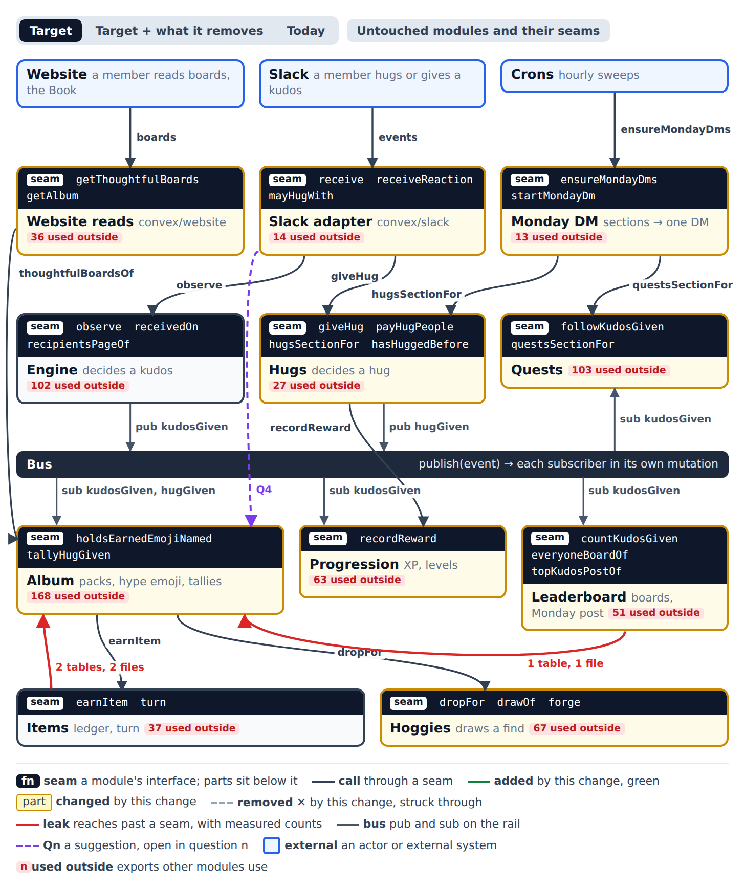
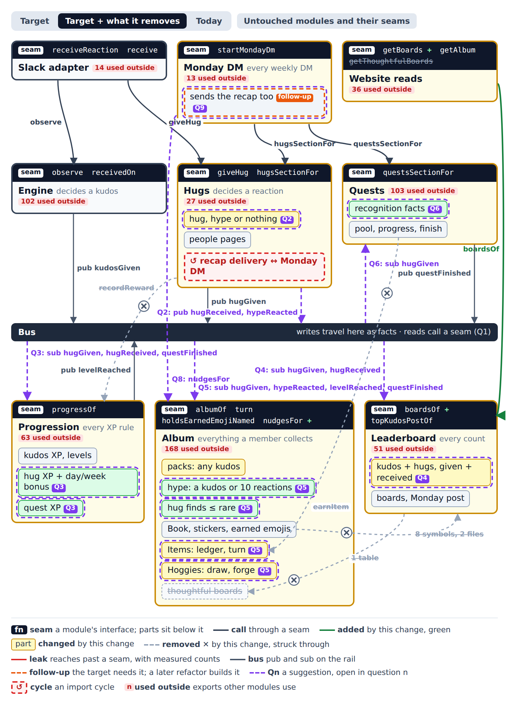

# Architecture: how hugs and kudos feed XP, finds, quests and boards

Shaped down the ladder from context to contracts. The product owner answered each round (🧑) and accepted the recommendations of every round after rung 3 in advance. A fork the code or an ADR settles is marked 🤖. This file is the interface section of the spec or implementation tickets that follow. Where a spec later differs, the spec wins.

## The question

How do hugs and kudos feed XP, hoggie finds, quests and boards once a hug is an award?
- **XP:** bonus XP for the first hug given each day and the first hug received each week.
- **Finds:** a hug can bring a hoggie find, up to rare.
- **Quests:** quests count hugs as well as kudos.
- **Boards:** the boards read hugs given, hugs received and kudos received.
- **Hype emojis:** a reaction with a hype emoji the giver doesn't hold isn't a hug, but it counts toward collecting that emoji, and it feeds the nudge to collect it.
- **Thoughtful-only paths:** what happens to everything that counts only kudos that say why.
- **Cost:** read budgets, and the free plan's database I/O.

**Premise.** Hugs and `Engine` decide what a member did and publish it on the bus as facts: `kudosGiven`, `hugGiven`, `hugReceived` and `hypeReacted`. Every module that acts on those facts follows the bus:
- `Progression` owns every XP rule.
- Leaderboard owns every count.
- `Album` owns everything a member collects, with Items and `Hoggies` inside it.
- Quests counts recognition facts and pays nothing itself.

No module calls another module's write function. Only reads and the turn cross a seam as a direct call. Each subscriber is keyed, so running it twice does no harm, and a failed one is replayed from its stored event.

## Decisions

Rung 1, context:
- 🧑 **Scope.**
  - Changed: the Slack adapter, Hugs, `Progression`, Quests, Leaderboard, `Album` (with Items and `Hoggies`), Unlocks (its level-up hoggies move to `Album`), Monday DM and Website reads.
  - Read only: `Engine`.
  - Out: Achievements, Activity, `Welcome`, `Feedback` (copy only) and Analytics. Analytics already follows `hugGiven` and `kudosGiven`.
- 🧑 **Actors.** The member in Slack gives a hug, a kudos or a hype reaction. The crons send the Monday DM, the hourly recap and the Monday post. The member on the website reads the boards and the Book. The website writes nothing new.
- 🤖 **`Engine`'s giving mutation stays out.** It costs about 5 index ranges per recipient against Convex's 4,096 a transaction, and one extra read per recipient already rolled it back once (#243). `kudosGiven` already carries the giver, the awards, the day and the time (`convex/bus/events.ts:20-37`).
- 🧑 **Thoughtful-only paths are recounted, not deleted.**
  - Packs: any kudos grants the pack, still one per giver, person and week, still naming the person's hype emoji.
  - Thoughtful boards retire. Leaderboard's boards replace them.
  - The Monday post's "top thoughtful kudos" becomes the week's top kudos, still ranked by hugs.
  - The thoughtful milestone counts any kudos under its stored id.
  - Say-why quests leave the pool. Their ids stay in the validator because stored draws name them.
  - Stored gate decisions stay (ADR-0004), and `saysWhy` loses every reader.

Rung 2, modules and seams:
- 🧑 **One rule, held by a guard test.** A write into another module is a bus fact, and a read is a seam call. Today's offenders sit on an allowlist that may only shrink.
- 🧑 **Hugs decides every reaction: hug, hype or nothing.** It publishes `hugGiven` once per hug, `hugReceived` once per person, and `hypeReacted` for a hype emoji the giver doesn't hold.
- 🧑 **`Progression` owns every XP rule.** Hug XP, the day and week bonuses, and a finished quest's XP. A quest's XP and its hoggie become two keyed writes in two subscribers ([ADR-0015](../adr/0015-quest-rewards-follow-the-finish.md)).
- 🧑 **Leaderboard owns every count.** One row per member and period: kudos given, kudos received, hugs given, hugs received ([ADR-0016](../adr/0016-leaderboard-owns-every-recognition-count.md)).
- 🧑 **`Album` is the one collection module.** Items' ledger and `Hoggies`' draw and forge become parts behind `Album`'s seam ([ADR-0017](../adr/0017-album-owns-collecting.md)). `Welcome`'s hoggie, Achievements' hoggies and the forge's own `earnItem` stay on the allowlist as a follow-up.
- 🧑 **Quests counts recognition facts.** Two adapters turn `kudosGiven` and `hugGiven` into one fact. Quests publishes `questFinished` and pays nothing.
- 🧑 **A count lands in the member's own week,** in their own time zone, for what they give and for what they receive.
- 🧑 **The nudge reads `Album`'s `nudgesFor`.** Monday DM asks `Album` for the "give X a kudos to collect their hype emoji" lines.
- 🧑 **Monday DM takes over the recap's delivery as a follow-up,** not in this change.
- 🤖 **The turn stays a direct call into `Album`.** It draws, shows and records milestones in one request (ADR-0010, product calls LP13–LP15).
- 🧑 **The cost of the extra subscribers is fine.** Each reads one or two index ranges.
- 🧑 **`Engine` and Hugs stay separate.** `Engine` is imported by 105 files, and its giving mutation sits near the range limit. The shared fact shape gives both producers one vocabulary without touching `Engine`.

Rung 3, call paths:
- 🧑 **Bonuses are keys, not reads.** `hug-day:{day}` and `hug-week:{week}` make the second hug of a day or week pay nothing.
- 🧑 **One `hugReceived` per person.** A people page of 100 schedules about 300 mutations, under Convex's 1,000.
- 🧑 **`Album` decides the hug find** under a `hug` crate kind capped at rare. The chance and any weekly cap are numbers for the spec.
- 🧑 **Hugs asks `Album` who owns a hype emoji** through `hypeEmojiFor`.
- 🧑 **Kudos received are counted in pages of 100 recipients,** as `Progression`'s `recordEffects` already pages.
- 🧑 **The boards read one index range and rank in memory.** No index per count.
- 🧑 **Every board reader moves to Leaderboard.** The player card and the link card included, so `album/boards.ts` and `album/thoughtfulGivers.ts` retire.
- 🧑 **`hugWeeks` keeps only the recap's state.** The hugs section reads its counts from Leaderboard.
- 🧑 **A failed subscriber is replayed by hand, and every new subscriber is tested twice** ([ADR-0014](../adr/0014-writes-cross-modules-as-bus-facts.md)).
- 🧑 **The giver's hug XP leaves the giving mutation.** It arrives a moment later, as kudos XP already does.

Rung 4, contracts (accepted in advance):
- 🧑 **Existing reward and item keys are kept,** so a fact replayed across the cutover pays nothing twice.
- 🧑 **`hugGiven` names the author** when the hug isn't on a kudos message, so Quests can count people without reading Hugs.
- 🧑 **`hypeReacted` names the message's author beside the emoji's owner.** The collecting rule decides which reactions count toward collecting.
- 🧑 **Quests keeps its own finish record.** It no longer uses `Progression`'s reward record to know a quest finished.
- 🧑 **`givenTotals` grows three fields** instead of becoming a new table, with a backfill for past periods.
- 🧑 **The draw gets a `cap`** beside its `floor`.

## Rung 1: context



The page is [hugs-hook/context.html](hugs-hook/context.html), and its spec is [hugs-hook/context.json](hugs-hook/context.json), with the [Target + what it removes](hugs-hook/context-removed.png) and [Today](hugs-hook/context-today.png) views. Counts are the exports other modules import, from an import-graph scan of non-test files.

## Rung 2: modules and seams



The page is [hugs-hook/modules.html](hugs-hook/modules.html), and its spec is [hugs-hook/modules.json](hugs-hook/modules.json), with the [Target](hugs-hook/modules-target.png), [Today](hugs-hook/modules-today.png) and [untouched](hugs-hook/modules-untouched.png) views. Struck through:
- Hugs' calls to `recordReward` (`convex/hugs/hugs.ts:78`, `convex/hugs/people.ts:31`).
- Quests' calls to `recordReward` and `earnItem` (`convex/quests/finish.ts:26,28`).
- Leaderboard's read of `Album`'s `thoughtfulBoardTallies` table (`convex/leaderboard/newGivers.ts:54`).
- `Album`'s import of 8 Leaderboard symbols from 2 files (`convex/album/boards.ts`, `convex/album/thoughtfulGivers.ts`).
- `Album`'s thoughtful boards, and `getThoughtfulBoards` (`convex/website/album.ts:379`).

Why Items and `Hoggies` didn't follow the bus: earning was never put on it. Seven files call `earnItem` directly (`album/opening.ts:81`, `album/packs.ts:108`, `items/welcome.ts:19`, `quests/finish.ts:28`, `items/achievements.ts:19`, `unlocks/levelUpHoggies.ts:28`, `hoggies/forge.ts:24`), and Unlocks calls `Hoggies`' `dropFor` itself (`unlocks/levelUpHoggies.ts:34`). ADR-0010 needs only the turn to be a direct call, not the earn.

## Rung 3: call paths

The sources are `.mmd` files beside their SVG renders.

- [The main write: a reaction becomes a hug, a hype reaction or nothing](hugs-hook/write.svg) ([source](hugs-hook/write.mmd))
- [The main read: the Leaderboard page](hugs-hook/read.svg) ([source](hugs-hook/read.mmd))
- [The failure: one subscriber throws](hugs-hook/failure.svg) ([source](hugs-hook/failure.mmd))

Convex retries a scheduled mutation only on its own transient errors, never on a throw. The failed-jobs sweep (`convex/analytics/sweep.ts`, every 15 minutes) reports a throw to error tracking, and nothing reruns the subscriber. So a throw loses only that subscriber's effect, and `bus.replay` repairs it from the stored event.

## Rung 4: contracts

Each locked seam is TypeScript in the repo's idiom. Existing types are reused: `MemberId` (`convex/workspace/directory.ts`), `DayKey` (`convex/engine/allowance.ts:4`), `MessageRef` (`convex/engine/messageEvent.ts`), `Period` and `PeriodKey` (`convex/leaderboard/periods.ts:6,10`), `Earning` (`convex/items/records.ts:34`), `HugReaction` (`convex/hugs/reaction.ts`).

### Bus: the facts (`convex/bus/events.ts`)

```ts
export const hugGivenEventValidator = v.object({
  type: v.literal("hugGiven"),
  workspace: v.string(),
  giver: v.id("members"),
  message: messageRefValidator,
  onKudos: v.boolean(),
  author: v.optional(v.id("members")),
  at: v.number(),
  day: v.string(),
  first: v.optional(v.boolean()),
});

export const hugReceivedEventValidator = v.object({
  type: v.literal("hugReceived"),
  workspace: v.string(),
  giver: v.id("members"),
  person: v.id("members"),
  message: messageRefValidator,
  at: v.number(),
  week: v.string(),
});

export const hypeReactedEventValidator = v.object({
  type: v.literal("hypeReacted"),
  workspace: v.string(),
  giver: v.id("members"),
  owner: v.id("members"),
  author: v.id("members"),
  emoji: v.string(),
  message: messageRefValidator,
  at: v.number(),
});

export const questFinishedEventValidator = v.object({
  type: v.literal("questFinished"),
  ...questFields,
  poolQuest: v.optional(poolQuestIdValidator),
  reward: v.optional(v.object({ xp: v.number(), coins: v.number() })),
  rewardKey: v.optional(v.string()),
  catalogueVersion: v.optional(v.string()),
  cause: v.optional(messageRefValidator),
});
```

- **Who publishes.** Only Hugs publishes `hugGiven`, `hugReceived` and `hypeReacted`. Only Quests publishes `questFinished`.
- **How often.**
  - `hugGiven`: once per hug, which is one per giver and message.
  - `hugReceived`: once per paid person, after Hugs writes that person's paid row, so a person is never published twice for one hug.
  - `hypeReacted`: may repeat when Slack redelivers or a member removes and adds the reaction. Its followers key by giver, owner and message.
- **What each fact carries.**
  - `author` on `hugGiven` is present exactly when `onKudos` is false.
  - `week` on `hugReceived` is the Monday of the person's own week, in their time zone (`weekOf(allowanceDay(at, timeZone)).monday`), the key Hugs already computes (`convex/hugs/weeks.ts:21-26`).
  - On `questFinished`, `rewardKey` is present on the Monday path. Followers that pay act only when it is present, so the legacy unlock path's events pay nothing new.
- **Compatibility.** New fields are optional, because jobs already scheduled carry the old shape.

### Bus: the rule and the replay (`convex/bus/replay.ts`, `convex/bus/seams.guard.test.ts`)

```ts
export type Replayed = "replayed" | "not failed" | "not a subscriber" | "already replayed";

export const replay = internalMutation({
  args: { job: v.id("_scheduled_functions") },
  handler: async (ctx, { job }): Promise<Replayed> => { … },
});
```

- **What replay does.** It reads the job from `_scheduled_functions`. It answers `not failed` unless the job's state is failed, and `not a subscriber` unless its function is in `subscribers` or is a subscriber's own next page (`payHugPeople`, `recordEffects`, `countKudosGiven`). Otherwise it schedules the same function with the same arguments, a page's `from` or `cursor` included. `spec/hugs-hook.md` (HH17) amends it: it answers `already replayed` for a job it replayed before, and records each replay in the same mutation that schedules it, so two calls never start two runs. Four subscribers finish their delivery under another function's name, and those functions replay as their pages do: `tallyHug` (after `tallyHugGiven`), `recordMilestonesOfStickerHolders` (after `recordMilestonesAfterTheMatches`), `forgetAuthoredWords` (after `forgetWordsOfLeaver`) and `recheckSomeoneNewOf` (after `recheckSomeoneNew` and `recheckRejoined`). The subscribers that would send a message again stay outside it until Silthus/personal#235.
- **A manual step.** An operator runs it from the sweep's error report. Nothing replays on its own, because a bug that throws would throw on every retry.
- **Performance.** One system read and one schedule.
- **The guard test.**
  - It fails when a file in one module imports another module's write function, such as `recordReward`, `applyGain`, `earnItem`, `markTurned` or `dropFor`.
  - It fails when a file queries a table that another module owns.
  - Table ownership is one map from table to module, beside the test.
  - The allowlist names each remaining pair, and the test fails when an allowlisted pair no longer occurs, so the list only shrinks.
- **The deliver-twice rule.** Each subscriber this change adds has a test that delivers its fact twice and expects one effect.

### Hugs (`convex/hugs`)

```ts
export type ReactionDecision =
  | { kind: "hug" }
  | { kind: "hype"; owner: MemberId }
  | { kind: "nothing" }
  | { kind: "unknown-people"; users: string[] };

export async function mayReactWith(ctx: QueryCtx, workspace: string, user: string, emoji: string): Promise<boolean>;

export async function decideReaction(ctx: MutationCtx, reaction: HugReaction): Promise<ReactionDecision>;

export async function hugsSectionFor(ctx: MutationCtx, member: MemberId, monday: DayKey): Promise<HugsSection | null>;
```

- **`mayReactWith` replaces `mayGiveHugWith`.** It answers true for the kudos emoji, and for any emoji `hypeEmojiFor` resolves. Every other reaction stays a query and never reaches a mutation.
- **What `decideReaction` decides.** It replaces `giveHug` and keeps its checks: within a day of the message, both people known members, one hug per giver and message, the daily hug budget, the `hugs` flag.
  - **A hug:** the emoji is the kudos emoji or one the giver holds. Hugs writes the hug and publishes `hugGiven`.
  - **A hype reaction:** the emoji is a hype emoji whose owner isn't the giver, and the giver doesn't hold it. Hugs writes nothing and publishes `hypeReacted`.
  - **Nothing:** anything else. Nothing is written.
- **What Hugs stops doing.** It no longer imports `recordReward` and no longer counts the giver's week.
- **People pages.** `payHugPeople` keeps its pages of 100 and its paid rows. For each person it pays nothing and publishes one `hugReceived`. A page schedules about 300 subscriber mutations and its next page.
- **`hugWeeks`.** The row keeps `recap`, `tries` and `mostHugged`, and its `given`, `givenXp`, `received` and `receivedXp` retire. `hugsSectionFor` reads the week's counts from Leaderboard's `totalsOf`, and the XP from the counts times `hugXp`.

### `Progression` (`convex/progression`)

```ts
export const payHugGiven = internalMutation({ args: { event: hugGivenEventValidator }, handler: … });
export const payHugReceived = internalMutation({ args: { event: hugReceivedEventValidator }, handler: … });
export const payQuestFinished = internalMutation({ args: { event: questFinishedEventValidator }, handler: … });
```

| Follows | Member | Key | Pays |
|---|---|---|---|
| `hugGiven` | giver | `hug-given:{conversation}:{message}` | `hugXp` |
| `hugGiven` | giver | `hug-day:{day}` | the day's first-hug bonus |
| `hugReceived` | person | `hug:{giver}:{conversation}:{message}` | `hugXp` |
| `hugReceived` | person | `hug-week:{week}` | the week's first-hug bonus |
| `questFinished` with `rewardKey` | member | `rewardKey` | the quest's XP, no coins |

- **Keys.** The hug and quest keys are today's (`convex/hugs/hugs.ts:77`, `convex/hugs/people.ts:30`, `convex/quests/finish.ts:25`), so nothing pays twice across the cutover. The bonus amounts are numbers for the spec.
- **Once only.** Each row is one `recordReward` call, which answers `already recorded` for a key it has seen (`convex/progression/progression.ts:72-78`). Two hugs racing on one bonus key conflict, and Convex's retry lets one of them pay.
- **Errors.** None of the three throws for a missing member. A member who left gets nothing.
- **Performance.** One or two index ranges per reward, plus `applyReward`'s progress row.

### Leaderboard (`convex/leaderboard`)

```ts
export type RecognitionCounts = { kudosGiven: number; kudosReceived: number; hugsGiven: number; hugsReceived: number };

export type BoardsAsked = { period: Period; team: string | null };

export async function boardsOf(ctx: QueryCtx, viewer: BoardViewer, asked: BoardsAsked): Promise<Boards>;

export async function placeOf(ctx: QueryCtx, member: BoardViewer, period: Period): Promise<BoardPlace | null>;

export async function totalsOf(ctx: QueryCtx, member: MemberId, period: PeriodKey): Promise<RecognitionCounts>;

export async function topKudosPostOf(…): …;
```

- **The table.** `givenTotals` (`convex/schema.ts:753`) grows `kudosReceived`, `hugsGiven` and `hugsReceived`, optional and read as 0. Its `kudos` stays kudos given. A backfill fills past periods from the stored awards and hugs, as `convex/leaderboard/backfill.ts` did for kudos given.
- **Its followers.**
  - `countKudosGiven` counts the giver as today. It counts each recipient's kudos received in pages of 100 recipients, with a `from` offset, as `recordEffects` pages (`convex/progression/progression.ts:23-31`).
  - `countHugGiven` follows `hugGiven`.
  - `countHugReceived` follows `hugReceived`.
- **Once only.** Each count is keyed by its fact in Leaderboard's own counted table, as `countedKudosGiven` is today: `kudos-given:{message}`, `kudos-received:{award}`, `hug-given:{giver}:{message}`, `hug-received:{person}:{giver}:{message}`.
- **Weeks.** Every count lands in the member's own day, week and month, in their own time zone.
- **What reads cost.**
  - `boardsOf` reads one index range, `by_period` for the workspace and period key. It ranks people by each count in memory, sums company teams, skips members who opted out (`isOnTheBoards`), and pins the viewer.
  - `placeOf` replaces `Album`'s `weekPlaceOf`, and `boardsOf` for `all` replaces `allTimeBoardsIn`.
  - `totalsOf` reads one row by `by_member_period`.
- **Monday post.** `topKudosPostOf` gets team emojis from `Album`'s seam instead of importing them.
- **What retires.** `album/boards.ts`, `album/thoughtfulGivers.ts`, `album/tallies.ts`'s board tallies, `getThoughtfulBoards`, and the `thoughtfulBoardTallies` table once nothing reads it.

### `Album` (`convex/album`, with `convex/album/items` and `convex/album/hoggies`)

```ts
export type HypeEmoji = { owner: MemberId; held: boolean };

export async function hypeEmojiFor(ctx: QueryCtx, workspace: string, giver: MemberId, emoji: string): Promise<HypeEmoji | null>;

export type HypeNudge = { owner: MemberId; emoji: string; reactions: number };

export async function nudgesFor(ctx: QueryCtx, member: MemberId, at: number): Promise<HypeNudge[]>;

export async function turn(ctx: MutationCtx, owner: PageOwner, item: Id<"items">, at: number): Promise<Turned | null>;

export const earnHugFind = internalMutation({ args: { event: hugGivenEventValidator }, handler: … });
export const recordHypeReaction = internalMutation({ args: { event: hypeReactedEventValidator }, handler: … });
export const earnLevelUpHoggies = internalMutation({ args: { event: levelReachedEventValidator }, handler: … });
export const earnQuestHoggie = internalMutation({ args: { event: questFinishedEventValidator }, handler: … });
```

- **`hypeEmojiFor`.** It resolves the emoji through the emoji registry (`emojiNames`), never by its `-hype` suffix. It answers `null` when no member owns the emoji. `held` is `hypeEarnedBy`'s answer for the giver (`convex/album/earnedEmojis.ts:286-289`). It replaces `holdsEarnedEmojiNamed` on the reaction path.
- **`earnHugFind`.** It follows `hugGiven`, not `hugReceived`: `spec/hugs-hook.md` (HH35) amends this capture, because the giver is the one forming the habit and a hug on a kudos message would otherwise fan finds out to every recipient. It decides from the hug's own key whether the giver finds, and earns the find face down with `earnItem`, keyed `hug-find:{day}` of the giver's day under a `hug` crate kind, so a member finds at most once a day. The draw at the turn uses `floor` and a new `cap` of rare (`convex/hoggies/draw.ts:14`), so a hug find is never epic or above, and the forge stops at rare (HH43). The chance is in the spec's numbers table.
- **`recordHypeReaction`.** It writes one row per giver, owner and message in a `hypeReactions` table indexed by giver and owner, and a duplicate does nothing. What the rows unlock belongs to the collecting rule, ten reactions on the owner's messages. `nudgesFor` reads them beside the packs, one index range per owner it names.
- **`earnLevelUpHoggies`.** It moves from `convex/unlocks/levelUpHoggies.ts` with its keys (`levelUpCrateKeyOf(level, slot)`) unchanged.
- **`earnQuestHoggie`.** It acts only when `rewardKey` is present and earns under `questItemKeyOf(rewardKey)`, today's key (`convex/quests/finish.ts:20-22`).
- **Once only.** `earnItem` returns the existing row for a member, source and key (`convex/items/ledger.ts:17-20`).
- **The turn.** `turn` stays a direct call with today's signature (`convex/items/turn.ts:42`), and its milestones stay inline (ADR-0010).
- **The move.** Items' and `Hoggies`' files move under `convex/album/`. Their exports leave the public surface except through `Album`'s seam: `albumOf` (today's `getAlbum` read), `turn`, `hypeEmojiFor`, `nudgesFor` and `holdsEarnedEmojiNamed`. The guard test's allowlist keeps `Welcome`'s and Achievements' `earnItem` calls (`convex/items/welcome.ts:19`, `convex/items/achievements.ts:19,24`) and the forge's own earn until their follow-up.

### Quests (`convex/quests`)

```ts
export type RecognitionFact = {
  source: "kudos" | "hug";
  workspace: string;
  giver: MemberId;
  people: MemberId[];
  kudos: number;
  message: MessageRef;
  day: DayKey;
  at: number;
};

export function factOfKudosGiven(event: KudosGivenEvent): RecognitionFact;

export function factOfHugGiven(event: HugGivenEvent): RecognitionFact;
```

- **The two adapters.**
  - A kudos becomes one fact naming its recipients, with `kudos` as its award count.
  - A hug becomes one fact with `kudos: 0`. It names its `author` when it has one, and nobody when it's on a kudos message, since that message's people were already counted.
- **What a pool quest counts.** It names what it counts from the fact: actions, people, days or kudos. Quests no longer reads award ids or `saysWhy` (`convex/quests/progress.ts:7`).
- **The finish.** `finishMondayQuest` writes Quests' own finish row, keyed by member and reward key, and publishes `questFinished` with `rewardKey`, `catalogueVersion`, `reward` and `cause`. It stops calling `recordReward` and `earnItem` (`convex/quests/finish.ts:24-31`). A second finish of the same key publishes nothing.
- **The legacy path.** The unlock path's `finishQuest` keeps its crates and held rewards. It stays on the allowlist until the legacy quests are deleted.

### Monday DM and Website reads

- **The nudge.** Monday DM calls `nudgesFor` and renders its lines through `Feedback`.
- **The rest of the DM.** It keeps calling `hugsSectionFor` and `questsSectionFor`.
- **Board reads.** Website reads add `getBoards({ period, team })` over `boardsOf`, and drop `getThoughtfulBoards`. The player card reads `placeOf`, and the link card reads `boardsOf` for `all`.

## Read budgets and database I/O

- **Slack reactions.** A reaction that names neither the kudos emoji nor a hype emoji costs one query and no mutation, as today.
- **A hug to n people:**
  - The decision: today's reads, minus one reward write and one week row.
  - `hugGiven` reaches about 8 followers.
  - Each page of up to 100 people writes the paid rows and schedules 3 followers per person.
  - Every follower reads one or two index ranges and writes one or two rows.
- **A kudos to a large group.** The giving mutation is unchanged. Leaderboard's received count adds pages of 100 recipients, each at about 5 index ranges per recipient, far under 4,096.
- **The Leaderboard page.** One index range for the period's rows, plus today's profile and company-team reads. The all-time board reads one row per member who ever took part.
- **The free plan.** Every new path reads by index and never scans, and the boards read stored totals instead of the history.

## ADRs

- **Recorded.**
  - [ADR-0014](../adr/0014-writes-cross-modules-as-bus-facts.md): writes cross modules as bus facts, reads call seams, and a failed subscriber is replayed by hand.
  - [ADR-0015](../adr/0015-quest-rewards-follow-the-finish.md): a quest's XP and hoggie are paid by followers of `questFinished`. It amends ADR-0013's "in the same mutation".
  - [ADR-0016](../adr/0016-leaderboard-owns-every-recognition-count.md): Leaderboard owns every recognition count, each in the member's own week.
  - [ADR-0017](../adr/0017-album-owns-collecting.md): `Album` owns collecting, with Items and `Hoggies` as its parts. It amends ADR-0009's and ADR-0010's ownership.
- **Below the bar.** These are easy to reverse or unsurprising after the ADRs above:
  - Hugs deciding every reaction, and `hypeReacted`: one subscriber to move.
  - Bonuses as reward keys: `recordReward`'s existing contract.
  - One `hugReceived` per person: a page-size choice.
  - Boards ranked in memory: one query to change.
  - `hugWeeks` keeping only the recap's state: it moves again with the recap follow-up.
  - The draw's `cap`: one parameter.
- **In the journal.** Each ADR names the `coherence decide` record that lands it with the first ticket, and each record names the ADR's path.

## Follow-ups

- **Monday DM takes over the recap's delivery** (high value). It breaks the Hugs ↔ Monday DM import cycle (`convex/hugs/recap.ts:13`). It waits for every member to have a Monday-path start, because ADR-0012's handover protocol is still live until then.
- **`Welcome`'s and Achievements' hoggies follow the bus** (high value). `Welcome` and Achievements publish facts, and `Album` earns. That empties the allowlist's `earnItem` pairs.
- **Delete the legacy unlock-path quest finish** (high value, with the legacy quests). It takes `finishQuest`'s crates and held rewards off the allowlist.
- **Audit the existing subscribers for running twice** (worth a look). The deliver-twice rule covers only the subscribers this change adds. The replay is safe for an older subscriber only after it passes the same test.
- **Rename `givenTotals` to `recognitionTotals`** (a maybe). The name stops fitting once it holds received counts.
- **Not now: merge `Engine` and Hugs into one module for kudos and hugs** (the bold map). `Engine` is imported by 105 files, and its giving mutation sits near the range limit. Revisit it if the giving mutation is ever split.
