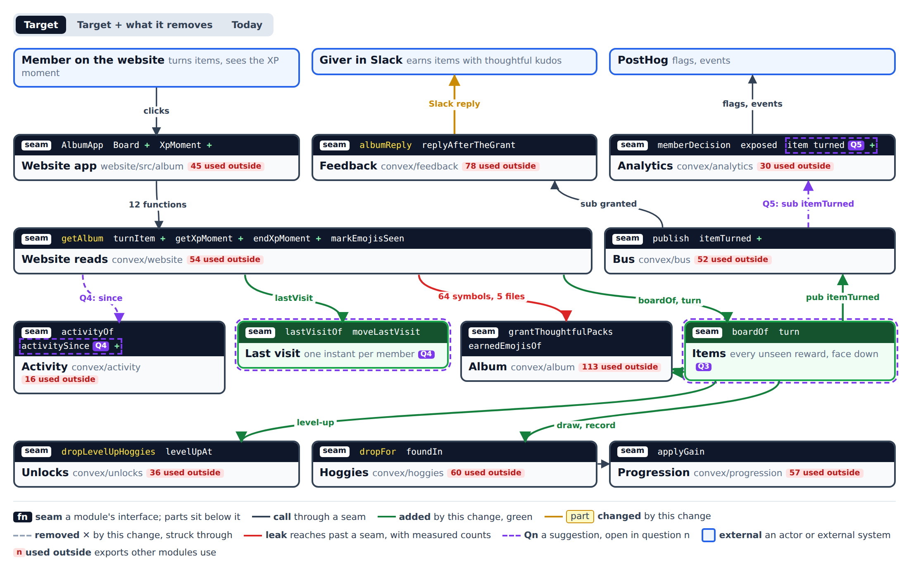
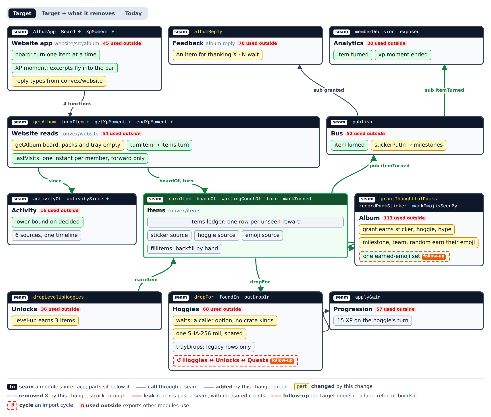
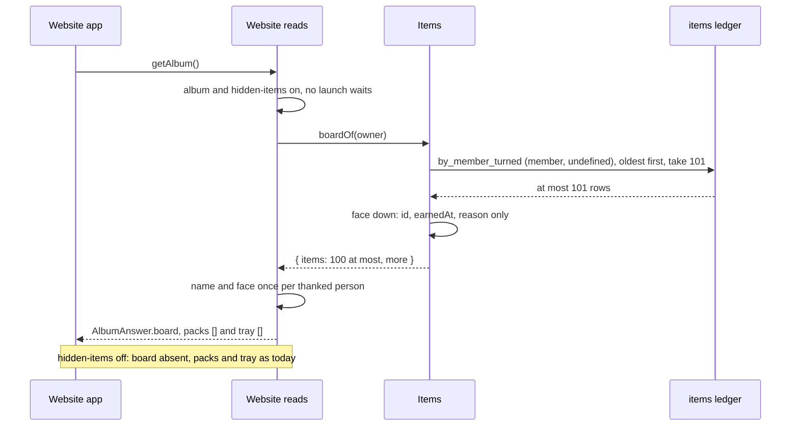
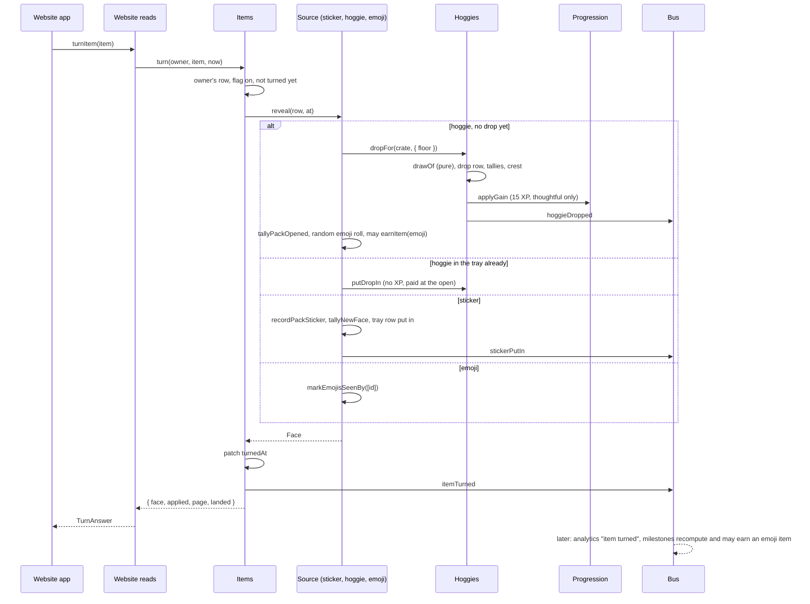
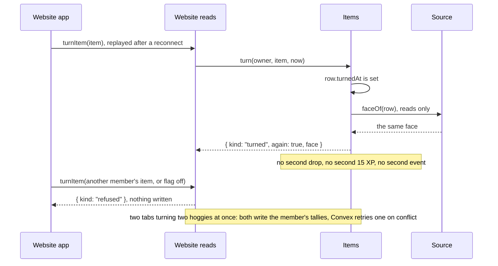
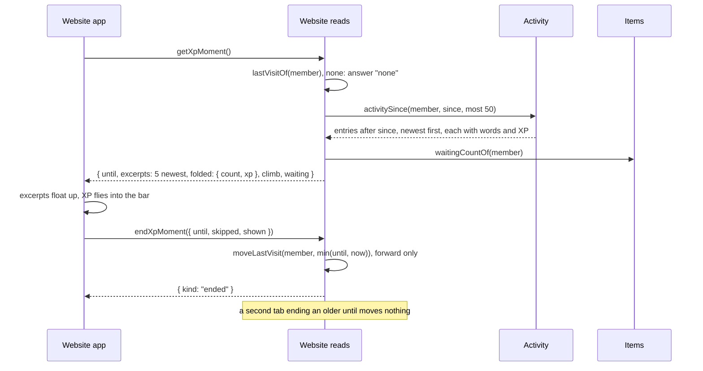

# Architecture: items, the retired tray and the last visit

Shaped on ticket 99 of the core-loop map, down the ladder from context to contracts. Round 1 was the product owner's; he accepted its recommendations and handed the remaining rungs to the agent. This file is the interface section of the spec that follows.

## The question

How do the data model and the module contracts change so that every reward a member has not seen lies face down as an item on one board, the tray and the put-in go dark, the Slack reply spoils nothing, and a last-visit record per member feeds an XP moment within Convex's read limits?

**Premise.** One new module, **Items** (`convex/items`), owns every reward a member has not seen. It keeps a ledger with one row per unseen reward, written where the reward is earned. `boardOf` reads that ledger in one index range, and `turn` is the only thing that reveals a row and puts it in the album. A hidden hoggie is drawn at its turn, so face down means "no drop record yet", not a flag every reader must remember. The website and the Slack reply ask Items instead of Album's pack, tray and put-in functions. A last-visit instant per member lives in Website reads, and the XP moment reads Activity's timeline since it.

## Decisions

Round 1 (accepted by the product owner, 👍):

- **Scope (Q1).** Website app, Website reads, Feedback (the album reply), Analytics, Bus, Album, Hoggies, Unlocks (the level-up hoggies), Progression (unchanged), Activity, and the new Items. Quests, the Store and crate store, the quest, feature and bought crates, the Book's stickers and Engine stay out.
- **Actors (Q2).** The giver in Slack earns items; the member on the website turns them and ends or skips the XP moment; PostHog decides the flags and receives the events.
- **Items is its own module (Q3).** `convex/items`, with its own spec. Feedback reads only its waiting count.
- **Last visit and the XP moment (Q4).** One forward-only instant per member, kept in Website reads; the XP moment reads Activity through a new lower bound.
- **Analytics (Q5).** `itemTurned` on the bus, projected as `item turned`; `endXpMoment` records `xp moment ended`; a sticker's turn keeps publishing `stickerPutIn`.
- **What deepening pulls in (Q6).** Hoggies' drop recorder comes in; the rest was for rung 2.

Rungs 2 to 4 (decided by the agent under the product owner's grant, 🤖):

- **A stored ledger, not a derived board.** One `items` row per unseen reward, written in the same mutation that earns it. The board and the Slack count are one index range each. A board derived from packs, tray, level-ups, random drops and earned emojis would recompute the earned-emoji set (team pages, milestones, levels) on every read, the Slack reply included. [ADR-0010](../adr/0010-hidden-items-are-a-ledger-drawn-at-the-turn.md)
- **Earned everywhere, shown where the flag is on.** Writers earn items whatever `hidden-items` says, as packs are recorded whatever `album` says (ADR-0006, ADR-0009). The old reveals (put-in, the level-up drop, `markEmojisSeen`) mark their items turned, so a member whose flag turns on finds exactly what they have not seen.
- **Drawn at the turn.** A pack's hoggie and a level-up's hoggies get no drop record until their turn. The pack's 15 XP pays at the hoggie's turn through the `applyGain` call Hoggies already makes (`convex/hoggies/drops.ts:44-48`). A thanks earns up to two items: the person's sticker (decided at the grant, as today) and the hoggie.
- **The random emoji is rolled at the hoggie's turn**, as it is rolled at the open today (`convex/album/opening.ts:29`). When it drops, it lands on the board as one more face-down item.
- **Hoggies forgets crate kinds** (refactor, this change). `dropFor` takes `waits` from its caller instead of sniffing `thoughtful` (`convex/hoggies/drops.ts:87-89`). The old opening passes `waits: true`; the turn passes nothing.
- **Milestones follow the bus** (refactor, this change). The `only` filter that keeps milestones off thoughtful drops goes (`convex/bus/publish.ts:55`), milestones subscribe to `stickerPutIn`, and the inline calls in the put-in go (`convex/album/putIn.ts:24`, `:32`). `recordMilestonesOf` recomputes, so an extra run changes nothing.
- **One roll** (refactor, this change). `emojiRoll.ts` and `draw.ts` share one SHA-256 fraction helper instead of two copies (`convex/album/emojiRoll.ts:5-12`, `convex/hoggies/draw.ts:28-38`).
- **Reply types from the server** (rule, this change). The website imports every new answer type from `convex/website`; it adds no hand copies to `website/src/album/answer.ts`.
- **Idempotent turns.** A replayed turn answers the same face again and writes nothing, because the Convex client resends a mutation after a reconnect.
- **The old tray rows stay.** A tray item not yet put in is an unturned item; its turn finishes today's put-in (no second XP). Nothing stored is deleted.
- **Two flags.** `hidden-items` (board, turn, tray and put-in dark, Slack copy) and `xp-moments` (the moment and the last visit), both sandbox-only first, both read without an exposure as `album` is.

## Rung 1: context



The page is [items/context.html](items/context.html); its spec is [items/context.json](items/context.json). Today, Website reads reaches past Album's seam with 64 symbols from 5 files, and Feedback with 15 symbols from 5 files, only to word the spoiler reply. Seven backend modules (Website reads, Feedback, Hoggies, Unlocks, Bus, Progression, Album) form one strongly connected import group.

## Rung 2: modules and seams



The page is [items/modules.html](items/modules.html), with the views [Target + what it removes](items/modules-removed.png) and [Today](items/modules-today.png). Orange parts are follow-ups.

| Module | Seam after the change | What changes inside |
|---|---|---|
| Items (new) | `earnItem`, `boardOf`, `waitingCountOf`, `turn`, `markTurned` | The `items` ledger; one source each for stickers, hoggies and emojis; `fillItems`, the backfill run by hand |
| Album | `grantThoughtfulPacks`, `recordPackSticker`, `markEmojisSeenBy`, `shownEarnedEmojiOf` (new) | The grant earns the sticker, the hoggie and the hype emoji; milestone tiers, team stickers and random drops earn their emoji; the tray and the put-in go dark |
| Hoggies | `dropFor` (takes `waits`), `foundIn`, `putDropIn` (legacy rows only) | No crate-kind sniffing; one shared roll; `trayDrops` read for legacy rows only |
| Unlocks | `dropLevelUpHoggies` | Where it drops three hoggies today, it earns three items while `hidden-items` is on |
| Progression | `applyGain` | Unchanged |
| Activity | `activityOf`, `activitySince` (new) | A lower bound on the decided instant |
| Website reads | `getAlbum` (board), `turnItem`, `getXpMoment`, `endXpMoment` | `lastVisits`; `openThoughtfulPack`, `putIn` and `putAllIn` refuse while `hidden-items` is on |
| Feedback | `albumReply` | "An item for thanking X", "N wait" from `waitingCountOf`; no outcome words, no hype picture |
| Bus | `publish` | `itemTurned`; `stickerPutIn` also feeds milestones; the thoughtful `only` filter goes |
| Analytics | | `item turned`, `xp moment ended` |

Dependencies point one way at file level: Album's, Unlocks' and Feedback's earn writers and readers import `convex/items/ledger.ts`, which imports no Album, Hoggies or Unlocks code; only `convex/items/turn.ts` and its sources import them.

## Rung 3: call paths

### The main read: the board



### The main write: a turn



A milestone tier reached by a turn lands a moment later, on the bus, as a new face-down item; the board shows it reactively.

### Failures



### The XP moment



The `.mmd` sources and their SVGs are in [items/](items/).

## Rung 4: contracts

### 1. The ledger (`convex/items/records.ts`, `convex/items/ledger.ts`, new)

```ts
export const itemSourceValidator = v.union(v.literal("sticker"), v.literal("hoggie"), v.literal("emoji"));

export const itemReasonValidator = v.union(
  v.object({ kind: v.literal("thanks"), person: v.id("members"), message: messageRefValidator }),
  v.object({ kind: v.literal("levelUp"), level: v.number() }),
  v.object({ kind: v.literal("milestone"), milestone: milestoneIdValidator }),
  v.object({ kind: v.literal("teamPage"), team: v.string() }),
);

export const itemValidator = v.object({
  workspace: v.string(),
  member: v.id("members"),
  source: itemSourceValidator,
  key: v.string(), // sticker: the pack ID; hoggie: the crate key; emoji: the earned emoji ID
  floor: v.optional(rarityValidator), // a level-up's third hoggie
  reason: itemReasonValidator,
  earnedAt: v.number(),
  turnedAt: v.optional(v.number()),
});

// schema.ts
items: defineTable(itemValidator)
  .index("by_member_turned", ["member", "turnedAt", "earnedAt"])
  .index("by_member_source_key", ["member", "source", "key"]),

export type Earning = Omit<Infer<typeof itemValidator>, "turnedAt">;
export type Reason = Infer<typeof itemReasonValidator>;
export type FaceDown = { item: Id<"items">; earnedAt: number; reason: Reason };

export const mostItemsShown = 100;
export const mostWaitingCounted = 50;

export function earnItem(ctx: MutationCtx, earning: Earning): Promise<Id<"items">>;
export function markTurned(ctx: MutationCtx, member: MemberId, source: ItemSource, key: string, at: number): Promise<void>;
export function boardOf(ctx: QueryCtx, member: MemberId): Promise<{ items: FaceDown[]; more: boolean }>;
export function waitingCountOf(ctx: QueryCtx, member: MemberId): Promise<{ count: number; more: boolean }>;
```

- **Invariants.** An item is earned once per member, source and key: a second `earnItem` returns the first row and moves nothing, so a redelivered event, a retried page and the backfill can overlap. An item turns once, and `turnedAt` never moves. Nothing the board answers names a face, a person's sticker, a hoggie, a rarity or a source: only the ID, the instant and the reason.
- **Writers.** `grantTo` (`convex/album/packs.ts:85`) earns the sticker (where `holdsSticker`), the hoggie (`thoughtful:<pack>`) and, at a first pack, the hype emoji, each with reason `thanks`. `dropLevelUpHoggies` (`convex/unlocks/levelUpHoggies.ts:17`) earns `level:<n>:<slot>` with the third slot's `rare` floor, inside the `level-up-reveal` decision it already takes, and drops nothing while `hidden-items` is on. The level-up insert (`convex/unlocks/unlocks.ts:33`) earns a level emoji at 5, 10, 15, 20 and 25; the milestone tier insert (`convex/album/milestones.ts:92`) earns its tier's emoji; the team sticker insert (`convex/album/teamStickers.ts:12`) earns the team emoji; the random drop insert (`convex/album/randomEmojis.ts:29`) earns the random emoji.
- **Old reveals.** `putItemIn` and `putEveryItemIn` mark their tray items' sticker and hoggie turned; the level-up drop marks its three hoggies turned; `markEmojisSeenBy` marks its emojis turned. `markTurned` on a missing row does nothing.
- **Errors.** None thrown. `earnItem` on another workspace's member is a programming error the tests catch.
- **Performance.** `boardOf`: one index range, 101 documents at most. `waitingCountOf`: one range, 51 at most, answered as "50+". `earnItem`: one unique lookup and one insert. The grant adds three of each per recipient to its 50-recipient pages.

### 2. The turn (`convex/items/turn.ts`, new; sources in `convex/items/sources/`)

```ts
export type Face =
  | { kind: "sticker"; person: MemberId }
  | { kind: "hoggie"; drop: Drop }
  | { kind: "emoji"; emoji: EarnedEmoji };

export type Page = { kind: "team"; team: string } | { kind: "people" } | { kind: "hoggies" } | { kind: "emojis" };

export type Turned = { face: Face; applied: AppliedReward | null; page: Page; landed: FaceDown[]; again: boolean };

export function turn(ctx: MutationCtx, owner: PageOwner, item: Id<"items">, at: number): Promise<Turned | null>;

type Source = {
  reveal(ctx: MutationCtx, owner: PageOwner, row: Doc<"items">, at: number): Promise<Omit<Turned, "again">>;
  faceOf(ctx: QueryCtx, owner: PageOwner, row: Doc<"items">): Promise<Omit<Turned, "again" | "landed">>;
};
```

- **Answers null** for another member's item, a missing item, or `album` or `hidden-items` off; nothing is written.
- **A turned item** answers `faceOf` with `again: true`, `applied: null` and no `landed`, and writes nothing.
- **Hoggie source.** With no drop record it calls `dropFor(ctx, member, crate, at, { surface: "website", floor })`, which draws, counts the hoggie found, records the crest and pays the crate's band (15 XP for `thoughtful`, nothing for `level`); for a pack it then tallies the pack opened and rolls the random emoji, whose drop lands in `landed`. With a drop record and a waiting `trayDrops` row it calls `putDropIn` and pays nothing. It leaves `thoughtfulPacks.openedAt` alone, so a flag turned back off shows the pack in the old flow, where the open finds the drop already made.
- **Sticker source.** `recordPackSticker`, `tallyNewFace`, `stickerPutIn` where a sticker is recorded, and a waiting tray row marked put in. The page is the member's first team page holding the person, else the people page.
- **Emoji source.** `markEmojisSeenBy([key])`, with the face from Album's new `shownEarnedEmojiOf`.
- **Event.** Every first turn publishes `itemTurned`.
- **Performance.** A hoggie turn costs what an open costs today (`dropFor` plus the random roll's class reads), and a sticker turn what a put-in costs, minus the milestones, which move to the bus.

### 3. Hoggies' drop (`convex/hoggies/drops.ts`)

```ts
export type DropContext = { surface?: Surface; floor?: Rarity; waits?: boolean };
export function dropFor(ctx: MutationCtx, member: MemberId, crate: CrateKey, at: number, context: DropContext): Promise<void>;
```

`waits: true` keeps today's tray behaviour for the old opening only (`convex/album/opening.ts:24`). `waitsInTheTray` and its crate-kind check go. `drawOf` stays pure (`convex/hoggies/draw.ts:12-17`), and `emojiRollOf` uses the same fraction helper.

### 4. The website (`convex/website/album.ts`, `convex/website/xpMoment.ts` new)

```ts
export type BoardItem = FaceDown & { thanked: Thanked | null };
export type AlbumAnswer = { /* as today */ board?: { items: BoardItem[]; more: boolean } }; // present while hidden-items is on; packs and tray are then []

export type TurnAnswer = ({ kind: "turned" } & Turned) | { kind: "refused" }; // applied masked by appliedShownTo
export const turnItem = memberMutation({ args: { item: v.id("items") }, handler: /* TurnAnswer */ });

// ActivityEntry: convex/activity/entries.ts:57; Standing: convex/progression/progress.ts:37
export type Excerpt = Extract<ActivityEntry, { kind: "kudosReceived" | "kudosGiven" | "hugReceived" | "hugGiven" | "levelUp" }>;
export type XpMomentRead =
  | { kind: "off" }
  | { kind: "none" }
  | { kind: "moment"; until: number; excerpts: Excerpt[]; folded: { count: number; more: boolean; xp: number }; climb: { from: Standing; to: Standing }; waiting: { count: number; more: boolean } };
export const getXpMoment = memberQuery(/* XpMomentRead */);
export const endXpMoment = memberMutation({ args: { until: v.union(v.number(), v.null()), skipped: v.boolean(), shown: v.number() }, handler: /* { kind: "ended" } | { kind: "refused" } */ });

// lastVisits: defineTable({ member: v.id("members"), at: v.number() }).index("by_member", ["member"])
export function lastVisitOf(ctx: QueryCtx, member: MemberId): Promise<number | null>;
export function moveLastVisit(ctx: MutationCtx, member: MemberId, at: number): Promise<void>;
```

- `openThoughtfulPack`, `putIn` and `putAllIn` answer refused while `hidden-items` is on; the code stays until the flag is everyone's and retired.
- `getXpMoment` answers `none` without a last visit. `endXpMoment` moves the visit to `min(until, now)`, or to now when `until` is null, and never backwards, so two devices agree and a stale tab moves nothing. Entries decided while the moment played stay for the next one, because `until` is the newest decided instant the moment read, not the clock.
- `excerpts` are the five newest entries after the visit, shown oldest first. `folded` counts the rest of what was read, `more` when a source was cut. `climb.from` is the standing at the member's XP minus the moment's XP.
- Every new public function joins `convex/publicSurface.test.ts`.

### 5. Activity (`convex/activity/activity.ts`)

```ts
export function activitySince(ctx: QueryCtx, member: MemberId, { since, most }: { since: number; most: number }): Promise<{ entries: ActivityEntry[]; cut: boolean }>;
```

Each source reads its index from the newest down with `gt("_creationTime", since)`, the implicit last field of every index, taking `most + 1`. That is one range per source and the mention lookups Activity already caps per page. `found` is left out: a turn already shows its find.

### 6. Slack (`convex/feedback/albumReplies.ts`)

While `hidden-items` is on for the giver: each named recipient's headline is "An item for thanking X", with no lines and no hype picture, or for `nextWeek` "Kudos counted." and "Your next item for X comes next week."; one line "N wait" (or "50+ wait") from `waitingCountOf(giver)`, which already counts this grant's items because the grant writes them before it publishes `thoughtfulPacksGranted`; one button, "See your items", to `/book#items`. With the flag off, today's reply stands.

### 7. Analytics

- `itemTurned` `{ workspace, member, source, rarity?, isNew?, at }` on the bus, projected as `item turned` with `source`, `rarity` and `is_new` on the allowlist. `darkFeatures.test.ts` needs a walk that reaches it.
- `xp moment ended` as a usage fact from `endXpMoment`, with `skipped`, `excerpts_shown` and `folded`.

## Members already part-way

`fillItems` (internal, run by hand once per deployment, then again after the flag widens) walks every member one mutation at a time, each scheduling the next, and earns, idempotently: every pack not yet opened (its sticker where it holds one, and its hoggie); every tray item not yet put in (the tray goes back face down); and every earned emoji not yet seen, random ones included. Level-up hoggies already dropped are already found and earn nothing. A member with more than 100 of one kind carries a cursor to the next mutation. Nothing is deleted, and a rerun earns nothing twice.

## Open items for the spec

- **The lexicon.** "Item" widens to cover the face-down rewards, as the map decided. "Board", "face down", "turn", "last visit" and "XP moment" need entries too.
- **Copy for two items per thanks.** The Slack line names the thanks once while the count says how many wait; the website prototype settles the wording.
- **The level-up reveal page** (`level-up-reveal`): with `hidden-items` on, its three hoggies are board items whose reason is `levelUp`, and the page reads them from the board.
- **Which five excerpts.** The contract says the five newest; the XP moment prototype may prefer the five worth the most XP.

## Follow-ups

- **One earned-emoji set** (Worth exploring). `earnedEmojisOf`, `emojisEarnedBetween`, `levelEmojisEarnedIn` and `isEarnedBy` each rebuild the earned set (`convex/album/earnedEmojis.ts:50`, `:75`, `:87`, `:246`). One derivation would also check that every earned, unseen emoji has an item.
- **Tallies as subscribers** (Worth exploring). The pack, face and hoggie tallies are inline calls (`convex/album/putIn.ts:62`, `:68`), while hugs tally through the bus.
- **Break the Hoggies ↔ Unlocks ↔ Quests cycle** (Worth exploring). `convex/hoggies/waitingPacks.ts:2-4` imports Quests and Unlocks, which import `convex/hoggies/drops.ts`.
- **Retire the tray** (Strong, after the flag is everyone's). Delete `openThoughtfulPack`, `putIn`, `putAllIn`, the tray UI and the `trayDrops` filter in `dropsByDecision`, keeping the rows. It also ends the latent `isNew` drift of tray hoggies, stored at the open from `nextCopyOf` and recounted at the put-in (`convex/hoggies/drops.ts:34`, `:54`); the turn already answers from the recount.
- **One guard for album mutations** (Speculative, not asked). Every handler in `convex/website/album.ts` repeats `albumShownTo`.

## ADRs

- [ADR-0010](../adr/0010-hidden-items-are-a-ledger-drawn-at-the-turn.md): hidden items are a stored ledger, drawn at the turn.
- The last visit on the server was settled on the map and is easy to reverse: no ADR.
- Milestones on the bus, the `waits` option and the shared roll are easy to reverse: no ADR.
