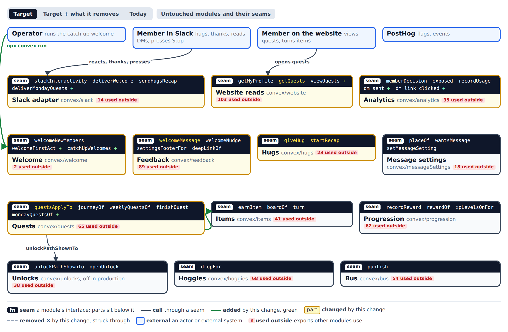
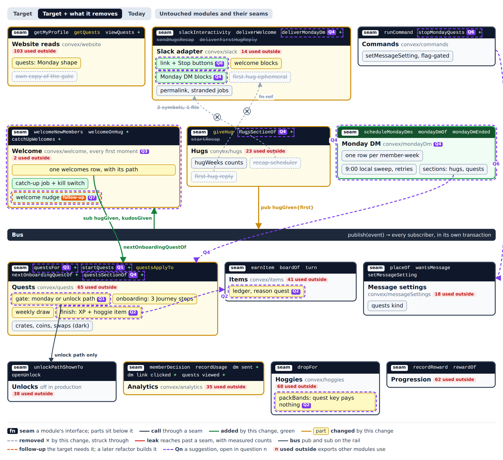

# Architecture: onboarding quests, Monday quests and the three welcomes

Shaped down the ladder from context to contracts, with each round's recommendation taken by the agent under the product owner's grant (🤖). This file is the interface section of the spec that follows.

## The question

How do onboarding quests, Monday quests and the three welcomes sit on today's modules?
- **Quests without `unlocks`:** onboarding and drawn quests run under a new `monday-quest` flag without reviving unlocks, coins, the store or group quests.
- **Rewards:** XP plus a face-down hoggie.
- **The welcomes:** three welcome DMs and a catch-up welcome with a kill switch.
- **The Monday DM:** one per member at 9:00 local, with a one-press Stop.
- **Measurement:** what is captured.
- **The website:** the reads the quests panel needs.

**Premise.** Quests gets a second start beside the unlock path. One gate seam, `questsFor`, answers which path a member is on, and `startQuests` is the only way quests begin. On the Monday path a finished quest pays XP through Progression and lays a face-down hoggie through Items. Welcome owns every first moment. It hears `hugGiven{first}` and `kudosGiven` on the bus and ends each welcome on `nextOnboardingQuestOf`. A new Monday DM module takes over the recap's 9:00-local scheduler and sends one DM per member and week, built from sections that Hugs and Quests supply.

## Decisions

Rung 1, context:
- 🤖 **Scope.**
  - Changed: the Slack adapter, Website reads, Analytics, Welcome, Feedback, Hugs, Message settings, Commands, Quests and Items.
  - Read only: Progression, Hoggies and Bus.
  - Unlocks is cut off from the Monday path.
  - Out: Wallet, Store, Groups, Achievements, Album and the website UI.
- 🤖 **Actors.** The member in Slack, the member on the website, the operator (catch-up), PostHog (flags, events), and the existing hourly crons.
- 🤖 **Deepening weighed in-change.** One quests gate, rewards through the item ledger, a Welcome module that owns first moments, and a weekly DM seam.
- 🤖 **Legacy quests stay dark, not deleted.** Crates, coins, swaps, group quests, `your-emoji` and `first-quest` keep their code and their flags off.

Rung 2, modules and seams:
- 🤖 **One quests gate.** `questsFor`/`startQuests` in Quests.
  - `questsApplyTo` keeps meaning the unlock path.
  - Three callers move to `questsFor`: the quests kind's applicability, the website quests read and the finish notice.
- 🤖 **Rewards through the item ledger.** XP with no coins, plus `earnItem` with a hoggie under a `quest:` key that has no pack band. No crates on the Monday path.
- 🤖 **Welcome owns every first moment.** One `welcomes` row per member, with its path.
  - Hugs publishes `hugGiven{first}` and stops calling Slack.
  - The welcome lays the welcome item.
  - The ephemeral first-hug reply goes away on the Monday path (LP73 reversed).
- 🤖 **A Monday DM module.** `convex/mondayDm` owns the per-member 9:00-local send, built from a hugs section and a quests section. Hugs keeps its counts.
- 🤖 **Bold map: a follow-up.**
- 🤖 **Stop as its own command.** `stopMondayQuests`/`resumeMondayQuests` are gated by the Monday path, not by `message-settings`. The reply carries the undo.
- 🤖 **The welcome nudge stays in Feedback for now.** It is never sent to a member who has a `welcomes` row.
- 🤖 **Measurement through usage facts.**
  - `dm sent`, `dm link clicked` (from Slack's URL-button actions) and `quests viewed`.
  - The first item turned is a first-time `item turned` in a person funnel.

Rung 3, call paths:
- 🤖 **First act wins.** The `welcomes` row is the only "welcomed" check.
- 🤖 **"Already finished" comes from the trigger.** The thoughtful-given welcome passes `justFinished` instead of racing the Quests subscriber.
- 🤖 **Delivery outcomes.** Each delivery reports `delivered | gone | failed`, and `dm sent` is recorded only on `delivered`.
- 🤖 **At most once.** The Monday DM uses `sendAtMostOnce` and retries only rate limits, three tries at most.
- 🤖 **Flags read at the row.** `monday-quest` is read with exposure where the row or start is written, and without writing at send.
- 🤖 **The catch-up's kill switch.** The `catch-up-welcome` flag is checked before each member. It targets the product owner first, then everyone, and fails closed.
- 🤖 **Keyed rewards.** Rewards are idempotent through `recordReward`'s key and `earnItem`'s key.

Rung 4, contracts:
- 🤖 **The Monday path wins** when both paths hold.
- 🤖 **Drawn quests wait for onboarding.** After that they come from the existing triggers.
- 🤖 **Rollout order.** Every `monday-quest` stage stays inside the `collection` and `hidden-items` stages.
- 🤖 **The recap cutover** belongs to the spec.

## Rung 1: context



The page is [monday-quests/context.html](monday-quests/context.html), and its spec is [monday-quests/context.json](monday-quests/context.json). Counts are the exports other modules import, from an import-graph scan of non-test files. Every module drawn sits in one 27-module import cycle today.

## Rung 2: modules and seams



The page is [monday-quests/modules.html](monday-quests/modules.html), with the [Target](monday-quests/modules-target.png) and [Today](monday-quests/modules-today.png) views. Two leaks are struck through. Hugs' recap imports the Slack adapter's `permalinkOf` and `convexActionTimeLimitMs` (`convex/hugs/recap.ts:13-14`). Hugs schedules `slack.firstHugReply` by function reference (`convex/hugs/hugs.ts:85-88`).

## Rung 3: call paths

The sources are `.mmd` files beside their SVG renders.

- [The main write: a first act becomes a welcome](monday-quests/welcome-write.svg) ([source](monday-quests/welcome-write.mmd))
- [The main send: the Monday DM, with its failure branch](monday-quests/monday-dm.svg) ([source](monday-quests/monday-dm.mmd))
- [One press: Stop, and a link click](monday-quests/stop-and-click.svg) ([source](monday-quests/stop-and-click.mmd))
- [The reward write: a quest finishes on the Monday path](monday-quests/quest-finish.svg) ([source](monday-quests/quest-finish.mmd))

Every once-only step is a database fact written in a mutation. Slack calls happen only in actions scheduled after those facts, so a retry or a replayed event can repeat a send attempt but never a decision.

## Rung 4: contracts

Each locked seam below is TypeScript in the repo's idiom. Existing types are reused: `MemberId` (`convex/workspace/directory.ts`), `JourneyStep` (`convex/quests/step.ts:4`), `WeekKey` (`convex/quests/week.ts:3`), `MessageKind` (`convex/messageSettings/kinds.ts:14`), `Earning` (`convex/items/records.ts`).

### Quests: the gate and the start (`convex/quests/flag.ts`)

```ts
export type QuestPath = { path: "monday" } | { path: "unlocks" };

export async function questsFor(ctx: QueryCtx, member: MemberId): Promise<QuestPath | null>;

export type QuestStart = "unlock" | "monday-quest";

export async function startQuests(ctx: MutationCtx, member: MemberId, cause: QuestStart, at: number): Promise<void>;
```

- **What `questsFor` answers.**
  - It answers `monday` when `monday-quest` and `xp-levels` are on for the member, read without writing.
  - It answers `unlocks` when today's `questsApplyTo` holds.
  - Monday wins when both hold.
  - It never throws. A failed flag read answers the flag's safe default, so the gate answers `null`.
- **What `startQuests` does.**
  - It writes the member's start once. A second call is a no-op.
  - It is the only writer of the start. The weekly draw and the onboarding steps read the start instead of `openedAtOf(member, "quests")`.
  - `openUnlock` calls it with `"unlock"`. The welcome, the draw and the Monday sweep call it with `"monday-quest"` and record the exposure.
- **`questsApplyTo` keeps its meaning.** It still means "on the unlock path". Only three callers move to `questsFor`: `convex/messageSettings/messageSettings.ts:28`, `convex/website/quests.ts`, and `convex/feedback/notify.ts:210-214`.
- **Performance.** `questsFor` makes two cached flag evaluations per transaction (`convex/analytics/flags.ts:84-93`) and no table reads on the Monday path.

### Quests: onboarding and the week (`convex/quests/journey.ts`, `convex/quests/weekly.ts`)

```ts
export const onboardingSteps = ["first-thanks", "someone-new", "two-days"] as const satisfies readonly JourneyStep[];

export type OnboardingStep = (typeof onboardingSteps)[number];

export async function nextOnboardingQuestOf(ctx: QueryCtx, member: MemberId, seen?: { justFinished: OnboardingStep }): Promise<OnboardingStep | null>;

export type QuestLine = { quest: "onboarding" | "drawn"; goal: string; done: number; needed: number; finished: boolean; reward: { xp: number; hoggie: true } };

export async function questsSectionOf(ctx: QueryCtx, member: MemberId, week: WeekKey): Promise<{ lines: QuestLine[] } | null>;
```

- **What `nextOnboardingQuestOf` answers.**
  - It answers the first unfinished step in `onboardingSteps` order, treating `justFinished` as finished.
  - It answers `null` once all three are finished.
  - A finished step is `rewardOf(member, "journey:<step>") !== null`.
  - The welcome paths differ only in copy and in `justFinished`:
    - hug: first-thanks
    - thoughtful-received: first-thanks
    - thoughtful-given: someone-new
- **Onboarding.** All three steps are active together from the start, with no feature openings. On the Monday path `two-days` has no Book dependency.
- **Drawn quests.**
  - They are drawn only after onboarding is finished. The draw happens at the first sweep, kudos or website read after that, three per week as today (`convex/quests/weekly.ts:26`).
  - They come from the coin-free pool. The pool quests keep their goals, and their reward becomes `{ xp: 20, hoggie }`.
- **What `questsSectionOf` answers.**
  - It answers `null` when the member is not on the Monday path, when their `quests` place is `none`, or when nothing is open.
  - Otherwise it lists the remaining onboarding quests, or the week's three drawn quests.
  - It reads only and is safe in the Monday DM's send query.

### Quests: the reward (`convex/quests/finish.ts`)

```ts
export function questItemKeyOf(rewardKey: string): `quest:${string}`;
```

- **One mutation on the Monday path.** Finishing a quest does three things together:
  - `recordReward(ctx, member, rewardKey, { xp, coins: 0 })`
  - `earnItem(ctx, { source: "hoggie", key: questItemKeyOf(rewardKey), reason: { kind: "quest", quest }, ... })`
  - `publish(questFinished)`
- **Idempotency.** It is idempotent through both keyed writes.
- **Invariant.** A `quest:` crate key has no pack band (`convex/hoggies/catalogue.ts:258,262`), so the turn pays no coins and no XP. It only draws the hoggie (ADR-0010).
- **Error mode.** Without `collection` on, `dropFor` draws nothing at the turn (`convex/hoggies/drops.ts:32`). A stage of `monday-quest` must not be widened past the stages of `collection` and `hidden-items`.

### Welcome (`convex/welcome/welcome.ts`)

```ts
export type WelcomePath = "hug" | "thoughtful-given" | "thoughtful-received" | "catch-up" | "giver" | "recipient";

export const welcomeOnHug: RegisteredMutation<"internal", { event: HugGivenEvent }, null>;
export const welcomeOnKudos: RegisteredMutation<"internal", { event: KudosGivenEvent }, null>;

export const catchUpWelcomes: RegisteredMutation<"internal", { workspace: string; cursor: string | null }, null>;

export async function welcomePathOf(ctx: QueryCtx, member: MemberId): Promise<WelcomePath | null>;
```

- **Once per member.**
  - A member has at most one `welcomes` row, with its path. It is inserted in the same transaction that decides the welcome, before any send is scheduled.
  - A member with a row is never welcomed again by any path, the catch-up included, and never gets the welcome nudge (`convex/feedback/welcomeNudge.ts:79-87` gains this check).
- **The trigger.**
  - `welcomeOnHug` acts only on `event.first`.
  - `welcomeOnKudos` acts only on a thoughtful kudos: for the giver, the path is `thoughtful-given`; for each recipient, `thoughtful-received`.
  - A member not on the Monday path keeps today's behaviour: the welcome on any kudos and the ephemeral first-hug reply.
- **The welcome.**
  - It lays the welcome item (`earnWelcomeItem`, idempotent), calls `startQuests(..., "monday-quest")`, and schedules `deliverWelcome` with the path, the next onboarding quest and the finished steps.
  - The delivery ends in `welcomeDelivered(outcome: "delivered" | "gone" | "failed")`, which records `dm sent { kind: "welcome", path }` only on `delivered`.
- **The catch-up.**
  - It works through pages of 100 opted-in members with no row. Opted in means the member gave a hug or gave or received a kudos.
  - Before each member it checks `catch-up-welcome` for that member, and stops the page on false.
  - It schedules its next page itself. A re-run starts over safely.
- **Performance.** Each page reads one index range of members and one `welcomes` lookup per member.

### Hugs (`convex/hugs`)

```ts
// hugGiven gains: first: boolean
export async function hugsSectionOf(ctx: QueryCtx, member: MemberId, week: WeekKey): Promise<{ lines: RecapLine[] } | null>;
```

- **What `hugsSectionOf` answers.** It answers `null` when the member had no hugs that week or did not want the recap. "Wanted" is today's `recapWantedBy` (`convex/hugs/recap.ts:118-121`).
- **What leaves Hugs.** Hugs stops scheduling Slack: the first-hug reply moves out for the Monday path, and the recap's delivery moves to the Monday DM. The leaks into `slack/permalink` and `slack/strandedJobs` go with them.

### Monday DM (`convex/mondayDm`, new)

```ts
export async function wantMondayDm(ctx: MutationCtx, member: MemberId, week: WeekKey): Promise<void>;

export const scheduleMondayDms: RegisteredMutation<"internal", {}, null>;

export async function mondayDmOf(ctx: QueryCtx, member: MemberId, week: WeekKey): Promise<{ hugs: HugsSection | null; quests: QuestsSection | null } | null>;

export const mondayDmEnded: RegisteredMutation<"internal", { member: MemberId; week: WeekKey; attempt: number; outcome: "delivered" | "gone" | "failed" }, null>;
```

- **One row per member and week.**
  - `mondayDms { member, week, state: "waiting" | "scheduled" | "sent" | "skipped" | "failed", dueAt, tries }` is unique by member and week.
  - `wantMondayDm` is idempotent. Hugs calls it on the week's first hug. Quests calls it at the week's draw, or at week start for a member still in onboarding.
- **Sending.**
  - `dueAt` is the Monday after the week, at 9:00 in the member's zone. The zone move and the fence on `tries` carry over from `convex/hugs/recap.ts:50-68,113-116`.
  - At send, `mondayDmOf` builds the sections. When both are `null` the row is `skipped`. Otherwise one DM goes out through `sendAtMostOnce`.
  - It retries only rate limits, at most three tries. `mondayDmEnded` records `dm sent { kind: "monday", sections }` on `delivered`.
- **The buttons.** The quests section carries the Stop button and link buttons. Each link button's `action_id` is `dm-link:monday:<destination>`.
- **Cutover.** Weeks already `scheduled` in `hugWeeks.recap` finish there, and new weeks go to `mondayDms`. The spec owns the switch-over and its flag.

### Commands (`convex/commands/commands.ts`)

```ts
type Command = /* today's union */ | { type: "stopMondayQuests" } | { type: "resumeMondayQuests" };
```

- **What they do.** Each writes the `quests` kind to `none`, or back to `dm`, through Message settings' storage. They report `message setting changed { kind: "quests", on, via: "dm-button" }`.
- **Their gate.** Only `questsFor(member)?.path === "monday"`, not `message-settings`. Outside the Monday path they are a no-op.
- **The reply.** `receiveHomeClick` replaces the DM in place with the stopped copy and a "Turn Monday quests back on" button, as the welcome picker does (`convex/slack/receipts.ts:91-94`).
- **Replays.** A replayed click does nothing new (`slackReceipts`, `convex/slack/receipts.ts:80-81`).

### Analytics and Website reads

```ts
type UsageFact = /* today's union */
  | { event: "dm sent"; member: MemberId; kind: "welcome" | "monday"; path?: WelcomePath; sections?: ("hugs" | "quests")[] }
  | { event: "dm link clicked"; member: MemberId; kind: "welcome" | "monday"; destination: string }
  | { event: "quests viewed"; member: MemberId; surface: "panel" | "profile" };

export const viewQuests: /* memberMutation */ (args: { surface: "panel" | "profile" }) => null;
```

- **How the facts are recorded.** They go through `recordUsage` or the isolated `report*` wrappers (`convex/analytics/isolatedUsage.ts:38-45`). A failed recording never blocks a DM or a click. Recording reads no flag (`convex/analytics/Analytics.spec.md:100`).
- **Link clicks.** `slackInteractivity` turns a `dm-link:<kind>:<destination>` action into a `dm link clicked` record instead of dropping it (`convex/slack/interactivity.ts:59-65`). URL buttons still open the URL in Slack itself, and the website link stays unchanged.
- **`getQuests`.** On the Monday path it answers `{ kind: "monday", onboarding: QuestLine[], drawn: QuestLine[] | null, nextUp: OnboardingStep | null }`. Each line carries its reward and, once finished, its item's `waiting | turned` state. The panel's look is ticket #172's.

## ADRs

- **Recorded.**
  - [ADR-0011](../adr/0011-quests-start-on-two-paths.md): quests start on two paths, and the Monday path never reads Unlocks.
  - [ADR-0012](../adr/0012-one-monday-dm-from-sections.md): one Monday DM per member and week, built from sections.
  - [ADR-0013](../adr/0013-quest-rewards-are-items-not-crates.md): quest rewards are items under a `quest:` key, not crates.
- **Below the bar.** They are easy to reverse or unsurprising:
  - one `welcomes` row with its path, which extends today's table;
  - the Stop command, a new command beside the existing one;
  - the catch-up's flag-as-kill-switch, which is operational;
  - measurement through usage facts, the existing pattern.
- **Not yet in the journal.** Coherence was not installed in the worktree that drew this, so the ADRs carry no `coherence decide` id yet. The spec that lands them records them.

## Follow-ups

- **The bold map** (Strong). Quests pays only through Progression and Items, and Unlocks becomes one start among others. One Messages module would hold preferences, the weekly digest, a recorded `deliverDm` and the Slack adapter. Feedback becomes pure copy, and Website reads become thin projections. Revisit it when the legacy quests are deleted.
- **Delete the legacy quests** (Strong, after Monday quests hold in production). This covers crates, pending crates, coins on quests, swaps, group quests, `your-emoji`, `first-quest`, and `questsApplyTo`'s unlock path.
- **Move the welcome nudge into Welcome** (Worth exploring).
- **A recorded `deliverDm`** at Slack delivery for every DM kind (Worth exploring). Today only the welcome and Monday DMs record `dm sent`.
- **Message kinds own their applicability** (Worth exploring). Message settings imports every feature's flag (`convex/messageSettings/messageSettings.ts:2-9,23-32`).
- **Feedback becomes copy only** (Speculative). It imports 33 quest symbols today.
