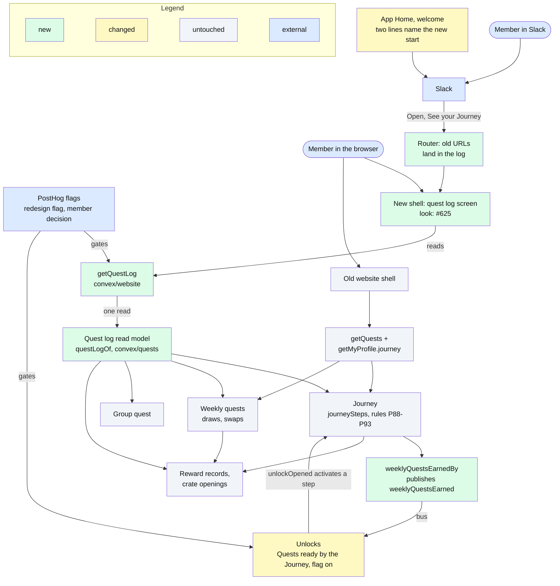
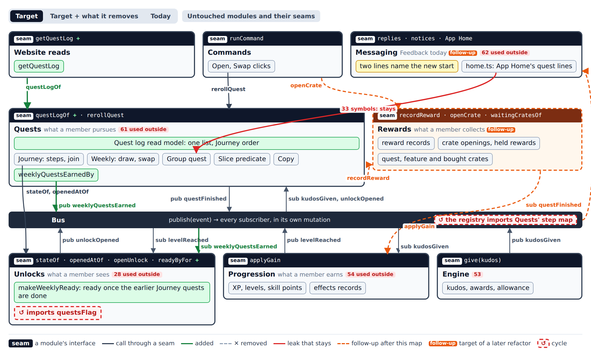
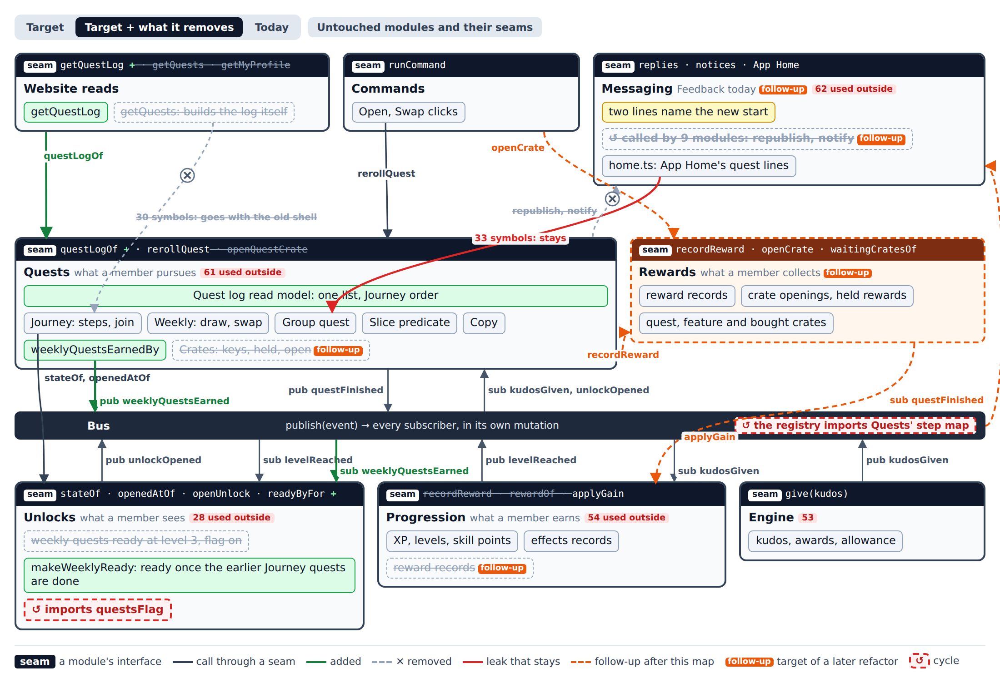
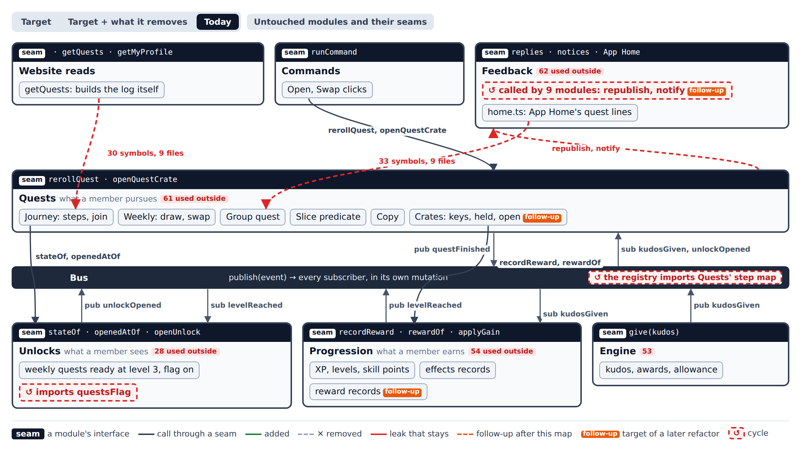
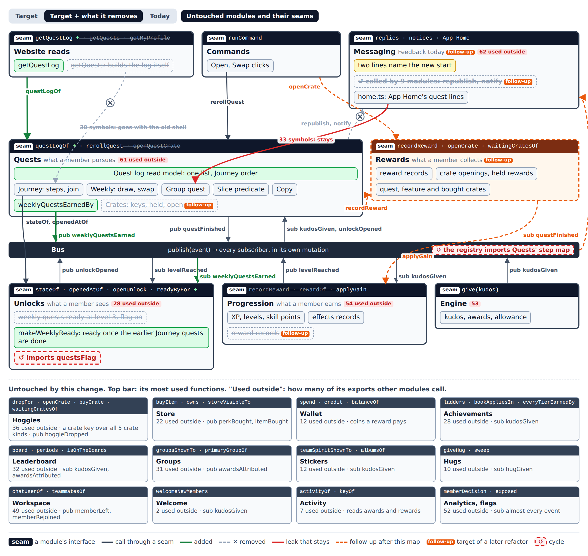
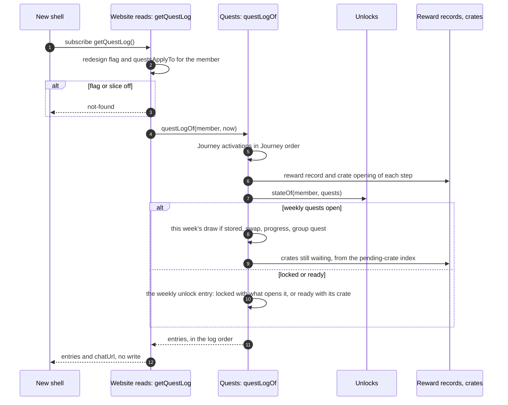
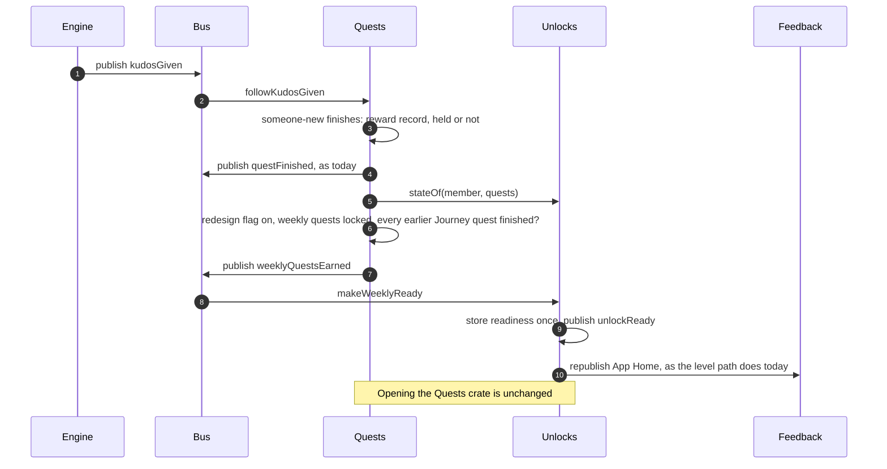
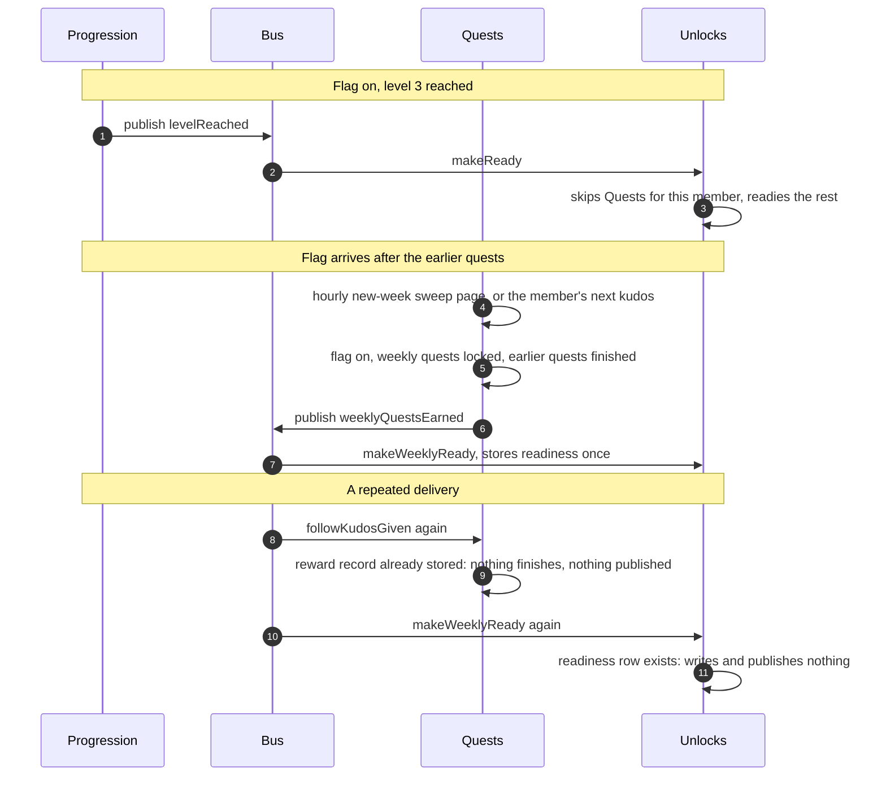

# Architecture: one quest log that the Journey drives

Shaped on [#626](https://github.com/Silthus/kudos/issues/626) (map #624) in five rounds, down the ladder from context to contracts. This file is the interface section of the spec that follows (#627). The look is #625's.

## The question

How does the website show one quest log in which the Journey decides what a member is offered next, without a separate Journey screen, and what has to change behind it?

**Premise.** The game splits by what a member does. **Quests** decides what they pursue: the Journey, the weekly and group quests, and the quest log. **Rewards** holds what they collect. **Progression** counts what they earn. **Unlocks** holds what they can see. **Messaging** only tells them, by following the bus. This change builds the quest log and lets the Journey start the weekly quests. Rewards and Messaging are follow-up refactors, drawn so that this change's seams land where they will stay.

## Decisions

- **One quest log** (map #624). The Journey has no section of its own: it decides which quests a member gets next.
- **Slack App Home** (map #624) is out of scope, except that its links land in the right place, and Q8's two lines.
- **Rules or reads (Q1).** The Journey keeps its rules (P88-P93). A quest log read model in Quests combines the Journey, the weekly quests and the group quest. Storage stays as it is, so nothing migrates. [ADR-0007](../adr/0007-the-journey-drives-one-quest-log.md)
- **The log from level 1 (Q2).** Quests start at level 1 wherever the quests slice applies. The weekly quests start later, once the member finishes their earlier Journey quests.
- **Old URLs (Q3).** The new shell's router maps today's Slack URLs to the log. No backend URL changes until the old shell is deleted.
- **A new read (Q4).** `getQuestLog` in `convex/website`, behind the redesign flag, with no flag of its own.
- **Rewards, crates and events (Q5).** Untouched. The log only reads them.
- **What starts the weekly quests (Q6).** The Journey: weekly quests become ready once the member has finished every Journey quest before `first-quest` that applies to them (`first-thanks`, `two-days` where the Book applies, `someone-new`). [ADR-0008](../adr/0008-the-journey-not-a-level-makes-weekly-quests-ready.md)
- **Its flag (Q7).** The new start rides the redesign flag. Members with it off keep level 3, in Slack and on the old shell.
- **Slack names the new start (Q8).** App Home's "Next: Quests at level 3." and the welcome line name the new start for members with the flag on.
- **What the log holds (Q9).** The Journey quests in Journey order (active, finished, or opened), then the weekly unlock while it is locked or ready, this week's slots with the swap, the group quest, and the crates still waiting.
- **A Rewards module (Q10).** The target is one module for reward records and every crate behind one `openCrate`. Follow-up after this change.
- **Unlocks stays its own module (Q11).** It decides what a member sees (ADR-0006).
- **Messaging follows the bus (Q12).** Feedback becomes Messaging, follows `questFinished`, and App Home reads `questLogOf`. Follow-ups after this change.
- **Quests decides, Unlocks stores (Q13).** Quests publishes `weeklyQuestsEarned`; Unlocks stores readiness and knows no Journey step names.
- **The level path skips Quests for flag-on members (Q14).** Every other feature and every flag-off member keep their levels.
- **Members who finished early (Q15).** Quests' hourly new-week sweep, the member's next kudos and App Home's publish publish the event for them.
- **Ready at the finish (Q16).** A finished Journey quest counts, held in its crate or not.
- **The read never draws (Q17).** `getQuestLog` stays query-only.
- **Facts behind the seam (Q18).** `questLogOf` answers facts and copy; seen keys, coin visibility, URLs and labels stay with each caller.
- **Cards reuse today's shapes (Q19).** `JourneyStep`, `QuestSlot`, `GroupQuestCard` and `WaitingCrate`, shaped by the same functions as `getQuests`.
- **No analytics recorder (Q20).** `unlockReady` already records the moment.
- **The flag turned off again (Q21).** A member whose weekly quests aren't ready goes back to level 3; a ready or opened Quests stays.
- **Old shell reads** stay unchanged until the old shell is deleted, so flag-off members see exactly what `main` shows.
- **A ready Quests stays ready.** Unlocks' invariant "a ready or opened feature is kept for good" settles it.

## Rung 1: context



## Rung 2: modules and seams

Each module is a frame; its dark top bar is its seam. Red counts are the module's exports other modules use. [`quest-log/modules.html`](quest-log/modules.html) is the interactive view: Target, Target + what it removes, Today, and a toggle for the untouched modules and their seams.

**Target**



**Target + what it removes**



**Today**



**With the untouched modules**



Leaks that stay after this change: App Home's quest lines reach 33 symbols across 9 Quests files (Q12 moves them onto `questLogOf`), Unlocks imports `questsFlag` from Quests, and the bus registry imports Quests' step map (`convex/bus/publish.ts`). The website's 30 symbols from 9 Quests files go when the old shell is deleted.

## Rung 3: call paths

### The main read: `getQuestLog`



### The main write: the Journey starts the weekly quests



### Failures and members already part-way



## Rung 4: contracts

### 1. Quests' read: `questLogOf` (`convex/quests/questLog.ts`, new)

```ts
export type QuestLog = { entries: QuestLogEntry[] };

export type QuestLogEntry =
  | { kind: "journey"; step: JourneyStep; goal: string; hint: string | null; reward: Reward; activatedAt: number | null; finishedAt: number | null; openedAt: number | null; waiting: boolean; opens: Feature | null }
  | { kind: "weeklyUnlock"; state: "locked" | "ready"; opensWith: WeeklyStart }
  | { kind: "weekly"; week: WeekKey; slot: WeeklySlot & { crate: WeeklyQuest }; swap: { used: boolean; available: boolean } }
  | { kind: "group"; quest: GroupQuest }
  | { kind: "waiting"; crate: UnopenedCrate | WaitingGroupCrate };

export type WeeklyStart = { by: "journey"; left: JourneyStep[] } | { by: "level"; level: number };

export function questLogOf(ctx: QueryCtx, member: MemberId, at: number): Promise<QuestLog>;
```

- **Order (Q9):** the Journey entries in catalogue order; then `weeklyUnlock` while weekly quests are locked or ready; then this week's slots by slot number; then the group quest; then the waiting crates, oldest week first.
- **Facts and copy, not presentation.** It answers the times, rewards, states and the goal and hint copy (Quests owns the copy). Seen keys, coin visibility, URLs and labels stay with the caller.
- **Applies only where the slice applies.** Where `questsApplyTo` is false it answers `{ entries: [] }`. A step that doesn't apply to the member (`journeyStepAppliesTo`) is left out, as today.
- **`first-thanks` before activation** shows as active with the catalogue's current reward (`activatedAt: null`), as `projectedJourneyOf` does today.
- **Never writes.** It is query-safe and draws no week (Q17).
- **Cost:** at most 5 activations, 2 reads per step (reward record and crate opening), the week's draw, swap and counted awards, one group quest, and the pending-crate index range, whose cost follows the crates still waiting. That is the same budget as `getQuests` plus `getMyProfile.journey` today.
- **Errors:** none of its own. A missing member throws, as `chatUserOf` does today.

### 2. The website's read: `getQuestLog` (`convex/website/questLog.ts`, new)

```ts
export type QuestLogAnswer =
  | { kind: "not-found" }
  | { kind: "log"; entries: QuestLogCard[]; chatUrl: string };

export type QuestLogCard =
  | { kind: "journey"; card: JourneyStep }
  | { kind: "weeklyUnlock"; state: "locked" | "ready"; opensWith: WeeklyStartShown; crate: Feature | null; seen: string | null }
  | { kind: "weekly"; card: QuestSlot; swap: WeekSwap }
  | { kind: "group"; card: GroupQuestCard }
  | { kind: "waiting"; card: WaitingCrate };

export type WeeklyStartShown = { by: "journey"; left: string[] } | { by: "level"; level: number };

export const getQuestLog: MemberQuery<QuestLogAnswer>;
```

- **`not-found`** wherever the redesign flag or `questsApplyTo` is off for the member, so nothing reaches a member the redesign hasn't reached.
- **Cards reuse today's shapes.** `JourneyStep`, `QuestSlot`, `GroupQuestCard` and `WaitingCrate` (`convex/website/quests.ts`) are shaped by the same functions, so the old and the new shell show one quest the same way. Deleting `getQuests` with the old shell leaves the shapers behind.
- **`left`** names the goals of the earlier Journey quests still unfinished, for "Weekly quests open after you…" copy (the spec writes the words).
- **No write, no draw**, and it follows the website clock (`followTheClock`) like `getQuests`, so the week turns over on the tick.

### 3. The event: `weeklyQuestsEarned` (`convex/bus/events.ts`)

```ts
export const weeklyQuestsEarnedEventValidator = v.object({
  type: v.literal("weeklyQuestsEarned"),
  workspace: v.string(),
  member: v.id("members"),
  at: v.number(),
});
// subscribers: [internal.unlocks.weekly.makeWeeklyReady]
```

- **Published by Quests only**, after a mutation finds the redesign flag on for the member, Quests' unlock still locked, and every earlier Journey quest that applies to them finished (`weeklyQuestsEarnedBy`, below). The mutations that check are the finish of a Journey step, the new-week sweep, the `kudosGiven` subscriber and App Home's publish (Q13, Q15).
- **`at`** is the finish of the last earlier quest, or the sweep's time for a member the flag reached later. Unlocks stores it as `readyAt`.
- **At most once in effect.** A repeat or a race of two publishers stores nothing new (see 4). Quests may publish it more than once.
- **No analytics recorder of its own**: `unlockReady` already records the readiness, and a new recorder would need its own walk in the dark-features oracle (E11).

```ts
export function weeklyQuestsEarnedBy(ctx: QueryCtx, member: MemberId): Promise<{ earned: boolean; left: JourneyStep[] }>;
```

- **Earlier quests** are the catalogue's steps before `first-quest` that apply to the member: `first-thanks`, `two-days` where the Book applies, and `someone-new`. A step counts as finished when its reward record exists, held or not (Q16).
- **Cost:** 3 reward-record reads and the Book's predicate.

### 4. Unlocks' readiness rule (`convex/unlocks/schedule.ts`, `convex/unlocks/weekly.ts` new)

```ts
export type ReadyBy = { by: "level" } | { by: "journey" };

export function readyByFor(ctx: QueryCtx, member: MemberId, feature: Feature): Promise<ReadyBy>;

export const makeWeeklyReady: InternalMutation<{ event: WeeklyQuestsEarnedEvent }>;
```

- **`readyByFor`** answers `journey` for Quests where the redesign flag is on in the member decision, and `level` for every other feature and member.
- **The level path** (`makeReady` on `levelReached`, the hourly ship sweep) leaves out every feature whose `readyByFor` is `journey` (Q14). The level up's record keeps listing only what it made ready.
- **`makeWeeklyReady`** stores Quests' readiness once, at the event's `at`, only where unlocks show to the member, Quests has shipped to them, and `readyByFor` is still `journey`. It publishes `unlockReady` and republishes App Home, as the level path does. A row that already exists makes it write and publish nothing.
- **Never takes anything away.** A ready or opened Quests stays, whatever the flag says later (the Unlocks invariant). With the flag turned off again, a member who isn't ready yet goes back to level 3.
- **Opening is unchanged:** `openUnlock` → `unlockOpened` → the first draw and `first-quest`'s activation.

### 5. Slack copy (Q8) and the router (Q3)

- App Home's next line and the welcome message read `readyByFor`, plus `weeklyQuestsEarnedBy(...).left` for the journey case. The words go in the spec.
- The new shell's router maps `/?crate=journey`, `/quests?quest={slot|journey|group}` and `/quests?crate=…` to the log entry, and the crate, that they name. No backend URL changes.

## Members already on the Journey

Nothing migrates: activations, reward records and crate openings stay where they are, and the log reads them.

- **Flag off:** exactly as on `main`, in Slack and on the old shell.
- **Flag on, Quests already ready or opened:** kept for good. The log shows their weekly quests as today.
- **Flag on, Quests not ready, earlier quests finished before the flag arrived:** the next hourly new-week sweep, kudos or App Home publish finds them and publishes `weeklyQuestsEarned`, so nobody waits more than an hour.
- **Flag on, Quests not ready, earlier quests unfinished:** level 3 no longer readies Quests; finishing the last earlier quest does.
- **Flag turned off again before Quests is ready:** back to level 3.

## Open items for the spec (#627)

- The copy: "Weekly quests open after you…", App Home's next line, and the welcome line.
- How two crates in a row look (the finishing step's crate, then the Quests crate), with #625.
- The redesign flag's name and its member decision.
- The new invariants for Quests and Unlocks (readiness by the Journey, the level path skipping Quests, the sweep's catch-up) and their oracles, including the flag-off byte comparison.
- The router's mapping table for the old URLs.

## ADRs

- [ADR-0007](../adr/0007-the-journey-drives-one-quest-log.md): the Journey drives one quest log (`questLogOf`).
- [ADR-0008](../adr/0008-the-journey-not-a-level-makes-weekly-quests-ready.md): the Journey, not a level, makes weekly quests ready (`weeklyQuestsEarned`, `readyByFor`).
- `getQuestLog` beside `getQuests` misses the bar: it is easy to reverse and goes away with the old shell.
- The router's mapping of old URLs misses the bar: one table in the new shell, easy to change.
- `questLogOf` answering facts, not presentation (Q18), and the cards reusing today's shapes (Q19) miss the bar: they follow where the copy and the shapers already live.
- No analytics recorder for `weeklyQuestsEarned` (Q20) misses the bar: adding one later costs a recorder and an E11 walk.
- Rewards (Q10) and Messaging (Q12) are follow-up targets, not built here; their ADRs belong with the refactors that build them.
- Unlocks staying its own module (Q11) is ADR-0006.
