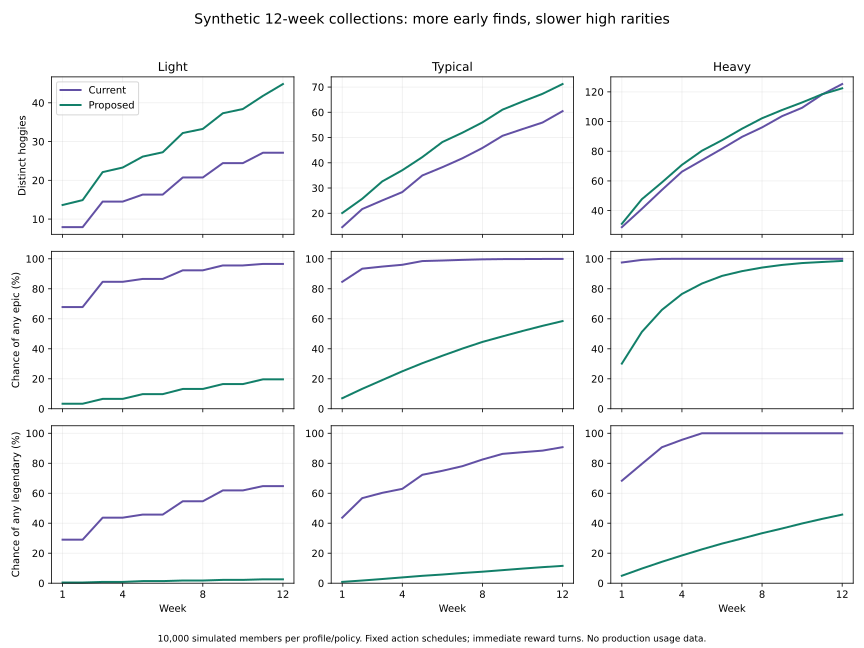

# Hoggie rarity: source audit and a twelve-week simulation

Research date: 2026-10-29. Audited source: [`df092e346d11f55fc5e86977715a8a03445820ce`](https://github.com/Silthus/kudos/tree/df092e346d11f55fc5e86977715a8a03445820ce). This branch is disposable research, never a merge candidate. All action counts and results below are synthetic. Production observations are kept in the private research ticket only.

**Rare floors are the immediate accelerator.** A welcome item has a 36.36% chance of epic or legendary before the member does anything else. Each level adds three more hoggies, including another rare-floor draw. Achievement rewards can additionally eliminate an owned rarity and renormalize upward. Ordinary draws do not read the collection and already permit duplicates. [S1, S2, S3]

**The new rule needs ceilings, not just lower floors.** A rare floor still permits legendary. Welcome, levels, quests, team rewards, legacy crates and the forge all need explicit limits if kudos are to be the only source of new epic and legendary rewards. The numbers below are recommendations for one product decision in the spec, not approved changes. No spec rules or domain code are amended here.

## Every current path to a hoggie

Each earned opportunity below yields one hoggie when successfully opened or turned, unless a flag prevents it. `collection` gates the ordinary drop; existing member/crate records prevent a second draw. The probability of earning an opportunity is separate from its rarity distribution. Pack XP/coins are also separate draws. [S1, S2]

Use these distribution names in the inventory:

| Distribution | Common | Uncommon | Rare | Epic | Legendary |
| --- | ---: | ---: | ---: | ---: | ---: |
| Base, common floor | 50% | 28% | 14% | 6% | 2% |
| Uncommon floor, initially | 0 | 56% | 28% | 12% | 4% |
| Rare floor, initially | 0 | 0 | 63.64% | 27.27% | 9.09% |
| Epic floor, initially | 0 | 0 | 0 | 75% | 25% |
| Legendary floor | 0 | 0 | 0 | 0 | 100% |

The catalogue has 60 common, 40 uncommon, 30 rare, 15 epic and 6 legendary hoggies. The draw chooses rarity by weight, then an entry uniformly within that rarity. The percentages are not per-entry weights. [S1]

| Path / crate kind | Opportunity and current odds | Collection dependence / conditions | Source |
| --- | --- | --- | --- |
| Welcome / `welcome` | One welcome item, rare floor | Duplicates permitted; `welcome-item` must apply | S4 |
| Level / `level` | Three per recorded level increase: base, base, rare floor | Duplicates permitted. Hidden items wait for their turns; old reveal draws directly. No pack bonus | S3 |
| Kudos pack / `thoughtful` | One per distinct recipient, once per giver/recipient/week, only for a kudos classified thoughtful; base odds | Repeated recipient that week earns no second pack. The giver gets the hoggie, plus a person sticker if new. Turning the item and the legacy pack/tray paths refer to the same draw | S5 |
| Completed team / `team` | One per completed person-team page, rare floor | Draw among unowned eligible entries; renormalizes when an eligible rarity is fully owned | S6 |
| Milestone / `milestone` | One per milestone/tier: bronze uncommon floor, silver rare, gold epic, diamond legendary | Same unowned behavior as team items. Five milestone tracks with four tiers each | S6, S7 |
| Monday onboarding or weekly quest / `quest` | One item per finished quest, base odds | Onboarding currently grants 50 XP each; weekly quests 20 XP. No extra pack bonus. Weekly draws wait until onboarding finishes | S8 |
| Legacy weekly, group, Journey quest / `weekly`, `group`, `journey` | One per first valid crate opening, base odds | Old quest path, subject to its feature and quest applicability. Monday rewards cannot be opened again through this path | S9 |
| Feature opening / `unlock` | One per first member opening of a ready feature, base odds | `openUnlock` drops; automatic `keepOpen` does not. A launch opening is not another member crate | S10 |
| Bought crate / `bought` | One per bought crate opened, base odds; costs 50 coins | Buying and opening have their own gates; cannot assume every member spends coins here | S11 |
| Forge / `forge` | Three spare copies of the same hoggie, keeping its first copy, buy one exactly one rarity higher | Uniform among unowned entries of the target rarity; if all owned, uniform among all target entries. Never rises above that target. Legendary cannot be forged upward. No XP/coins | S12 |

There is **no direct hug draw today**. Hugs can indirectly earn level drops through their XP. Hug giver and recipient each earn 1 XP; successful hugs have a daily budget and deduplication. A hug on a kudos can pay multiple recipients, so adding a find for every recipient would introduce an extra fan-out. [S13]

## Why high rarities arrive early

1. **Welcome is already a large high-rarity roll.** The rare floor removes the 78 common/uncommon weight, leaving 14/6/2. Epic plus legendary becomes `8 / 22 = 36.36%`. [S1, S4]
2. **Every level repeats that floor.** Assuming independent new crate hashes, the chance of at least one epic-or-legendary in a level's three draws is `1 - 0.92² × 14/22 = 46.14%`. Welcome plus two level increases gives `1 - (14/22)³ × 0.92⁴ = 81.54%` for at least one. These are chances of any high rarity, not a legendary specifically. [S1, S3]
3. **Milestones turn progress into increasingly strong guarantees.** A gold tier is always epic-or-legendary; diamond is always legendary. People tiers are at 1/10/25/50, reach at 3/10/25/50, and the current thoughtful track at 1/25/100/500. One member can earn several tracks, and hoggie rewards can themselves cross collection tiers. [S6, S7]
4. **Achievement exhaustion is an extra accelerator, not a global property.** Only item reasons `team` and `milestone` pass `unowned: true` to `dropFor`. If every rare is owned on a rare-floor achievement, the remaining 6/2 weights become 75% epic and 25% legendary. If epic is also complete, legendary becomes 100%. If all eligible entries are owned, the function falls back to the full eligible pools and allows duplicates; it does not stop dropping. [S1, S2, S6]
5. **Forge is a second escalation route.** Four copies of one rare (the kept original plus three spares) can make an epic with certainty; epic spares can make a legendary. New hug draws would therefore make a path to high rarities even if their direct draws stop at rare. [S12]

`probe.mjs` calls the actual source draw with 10,000 synthetic keys. Its saved output verifies both the rare-floor distribution and the jump to 75/25 when the rare achievement pool is owned. It also demonstrates that an ordinary call can return the already-owned rare entry. This is an actual-function check, separate from the simulator's model.

## Recommended numbers for the spec decision

This is one proposed bundle. Ratios become probabilities after normalization within the permitted range. Changes to future XP, quest rewards or pack frequency require rerunning the model.

| Setting | Recommended value | Reason |
| --- | --- | --- |
| Hug find opportunity | 20% per accepted **given** hug, stop after one successful find per giver/local day; existing hug budget still applies | Two daily hugs give a 36% chance of a find; ten give 89.26%, with a daily ceiling. Received hugs grant XP but no additional draw |
| Hug and other ordinary non-kudos rarity weights | Common/uncommon/rare = 50/28/14, normalized to 54.35% / 30.43% / 15.22%; epic/legendary = 0 | Keeps familiar low-rarity proportions and a hard rare ceiling |
| Kudos pack opportunity | One guaranteed hoggie per distinct thanked recipient per giver/week; remove thoughtful classification | Preserves the existing anti-repeat unit. No extra roll per emoji or kudos unit |
| Kudos rarity weights | Common/uncommon/rare/epic/legendary = **50/28/18/3.5/0.5**, no floor | Legendary is a 1-in-200 reward opportunity on average; original weights are shown as a sensitivity below |
| Welcome | Exactly rare | Gives an immediate clear reward without opening a high-rarity bypass |
| Level | Keep three items: two common-to-rare draws, third exactly rare | Keeps the level beat and eliminates high rarities from hug-funded levels |
| Completed person team | Exactly rare | Rewards completion without another high-rarity faucet |
| Milestone tiers | Bronze uncommon-to-rare, weights 28/14; silver/gold/diamond exactly rare | Caps both floor and ceiling. Tier prestige comes from the milestone/emoji, not guaranteed legendary draws |
| Quest, feature and bought/legacy crate draws | Common-to-rare, weights 50/28/14; no high-rarity exception for a quest requiring kudos | Makes the direct kudos pack the single high-rarity source |
| Ownership handling | Never delete a rarity from a draw because it is owned; ordinary and achievement results may duplicate | Prevents collection progress changing the published rarity odds |
| Forge | Keep three-spare cost; common → uncommon and uncommon → rare only. Prefer unowned entries within that fixed target, otherwise duplicate. Rare/epic/legendary spares cannot upgrade | Satisfies literal kudos exclusivity without new provenance tracking; the cost is that high-rarity duplicates have no new forge use |
| Hug XP, giver | First given hug of local day **10 XP total**, later accepted hugs 1 XP | A daily first step pays as much base giver XP as one kudos |
| Hug XP, recipient | First received hug of local week **5 XP total**, later received hugs 1 XP | A weekly first receipt pays the base recipient XP of a kudos. Bonus once per recipient/week, not once per giver |
| Other XP used in model | Keep kudos giver 10, recipient 5, existing pack 15; onboarding 50 each; weekly quest 20 | Isolates the rarity/first-hug proposal instead of retuning the whole economy |

The daily ceiling applies to **successful finds**, not only the first reaction's roll. Otherwise a failed first hug would make every later hug unable to find anything that day. Roll once for the stored accepted hug and persist its policy/result; retries or removing/re-adding the reaction must not roll again. Daily and weekly keys follow the member's existing timezone conventions. [S13]

Dropping only the milestone floors to rare would not implement this proposal: the welcome, all three level slots, non-kudos base crates and forge still admit high rarities. Likewise, keeping the current "unowned among eligible rarities" algorithm would silently undo a cap's intended odds when lower pools fill.

## Simulation contract

The script models 10,000 new synthetic members per profile and policy for 12 weeks, from an empty collection. It reads the real catalogue; the audited reward/XP constants are explicit model inputs. It uses reproducible pseudo-random independent draws instead of the production SHA-256 secret. SHA-256 makes a real member/crate result deterministic; it does not make a later rarity draw prefer a new entry. [S1]

| Synthetic profile | Hugs given/week and given days | Hugs received/week | Kudos given/week | Kudos received/week | Recipient circle |
| --- | --- | ---: | ---: | ---: | ---: |
| Light | 2, on 2 days | 2 | 1 every other week | 1 every other week | 12 |
| Typical | 10, on 5 days | 5 | 2 | 1 | 48 |
| Heavy | 50, on 5 days | 20 | 10 | 5 | 160 |

"Typical" is a scenario label, not a median estimated from analytics. These schedules are deliberately stable to isolate the reward policy. Each kudos has one recipient and one kudos unit, on at most two messages a day. Each profile cycles through a fixed, seeded shuffle of its synthetic circle, exhausting new recipients before repeating. Synthetic teams have four people, with no unmatched or overlapping memberships; team and reach milestones follow those synthetic teams. This is a breadth-friendly scenario, especially for the heavy profile, not a prediction of a real org chart.

Both policies use current level thresholds (20 XP for level 2; `50 × (L−1) × (L−2)` thereafter), a welcome item, three items per new level, current milestone thresholds, automatic completion of eligible synthetic teams, and immediate turning of every earned item. All relevant reward flags are treated as on. No legacy backfill is added. The current policy assumes every modeled kudos passes the thoughtful classifier, which is favorable to current rewards. [S1, S3, S6, S7, S14]

Onboarding is paid once per current step: first kudos, a later kudos to someone new, and kudos on two days. Two steps can finish on the same message, as in the current code. Weekly completion under today's rules is optimistically one or two quests after onboarding, limited by later kudos messages that week. Under the proposal a hug quest finishes every week and a kudos quest in every week containing a kudos, available from the start. This models the proposed easy/middle pairing, rather than pretending the future pool already exists. [S8]

Forge runs eagerly whenever enough spare copies exist. It retains the first copy and can chain; a second run without forging shows its contribution. Non-kudos draws pay no modeled pack bonus on the Monday path. The kudos pack pays its existing 15 XP. The model excludes voluntary coin purchases, manual feature-open crates, legacy group/Journey crates, skill-tree perks, unrelated achievement XP, the first-kudos top-up, multiple-recipient messages, retained legacy inventories, missed turns and abandonment. The source can top up a first kudos to level 2 independently of onboarding quest XP, depending on existing XP and subscriber/turn order; this model combines base and pack XP before settling levels and does not model that small timing-dependent top-up. These are opportunity and engagement assumptions, not claims that those paths do not exist. In particular, purchases or extra recipient packs add additional chances in today's policy, and more future XP adds low-rarity level items under the proposal. [S1, S5, S9, S10, S11, S14]

Unique counts mean distinct hoggie designs ever held, not current spare copies or draw counts. Forge keeps the first copy, so the count stays monotonic. Probabilities mean the share of simulated members who have ever found at least one of the named rarity. Rarity rolls and total reward volume are reported separately in `results.csv`, including source counts, duplicates and levels.

## Results

The synthetic proposal gives light and typical members more distinct hoggies, while epic and legendary results depend on their kudos packs. The breadth-friendly heavy profile nearly fills the high-rarity pages under today's floors; the proposed high-rarity ceiling on other sources prevents that.

| Week | Profile | Policy | Mean distinct (10th–90th percentile) | Mean epic / legendary designs | Chance any epic | Chance any legendary |
| ---: | --- | --- | --- | --- | ---: | ---: |
| 2 | light | today | 7.9 (8–8) | 1.00 / 0.33 | 67.8% | 29.0% |
| 12 | light | today | 27.1 (25–29) | 2.92 / 0.96 | 96.6% | 64.8% |
| 2 | light | proposed | 14.9 (13–16) | 0.03 / 0.00 | 3.4% | 0.4% |
| 12 | light | proposed | 44.9 (41–48) | 0.21 / 0.03 | 19.6% | 2.6% |
| 2 | typical | today | 21.7 (20–23) | 2.32 / 0.77 | 93.4% | 56.8% |
| 12 | typical | today | 60.5 (57–64) | 5.88 / 2.01 | 99.9% | 90.7% |
| 2 | typical | proposed | 25.7 (23–28) | 0.14 / 0.02 | 13.3% | 1.8% |
| 12 | typical | proposed | 71.2 (66–76) | 0.83 / 0.12 | 58.5% | 11.6% |
| 2 | heavy | today | 41.2 (38–44) | 4.21 / 1.42 | 99.3% | 79.6% |
| 12 | heavy | today | 125.3 (121–130) | 14.52 / 5.63 | 100.0% | 100.0% |
| 2 | heavy | proposed | 47.7 (44–51) | 0.69 / 0.10 | 51.3% | 9.8% |
| 12 | heavy | proposed | 122.4 (118–126) | 3.69 / 0.58 | 98.6% | 45.8% |



At week 12 the proposed light/typical/heavy scenarios make about 55/101/269 total finds, versus 29/74/210 today. Those totals include forge outputs; they are not distinct designs. More finds do not mean more high-rarity finds. The heavy proposal still collects about 118 of the 130 low-rarity designs, so it slows high-rarity saturation rather than promising an endless supply of new common-to-rare designs.

## Sensitivity and limits

Changing only source eligibility already helps, but keeping a 2% legendary chance on every kudos pack still gives the heavy scenario about a 91% chance of a legendary within twelve weeks. Reducing it to 0.5% makes that about 46%. This is a pacing choice, not a statistically optimized rate.

| Profile | Proposed legendary chance, 0.5% kudos | Same source restrictions, original 2% kudos | Mean distinct, forge on | Mean distinct, forge off |
| --- | ---: | ---: | ---: | ---: |
| light | 2.6% | 11.4% | 44.9 | 44.8 |
| typical | 11.6% | 39.6% | 71.2 | 70.6 |
| heavy | 45.8% | 91.3% | 122.4 | 115.3 |

The original-weight run is saved in `original-weights.csv`, and the forge-off run in `no-forge.csv`. In the current heavy scenario, turning forging off still leaves every simulated member with a legendary, and changes mean epic/legendary designs only from 14.52/5.63 to 14.15/5.44. Floors and repeated opportunities dominate that scenario; forge is not the primary explanation for its early high-rarity collection.

Independently of the simulation, the proposed chance of any legendary after `k` kudos packs is `1 − 0.995^k`: 2.96% for 6 packs, 11.33% for 24 and 45.20% for 120. The measured simulated rates differ by sampling error. `verify_results` checks every weekly proposed epic/legendary probability against its closed form, including both sensitivity runs. This checks that no modeled non-kudos source leaks high rarities.

For the successful-find daily ceiling, expected **direct hug finds per week** can be computed exactly without another simulation:

| Per-hug find rate | Light (2 days × 1 hug) | Typical (5 days × 2 hugs) | Heavy (5 days × 10 hugs) |
| ---: | ---: | ---: | ---: |
| 10% | 0.20 | 0.95 | 3.26 |
| 20% | 0.40 | 1.80 | 4.46 |
| 30% | 0.60 | 2.55 | 4.86 |

These direct-find counts exclude welcome, quests, levels, milestones and forge outputs. The 20% choice yields a direct find every five accepted hug opportunities on average before applying the daily cap; light participation can still miss a whole week, so the guaranteed easy-quest item matters. If the spec chooses different XP or reward counts, rerun the collection simulation rather than multiplying these direct-find counts into a total collection forecast.

No finite run proves an outcome impossible. The proposed zero chance of a hug-only epic/legendary follows from the permitted rarity sets and the forge ceiling; the simulator also checks it with a forced-find stress case. For nonzero probabilities, 10,000 trials have at most about ±1 percentage point of Monte Carlo error at 95% confidence. Behavior assumptions dominate that sampling error.

This analysis does not assert that the observed member described in the ticket exhausted a rarity, nor that a particular milestone tier caused their drops. Analytics projects only `crate_kind`, rarity and whether new, not the item floor, milestone ID/tier, full collection at the draw, catalogue policy version, or hug-find eligibility. Production source evidence is recorded privately. [S15]

## Handoff

The spec decision should accept or change the whole numeric bundle once, including the forge trade-off. Keeping every current forge upgrade and promising that only kudos can produce high rarities cannot both hold when hugs supply rare duplicates. Restricting upgrades explicitly gives up a use for rare/epic spares; if "duplicates go to the forge" promises a use for every rarity, the map needs that product choice clarified in the spec park. A same-rarity reroll for rare/epic spares is a possible later alternative, but is not modeled or recommended as an extra feature here. Tracking the source of every spare would preserve some upgrades but adds a new inventory policy solely to distinguish hug-earned copies from kudos-earned copies.

Version the **draw policy**, including floor, ceiling and weights, separately from the art catalogue. Preserve stored drops and already-owned hoggies. Recommended transition: preserve already-earned item promises under the old policy and apply the new policy only to newly earned opportunities. This means old pending items can still yield a high rarity after launch; describe the exclusivity promise as applying to newly earned rewards. If exclusivity must start immediately for every unopened item, changing those old promises is a separate product decision for the spec park. The new-member model includes neither transition. [S2, S4, S6]

Before implementation is accepted, verify that a hug-only member cannot reach epic/legendary through welcome, levels, achievements, quests, bought crates or forge; completing a rarity never changes its draw weight; reaction retries do not reroll; the per-day successful-find cap and first-hug XP keys survive retries; legacy stored drops never change; and earned items retain the policy promised when earned. These are handoff checks, not new spec rules.

Reproduce from this branch:

```sh
node docs/research/hoggie-rarity/probe.mjs
python3 docs/research/hoggie-rarity/simulate.py --trials 10000
python3 docs/research/hoggie-rarity/simulate.py --trials 10000 --keep-kudos-weights --output /tmp/hoggie-original-weights.csv
python3 docs/research/hoggie-rarity/simulate.py --trials 10000 --no-forge --output /tmp/hoggie-no-forge.csv
```

`results.csv` records all twelve weekly snapshots. `probe-results.json` records actual-function checks. `comparison.svg` plots the synthetic unique collection, epic probability and legendary probability over time; `plot.py` regenerates it with matplotlib. None of these artifacts contains production usage data.

Research choices and limits are recorded in the branch's Coherence journal: `d-f822cef6` separates recommendations from approvals; `d-70763843` records the non-kudos and forge ceilings; `d-f0c4ed2e` records model limits; `d-62d584e6` records the proposed transition and its cost; `d-187523c7` records the unapproved numeric bundle; `d-fa98bb6c` records the independent probability check. No product policy is changed by these records.

## Sources

All code references below are pinned to the audited commit, so the findings stay reproducible as implementation proceeds.

- **S1:** [Catalogue weights, entries and pack bands](https://github.com/Silthus/kudos/blob/df092e346d11f55fc5e86977715a8a03445820ce/convex/hoggies/catalogue.ts), [pure draw and pool selection](https://github.com/Silthus/kudos/blob/df092e346d11f55fc5e86977715a8a03445820ce/convex/hoggies/draw.ts#L14).
- **S2:** [Drop idempotency, ownership argument and permanent record](https://github.com/Silthus/kudos/blob/df092e346d11f55fc5e86977715a8a03445820ce/convex/hoggies/drops.ts#L31), [item turn only requests unowned for achievements](https://github.com/Silthus/kudos/blob/df092e346d11f55fc5e86977715a8a03445820ce/convex/items/turn.ts#L63).
- **S3:** [Three level items, third rare-floor](https://github.com/Silthus/kudos/blob/df092e346d11f55fc5e86977715a8a03445820ce/convex/unlocks/levelUpHoggies.ts#L13).
- **S4:** [Welcome item and stored rare floor](https://github.com/Silthus/kudos/blob/df092e346d11f55fc5e86977715a8a03445820ce/convex/items/welcome.ts#L17).
- **S5:** [Thoughtful gate](https://github.com/Silthus/kudos/blob/df092e346d11f55fc5e86977715a8a03445820ce/convex/album/earns.ts), [pack opportunity and giver item](https://github.com/Silthus/kudos/blob/df092e346d11f55fc5e86977715a8a03445820ce/convex/album/packs.ts#L84), [legacy open/tray](https://github.com/Silthus/kudos/blob/df092e346d11f55fc5e86977715a8a03445820ce/convex/album/opening.ts).
- **S6:** [Team and tier floors](https://github.com/Silthus/kudos/blob/df092e346d11f55fc5e86977715a8a03445820ce/convex/items/achievements.ts#L13), [achievement reasons and flag](https://github.com/Silthus/kudos/blob/df092e346d11f55fc5e86977715a8a03445820ce/convex/items/achievementFlag.ts).
- **S7:** [Milestone thresholds](https://github.com/Silthus/kudos/blob/df092e346d11f55fc5e86977715a8a03445820ce/convex/album/milestoneCatalogue.ts), [tier recording and collection feedback](https://github.com/Silthus/kudos/blob/df092e346d11f55fc5e86977715a8a03445820ce/convex/album/milestones.ts#L95), [team page completion facts](https://github.com/Silthus/kudos/blob/df092e346d11f55fc5e86977715a8a03445820ce/convex/album/teamPages.ts).
- **S8:** [Monday quest item](https://github.com/Silthus/kudos/blob/df092e346d11f55fc5e86977715a8a03445820ce/convex/quests/finish.ts#L24), [onboarding rewards and completion](https://github.com/Silthus/kudos/blob/df092e346d11f55fc5e86977715a8a03445820ce/convex/quests/onboarding.ts), [weekly rewards](https://github.com/Silthus/kudos/blob/df092e346d11f55fc5e86977715a8a03445820ce/convex/quests/pool.ts), [weekly draw gate](https://github.com/Silthus/kudos/blob/df092e346d11f55fc5e86977715a8a03445820ce/convex/quests/weekly.ts#L374).
- **S9:** [Legacy quest opening](https://github.com/Silthus/kudos/blob/df092e346d11f55fc5e86977715a8a03445820ce/convex/quests/open.ts#L18), [all crate kinds](https://github.com/Silthus/kudos/blob/df092e346d11f55fc5e86977715a8a03445820ce/convex/hoggies/crateKey.ts).
- **S10:** [Member and automatic feature openings](https://github.com/Silthus/kudos/blob/df092e346d11f55fc5e86977715a8a03445820ce/convex/unlocks/unlocks.ts#L38).
- **S11:** [Bought crate price, gates and opening](https://github.com/Silthus/kudos/blob/df092e346d11f55fc5e86977715a8a03445820ce/convex/hoggies/boughtCrates.ts).
- **S12:** [Forge spend and target rarity](https://github.com/Silthus/kudos/blob/df092e346d11f55fc5e86977715a8a03445820ce/convex/hoggies/forge.ts#L20), [forge contract](https://github.com/Silthus/kudos/blob/df092e346d11f55fc5e86977715a8a03445820ce/spec/hoggie-forge.md).
- **S13:** [Accepted hug, budget, giver payment and event](https://github.com/Silthus/kudos/blob/df092e346d11f55fc5e86977715a8a03445820ce/convex/hugs/hugs.ts), [recipient payment](https://github.com/Silthus/kudos/blob/df092e346d11f55fc5e86977715a8a03445820ce/convex/hugs/people.ts), [current hug XP](https://github.com/Silthus/kudos/blob/df092e346d11f55fc5e86977715a8a03445820ce/convex/hugs/xp.ts), [subscribers, including no direct hug draw](https://github.com/Silthus/kudos/blob/df092e346d11f55fc5e86977715a8a03445820ce/convex/bus/publish.ts).
- **S14:** [Base XP](https://github.com/Silthus/kudos/blob/df092e346d11f55fc5e86977715a8a03445820ce/convex/progression/catalogue.ts), [level thresholds](https://github.com/Silthus/kudos/blob/df092e346d11f55fc5e86977715a8a03445820ce/convex/progression/levels.ts), [optional skill-tree bonuses](https://github.com/Silthus/kudos/blob/df092e346d11f55fc5e86977715a8a03445820ce/convex/progression/tree.ts), [first-kudos top-up](https://github.com/Silthus/kudos/blob/df092e346d11f55fc5e86977715a8a03445820ce/convex/progression/firstThanks.ts).
- **S15:** [Drop analytics projection](https://github.com/Silthus/kudos/blob/df092e346d11f55fc5e86977715a8a03445820ce/convex/analytics/projections.ts#L263).
