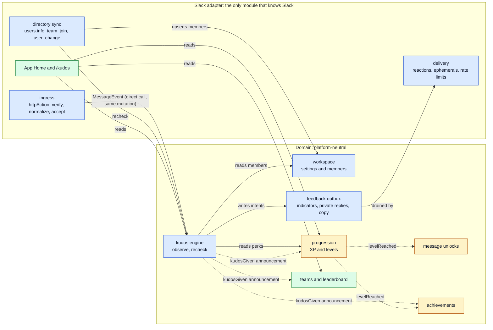
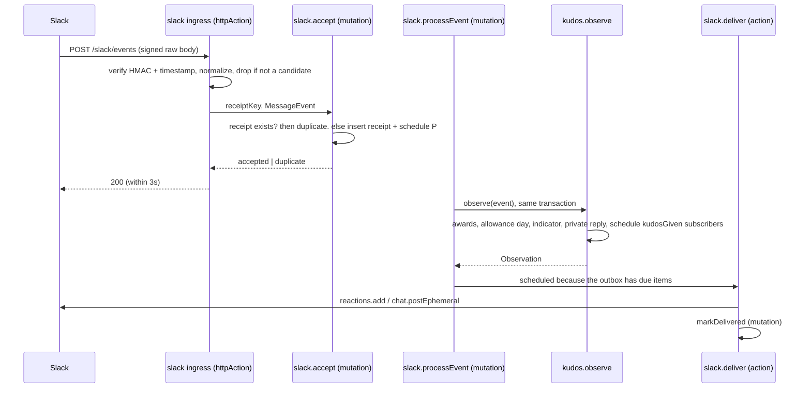
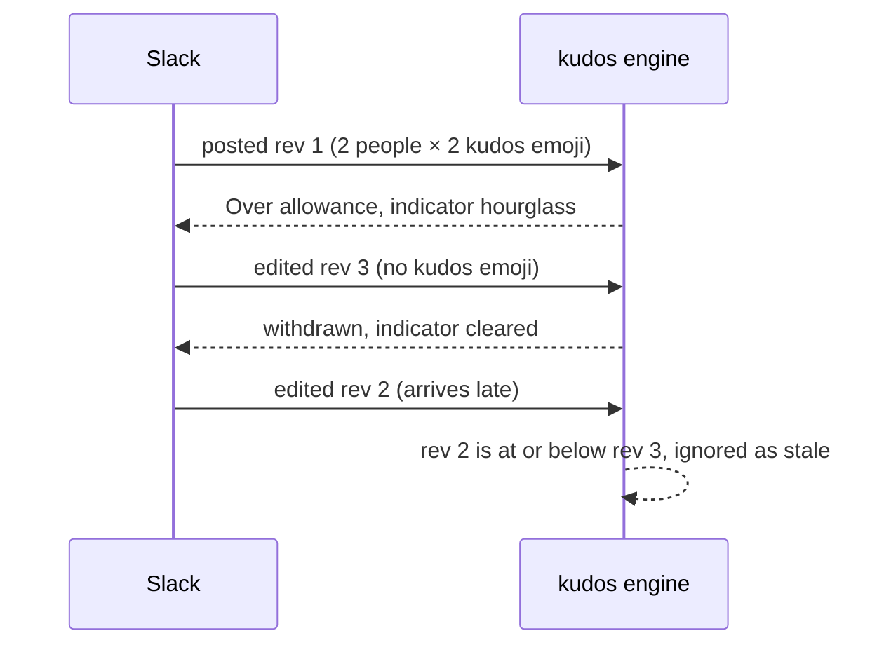
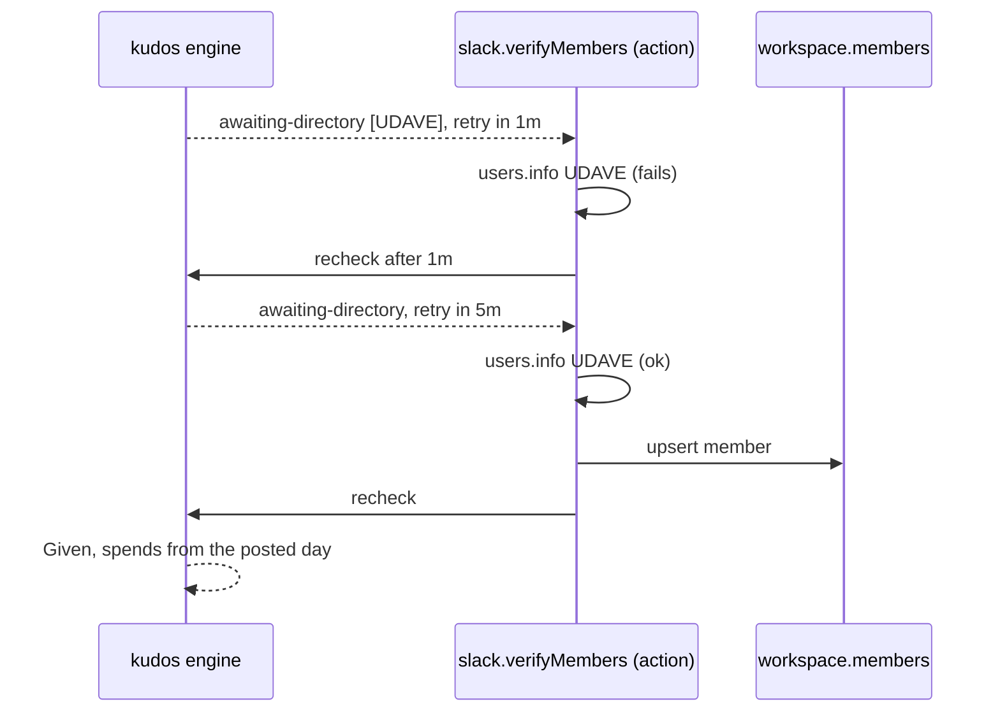
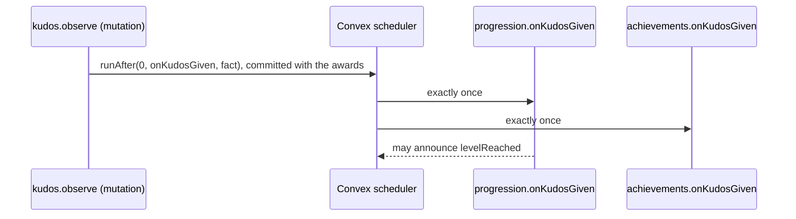

# Architecture brief: the module map and its seams

> **PROTOTYPE. Throwaway branch `prototype/architecture`, never merged.** Ticket [#11](https://github.com/Silthus/kudos/issues/11) on map [#1](https://github.com/Silthus/kudos/issues/1). The stub code next to this file (`prototype/architecture/`) exists only to settle seams. Run it with `node prototype/architecture/scenarios.ts` (Node 24, no build); its output is checked in as [`scenarios.out.txt`](architecture/scenarios.out.txt).

## 1. Question

What is the module map of the new Kudos backend, and what are the contracts at its seams? The destination is a production Convex deployment wired to a new Slack app that covers the core loop, progression (XP, levels, unlockable messages, achievements) and a team leaderboard with a Slack-only profile. Only the Slack adapter may know Slack, so another chat platform could replace it.

This brief answers it greenfield: there is no backend code on `main` yet. Its grounding is the four research reports and the rules settled in the [#8 handoff](https://github.com/Silthus/kudos/issues/8). It proves the eight seam follow-ups from #8 with runnable scenarios (§9), settles where Sign in with Slack goes, maps the three specs onto modules (§11), and proposes how the core loop spec [#12](https://github.com/Silthus/kudos/issues/12) slices into implementation tickets (§12). Progression internals stay open while the [#9](https://github.com/Silthus/kudos/issues/9) grilling runs. Only the seam the kudos engine uses to announce "kudos given" is shaped here.

**How to read it:** §2 (map) and §7 (decision cards) are the core. §3 to §6 hold the detail behind the cards.

## 2. Module map



Legend: blue = spec 1 (core loop), amber = spec 2 (progression), green = spec 3 (leaderboard and profile). A solid arrow is a direct call inside one Convex transaction. A dotted arrow is an **announcement**: the caller schedules each subscriber's internal mutation in its own transaction (card D1).

| Module | Folder | Owns (Convex tables) | Interface (all `internal` except HTTP routes) |
| --- | --- | --- | --- |
| Slack adapter | `convex/slack/` | `slackReceipts`, delivery state, installation (card D9) | HTTP routes; `processEvent`, `verifyMembers`, `deliver` |
| workspace | `convex/workspace/` | `workspaces` (settings), `members` (directory) | `settingsOf`, `lookupMember`, `upsertMember` |
| kudos engine | `convex/kudos/` | `kudosMessages`, `awards`, `allowanceDays` | `observe(MessageEvent)`, `recheck(MessageRef)`, `allowanceLeft(member)` |
| feedback outbox | `convex/feedback/` | `indicators`, `privateReplies` | `setIndicator`, `replyPrivately`, `claimDue`, `markDelivered`, `render(Reply)` |
| progression | `convex/progression/` | open until #9 | implements `Perks`; subscribes to `kudosGiven` |
| message unlocks | `convex/unlocks/` | open until #9 | open until #9 (card D10) |
| achievements | `convex/achievements/` | open until #9 | subscribes to `kudosGiven`, `levelReached` |
| teams and leaderboard | `convex/teams/` | spec 3 | subscribes to `kudosGiven`; leaderboard queries |

## 3. Contracts at the seams

The full types are in [`architecture/contracts.ts`](architecture/contracts.ts). The engine behind them is [`architecture/engine.ts`](architecture/engine.ts).

### 3.1 Chat adapter → kudos engine

```ts
type MessageRef = { workspace: WorkspaceId; conversation: string; message: string };
type Mention = { kind: "person"; user: ChatUserId } | { kind: "group" } | { kind: "broadcast" };

type MessageEvent = {
  kind: "posted" | "edited";
  ref: MessageRef;
  threadRoot?: string;
  author: ChatUserId;
  revision: bigint;
  at: number;
  content: { mentions: Mention[]; emoji: string[] };
};

interface KudosEngine {
  observe(event: MessageEvent): Observation;
  recheck(ref: MessageRef): Observation;
}

type Observation =
  | { kind: "ignored"; why: "not-a-member" | "ordinary-chat" | "stale-revision" | "unchanged" }
  | { kind: "awaiting-directory"; users: ChatUserId[]; retryInMs: number }
  | { kind: "abandoned" }
  | { kind: "withdrawn" }
  | { kind: "already-given"; toldGiver: boolean }
  | { kind: "evaluated"; outcome: Outcome };
```

- **Invariants.** `ref` identifies the message, not the delivery. `revision` strictly increases per message (Slack: `edited.ts`, else the event `ts`, as integer microseconds). `content` holds only the countable rich text: the adapter drops code, quotes, strikethrough, attachments and forwards. It passes **every** emoji name, because only the engine knows a giver's kudos emoji. Message text never crosses the seam and is never stored.
- **Idempotent per revision.** A revision at or below the stored one is `ignored` and changes nothing. A message gives kudos at most once.
- **Errors.** None thrown for domain cases. `awaiting-directory` tells the caller to verify the users and call `recheck` after `retryInMs`. The engine owns the retry budget (card D6).
- **Performance.** One mutation that reads the message row, the giver's members, settings, perks and one allowance-day row, then writes at most the message row, N award rows, the allowance-day row and the outbox rows. It never calls the network.

### 3.2 Kudos engine → workspace, progression (direct reads)

```ts
interface Directory { lookup(workspace: WorkspaceId, user: ChatUserId): MemberFacts | undefined }
type MemberFacts =
  | { kind: "member"; member: MemberId; timeZone: string | undefined }
  | { kind: "bot" }
  | { kind: "not-a-member" };

interface Settings { of(workspace: WorkspaceId): { baseAllowance: number; kudosEmoji: string } }
interface Perks { of(giver: MemberId): { allowanceBonus: number; kudosEmoji: string[] } }
```

`undefined` means unknown, not "not a member". `Perks` is the seam progression fills in spec 2: until then a constant adapter returns `{ allowanceBonus: 0, kudosEmoji: [] }`. Settings are read when the message is evaluated, as #8 rules.

### 3.3 Kudos engine → downstream (the "kudos given" announcement)

```ts
type KudosGiven = {
  workspace: WorkspaceId;
  message: MessageRef;
  giver: MemberId;
  awards: Array<{ giver: MemberId; recipient: MemberId; kudos: number }>;
  kudosEmoji: string;
  day: DayKey;
  at: number;
};
```

- Announced in the same mutation that commits the awards, as one scheduled internal mutation per subscriber (`ctx.scheduler.runAfter(0, internal.progression.onKudosGiven, fact)`). Convex commits the schedule with the awards, and a scheduled mutation runs exactly once, so a subscriber sees each award exactly once without its own dedupe.
- A subscriber's bug fails only its own job. It never blocks or reverses the award. Awards are permanent ([ADR-0001](https://github.com/Silthus/kudos/blob/main/docs/adr/0001-awards-are-permanent.md)), so there is no "kudos revoked" event to design.
- Open until #9: whether the fact carries note facts (for example a word count the adapter computes) if XP rewards the note. Adding a field is backward compatible for queued jobs.

### 3.4 Kudos engine → feedback outbox → Slack delivery

```ts
interface Feedback {
  setIndicator(ref: MessageRef, indicator: { emoji: string } | null): void;
  replyPrivately(ref: MessageRef, threadRoot: string | undefined, to: ChatUserId, reply: Reply): void;
}
type Reply =
  | { kind: "given"; outcome: GivenOutcome; base: number }
  | { kind: "over-allowance"; outcome: OverAllowanceOutcome; base: number }
  | { kind: "invalid"; outcome: InvalidOutcome }
  | { kind: "accepted-message-edited" };
```

- **The indicator is desired state, not an operation.** One row per message holds the reaction it should carry, with a version. The delivery action reads the latest desired state and reconciles: it removes the app's other indicator reactions and adds the desired one ([`reconcile-indicator.ts`](architecture/reconcile-indicator.ts)). `already_reacted` and `no_reaction` count as success. A late or retried delivery can't leave a stale hourglass beside a kudos reaction.
- **Private replies are append-only intents** placed in the thread for a thread reply, in the channel otherwise. Their retry policy is card D3.
- **Written in the engine's mutation, delivered after it.** A failed or repeated delivery never re-enters the engine, so feedback can never award twice.
- **Copy** is rendered from `Reply` by the feedback module into text segments with member placeholders. The adapter turns placeholders into `<@U…>` (card D4).

### 3.5 Slack ingress → adapter processing

```ts
type Normalized = { receiptKey: string; event: MessageEvent | null };
function normalize(envelope: SlackEnvelope): Normalized;
```

See [`slack-normalize.ts`](architecture/slack-normalize.ts). The receipt key is `team_id/event_id`. Message identity is `(team, channel, message.ts)`. `message_changed` reads the nested `message`. `thread_broadcast` is one message with one `ts`. Bot-authored messages, DMs and deletions return `event: null`.

## 4. Flows

### 4.1 Main write path: a kudos message is posted



### 4.2 Edit-to-retry, including out-of-order revisions



### 4.3 A recipient the app can't check



After the last retry the message is `abandoned`: no reaction, no reply (#8 rule 10).

### 4.4 Kudos given → progression



## 5. Data (spec 1 tables)

```ts
// convex/schema.ts (sketch)
workspaces: defineTable({ externalId: v.string(), baseAllowance: v.number(), kudosEmoji: v.string() })
  .index("by_externalId", ["externalId"]),
members: defineTable({
  workspace: v.id("workspaces"), chatUserId: v.string(),
  kind: v.union(v.literal("member"), v.literal("bot"), v.literal("not-a-member")),
  timeZone: v.optional(v.string()), refreshedAt: v.number(),
}).index("by_workspace_and_chatUserId", ["workspace", "chatUserId"]),

kudosMessages: defineTable({
  workspace: v.id("workspaces"), conversation: v.string(), message: v.string(),
  threadRoot: v.optional(v.string()), author: v.string(), revision: v.int64(),
  fingerprint: v.string(), content: contentValidator, spendsAt: v.number(), verifyTries: v.number(),
  state: v.union(/* watermark | awaiting-directory | abandoned | given | over-allowance | invalid | withdrawn */),
}).index("by_message", ["workspace", "conversation", "message"]),
awards: defineTable({
  workspace: v.id("workspaces"), kudosMessage: v.id("kudosMessages"),
  giver: v.id("members"), recipient: v.id("members"), kudos: v.number(), day: v.string(), at: v.number(),
}).index("by_recipient", ["recipient", "at"]).index("by_giver", ["giver", "at"]),
allowanceDays: defineTable({ giver: v.id("members"), day: v.string(), spent: v.number() })
  .index("by_giver_and_day", ["giver", "day"]),

indicators: defineTable({ kudosMessage: v.id("kudosMessages"), emoji: v.union(v.string(), v.null()), version: v.number(), deliveredVersion: v.number() }),
privateReplies: defineTable({ kudosMessage: v.id("kudosMessages"), to: v.string(), reply: replyValidator, tries: v.number(), state: deliveryState }),

slackReceipts: defineTable({ key: v.string(), receivedAt: v.number() }).index("by_key", ["key"]),
```

- `content` holds mention IDs and kudos emoji names, never message text. A `watermark` row is a tiny tombstone that makes "newest revision wins" hold when an edit arrives before its original or removes the emoji.
- Award rows are immutable and only ever inserted (ADR-0001). There is no migration: this is the first schema.
- Receipts are deleted by a daily cron after 7 days. That is safe because the engine's revision check, not the receipt, is what prevents a second award.

## 6. Caching and performance

- **Hot path:** every message in every channel the app is in reaches the httpAction. The httpAction drops a new message with no mention or no emoji before any mutation. Every `message_changed` passes, because an edit that removes the emoji withdraws an attempt.
- **Acknowledgment:** verify (Web Crypto HMAC), normalize (pure), then one small mutation (indexed receipt read, insert, schedule). It still needs a measurement against a deployed backend in the sandbox.
- **Members are a cache** of Slack's directory, refreshed by `team_join`/`user_change` and on a miss through `users.info`. A miss parks the message (card D2). The cache also holds the giver's time zone for the allowance day.
- **Contention:** the only shared row in a decision is the giver's `allowanceDays` row, so OCC conflicts happen only between one giver's own concurrent messages. Convex serializes them, and the second one sees the first's spend (the "last kudos" race).
- **Outbound:** reactions are Tier 3 (50+/min per workspace), ephemerals Tier 4. Delivery honours `Retry-After` per workspace and method. Expected load is a team's chat volume, far below the 30,000 events per hour Slack allows per workspace, unless the app joins every public channel (card D7).
- No other caching is needed in spec 1. The leaderboard's totals are a spec 3 decision (aggregate component or a totals table fed by `kudosGiven`).

## 7. Decision cards

### Open: round 1

Every card below is independent of the others. Answer with the card's id and an option, or "rec" to take the recommendation.

**D1. How do modules talk?**
- **A. Direct reads upstream, announcements downstream.** The engine calls workspace, perks and feedback inside its mutation. It announces `kudosGiven` by scheduling one internal mutation per subscriber in the same commit. Atomic with the award, exactly once per subscriber, and a progression bug can't block giving.
- B. Direct calls everywhere. Progression and achievements run inside the award's mutation: simplest and fully atomic, but every subscriber's cost and failure sits in the giving transaction.
- C. A durable event table that subscribers poll from a cron. It decouples the most and replays easily, but adds latency, a cursor per subscriber and a cron to babysit.
- **Recommendation: A.** It is the smallest design that keeps the award path independent of progression, and Convex's scheduler gives exactly-once for free.

**D2. Where are recipients checked?**
- **A. A members table in the domain.** The engine reads it and parks the message as `awaiting-directory` on a miss. A Slack action verifies and calls `recheck`. Every decision stays in a mutation, tests need no network, and #8's retry rule lives in the engine.
- B. Resolve first, in an action. The adapter calls `users.info` for every mention, then calls the engine. Fewer moving parts per message, but each message waits on Slack and scheduled actions run at most once, so we write our own retries anyway.
- **Recommendation: A.**

**D3. How are private replies retried?**
- **A. At least once, bounded.** Retry a reply up to 3 times on any failure, including a timeout whose result is unknown, honouring `Retry-After`. Worst case is a duplicate ephemeral that only the giver sees and that disappears.
- B. At most once. Never retry after an unknown result. Worst case is a giver with a reaction but no line telling them what's left.
- **Recommendation: A.** Reactions are idempotent and always retried, whichever you pick.

**D4. Who owns the reply copy?**
- **A. The domain feedback module.** It renders `Reply` into segments with member placeholders, and the adapter formats mentions. The copy is tested without Slack and survives a platform swap, and unlockable success lines (spec 2) plug in there.
- B. The Slack adapter. The copy sits next to Slack formatting, but it would be duplicated for a second platform.
- **Recommendation: A.**

**D5. Which day pays when the first event seen for a message is an edit?** #8 says a post pays from the posted day and a retry from the edit day. When the edit arrives before its original (or the original never arrives), we can't tell whether it was a retry.
- **A. The edit day.** Every evaluation started by an edit pays from the edit's day. One rule, and it matches the usual case (an edit that adds the emoji).
- B. The posted day (`message.ts`) when nothing was evaluated before. Right for a prose edit that overtook its original, wrong for a real retry.
- **Recommendation: A.** It only matters when the edit and the post fall on different days and arrive out of order.

**D6. How long do we retry a recipient the app can't check?**
- **A. 5 checks at 1 min, 5 min, 30 min, 2 h and 6 h** (about 8.5 h), then abandon silently.
- B. 3 checks within the first hour. A failure shows up sooner, but a Slack incident longer than an hour loses the kudos message.
- C. Until midnight of the posted day in the giver's time zone. Ties the budget to the allowance day, but the window varies from minutes to a full day.
- **Recommendation: A.** It outlasts most Slack incidents, and the message still pays from its posted day.

**D7. How do we get the app into channels?** A bot gets no events from a channel it isn't in, so the app can't see a kudos attempt there and can't reply to it. "Tell them to invite it" is only possible before or after the fact.
- A. Auto-join every public channel: `channels:join` on install and on `channel_created`. Public channels just work. Private channels still need `/invite`. Every public message reaches the backend, each join posts a system line, and a big workspace can approach the event limit.
- **B. Opt in per channel with `/kudos`.** A slash command works in channels the app isn't in. In a public channel it joins (`channels:join`). In a private channel it replies privately with `/invite @Kudos`. App Home onboarding explains it. Slack's own "add them?" prompt when someone @-mentions the app comes for free.
- C. No code: document `/invite` and rely on Slack's prompt.
- **Recommendation: B.** It is the closest to "tell them to invite it" the platform allows, with no surprise joins. Pick A if coverage of every public channel matters more than control.

**D8. Sign in with Slack in a Slack-only backend.**
- **A. Keep the door open, wire nothing.** Nothing in this map consumes a signed-in session: Slack signs every request and carries the user, and admin checks use the Slack user's role. Members are keyed by `(workspace, Slack user ID)`, which are exactly the OIDC claims `https://slack.com/team_id` and `https://slack.com/user_id`, so a later login maps onto a member with no migration. Sign in with Slack stays the chosen auth for any future web surface.
- B. Wire Convex Auth with the Auth.js Slack OIDC provider now. Convex doesn't support that provider, Convex Auth is beta, and no screen would use the session.
- C. Hand-roll OIDC in an httpAction. Full control, but security-sensitive code with no consumer.
- **Recommendation: A.** It removes the fog from the map without code.

**D9. Sandbox first, then the real workspace: how are installs modelled?**
- **A. Two single-workspace Slack apps from one manifest template**, each pointed at its own Convex deployment (sandbox at a staging deployment, real at production). The bot token and signing secret live in that deployment's environment. No OAuth install flow and no installations table. Every row still carries its workspace.
- B. One distributed app with an OAuth install per workspace, one Events URL and an installations table holding a token per workspace, on one production deployment. Real multi-tenancy, but sandbox traffic and data share production.
- **Recommendation: A.** It is the smallest setup that keeps sandbox data out of production. B becomes a later ticket only if more workspaces should install Kudos.

### Open: waits on the progression grilling (#9)

**D10. How does an unlockable message reach the success reply?**
- A. The engine asks the unlocks module for the giver's success line, a direct read inside the award's mutation, and puts it in the `given` reply. One reply, so the line counts as seen only when the reply goes out.
- B. Unlocks subscribes to `kudosGiven` and sends its own follow-up. Looser coupling, but two messages for one kudos message.
- Leaning A. Decided with #9's answer on what "unlockable" means.

**D11. Does `kudosGiven` carry facts about the note?** Only if XP rewards the note (word count, story length). The adapter would count words and pass a number, never text.

### Locked (reopen any of them)

- **L1. Only HTTP routes are public; every domain function is `internal`.** Reason: Convex research (#7); a signed Slack request is the only caller.
- **L2. Receipts dedupe deliveries; the revision check dedupes attempts.** Reason: #8 follow-up, Slack's separate `event_id` and `message.ts` identities. Proven in scenario 2.
- **L3. The indicator is delivered as desired state.** Reason: an add/remove queue can leave a stale hourglass after a retry; desired state can't (scenarios 3 and 11).
- **L4. Message text is never stored.** Reason: nothing needs it, and it keeps data deletion and the public repo simple. Note facts, if #9 needs them, are numbers.
- **L5. Deletions are dropped at the adapter.** Reason: ADR-0001. One consequence: a message deleted while it waits for a recipient check still gives when the check succeeds.
- **L6. `Perks` is a port the kudos engine owns, with a zero adapter until spec 2.** Reason: #8 fixes the allowance at base + unlocked bonus and a per-giver kudos emoji set.
- **L7. Tests run outside-in at three seams with `convex-test`:** signed requests through `t.fetch('/slack/events')`, the engine's internal mutations with a seeded members table, and delivery with a stubbed global `fetch`. Reason: Convex research (#7).

## 8. Blast radius

- **Nothing existing can break.** `main` has no backend yet.
- **Assumptions that need a live Slack check in the sandbox** (they become acceptance checks on the implementation tickets):
  - A `thread_broadcast` arrives as one event, not as a thread event plus a channel event.
  - `message_changed` for a thread parent's reply metadata and for language detection has no `edited` block.
  - Struck-through and code-styled emoji carry `style` flags in rich text.
  - Web Crypto HMAC verifies in a deployed httpAction, and the acknowledgment stays under 3 s.
  - An ephemeral in a thread reaches the giver when the thread is not open.
- **Who notices a failure:** a giver who sees no reaction. The awards stay correct, because feedback is separate from them.
- **Out of scope:** a web UI, a second chat platform, group super kudos, giving by user reaction, migrating kudos-garden data.

## 9. The #8 follow-ups, proven

Each scenario sends Slack-shaped envelopes through `normalize` into the engine and prints the full state ([output](architecture/scenarios.out.txt)).

| #8 follow-up | Scenario | What it shows |
| --- | --- | --- |
| Delivery receipts deduped apart from attempts | 2 | A repeated `event_id` stops at the receipt; the same revision under a new id stops at the engine; one award |
| Newest revision wins, edit before original, late older revision | 4, 5 | The original after its edit is stale; a late retry after a withdrawal is ignored |
| Prose- and metadata-only edits ignored | 6, 7 | The fingerprint (mentions + kudos emoji) is unchanged, so nothing happens |
| Bounded retries for an unverifiable recipient | 9, 10 | Waits, then gives on the posted day; abandoned after 5 checks with no reply |
| Feedback failing after an award never awards twice | 11 | Delivery throws and is retried; one award, one reaction |
| Reaction swap on retry | 3 | Hourglass, then the kudos reaction after the retry by edit |
| A thread reply also sent to the channel counts once | 8 | One message, one award, feedback in the thread; the parent's metadata edit is ignored |
| Prompting an invite | card D7 | Not observable from Slack, so it is a product choice |
| Sign in with Slack | card D8 | |

Scenarios 1 and 12 add skipped mentions (self, bot, broadcast, external) and struck-through emoji.

## 10. New words this brief uses

Not in `lexicon.json` yet. They are settled through Coherence in the first implementation ticket that uses them: **revision** (one version of a message, ordered), **indicator** (the reaction showing an attempt's outcome), **directory** (the members table as a cache of the chat platform's users), **announcement** (a scheduled, exactly-once notice to another module).

## 11. The three specs on the modules

| Spec | Modules it builds | Seams it adds or fills |
| --- | --- | --- |
| 1. Core loop on Slack, in production | Slack ingress, normalize, directory sync, delivery; workspace; kudos engine; feedback outbox; receipts cron; manifest and deploy | `MessageEvent`, `Observation`, `Directory`, `Settings`, `Feedback`; `Perks` with its zero adapter; `kudosGiven` announced with no subscribers yet |
| 2. Progression | progression, unlocks, achievements | Fills `Perks`; subscribes to `kudosGiven`; adds `levelReached`; adds success lines to `Reply` (D10) |
| 3. Leaderboard and Slack profile | teams (Slack user groups through the adapter's directory sync), leaderboard queries, App Home and `/kudos` | Subscribes to `kudosGiven` or reads `awards`; profile reads from kudos, progression and teams |

## 12. Proposed slicing of the core loop spec (#12)

Each slice is a vertical, deployable pull request, tested outside-in. The order is a dependency chain unless a slice says otherwise.

1. **Walking skeleton.** Add Convex and `convex-test`. Add `/slack/events` with signature check, `url_verification`, receipt and schedule, and a processing step that does nothing yet. Carries the bootstrap's Coherence follow-ups: the entry spec with trust levels, the httpAction entrance declared by hand, `convex/_generated` ignored. Deploys to the sandbox deployment.
2. **The first kudos.** Normalize posted messages; workspace settings with defaults; the members directory filled by `users.info`; `observe` for posts with the Given outcome, allowance day in the giver's time zone, awards; the indicator and its delivery.
3. **Saying no.** Over allowance and Invalid, skipped mentions, and every private reply with the #8 copy (D4).
4. **Edit-to-retry.** `message_changed`, revisions and watermarks, retry, withdrawal, the accepted-message reply, the indicator swap.
5. **Recipients the app can't check.** `awaiting-directory`, the retry ladder (D6), directory refresh from `team_join` and `user_change`.
6. **Delivery you can trust.** Rate limits and `Retry-After`, the reply retry policy (D3), receipt cleanup. Can run in parallel with 4 and 5.
7. **Getting into channels.** The invite flow chosen in D7.
8. **Go-live.** The manifest template and the two apps (D9), the production deploy pipeline, the real-workspace install. This is the spec's `ship` ticket.

Settings mid-day (the base drops below what was given, or the emoji changes) falls out of "settings in force at evaluation" and "never below 0". Slice 3 tests it.
