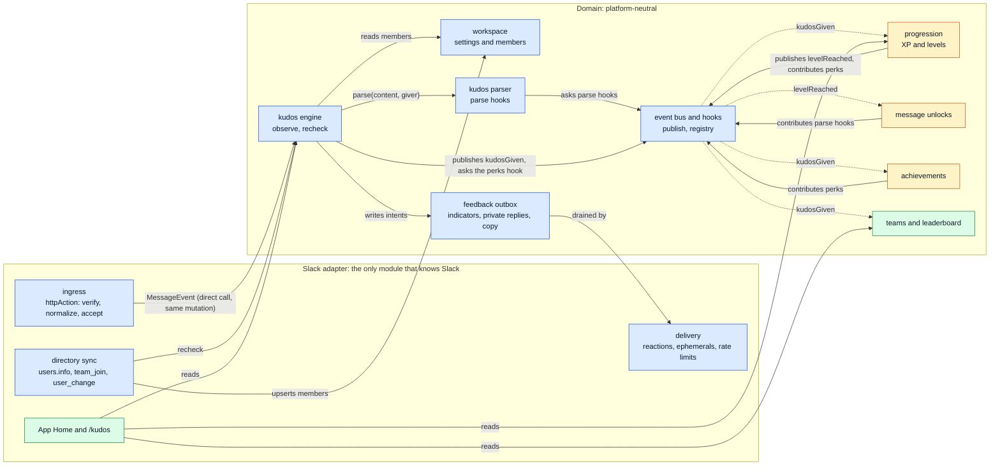
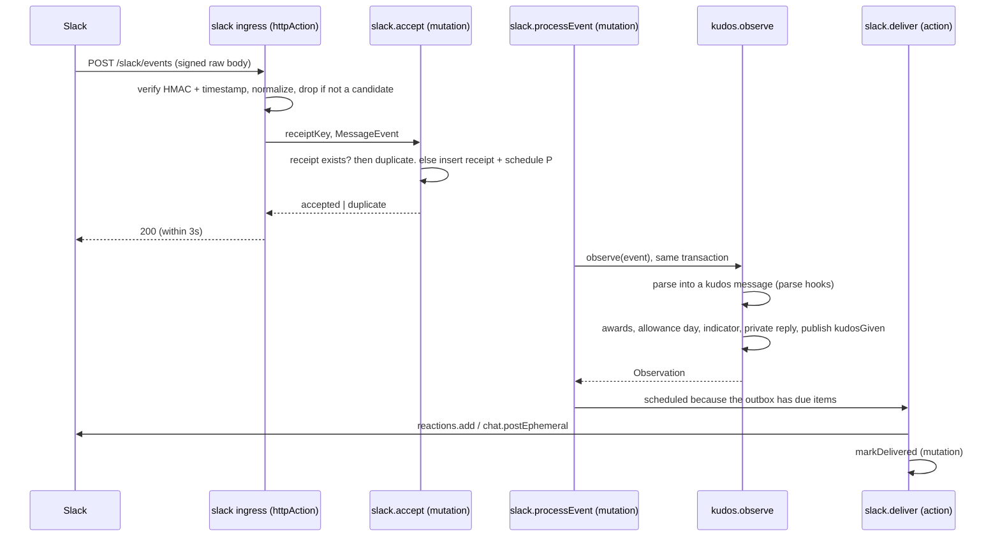
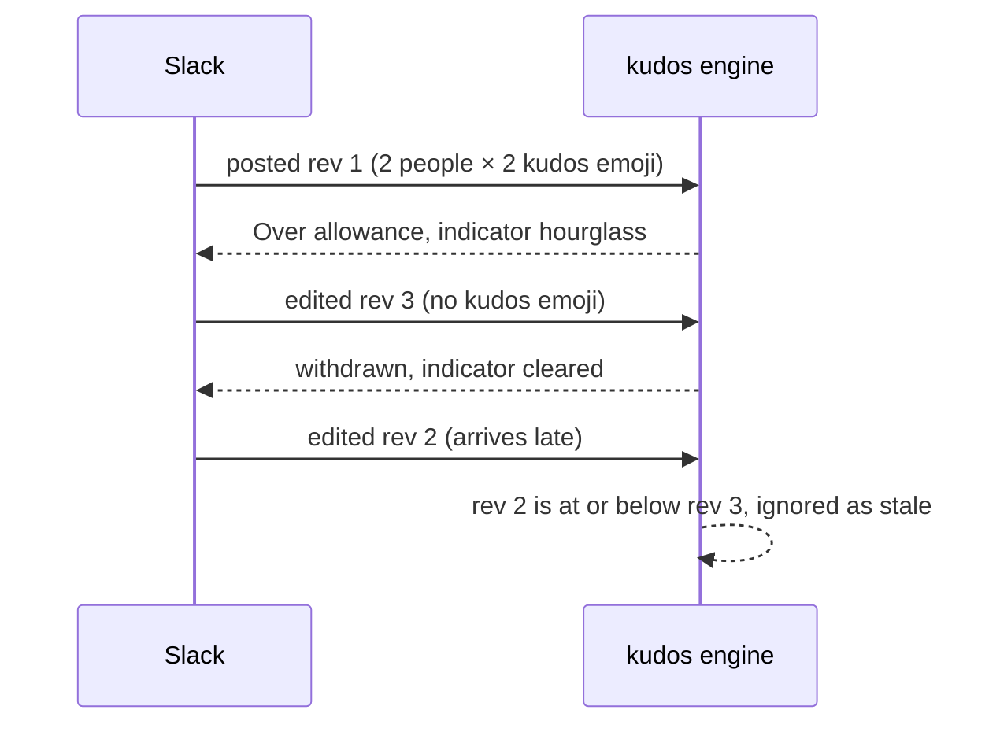
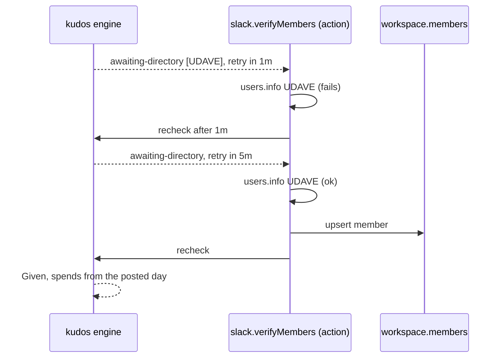
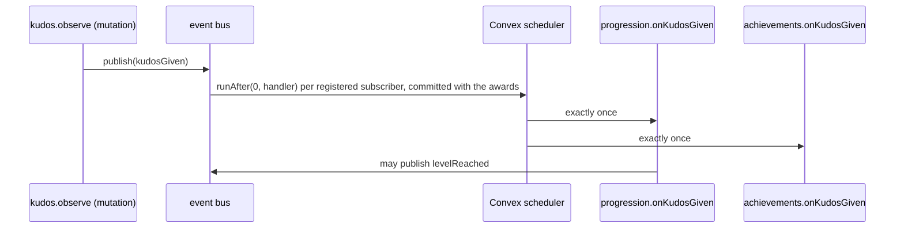

# Architecture brief: the module map and its seams

> **PROTOTYPE. Throwaway branch `prototype/architecture`, never merged.** Ticket [#11](https://github.com/Silthus/kudos/issues/11) on map [#1](https://github.com/Silthus/kudos/issues/1). The stub code next to this file (`prototype/architecture/`) exists only to settle seams. Run it with `node prototype/architecture/scenarios.ts` (Node 24, no build); its output is checked in as [`scenarios.out.txt`](architecture/scenarios.out.txt).

## 1. Question

What is the module map of the new Kudos backend, and what are the contracts at its seams? The destination is a production Convex deployment wired to a new Slack app that covers the core loop, progression (XP, levels, unlockable messages, achievements) and a team leaderboard with a Slack-only profile. Only the Slack adapter may know Slack, so another chat platform could replace it.

This brief answers it greenfield: there is no backend code on `main` yet. Its grounding is the four research reports and the rules settled in the [#8 handoff](https://github.com/Silthus/kudos/issues/8). It proves the eight seam follow-ups from #8 with runnable scenarios (§9), settles where Sign in with Slack goes, maps the three specs onto modules (§11), and proposes how the core loop spec [#12](https://github.com/Silthus/kudos/issues/12) slices into implementation tickets (§12). Progression internals stay open while the [#9](https://github.com/Silthus/kudos/issues/9) grilling runs. Only the event the kudos engine publishes when kudos are given, and the hooks progression plugs into, are shaped here.

**How to read it:** §2 (map) and §7 (decision cards) are the core. §3 to §6 hold the detail behind the cards. §13 battle-tests the design against every game idea from the progression grilling.

**Round log**
- **Round 1 feedback (Michael):** make it event-driven. The engine issues events, and other modules subscribe or hook in, so the engine never knows who listens. Now locked as L8. It adds the event bus and hook points (§2, §3.3, `events.ts`), scenarios 13 and 14, and three new cards: D12 (how the bus delivers), D13 (where a plug-in may shape a decision) and D14 (which events spec 1 publishes).
- **Round 1 feedback (Michael), second message:** add a parser that turns the message into a kudos message before the engine processes it, with parse hooks that add-ons can register (for example special unlocked emoji), so a later Jev decision engine that judges how mindful a kudos message is can add XP without tight coupling. Now locked as L9. It adds the kudos parser (§3.2, `parser.ts`), scenarios 14 and 15, and two new cards: D15 (two hooks claim the same emoji) and D16 (how a later mindfulness assessor reads the note). L4 and L6 changed with it.
- **Round 2 (Michael): battle-test it against the game ideas** from the progression grilling (#9 thread, rounds 1–4, and its Octalysis research). Verdict: the design holds, with six extensions (§13). It adds allowance pools (daily plus weekly, in `engine.ts`), allowance facts on `kudosGiven`, a progression reducer sketch (`progression-sketch.ts`), a simulation (`simulate.ts`), cards D17–D21, lock L10, and a new lean on D16.

## 2. Module map



Legend: blue = spec 1 (core loop), amber = spec 2 (progression), green = spec 3 (leaderboard and profile). A solid arrow is a direct call inside one Convex transaction. A dotted arrow is a **domain event** delivered by the bus to every module that subscribed in the registry (L8). The kudos engine imports the bus and nothing downstream of it.

| Module | Folder | Owns (Convex tables) | Interface (all `internal` except HTTP routes) |
| --- | --- | --- | --- |
| Slack adapter | `convex/slack/` | `slackReceipts`, delivery state, installation (card D9) | HTTP routes; `processEvent`, `verifyMembers`, `deliver` |
| workspace | `convex/workspace/` | `workspaces` (settings), `members` (directory) | `settingsOf`, `lookupMember`, `upsertMember` |
| kudos engine | `convex/kudos/` | `kudosMessages`, `awards`, `allowanceDays` | `observe(MessageEvent)`, `recheck(MessageRef)`, `allowanceLeft(member)` |
| feedback outbox | `convex/feedback/` | `indicators`, `privateReplies` | `setIndicator`, `replyPrivately`, `claimDue`, `markDelivered`, `render(Reply)` |
| kudos parser | `convex/parser/` | none | `parse(content, context) → KudosMessage \| null`; runs the registered parse hooks |
| event bus and hooks | `convex/events/` | none (D12 A); the Convex scheduler holds queued jobs | `publish(event)`; `registry.ts` wires subscribers and hook contributors |
| progression | `convex/progression/` | open until #9 | subscribes to `kudosGiven`; publishes `levelReached`; contributes to the perks hook |
| message unlocks | `convex/unlocks/` | open until #9 | may contribute parse hooks (unlocked kudos emoji) and the success-line hook (D10) |
| achievements | `convex/achievements/` | open until #9 | subscribes to `kudosGiven`, `levelReached`; may contribute to the perks hook |
| teams and leaderboard | `convex/teams/` | spec 3 | subscribes to `kudosGiven`; leaderboard queries |

## 3. Contracts at the seams

The full types are in [`architecture/contracts.ts`](architecture/contracts.ts). The engine behind them is [`architecture/engine.ts`](architecture/engine.ts).

### 3.1 Chat adapter → kudos engine

```ts
type MessageRef = { workspace: WorkspaceId; conversation: string; message: string };
type Mention = { kind: "person"; user: ChatUserId } | { kind: "group" } | { kind: "broadcast" };

type MessageEvent = {
  kind: "posted" | "edited";
  ref: MessageRef;
  threadRoot?: string;
  author: ChatUserId;
  revision: bigint;
  at: number;
  content: { mentions: Mention[]; emoji: string[]; text: string };
};

interface KudosEngine {
  observe(event: MessageEvent): Observation;
  recheck(ref: MessageRef): Observation;
}

type Observation =
  | { kind: "ignored"; why: "not-a-member" | "ordinary-chat" | "stale-revision" | "unchanged" }
  | { kind: "awaiting-directory"; users: ChatUserId[]; retryInMs: number }
  | { kind: "abandoned" }
  | { kind: "withdrawn" }
  | { kind: "already-given"; toldGiver: boolean }
  | { kind: "evaluated"; outcome: Outcome };
```

- **Invariants.** `ref` identifies the message, not the delivery. `revision` strictly increases per message (Slack: `edited.ts`, else the event `ts`, as integer microseconds). `content` holds only the countable rich text: the adapter drops code, quotes, strikethrough, attachments and forwards. It passes **every** emoji name, because only the parser knows a giver's kudos emoji. `text` is the countable prose, so parse hooks can compute facts about the note. It lives in memory for one evaluation and is never stored (L4).
- **Idempotent per revision.** A revision at or below the stored one is `ignored` and changes nothing. A message gives kudos at most once.
- **Errors.** None thrown for domain cases. `awaiting-directory` tells the caller to verify the users and call `recheck` after `retryInMs`. The engine owns the retry budget (card D6).
- **Performance.** One mutation that reads the message row, the giver's members, settings, perks and one allowance-day row, then writes at most the message row, N award rows, the allowance-day row and the outbox rows. It never calls the network.

### 3.2 Chat message → kudos message: the parser

Slack parsing has two stages. The adapter turns a Slack payload into the platform-neutral chat message above (only it knows Slack). The domain parser turns that chat message into a **kudos message**, and the engine evaluates only kudos messages. Parse hooks plug into the second stage, so an add-on never sees a Slack payload and survives a platform swap. See [`parser.ts`](architecture/parser.ts).

```ts
type ParseContext = { workspace: WorkspaceId; giver: MemberId | undefined };
type KudosMessage = {
  mentions: Mention[];
  kudosEmoji: Array<{ name: string; kudos: number }>;
  perRecipient: number;
  annotations: Record<string, string | number | boolean>;
};
type ParseHook = {
  name: string;
  kudosEmoji?(context: ParseContext): Array<{ name: string; kudos: number }>;
  annotate?(content: MessageContent, context: ParseContext): Annotations;
};
interface KudosParser { parse(content: MessageContent, context: ParseContext): KudosMessage | null }
```

- **`null` means ordinary chat.** It returns `null` when there is no mention, or when no emoji is claimed by a hook.
- **The core rule is itself a hook.** The workspace emoji is worth 1 (`workspaceEmojiHook`). Spec 2 can register a hook that makes a giver's unlocked `:star:` worth 2 (scenario 14), and the engine doesn't change.
- **Annotations are facts about the note**, for example a word count. They travel with `kudosGiven`, so a subscriber reads facts, never text (scenario 15).
- **Two hooks claiming the same emoji:** the highest value wins (D15).
- **The parser runs inside the engine's mutation**, so hooks are synchronous reads with no network calls. A message from an author the directory doesn't know yet is parsed without a giver: an unknown member can't have unlocked anything.
- **The engine stores the kudos message, not the chat message.** A recheck after a directory miss evaluates the stored kudos message, so hooks don't run twice and no text is kept.
- **Editing.** The fingerprint that tells a retry from a prose edit is computed from the kudos message (mentions plus kudos emoji), so annotations never turn a prose edit into a retry.

### 3.2b Kudos engine → workspace, perks (direct reads)

```ts
interface Directory { lookup(workspace: WorkspaceId, user: ChatUserId): MemberFacts | undefined }
type MemberFacts =
  | { kind: "member"; member: MemberId; timeZone: string | undefined }
  | { kind: "bot" }
  | { kind: "not-a-member" };

interface Settings { of(workspace: WorkspaceId): { baseAllowance: number; kudosEmoji: string } }
interface Perks { of(giver: MemberId, day: DayKey): { dailyBonus: number; weeklyBonus: number } }
```

`undefined` means unknown, not "not a member". `Perks` is a **hook**: any module can contribute, and the hook sums the daily and weekly bonuses (`combinePerks` in [`events.ts`](architecture/events.ts)). It gets the allowance day, so a perk can start "from the next local reset". The engine owns the spending: the daily pool first, then the weekly pool (D19). Spec 1 registers no contributors, so both bonuses are zero. Unlocked kudos emoji moved to parse hooks, so "what counts in a message" lives only in the parser. Settings are read when the message is evaluated, as #8 rules.

### 3.3 Domain events and hooks: the engine publishes, modules subscribe

```ts
type DomainEvent = KudosGivenEvent; // spec 2 adds LevelReachedEvent, and so on
type KudosGivenEvent = {
  type: "kudosGiven";
  workspace: WorkspaceId;
  message: MessageRef;
  giver: MemberId;
  awards: Array<{ giver: MemberId; recipient: MemberId; kudos: number }>;
  kudosEmoji: string;
  annotations: Annotations; // from parse hooks
  allowance: { dailyOpening: number; dailyLeft: number; weeklyLeft: number }; // after this award
  day: DayKey;
  at: number;
};

interface EventBus { publish(event: DomainEvent): void }

// convex/events/registry.ts: the only file that knows who listens or contributes
export const subscriptions = {
  kudosGiven: [internal.progression.events.onKudosGiven, internal.achievements.events.onKudosGiven, internal.teams.events.onKudosGiven],
  levelReached: [internal.unlocks.events.onLevelReached, internal.achievements.events.onLevelReached],
} satisfies Subscriptions;
export const perkContributors = [progressionPerks, achievementPerks] satisfies PerkContributor[];
export const parseHooks = [workspaceEmojiHook, unlockedEmojiHook, noteWordsHook] satisfies ParseHook[];
```

- **Publishers know only the bus.** The kudos engine calls `publish` and never imports progression, achievements or the leaderboard. `registry.ts` is the one place that wires subscribers. A new subscriber is one line there, and no publisher changes. Spec 1 ships the bus with an empty registry.
- **Delivery (D12).** In the recommended option, `publish` schedules each registered handler (`ctx.scheduler.runAfter(0, handler, { event })`) in the publisher's transaction. The jobs commit with the awards, and a scheduled mutation runs exactly once, so every subscriber sees each event exactly once without its own dedupe. Scenario 13 shows a failing subscriber touching neither the award nor the other subscribers. Its failed run stays visible in Convex's scheduled-functions table.
- **Events are past-tense facts.** They react after the commit and cannot change the decision. Their shape grows only by adding fields, because queued jobs keep the arguments they were scheduled with.
- **Hooks are for shaping a decision (D13).** A hook is a named, synchronous extension point inside the transaction, with a rule for combining contributions. Spec 1 has two: parse hooks and perks. Spec 2 may add a success-line hook (D10). Scenario 14 shows a perk raising the allowance and a parse hook making an unlocked emoji worth 2, and the engine knows neither of them.
- **No "kudos revoked" event.** Awards are permanent ([ADR-0001](https://github.com/Silthus/kudos/blob/main/docs/adr/0001-awards-are-permanent.md)).
- Open until #9: which annotations spec 2 needs (D11).

### 3.3b Later: a Jev decision engine that judges how mindful a kudos message is

It fits as a subscriber, not as a parse hook. A parse hook runs inside the giving transaction, and a model call there is impossible (a mutation can't call the network) and unwanted (giving would wait on a model). So:

1. The assessor subscribes to `kudosGiven` and runs as an action that calls the model.
2. It publishes `kudosAssessed { message, giver, score }`.
3. Progression subscribes to `kudosAssessed` and adds XP.

Neither the engine nor progression knows the assessor exists. The open question is how it reads the note (D16). It isn't on the map yet, so it's a follow-up for the conductor.

### 3.4 Kudos engine → feedback outbox → Slack delivery

```ts
interface Feedback {
  setIndicator(ref: MessageRef, indicator: { emoji: string } | null): void;
  replyPrivately(ref: MessageRef, threadRoot: string | undefined, to: ChatUserId, reply: Reply): void;
}
type Reply =
  | { kind: "given"; outcome: GivenOutcome; base: number }
  | { kind: "over-allowance"; outcome: OverAllowanceOutcome; base: number }
  | { kind: "invalid"; outcome: InvalidOutcome }
  | { kind: "accepted-message-edited" };
```

- **The indicator is desired state, not an operation.** One row per message holds the reaction it should carry, with a version. The delivery action reads the latest desired state and reconciles: it removes the app's other indicator reactions and adds the desired one ([`reconcile-indicator.ts`](architecture/reconcile-indicator.ts)). `already_reacted` and `no_reaction` count as success. A late or retried delivery can't leave a stale hourglass beside a kudos reaction.
- **Private replies are append-only intents** placed in the thread for a thread reply, in the channel otherwise. Their retry policy is card D3.
- **Written in the engine's mutation, delivered after it.** A failed or repeated delivery never re-enters the engine, so feedback can never award twice.
- **Copy** is rendered from `Reply` by the feedback module into text segments with member placeholders. The adapter turns placeholders into `<@U…>` (card D4).

### 3.5 Slack ingress → adapter processing

```ts
type Normalized = { receiptKey: string; event: MessageEvent | null };
function normalize(envelope: SlackEnvelope): Normalized;
```

See [`slack-normalize.ts`](architecture/slack-normalize.ts). The receipt key is `team_id/event_id`. Message identity is `(team, channel, message.ts)`. `message_changed` reads the nested `message`. `thread_broadcast` is one message with one `ts`. Bot-authored messages, DMs and deletions return `event: null`.

## 4. Flows

### 4.1 Main write path: a kudos message is posted



### 4.2 Edit-to-retry, including out-of-order revisions



### 4.3 A recipient the app can't check



After the last retry the message is `abandoned`: no reaction, no reply (#8 rule 10).

### 4.4 Kudos given → whoever subscribed



## 5. Data (spec 1 tables)

```ts
// convex/schema.ts (sketch)
workspaces: defineTable({ externalId: v.string(), baseAllowance: v.number(), kudosEmoji: v.string() })
  .index("by_externalId", ["externalId"]),
members: defineTable({
  workspace: v.id("workspaces"), chatUserId: v.string(),
  kind: v.union(v.literal("member"), v.literal("bot"), v.literal("not-a-member")),
  timeZone: v.optional(v.string()), refreshedAt: v.number(),
}).index("by_workspace_and_chatUserId", ["workspace", "chatUserId"]),

kudosMessages: defineTable({
  workspace: v.id("workspaces"), conversation: v.string(), message: v.string(),
  threadRoot: v.optional(v.string()), author: v.string(), revision: v.int64(),
  fingerprint: v.string(), parsed: v.union(kudosMessageValidator, v.null()), spendsAt: v.number(), verifyTries: v.number(),
  state: v.union(/* watermark | awaiting-directory | abandoned | given | over-allowance | invalid | withdrawn */),
}).index("by_message", ["workspace", "conversation", "message"]),
awards: defineTable({
  workspace: v.id("workspaces"), kudosMessage: v.id("kudosMessages"),
  giver: v.id("members"), recipient: v.id("members"), kudos: v.number(), day: v.string(), at: v.number(),
}).index("by_recipient", ["recipient", "at"]).index("by_giver", ["giver", "at"]),
allowanceDays: defineTable({ giver: v.id("members"), day: v.string(), spent: v.number() })
  .index("by_giver_and_day", ["giver", "day"]),

indicators: defineTable({ kudosMessage: v.id("kudosMessages"), emoji: v.union(v.string(), v.null()), version: v.number(), deliveredVersion: v.number() }),
privateReplies: defineTable({ kudosMessage: v.id("kudosMessages"), to: v.string(), reply: replyValidator, tries: v.number(), state: deliveryState }),

slackReceipts: defineTable({ key: v.string(), receivedAt: v.number() }).index("by_key", ["key"]),
```

- `parsed` holds the kudos message: mention IDs, kudos emoji with their values, and annotations, never message text. A `watermark` row is a tiny tombstone that makes "newest revision wins" hold when an edit arrives before its original or removes the emoji.
- Award rows are immutable and only ever inserted (ADR-0001). There is no migration: this is the first schema.
- Receipts are deleted by a daily cron after 7 days. That is safe because the engine's revision check, not the receipt, is what prevents a second award.

## 6. Caching and performance

- **Hot path:** every message in every channel the app is in reaches the httpAction. The httpAction drops a new message with no mention or no emoji before any mutation. Every `message_changed` passes, because an edit that removes the emoji withdraws an attempt.
- **Acknowledgment:** verify (Web Crypto HMAC), normalize (pure), then one small mutation (indexed receipt read, insert, schedule). It still needs a measurement against a deployed backend in the sandbox.
- **Members are a cache** of Slack's directory, refreshed by `team_join`/`user_change` and on a miss through `users.info`. A miss parks the message (card D2). The cache also holds the giver's time zone for the allowance day.
- **Contention:** the only shared row in a decision is the giver's `allowanceDays` row, so OCC conflicts happen only between one giver's own concurrent messages. Convex serializes them, and the second one sees the first's spend (the "last kudos" race).
- **Outbound:** reactions are Tier 3 (50+/min per workspace), ephemerals Tier 4. Delivery honours `Retry-After` per workspace and method. Expected load is a team's chat volume, far below the 30,000 events per hour Slack allows per workspace, unless the app joins every public channel (card D7).
- No other caching is needed in spec 1. The leaderboard's totals are a spec 3 decision (aggregate component or a totals table fed by `kudosGiven`).

## 7. Decision cards

### Open: round 1

Every card below is independent of the others. Answer with the card's id and an option, or "rec" to take the recommendation. D1 is locked as L8 after round 1 feedback.

**D12. How does the bus deliver an event?** (new in round 1)
- **A. Fan-out on publish.** `publish` reads the registry and schedules each handler in the publisher's transaction. No table. A failed run shows in Convex's scheduled-functions table and is re-run by hand. *Battle test:* a subscriber that calls the network (the Jev assessor, a Slack read) is an action, and Convex runs a scheduled action at most once. So under A, action subscribers run through a retrying runner (the Workpool component), and mutation subscribers stay plain.
- B. A durable event log. `publish` appends to an `events` table and schedules a dispatcher that records delivery per subscriber. You get an audit trail, replay, backfill for a new subscriber and automatic retry, at the cost of a table, a dispatcher and delivery bookkeeping.
- C. A Workpool component per subscriber. Retries and concurrency limits come built in, for one more dependency.
- **Recommendation: A.** The awards table is already a permanent log, so a later subscriber (the leaderboard in spec 3) backfills from it. Move to B when a second reason for replay appears. `publish` looks the same under A and B, so switching later touches only the bus.

**D13. Where may a plug-in shape a decision, not just react to it?** (new in round 1)
- **A. Events plus named hooks.** Async events for reacting, and a few synchronous hooks inside the transaction where modules contribute to a decision: parse hooks and perks now, perhaps the success line in spec 2. Each hook has a combine rule.
- B. Events only. Progression's subscriber writes bonuses and unlocked emoji to a table, and the engine reads it. One mechanism, but the engine depends on that table, and it lags one event behind.
- C. Generic lifecycle hooks (before and after evaluation, before a reply) that any module can intercept. The most flexible, but the order between plug-ins starts to matter, and the result is hard to reason about and test.
- **Recommendation: A.**

**D14. Which events does spec 1 publish?** (new in round 1)
- **A. Only `kudosGiven`**, the one event with a known subscriber. Adding another later is a type in the union plus a registry line.
- B. The whole attempt lifecycle: message observed, attempt evaluated (all three outcomes), retried, withdrawn, kudos given. Ready for achievements such as "first time over allowance", but unused until someone subscribes.
- **Recommendation: A.**


**D15. Two parse hooks claim the same emoji. Which value counts?** (new in round 1)
- **A. The highest value.** An unlock can only make an emoji worth more, never less, and the order of registration doesn't matter.
- B. The first registered hook wins. Predictable, but the registry's order becomes a rule.
- C. The values add up. Two plug-ins can stack, and an emoji's worth can grow by accident.
- **Recommendation: A.**

**D2. Where are recipients checked?**
- **A. A members table in the domain.** The engine reads it and parks the message as `awaiting-directory` on a miss. A Slack action verifies and calls `recheck`. Every decision stays in a mutation, tests need no network, and #8's retry rule lives in the engine.
- B. Resolve first, in an action. The adapter calls `users.info` for every mention, then calls the engine. Fewer moving parts per message, but each message waits on Slack and scheduled actions run at most once, so we write our own retries anyway.
- **Recommendation: A.**

**D3. How are private replies retried?**
- **A. At least once, bounded.** Retry a reply up to 3 times on any failure, including a timeout whose result is unknown, honouring `Retry-After`. Worst case is a duplicate ephemeral that only the giver sees and that disappears.
- B. At most once. Never retry after an unknown result. Worst case is a giver with a reaction but no line telling them what's left.
- **Recommendation: A.** Reactions are idempotent and always retried, whichever you pick.

**D4. Who owns the reply copy?**
- **A. The domain feedback module.** It renders `Reply` into segments with member placeholders, and the adapter formats mentions. The copy is tested without Slack and survives a platform swap, and unlockable success lines (spec 2) plug in there.
- B. The Slack adapter. The copy sits next to Slack formatting, but it would be duplicated for a second platform.
- **Recommendation: A.**

**D5. Which day pays when the first event seen for a message is an edit?** #8 says a post pays from the posted day and a retry from the edit day. When the edit arrives before its original (or the original never arrives), we can't tell whether it was a retry.
- **A. The edit day.** Every evaluation started by an edit pays from the edit's day. One rule, and it matches the usual case (an edit that adds the emoji).
- B. The posted day (`message.ts`) when nothing was evaluated before. Right for a prose edit that overtook its original, wrong for a real retry.
- **Recommendation: A.** It only matters when the edit and the post fall on different days and arrive out of order.

**D6. How long do we retry a recipient the app can't check?**
- **A. 5 checks at 1 min, 5 min, 30 min, 2 h and 6 h** (about 8.5 h), then abandon silently.
- B. 3 checks within the first hour. A failure shows up sooner, but a Slack incident longer than an hour loses the kudos message.
- C. Until midnight of the posted day in the giver's time zone. Ties the budget to the allowance day, but the window varies from minutes to a full day.
- **Recommendation: A.** It outlasts most Slack incidents, and the message still pays from its posted day.

**D7. How do we get the app into channels?** A bot gets no events from a channel it isn't in, so the app can't see a kudos attempt there and can't reply to it. "Tell them to invite it" is only possible before or after the fact.
- A. Auto-join every public channel: `channels:join` on install and on `channel_created`. Public channels just work. Private channels still need `/invite`. Every public message reaches the backend, each join posts a system line, and a big workspace can approach the event limit.
- **B. Opt in per channel with `/kudos`.** A slash command works in channels the app isn't in. In a public channel it joins (`channels:join`). In a private channel it replies privately with `/invite @Kudos`. App Home onboarding explains it. Slack's own "add them?" prompt when someone @-mentions the app comes for free.
- C. No code: document `/invite` and rely on Slack's prompt.
- **Recommendation: B.** It is the closest to "tell them to invite it" the platform allows, with no surprise joins. Pick A if coverage of every public channel matters more than control.

**D8. Sign in with Slack in a Slack-only backend.**
- **A. Keep the door open, wire nothing.** Nothing in this map consumes a signed-in session: Slack signs every request and carries the user, and admin checks use the Slack user's role. Members are keyed by `(workspace, Slack user ID)`, which are exactly the OIDC claims `https://slack.com/team_id` and `https://slack.com/user_id`, so a later login maps onto a member with no migration. Sign in with Slack stays the chosen auth for any future web surface.
- B. Wire Convex Auth with the Auth.js Slack OIDC provider now. Convex doesn't support that provider, Convex Auth is beta, and no screen would use the session.
- C. Hand-roll OIDC in an httpAction. Full control, but security-sensitive code with no consumer.
- **Recommendation: A.** It removes the fog from the map without code.

**D9. Sandbox first, then the real workspace: how are installs modelled?**
- **A. Two single-workspace Slack apps from one manifest template**, each pointed at its own Convex deployment (sandbox at a staging deployment, real at production). The bot token and signing secret live in that deployment's environment. No OAuth install flow and no installations table. Every row still carries its workspace.
- B. One distributed app with an OAuth install per workspace, one Events URL and an installations table holding a token per workspace, on one production deployment. Real multi-tenancy, but sandbox traffic and data share production.
- **Recommendation: A.** It is the smallest setup that keeps sandbox data out of production. B becomes a later ticket only if more workspaces should install Kudos.

### Open: round 2 (from the battle test, §13)

**D17. How do button clicks and commands reach a module?** Perk purchases, active perks, quip choices, settings and later the store are all Slack interactions, but only the adapter may know Slack.
- **A. A command registry, mirroring the event registry.** The adapter verifies the request (`/slack/interactivity`, `/slack/commands`), turns it into a platform-neutral command such as `{ type: "buyPerk", member, perk }`, adds an idempotency key from the request, and the registry routes it to the owning module's internal mutation. The module returns a result, and the adapter renders it (update the DM, an ephemeral, or refresh App Home).
- B. Each module ships its own Slack handlers. Fewer layers, but Slack leaks into every domain module and breaks the adapter seam.
- **Recommendation: A.**

**D18. Several modules want to say something under the same kudos message** (a quip, a level up, an achievement). The research asks for one reply per kudos message.
- **A. One public reply per kudos message, as desired state.** Each module writes its section into the feedback module. Delivery posts the reply and later edits it (`chat.update`) as more sections arrive, like the indicator (L3). The admin's announcement channel and the members' mute and hide choices are routing rules inside the feedback module.
- B. Each module posts its own reply. Simple, but noisy.
- C. Wait a fixed window, then post once. Fewer edits, but every quip arrives late.
- **Recommendation: A.**

**D19. Weekly bonus kudos ("overshield")**: your idea from #9 round 4. Bonus kudos per week, spent once the daily allowance is used up. This **changes a #8 rule**: the daily allowance stops being the only budget, and the copy has to show both.
- **A. Two pools owned by the engine.** The daily pool resets at local midnight. The weekly pool resets on the giver's local Monday. A kudos message is paid from the daily pool first, then the weekly pool. Plug-ins only contribute pool sizes through the perks hook. One message can draw from both pools (scenario: `simulate.ts`, the maximiser).
- B. No weekly pool. Bonuses only ever raise the daily allowance.
- **Recommendation: A, recorded as a change to #8**, if you confirm the overshield idea.

**D20. Which "day" do progression rules use?** The research says the time the award was evaluated. The engine has its own day: the allowance day (the posted day, the edit day for a retry, the posted day after a late recipient check).
- **A. The `day` on `kudosGiven`**, so streaks, "first kudos of the day", Weekly Rhythm and the allowance agree on one calendar.
- B. The evaluation time. It differs from the allowance day for late checks and messages near midnight.
- **Recommendation: A.**

**D21. How is progression built?**
- **A. As a pure reducer over domain events**, `(state, event, catalogue, random) → (state, events)`, wrapped by thin Convex subscribers. The same code then runs in tests, in retroactive achievement replay and in a balancing simulation that drives the real engine with no Slack (`progression-sketch.ts`, `simulate.ts`).
- B. Rules written directly inside Convex mutations. Less structure, but simulation and replay need a second implementation.
- **Recommendation: A.** Your "simulate it to balance it" request in #9 gets production code instead of a spreadsheet.

### Open: waits on the progression grilling (#9)

**D10. How does an unlockable message (quip) reach people?** #9 round 2 made quips public, as a thread reply under the kudos message.
- A. A success-line hook inside the award's mutation that puts the quip into the giver's private reply. This was the round 1 idea, and #9 overtook it.
- **B. Quips subscribe to `kudosGiven` and add their section to the one public reply (D18).** No synchronous hook is needed, and the success reply stays as #8 wrote it.
- Leaning B after the battle test. Decided with #9.

**D11. Which annotations does spec 2 need?** The mechanism is settled (parse hooks annotate, and `kudosGiven` carries the annotations). Only the content depends on whether XP rewards the note (word count, story length).

### Open: waits on the mindfulness assessor (a later feature)

**D16. How does the Jev decision engine read the note?** The text is never stored (L4), but a model needs it.
- A. `kudosGiven` carries the text. It sits only in the queued job's arguments, which Convex keeps for a while after the run. Simplest, but every subscriber receives the text.
- B. The assessor asks the Slack adapter for the message text when it runs (a "read message" port, `conversations.history`). No text stored on our side, at the cost of a Slack call per kudos message and one more adapter capability.
- C. Store notes with a retention window. Re-assessment becomes possible, but the data needs deletion when someone leaves.
- ~~Leaning B.~~ **Now leaning A, narrowed**: the battle test shows that B has a loophole. Under B, a giver could get a kudos message accepted, then edit it into something thoughtful before the assessor reads it. The judgment must see the accepted revision. So the note travels with the event, and the bus hands it only to subscribers that declare they need it (the assessor), never to the others. Decide on the assessor's ticket.

### Locked (reopen any of them)

- **L1. Only HTTP routes are public; every domain function is `internal`.** Reason: Convex research (#7); a signed Slack request is the only caller.
- **L2. Receipts dedupe deliveries; the revision check dedupes attempts.** Reason: #8 follow-up, Slack's separate `event_id` and `message.ts` identities. Proven in scenario 2.
- **L3. The indicator is delivered as desired state.** Reason: an add/remove queue can leave a stale hourglass after a retry; desired state can't (scenarios 3 and 11).
- **L4. Message text is never stored.** It crosses the adapter seam in memory so parse hooks can annotate, then it is dropped. Reason: nothing downstream needs the text itself, and it keeps data deletion and the public repo simple. (Changed in round 1: the text used to stop at the adapter.)
- **L5. Deletions are dropped at the adapter.** Reason: ADR-0001. One consequence: a message deleted while it waits for a recipient check still gives when the check succeeds.
- **L6. Perks come from a hook that sums allowance bonuses. Spec 1 registers no contributors.** Reason: #8 fixes the allowance at base + unlocked bonus. Unlocked kudos emoji are parse hooks (L9). (Changed in round 1.)
- **L8. Modules talk through domain events: the engine publishes to a bus, and modules subscribe through one registry.** The engine knows no subscriber. Michael, round 1 (replaces the old D1).
- **L10. A module that needs another module's derived state subscribes to that module's event, and never recomputes the state from the original event.** For example, achievements read streaks from progression's `streakExtended`, not from `kudosGiven`. Reason: subscribers to one event run in parallel and can't see each other's writes (found in the battle test, §13).
- **L9. A domain kudos parser with parse hooks sits between the adapter and the engine.** The adapter turns Slack into a chat message, the parser turns it into a kudos message, and the engine evaluates only kudos messages. Michael, round 1.
- **L7. Tests run outside-in at three seams with `convex-test`:** signed requests through `t.fetch('/slack/events')`, the engine's internal mutations with a seeded members table, and delivery with a stubbed global `fetch`. Reason: Convex research (#7).

## 8. Blast radius

- **Nothing existing can break.** `main` has no backend yet.
- **Assumptions that need a live Slack check in the sandbox** (they become acceptance checks on the implementation tickets):
  - A `thread_broadcast` arrives as one event, not as a thread event plus a channel event.
  - `message_changed` for a thread parent's reply metadata and for language detection has no `edited` block.
  - Struck-through and code-styled emoji carry `style` flags in rich text.
  - Web Crypto HMAC verifies in a deployed httpAction, and the acknowledgment stays under 3 s.
  - An ephemeral in a thread reaches the giver when the thread is not open.
- **Who notices a failure:** a giver who sees no reaction. The awards stay correct, because feedback is separate from them.
- **Out of scope:** a web UI, a second chat platform, group super kudos, giving by user reaction, migrating kudos-garden data.

## 9. The #8 follow-ups, proven

Each scenario sends Slack-shaped envelopes through `normalize` into the engine and prints the full state ([output](architecture/scenarios.out.txt)).

| #8 follow-up | Scenario | What it shows |
| --- | --- | --- |
| Delivery receipts deduped apart from attempts | 2 | A repeated `event_id` stops at the receipt; the same revision under a new id stops at the engine; one award |
| Newest revision wins, edit before original, late older revision | 4, 5 | The original after its edit is stale; a late retry after a withdrawal is ignored |
| Prose- and metadata-only edits ignored | 6, 7 | The fingerprint (mentions + kudos emoji) is unchanged, so nothing happens |
| Bounded retries for an unverifiable recipient | 9, 10 | Waits, then gives on the posted day; abandoned after 5 checks with no reply |
| Feedback failing after an award never awards twice | 11 | Delivery throws and is retried; one award, one reaction |
| Reaction swap on retry | 3 | Hourglass, then the kudos reaction after the retry by edit |
| A thread reply also sent to the channel counts once | 8 | One message, one award, feedback in the thread; the parent's metadata edit is ignored |
| Prompting an invite | card D7 | Not observable from Slack, so it is a product choice |
| Sign in with Slack | card D8 | |

| A failing subscriber is isolated (round 1) | 13 | Achievements throws; the award and the other subscribers are unaffected |
| Plug-ins (round 1) | 14 | A perk gives allowance 3 + 1; a parse hook makes Alice's unlocked `:star:` worth 2 (3 kudos to Bob); Bob hasn't unlocked it, so his `:star:` is ordinary chat |
| Annotations, no stored text (round 1) | 15 | A word-count hook annotates the note; the subscriber sees `noteWords: 7`; the stored records contain no text |

Scenarios 1 and 12 add skipped mentions (self, bot, broadcast, external) and struck-through emoji.

## 10. New words this brief uses

Not in `lexicon.json` yet. They are settled through Coherence in the first implementation ticket that uses them: **revision** (one version of a message, ordered), **indicator** (the reaction showing an attempt's outcome), **directory** (the members table as a cache of the chat platform's users), **domain event** (a past-tense fact one module publishes and any module can subscribe to), **hook** (a synchronous extension point where modules contribute to a decision), **parse hook** (a hook that decides which emoji give kudos and annotates the note), **annotation** (a fact about the note that travels with `kudosGiven`).

## 11. The three specs on the modules

| Spec | Modules it builds | Seams it adds or fills |
| --- | --- | --- |
| 1. Core loop on Slack, in production | Slack ingress, normalize, directory sync, delivery; workspace; kudos engine; feedback outbox; receipts cron; manifest and deploy | `MessageEvent`, `Observation`, `Directory`, `Settings`, `Feedback`; the kudos parser with the workspace emoji hook; the event bus with `kudosGiven` and no subscribers; the perks hook with no contributors |
| 2. Progression | progression, unlocks, achievements | Registers subscribers, perk contributors and parse hooks (unlocked emoji, annotations); publishes `levelReached`; may add the success-line hook (D10) |
| 3. Leaderboard and Slack profile | teams (Slack user groups through the adapter's directory sync), leaderboard queries, App Home and `/kudos` | Subscribes to `kudosGiven` or reads `awards`; profile reads from kudos, progression and teams |

## 12. Proposed slicing of the core loop spec (#12)

Each slice is a vertical, deployable pull request, tested outside-in. The order is a dependency chain unless a slice says otherwise.

1. **Walking skeleton.** Add Convex and `convex-test`. Add `/slack/events` with signature check, `url_verification`, receipt and schedule, and a processing step that does nothing yet. Carries the bootstrap's Coherence follow-ups: the entry spec with trust levels, the httpAction entrance declared by hand, `convex/_generated` ignored. Deploys to the sandbox deployment.
2. **The first kudos.** Normalize posted messages; the kudos parser with the workspace emoji hook; workspace settings with defaults; the members directory filled by `users.info`; `observe` for posts with the Given outcome, allowance day in the giver's time zone, awards; the indicator and its delivery.
3. **Saying no.** Over allowance and Invalid, skipped mentions, and every private reply with the #8 copy (D4).
4. **Edit-to-retry.** `message_changed`, revisions and watermarks, retry, withdrawal, the accepted-message reply, the indicator swap.
5. **Recipients the app can't check.** `awaiting-directory`, the retry ladder (D6), directory refresh from `team_join` and `user_change`.
6. **Delivery you can trust.** Rate limits and `Retry-After`, the reply retry policy (D3), receipt cleanup. Can run in parallel with 4 and 5.
7. **Getting into channels.** The invite flow chosen in D7.
8. **Go-live.** The manifest template and the two apps (D9), the production deploy pipeline, the real-workspace install. This is the spec's `ship` ticket.

Settings mid-day (the base drops below what was given, or the emoji changes) falls out of "settings in force at evaluation" and "never below 0". Slice 3 tests it.

## 13. Battle test: the game ideas from the progression grilling

Every mechanic proposed in the #9 thread (rounds 1–4 and its Octalysis research) is listed below, with the seam that carries it. The economy simulation and cosmetics research started in #9 round 4 hadn't reported when this ran, so their results aren't covered. **Holds** means no new seam. **Extends** names the extension (E1–E6) it needed. Nothing **breaks**: no mechanic forces the engine to know a game module.

| Mechanic (#9 source) | Carried by | Verdict |
| --- | --- | --- |
| Base XP 10 per kudos given, 5 received (R1) | progression subscribes to `kudosGiven` | Holds |
| Level curve, quick first win, skill point per level (R2) | progression state; publishes `levelReached` | Holds |
| Perks bought with skill points, level gates, prerequisites, no respec (R2, R4) | progression state; purchase is a command | Extends: E1 |
| First Spark, Steady Flame, Three Cheers, Open Circle, Weekly Rhythm (R4) | progression reduces `kudosGiven` against its own per-day facts | Holds; needs one calendar (D20) |
| Bonus XP and drops count only your first kudos to each person per day, max 3 (R4) | progression, inside the reducer | Holds |
| "Only thoughtful kudos activate perks and bonus XP" via a Jev judgment (R4) | assessor subscribes to `kudosGiven` and publishes `kudosAssessed`; progression pays base XP now and bonuses on assessment | Extends: E4 (action subscribers), D16 |
| Extra Mile +1 daily allowance, from the next reset (R4) | perks hook with the allowance day | Extends: E2 |
| Weekly bonus kudos, spent after the daily ("overshield") (R4) | engine-owned weekly pool | Extends: E2; changes #8 (D19) |
| Team perk: one extra kudos per teammate per week (R4) | teams contributes to the weekly pool through the perks hook | Holds after E2; needs teams |
| Unlockable kudos emoji, curated plus admin custom emoji, achievement emoji (R1, R2) | parse hooks from progression and achievements | Holds (scenario 14); collisions D15 |
| Quips with five WoW rarities, stable IDs, chosen in App Home (R2, R4) | a quips module; choices are commands | Extends: E1 |
| Quip shown publicly under the kudos message (R2) | quips subscribes to `kudosGiven` and adds a section to the public reply | Extends: E3 (D18); replaces D10's hook idea |
| Choose a quip per kudos message from an ephemeral menu (R2, parked) | interaction command updates that message's reply section | Holds after E1 and E3 |
| Luck perks with WoW-style rising chance after each miss (R4) | progression or quips reducer; the draw is stored in the same exactly-once mutation, so a retry never rerolls | Holds (`simulate.ts` uses a rising-chance table) |
| Grand Finale: a legendary chance on the day you use your whole allowance (R4) | needs the allowance facts | Extends: E5 |
| Active perks: Spotlight, workspace Rally, team-wide multipliers (R4) | activation is a command; effects apply in progression's reducer; expiry is computed from timestamps | Holds after E1; team-wide needs teams |
| Streaks over member workdays, free pauses, best streak, no reminders (R4) | progression state; breaks are computed lazily on the next give or read, so no cron | Holds |
| Streak freezes, boosters, cosmetics, a kudos coins store (R2, R4, later) | wallet, store and inventory modules; a purchase is one mutation that debits and grants; boosters activate through progression's command | Holds as new modules. Out of the map's scope (see below) |
| 9 achievement ladders × 4 tiers, streak ladder, retroactive on new ladders (R4) | achievements subscribes to `kudosGiven` and progression's events; replays awards through the kudos module's query | Extends: E6 (L10) |
| "All in": use your whole daily allowance | needs the allowance facts | Extends: E5 |
| DM plus a public notice, admin announcement channel, members can mute and hide (R2, R4) | the feedback module as a shared notification service | Extends: E3 |
| Unlockable stickers or GIFs (R4 idea) | an image segment in reply sections; Slack shows images, it has no stickers | Holds after E3 |
| Group super kudos (map, later) | a new adapter event (clicks on the app's own reaction) into a new engine entry; publishes `superKudosReached` | Holds |
| A balancing simulation (R4) | the progression reducer runs outside Convex | Extends: E6 (D21) |

### The extensions

- **E1. A command registry for interactions** (D17). It is the twin of the event registry, so the adapter stays the only Slack code.
- **E2. Allowance pools** (D19), shown in `engine.ts`. The daily and weekly pools are both owned by the engine and spent in one transaction. The perks hook now takes the allowance day and returns `{ dailyBonus, weeklyBonus }`.
- **E3. Feedback becomes a shared notification service** (D18). It covers DMs, one public reply per kudos message as desired state with sections from many modules, the announcement channel, mute and hide, and image segments.
- **E4. Subscribers that call the network run through a retrying runner** (D12, Workpool). The note goes only to subscribers that declare they need it (D16).
- **E5. `kudosGiven` carries allowance facts** (opening daily allowance, daily and weekly left), shown in `contracts.ts`. The change is additive and safe for queued jobs.
- **E6. Derived events and a pure progression reducer** (L10, D21). Progression publishes what it derives (`levelReached`, `streakExtended`, `quipDropped`). Achievements and quips subscribe to those, and the reducer runs the same in Convex, tests, replay and simulation.

### What the simulation shows (`node prototype/architecture/simulate.ts`)

It runs four workweeks through the real engine, parser, bus and progression reducer, entering at the platform-neutral seam with no Slack. A note-word parse hook stands in for the Jev assessor ([output](architecture/simulate.out.txt)).

| Archetype | Kudos given | XP | Bonus XP | Level |
| --- | ---: | ---: | ---: | ---: |
| Thoughtful daily giver (3 people a day, real notes) | 60 | 707 | 107 | 5 |
| Allowance maximiser ("ty", buys the weekly pool) | 66 | 660 | 0 | 5 |
| Twice-a-week giver | 8 | 80 | 0 | 2 |

The architecture finding: every mechanic composed through hooks and events, and once the maximiser bought the weekly-pool perk (in week 2), it paid out exactly 2 extra kudos a week. A **balancing signal for #9**, not decided here: gating only the bonus on thoughtfulness still leaves the maximiser at 93% of the thoughtful giver's XP, because base XP dominates. If thoughtfulness should matter more, it has to touch base XP or the bonuses have to be bigger. That is #9's call.

### Scope flags for the conductor

- The store, coins, cosmetics and quests are "Out of scope" on map #1, but #9 is now designing coins. The #9 worker flagged the same conflict. This brief only shows they fit as new modules.
- The Jev assessor isn't on the map.

