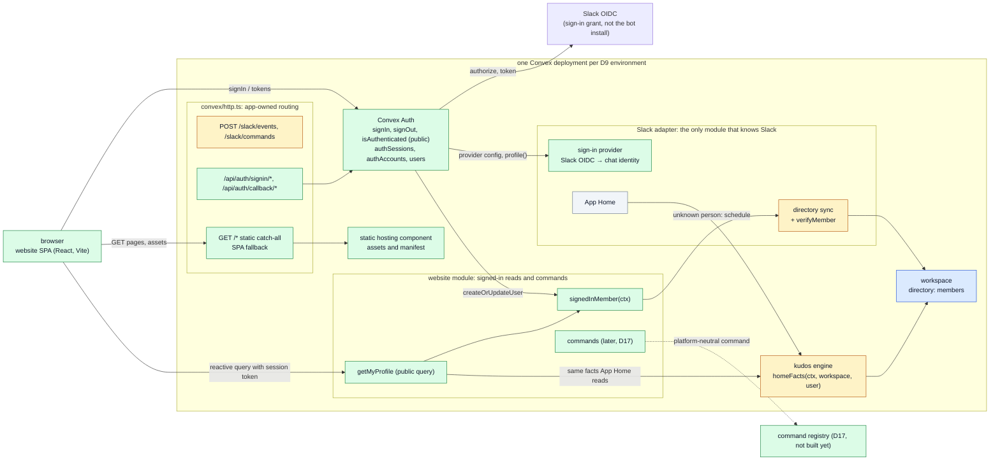
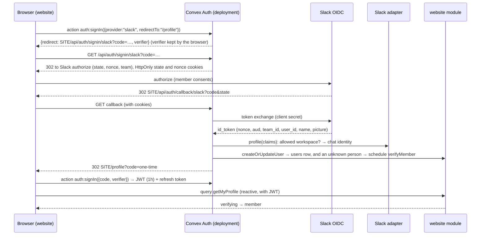
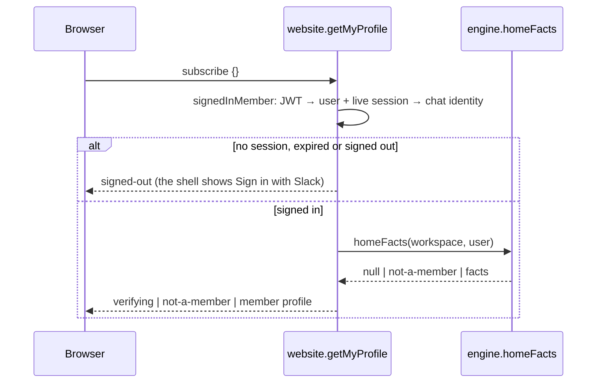

# Architecture brief: how the website signs in, reads and acts

**PROTOTYPE, throwaway branch `prototype/website-architecture`.** It never merges to `main`. Ticket [#64](https://github.com/Silthus/kudos/issues/64) on website map [#57](https://github.com/Silthus/kudos/issues/57). This branch is built on the core loop (`origin/spec/core-loop`), because `main` has no backend yet.

## 1. Question

How is the website shaped, before its first spec (#65)? Members of one workspace sign in with Slack and see their own Kudos in a browser. The backend so far has one caller, Slack, and every domain function is `internal` (architecture L1, core loop R50). The website adds a second caller: a browser. This brief settles where the website lives, which functions become public and how each one checks the signed-in member, how a Slack sign-in becomes a member (D8), how pages read facts without recomputing them (R46), how actions reach the command registry (D17), which profile fields and deep links map #1 must add, and which deployment serves which website (D9).

**The riskiest claim is proven on a disposable local backend.** Convex Auth with the Auth.js Slack provider runs the real OIDC handshake end to end against a mock Slack issuer: **26 of 26 checks pass** ([proof](website-architecture/proof-2026-10-13.txt)). A live Slack round trip still needs a Slack app with a redirect URL (card W11).

### How to read this brief

- §2 is the change map, §3 the contracts at each seam, and §4 the flows.
- §7 holds the decision cards: open cards first, then locked cards with their reasons.
- §9 lists what map #1 must change, and §10 proposes the first-slice spec's tickets.
- The stub code is real and runs. `pnpm test` passes (200 tests), and §11 says how to rerun the live proof.

## 2. Change map



Legend: green = **new**, amber = **changed** (a small refactor or one new function), blue = **extended** (new rows or fields later), grey = **untouched**.

| Module | Folder | What changes | Evidence |
| --- | --- | --- | --- |
| HTTP router | `convex/http.ts` | Auth routes and the static catch-all are registered after the Slack routes | [`http.ts:10-13`](../convex/http.ts#L10-L13) |
| Slack adapter | `convex/slack/` | Gains the sign-in provider and a `verifyMember` action | [`signIn.ts:9`](../convex/slack/signIn.ts#L9), [`directory.ts:54`](../convex/slack/directory.ts#L54) |
| website | `convex/website/` (new) | Resolves the signed-in member and serves the website's public reads | [`signedInMember.ts:8`](../convex/website/signedInMember.ts#L8), [`profile.ts:21`](../convex/website/profile.ts#L21) |
| kudos engine | `convex/engine/` | `homeOf` becomes a wrapper around a plain `homeFacts` function, so App Home and the website read one set of facts | [`home.ts:14-19`](../convex/engine/home.ts#L14-L19) |
| workspace | `convex/workspace/` | Untouched now. Display names and avatars come later (card W8) | [`directory.ts:21`](../convex/workspace/directory.ts#L21) |
| Convex Auth | `convex/auth.ts`, `convex/auth.config.ts` | New. Owns the auth tables, the sign-in routes and three public functions | [`auth.ts:5`](../convex/auth.ts#L5) |
| static hosting | `convex/convex.config.ts` | New component, mounted by the app's own router, not at `/` by the component | [`convex.config.ts`](../convex/convex.config.ts) |
| R50 test | `convex/publicSurface.test.ts` | "No public function" becomes an exact allowlist | [`publicSurface.test.ts:6-7`](../convex/publicSurface.test.ts#L6-L7) |

## 3. Contracts at the seams

### 3.1 The public surface (changes L1 and R50)

Before, from core loop R50 (`convex/internalDomain.test.ts`):

```ts
expect(publicFunctions).toEqual([]); // every Convex function is internal; only HTTP routes are public
```

After ([`publicSurface.test.ts`](../convex/publicSurface.test.ts)):

```ts
const signInLibrary = ["./auth.ts:isAuthenticated", "./auth.ts:signIn", "./auth.ts:signOut"];
const websiteReads = ["./website/profile.ts:getMyProfile"];
expect(publicFunctions.sort()).toEqual([...signInLibrary, ...websiteReads].sort());
```

- **Invariant.** The public surface is an exact list. A new public function fails the test until it is added to the list, so every new entrance is a reviewed change. Convex Auth needs `signIn` and `signOut` to be public whatever we choose, so R50 must change even with an HTTP-only website API (card W2).
- **Every website function derives its member from the session, never from arguments.** `getMyProfile` takes `{}`. A later command takes an item ID, never an actor or a workspace.
- **Static hosting adds no public function.** Its deployment-update query stays unexposed. Measured on the deployment: the public functions are exactly the four above.
- **Proposed rule text for map #1** (L1 and R50): *Only HTTP routes, Convex Auth's `signIn`, `signOut` and `isAuthenticated`, and the website's signed-in functions in `convex/website/` are public. Every website function resolves the signed-in member from the session before it reads or acts, and every other function is internal.*

### 3.2 Slack sign-in → chat identity (inside the Slack adapter)

```ts
// convex/slack/signIn.ts
export function slackSignIn(): OIDCConfig;              // Auth.js Slack provider, checks: ["state", "nonce"], scope "openid profile", team=SLACK_WORKSPACE_ID
export function signedInProfile(claims, allowedWorkspace: string): SignedInProfile; // throws for another workspace or a missing claim
export type SignedInProfile = { id: `${string}/${string}`; chatWorkspace: string; chatUser: string; name?: string; image?: string };
```

- **Only the Slack adapter knows Slack.** It reads `https://slack.com/team_id` and `https://slack.com/user_id` and hands on a platform-neutral chat identity, the same `(workspace, user)` pair the directory is keyed by (`members.by_user`).
- **Fails closed.** Another workspace, an empty claim, or an unset `SLACK_WORKSPACE_ID` throws, and the browser lands back on the website with no code.
- **Credentials** use Convex Auth's convention: `AUTH_SLACK_ID` and `AUTH_SLACK_SECRET` are that deployment's Slack app client ID and secret.

### 3.3 Session → signed-in member (the website module)

```ts
// convex/website/signedInMember.ts
export type SignedInMember = { kind: "signed-in"; workspace: string; user: string; name?: string; image?: string } | { kind: "signed-out" };
export function signedInMember(ctx: QueryCtx): Promise<SignedInMember>;

// convex/website/signIn.ts, Convex Auth's createOrUpdateUser callback
export function rememberSignedInMember(ctx, { existingUserId, profile }): Promise<Id<"users">>;
```

- **The session must still exist.** A signed-out or expired session reads `signed-out`, even while its JWT is still valid for up to an hour (proven: "after sign-out, a still-unexpired token reads signed-out").
- **Membership is checked on every read, not at sign-in.** The directory decides, and `user_change` already marks a deactivated person `not-a-member`, so leaving takes effect on the next read.
- **Accounts link only by the Slack pair**, never by email. The custom callback replaces Convex Auth's default email linking.
- **A person the directory doesn't know yet** is scheduled for the Slack adapter's `verifyMember` (users.info), and reads `verifying` until it answers (card W4).

### 3.4 Website reads → module facts

Before ([`home.ts` on core loop](https://github.com/Silthus/kudos/blob/spec/core-loop/convex/engine/home.ts)): the facts lived inside `homeOf`'s handler. After:

```ts
// convex/engine/home.ts
export const homeOf = internalQuery({ args: { workspace, user }, handler: (ctx, a) => homeFacts(ctx, a.workspace, a.user) }); // App Home, unchanged
export function homeFacts(ctx: QueryCtx, workspace: string, user: ChatUserId): Promise<HomeFacts | null>;            // the one read model

// convex/website/profile.ts
export const getMyProfile = query({ args: {}, handler: (ctx): Promise<MyProfile> => … });
export type MyProfile =
  | { kind: "signed-out" } | { kind: "verifying" } | { kind: "not-a-member" }
  | { kind: "member"; name?: string; image?: string; kudosEmoji: string;
      allowance: { left: number; base: number }; thisWeek: { given: number; received: number }; lifetime: { given: number; received: number } };
```

- **Never recomputed.** The website projects the owning module's facts. Each later page does the same with that stopping point's facts function (progression, groups), wrapped once as an internal query for App Home and once as a public website query.
- **A typed denial, never an empty profile.** No session reads `signed-out`, never zeros.
- **Reactive.** `getMyProfile` is a Convex query, so the page updates when a kudos lands, with no polling.
- **Cost:** one query reads the user, the session, one member row, the settings row, one allowance row, the week's awards for one giver and one totals row.

### 3.5 Website commands → command registry (D17, later)

No command exists in the first slice, and the core loop hasn't built D17's registry yet. The proposed shape is card W7:

```ts
// convex/website/perks.ts (example, a later stopping point)
export const buyPerk = memberMutation({
  args: { perk: v.string(), requestId: v.string() },
  handler: (ctx, { perk, requestId }, me) => run(ctx, { type: "buyPerk", member: me.member, perk }, { idempotencyKey: `web/${requestId}` }),
});
```

- The actor comes from `memberMutation`, which resolves the signed-in member first, the same way the Slack adapter fills in the member from a signed request.
- `run` is D17's registry: the same platform-neutral command and owning module that Slack's interactivity route reaches. The result is returned to the page and shown reactively. App Home republishes through P68 as usual.

### 3.6 Routing: one origin, three owners

```ts
// convex/http.ts
http.route({ path: "/slack/events", method: "POST", handler: slackEvents });
http.route({ path: "/slack/commands", method: "POST", handler: slackCommands });
auth.addHttpRoutes(http);                                   // /api/auth/signin/*, /api/auth/callback/*, /.well-known/*
registerStaticRoutes(http, components.staticHosting);       // GET /* with SPA fallback, last
```

- Exact and longer prefixes win, so Slack's URLs never move. Measured on the deployment: unsigned `POST /slack/events` gets `401`, `/api/auth/signin/slack` is Convex Auth's, `/` and `/profile` serve the shell, a hashed asset is `immutable`, and a missing asset is `404`.
- **The shell is public bytes.** Every member fact comes through an authenticated query, and nothing private is ever built into the bundle.

## 4. Flows

### 4.1 Sign-in (the proven path)



### 4.2 A page read



### 4.3 Refusals (each one proven, with the check that refused it)

| Attempt | Refused by | Browser sees |
| --- | --- | --- |
| A member of another workspace | `signedInProfile`: "sign-in from workspace … is not allowed here" | lands on the page with no code, still signed out |
| An ID token with a wrong nonce | oauth4webapi: unexpected ID Token `nonce` | same |
| An ID token for another client | oauth4webapi: unexpected JWT `aud` | same |
| A tampered `state` | oauth4webapi: unexpected `state` value | same |
| No state cookie, and login CSRF with neither state nor cookies | oauth4webapi: unexpected `state` / `nonce` | same |
| The one-time code replayed | Convex Auth: the code is spent | the sign-in fails |
| A code stolen from the redirect, without the browser's verifier | Convex Auth: invalid verifier | the sign-in fails |
| A JWT after sign-out | `signedInMember`: the session is gone | `signed-out` |

## 5. Data

```ts
// convex/schema.ts (added)
...authTables,                    // authSessions, authAccounts, authRefreshTokens, authVerificationCodes, authVerifiers, authRateLimits
users: defineTable({              // Convex Auth's table, narrowed to what the website keeps
  name: v.optional(v.string()),   // from the sign-in claims, refreshed on every sign-in (card W8)
  image: v.optional(v.string()),
  chatIdentity: v.optional(v.object({ workspace: v.string(), user: v.string() })),
}),
// static hosting keeps its manifest and files in its own component tables and storage
```

- **No migration.** Every table is new. `members`, `awards` and `kudosTotals` are unchanged.
- **An auth `users` row is not a member.** It holds a sign-in identity. Membership stays in `members`, decided by the directory on each read.
- The account key is `"<workspace>/<user>"` (`authAccounts.providerAccountId`), so the same Slack person always lands on the same `users` row.
- Deleting a member's data later means their `users`, `authAccounts` and `authSessions` rows too.

## 6. Caching and performance

- **Assets:** hashed files are `public, max-age=31536000, immutable`. HTML and SPA routes are `max-age=0, must-revalidate` with ETags (measured). Static serving shares the deployment's function and egress budget with the backend, per the hosting research.
- **Reads:** Convex caches query results and pushes updates over the websocket. A profile page is one subscription. No extra cache is needed.
- **Sign-in:** a few function calls per sign-in, plus Slack's two round trips. The JWT lives 1 hour and refreshes silently. Sessions last 30 days by default (card W5).
- **Hot path untouched:** Slack's event route and the engine are unchanged. The website adds no work to giving kudos.
- **Old tabs:** a published update deletes old chunks, so the first slice avoids lazy chunks (hosting research).

## 7. Decision cards

### Open: round 1

**W1. Where does the website live in the repo?**
- **A. A `website/` pnpm workspace package beside `convex/`, which stays at the root.** It has its own `package.json` (React, Vite, Tailwind) and `tsconfig` with the DOM types, and imports `../convex/_generated/api`. `pnpm gate` runs its typecheck and tests through Vitest projects, and Coherence gets a `website/Website.spec.md` component spec. Map #1's paths never move.
- B. `apps/website` plus `packages/backend`, moving `convex/` into a package. It is the shape of your starter template, but it moves every map #1 path while that map is mid-flight.
- C. One package: React and Vite in the root `package.json`. It is the fewest files, but browser and backend dependencies and their tsconfigs mix.
- **Recommendation: A.** It keeps map #1 untouched and still separates browser and Convex dependencies. `static-hosting deploy --build-command "pnpm --filter website build" --dist website/dist`.

**W2. What shape is the public surface?**
- **A. Signed-in public Convex functions in `convex/website/`, guarded by an exact allowlist test.** Each one is built on `memberQuery` / `memberMutation`, which resolve the signed-in member before the handler runs, so a website function can't forget the check. Reads are reactive, and types flow to the browser. The allowlist and the per-read check are proven as stubs; the wrapper is the proposed shape.
- B. An authenticated HTTP API (`GET /website/me`) with internal functions behind it. R50 still changes, because Convex Auth's `signIn` and `signOut` must be public, and we lose reactivity, typed references and free caching, and gain CORS and polling.
- **Recommendation: A**, with the rule text in §3.1 going to map #1 as the L1/R50 exception.

**W3. Which workspace may sign in to a deployment?**
- **A. One explicit `SLACK_WORKSPACE_ID` per deployment** (D9: one workspace per deployment). It is checked against the returned `team_id` claim, and it also pins `team=` so Slack opens the right workspace. Unset means no one signs in.
- B. Any workspace the directory has seen. There's no new setting, but the rule depends on data that a bug could widen.
- **Recommendation: A.** It fails closed and is one line in each deployment's setup.

**W4. Someone signs in whom the directory doesn't know yet.** For example, they joined before the app ran and never posted.
- **A. Sign-in succeeds, and the Slack adapter verifies them in the background** (`verifyMember` → users.info → directory). The page shows "Checking your membership…" and flips to the profile reactively, as App Home already does on a miss. This is proven ("verifying" → "member").
- B. Sign-in writes the member straight from the OIDC claims. It is faster, but it adds a second writer to the directory and skips the bot and deleted checks users.info gives.
- C. Refuse sign-in until the directory knows them. It is simplest, but a legitimate member gets a dead end.
- **Recommendation: A.**

**W5. How long does a website session last?**
- **A. Convex Auth's defaults:** a 1-hour JWT, 30 days total and 30 days of inactivity, tokens in `localStorage`. Every read rechecks the session and membership, so sign-out and leaving the workspace take effect at once.
- B. Shorter, for example 7 days. Members sign in with Slack more often.
- **Recommendation: A** for an internal tool. Pair it with a strict Content Security Policy on the shell, because `localStorage` tokens make XSS the main risk.

**W6. How are reads cut?**
- **A. One query per page** (`getMyProfile`, later `getMySkills`, `getLeaderboard`), each composed from the owning modules' facts functions. One subscription per page, and each page ships with its stopping point.
- B. One query per module (`getMyProgression`, `getMyKudos`), composed in the browser. There's more reuse across pages, but more subscriptions, and the browser assembles the page.
- **Recommendation: A.** Split a query only when two pages really share it.

**W7. How do website actions reach the modules (D17)?**
- **A. One public mutation per command in `convex/website/`** (`buyPerk`, `equip`, …), built on `memberMutation`. Each sends the same platform-neutral command through D17's registry, with an idempotency key from a browser-generated request ID. Each is typed and appears by name in the allowlist.
- B. One generic `website.run(command)` with a union validator. One entrance, but the allowlist says nothing about what it can do, and every new command widens it silently.
- **Recommendation: A.** The first slice has no command, so this shapes the first action-bearing slice.

**W8. Display names and avatars.**
- **A. Now: the signed-in member's own name and picture come from the sign-in claims** (stored on `users`, refreshed per sign-in, proven). **Before any page shows other members** (leaderboard, profile cards, sticker book), the directory stores a display name and an avatar from users.info, `team_join` and `user_change`. That is a map #1 change, and `users:read` already covers it.
- B. Directory fields first, before the first slice. A cross-map dependency then blocks the first slice.
- C. The website asks Slack for names live. That means an action per page, and Slack rate limits.
- **Recommendation: A.**

**W9. What URL scheme do deep links use?**
- **A. Real paths on the deployment's site:** `/profile`, `/skills`, `/stickers`, `/achievements`, `/collection`, `/leaderboard`, `/members/<memberId>`, matching the UI prototype's screens. A link carries no identity. A signed-out visitor signs in and returns to the same path (`redirectTo`, proven landing on `/profile`). App Home and messages build links as `${SITE_URL}/<path>`.
- B. Hash routes (`/#/profile`), as in the UI prototype. They need no SPA fallback, but Convex Auth appends `?code=` to the URL, which tangles with hashes, and links read worse in Slack.
- **Recommendation: A.** `<memberId>` is the domain member ID, not a Slack ID, so links stay platform-neutral.

**W10. Which Slack app signs members in?**
- **A. The same D9 app per environment**: the sandbox app for the sandbox deployment, the real app for production. Its manifest adds the redirect URL `<site>/api/auth/callback/slack` and the user scopes `openid` and `profile`. Sign-in is a separate grant from the bot install, and it shows the HedgeHug name members already know.
- B. A separate "HedgeHug sign-in" app per environment. It isolates credentials, but means two more apps to install and keep in sync.
- **Recommendation: A.**

**W11. The live Slack proof.** The mock proves Convex Auth's handshake. Still unverified with real Slack: Slack's discovery document, its token endpoint's client authentication method, the `team` parameter, and the real claim names in a live ID token.
- A. You create a throwaway Slack app in the sandbox workspace from a manifest I provide, pointed at a disposable Convex dev deployment, and I run `prove-sign-in.ts` against real Slack before #65 is written.
- **B. Make it the first slice's acceptance check on the sandbox deployment,** once map #1's manifest carries the redirect URL (W10). If real Slack disagrees, the fallback is a custom OIDC flow in the same Slack adapter seam, behind the same `signedInMember` and public surface, so no contract in this brief changes.
- **Recommendation: B.** The seam contains the risk. Pick A if you want certainty before the spec.

### Locked (reopen any of them)

- **L-W1. Convex Auth with the Auth.js Slack provider, `checks: ["state", "nonce"]`.** Reason: the auth research (#60) recommends it, and this prototype proves the handshake and all eight refusal cases end to end.
- **L-W2. Sign-in code lives in the Slack adapter; the website module sees only a chat identity.** Reason: "only its adapter knows about Slack" (CLAUDE.md, architecture §2).
- **L-W3. Every read checks the live session and current membership.** Reason: a JWT outlives sign-out by up to an hour, and leaving the workspace must take effect at once (research #60 §3, proven).
- **L-W4. App-owned routing: Slack routes, then auth routes, then the static catch-all.** Reason: hosting research #61. Slack's URLs never move, as measured on the deployment.
- **L-W5. Each D9 deployment serves its own website from its own static hosting at its `*.convex.site` root, built against that deployment.** Reason: D9 and hosting research #61. Mock data (the UI prototype) is only ever published to a disposable deployment, never the sandbox. A custom domain and Vercel come later and change only `SITE_URL` and the redirect URLs.
- **L-W6. The website projects module facts and never computes game rules.** Reason: map #57, decision 2, and core loop R46. `homeFacts` is the first instance.

## 8. Blast radius

- **What can break:** the core loop's R50 test (replaced by the allowlist), and `engine/home.ts` (a pure extract, with App Home's tests green). Nothing in the giving path changes.
- **Who notices:** map #1's conductor, because L1/R50, the manifest and the directory change (§9). Members notice nothing until the first slice ships.
- **New risk:** a public function that forgets the member check. Mitigated by the allowlist, the `memberQuery` wrapper (W2) and per-function denial tests like [`profile.test.ts`](../convex/website/profile.test.ts).
- **Unsupported provider:** Convex Auth is beta and doesn't list Slack as tested. Pin the versions (`@convex-dev/auth` 0.0.96, `@auth/core` 0.41.1, `@convex-dev/static-hosting` 0.2.1), and keep `prove-sign-in.ts` as an upgrade check.
- **Out of scope:** Vercel, a custom domain, branch previews, admin on the web, and public pages.

## 9. Cross-map needs on map #1

The conductor records these on map #57. This brief edits nothing on map #1.

1. **L1 / R50 exception:** the rule text in §3.1, plus the allowlist test replacing "no public function".
2. **`engine/home.ts`:** extract `homeFacts` from `homeOf` (pure refactor, §3.4). The website's first slice can do it with map #1's agreement.
3. **Slack adapter:** a `verifyMember` internal action for a signed-in person the directory doesn't know (W4), and the sign-in provider `convex/slack/signIn.ts` (L-W2).
4. **Manifests (both apps):** the OIDC redirect URL `<site>/api/auth/callback/slack` and the user scopes `openid` and `profile` (W10), next to the HedgeHug rename from #58.
5. **Deployment setup (both):** `AUTH_SLACK_ID`, `AUTH_SLACK_SECRET` (the app's client ID and secret), `SLACK_WORKSPACE_ID` (W3), `SITE_URL`, `JWT_PRIVATE_KEY`, `JWKS`.
6. **Directory display fields:** a display name and an avatar from users.info, `team_join` and `user_change`, before any page shows another member (W8).
7. **G45 amendment:** individual boards may also be seen "on the signed-in website". **P65 still holds:** hidden progress stays off every surface other members see, the website's member views included.
8. **Deep links:** App Home (#56) and kudos messages link to `${SITE_URL}/<path>` (W9).
9. **Schema:** Convex Auth's tables, including a `users` table that holds sign-in identities, not members. The vocabulary check may want `users` named in the lexicon as Convex Auth's term.

## 10. Proposed slicing of the first-slice spec (#65)

1. **Website scaffold and hosting.** The `website/` package (W1), the PostHog-brand shell in light and dark, static hosting on a dev deployment, `pnpm gate` and Coherence covering it, and a public signed-out page.
2. **Sign in with Slack.** Convex Auth, the Slack provider in the adapter, the allowed workspace (W3), the auth tables, the allowlist test and `memberQuery` (W2), and the sign-in, sign-out, verifying, not-a-member and refused screens. The mock-issuer proof becomes an integration test.
3. **The profile page.** `getMyProfile` from `homeFacts`: kudos left, given and received, this week and in total, with the member's own name and picture (W8).
4. **Ship to sandbox, then production.** Manifest redirect URLs (cross-map 4), deployment env (cross-map 5), and the live sign-in check on the sandbox (W11), then production. The `ship` ticket returns the published URL to Michael.

The App Home deep link (cross-map 8) rides with map #1's #56 once slice 4 has a URL.

## 11. Running the prototype

- **Unit and authorization tests:** `pnpm test` (200 tests). The new ones are [`publicSurface.test.ts`](../convex/publicSurface.test.ts), [`website/profile.test.ts`](../convex/website/profile.test.ts) and [`slack/signIn.test.ts`](../convex/slack/signIn.test.ts).
- **The live handshake proof:** start a disposable local backend on its own ports (3310 and 3311, storage under `/tmp/prototype-website-architecture-wipe-me`). Set the env from §9.5 with dummy values, plus `SLACK_OIDC_ISSUER=http://127.0.0.1:3399` and `SLACK_API_URL=http://127.0.0.1:3399/api`. Run `npx --no -- convex dev --once`, upload any `dist` with `npx --no -- static-hosting upload`, then run `node prototype/website-architecture/prove-sign-in.ts`. [`mock-slack.ts`](website-architecture/mock-slack.ts) plays Slack's issuer and users.info. No Slack app, no map #1 deployment and no real credential was touched.
