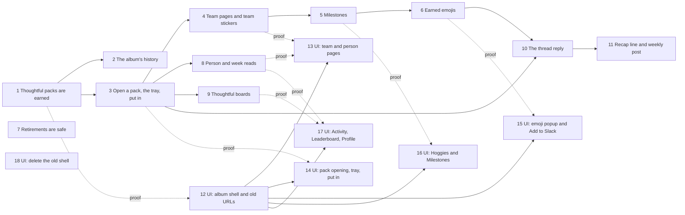

# Planned implementation tickets: the collection-first core loop and the album website

> **Settled on [#627](https://github.com/Silthus/kudos/issues/627) (2026-10-18) under the product owner's full-autonomy grant, not yet published.** The conductor publishes them as `wayfinder:implement` tickets of map #624 with native blocking edges, and adds the ship tickets. Rule numbers (`AL7`) refer to the [album spec](album.md); `MS…` rules to `spec/measure.md` on `docs/measure`.

Every ticket builds on `main`, is AFK and `tdd`-sized, is tested outside-in at the seam it names, has `pnpm gate` green, merges dark, and proves itself as its "Proof" line says. No ticket puts a usage number into the repository. A ticket that declares a flag creates it in PostHog project 662840 at `environment = sandbox`, 100%, and links it in its PR. A ticket that renames a scheduled function or changes its arguments checks production's pending `_scheduled_functions` before merging.

**UI** marks a ticket that renders website pages: it owes a sandbox browser proof (real sandbox data, light and dark, 1440×900 and 390×844, keyboard, reduced motion, no CSP violation in the console, a recording for moments) and owns the phone, dark and reduced-motion layouts of the pages it builds (AL55). A UI ticket's **Starts after** edge is hard; its **Proof waits for** edge lets it build against the fixture contract (`AlbumAnswer`, from ticket 12) while the backend lands, and merge only once that backend is on `main`.

**Order.** The backend core loop (1 → 3 → 4 → 5 → 6) and the retirement fixes (7, no blockers) come first. The album shell (12) starts at once against fixtures, in parallel with 1. 2, 8 and 9 run beside the chain once their blocker lands. 10 and 11 wait for the emojis. 13–17 start once 12 is on `main` and merge once their backend is. 18 waits for the rollout (AL66 step 7). Backend: 1–11. UI: 12–18.

---

## 1. Thoughtful packs are earned

**Blocked by:** none. **Flag:** declares `album` (AL39). **Backend.**

**What to build:** a giver who sends a thoughtful kudos to three people earns one thoughtful pack for each, at most one per person per week; a second thoughtful kudos to one of them that week earns none; a short kudos and a hug earn none. Each pack records at its grant whether it holds the recipient's sticker. `kudos given` carries `packs_earned`. A new `Album` module holds it, with the `album` flag declared and created, ADR-0009 landed with its decision record, the lexicon's **thoughtful pack** declared, and a first `getAlbum` read that answers `{ kind: "off" }` while `album` is off and, while on, the member, their level and their waiting packs.

**Test seam:** signed Slack events through the router with `convex-test` (`transactionLimits: true`), PostHog stubbed at `fetch`, `getAlbum` read with `aSignedInSession`.
**Proof:** in the sandbox, signed Slack-shaped kudos (one thoughtful to three people, a second thoughtful to one of them, one short) and `convex run website/album:getAlbum --identity …` show exactly three waiting packs; the project shows `packs_earned = 3` then `0`.

- [ ] AL1, AL2 (uniqueness over every case of the invariant "a thoughtful pack is earned once per giver, person and week"), AL3, AL4 (a subscriber, 50 recipients a mutation, ≤3 ranges each), AL5's decision recorded at the grant, AL7's crate key.
- [ ] AL6: `packs_earned` from `Album`'s exported read in Analytics' own transaction; Analytics' allowlist invariant amended.
- [ ] `album` declared (safe default `false`) and created in PostHog; "the album is dark where album is off" over Slack calls, App Home and every website read, apart from the pack records.
- [ ] `getAlbum` v1 behind `memberQuery`; the entrance declared; "the album is private" started.
- [ ] `docs/adr/0009-the-album-is-collection-first.md` with its `coherence decide` record (spec "Further Notes").

## 2. The album's history: people you thanked before it

**Blocked by:** 1. **Flag:** `album` (records whatever it says). **Backend.**

**What to build:** a member who gave kudos before the album finds those people already in their album; people who only thanked them are not there. A one-off, paged backfill records them and its start instant; awards after it collect only through packs.

**Test seam:** the backfill run directly with `convex-test` over awards in both directions, then `getAlbum`.
**Proof:** in the sandbox, `startAlbumHistory` runs to done; `getAlbum` for a synthetic member who gave to two people and was thanked by a third holds exactly the two. A second run changes nothing.

- [ ] AL14: 50 awards a page, unique per member and person, run twice and racing a pack, start instant stored once, no product event.
- [ ] AL13, AL15, AL16; the invariant "people join the album only by giving"; lexicon **album sticker**.
- [ ] `getAlbum` answers `people` with `held`.

## 3. Open a thoughtful pack, the tray and putting in

**Blocked by:** 1. **Flag:** `album`. **Backend.**

**What to build:** a member opens a waiting thoughtful pack on the website: it draws a hoggie (crate kind `thoughtful`, surface `website`), pays 15 XP and no coins, and puts the pack's sticker and hoggie in their tray. They put items in one at a time or all at once, in AL11's order, and the person joins their album. The tray survives a reload. Putting a sticker in sends `album sticker collected`.

**Test seam:** website commands `openThoughtfulPack`, `putIn`, `putAllIn` with `aSignedInSession` and `convex-test`, PostHog stubbed at `fetch`.
**Proof:** in the sandbox, a synthetic member opens two packs and puts all in; `getAlbum` shows the tray empty, the person held, the hoggie found; the project shows `hoggie dropped` with `crate_kind: thoughtful`, `surface: website`, and one `album sticker collected`.

- [ ] AL8–AL12, AL17; refusals for a second open, someone else's pack, an unknown item and `album` off.
- [ ] `Hoggies`: kind `thoughtful` in `crateKey`, `dropFor` and band version 2 (15 XP, 0 coins); found-only-when-put-in for thoughtful drops.
- [ ] Invariants "a pack's sticker is decided at its grant" and "a tray item is put in once"; lexicon **tray**; the darkFeatures walk fires the `stickerPutIn` recorder (E11).
- [ ] `getAlbum` answers `tray`; the three entrances declared.

## 4. Team pages from album stickers and the team sticker unlock

**Blocked by:** 3. **Flag:** `album`. **Backend.**

**What to build:** each company team is a page counting the member's album stickers of its matched people (the member excluded, unmatched people shown but not counted, nobody dropped from a big team). A complete page answers `ready`; the member's click unlocks its team sticker once, for good.

**Test seam:** website command `unlockTeamSticker` and `getAlbum` with `convex-test`, the company copy seeded as the Company Profiles sync writes it.
**Proof:** in the sandbox, a synthetic member holding everyone on a seeded team reads `ready`, unlocks it, and reads `unlocked` with its date after a teammate joins the team on the copy.

- [ ] AL18–AL20; refusals for incomplete, unknown, twice and `album` off.
- [ ] The invariant "a team sticker stays unlocked"; lexicon **team sticker**.
- [ ] `getAlbum` answers `teams` with `state`; the entrance declared.

## 5. `Milestones`

**Blocked by:** 4. **Flag:** `album`. **Backend.**

**What to build:** five milestones count album facts and record each tier once with its date: Faces in the album, Full pages, Across the company, Hoggie hunter, Kind words. The diamond steps for teams are fixed from the real company team count on the day the catalogue is built.

**Test seam:** kudos through the router, the website commands of 3 and 4, then `getAlbum`'s `milestones`, with `convex-test`.
**Proof:** in the sandbox, a synthetic member's first thoughtful kudos and first put-in show Kind words and Faces in the album at bronze with today's date; the catalogue's `D` is stated in the PR without any usage number.

- [ ] AL21 with tallies and insert-only tiers, recorded once however often a count moves; the catalogue versioned.
- [ ] Lexicon **milestone**.

## 6. Earned emojis

**Blocked by:** 5. **Flag:** `album`. **Backend.**

**What to build:** every member's earned emojis (team, milestone at gold, levels 5–25, hype per person from their first thoughtful pack) are derived from their causes, with slugged names, pictures, progress for locked ones, `seen`, and `inSlack` from the workspace's custom emoji copy. Team, milestone and level art is built into the website as `/emoji/<name>.png`. Admins get the shared list.

**Test seam:** `getAlbum`'s `emojis` and `markEmojisSeen` with `convex-test`; `emoji.list` stubbed at `fetch` through the existing custom emoji sync; the static file listing asserted from the website build.
**Proof:** in the sandbox, a synthetic member's emojis show the hype emoji of a packed person; after a test emoji with that name is added to the sandbox workspace by hand, `emoji_changed` turns its `inSlack` true. `curl` of one `/emoji/<name>.png` answers a PNG under 128 KB.

- [ ] AL23–AL27, AL29, AL30, AL32's read (admins and owners only); the invariant "an earned emoji follows its cause"; lexicon **earned emoji**, **hype emoji**.
- [ ] No Slack write, no new scope (AL28).
- [ ] The entrance `markEmojisSeen` declared.

## 7. Retirements are safe

**Blocked by:** none. **Flag:** none new; makes AL33's flags safe to turn off. **Backend.**

**What to build:** turning off `store` or `coins` no longer stops a member's owned kudos emojis from giving kudos; turning off `group-quest` stops every group quest draw, launches recorded before included; turning off `unlocks` shows every shipped feature from level 1 and names none in a level-up DM. One walk proves the end state with every retirement flag off.

**Test seam:** kudos with owned kudos emojis through the router; the group quest sweep; level-ups through kudos; App Home through signed `app_home_opened`; all with `convex-test`.
**Proof:** in the sandbox with `store` and `coins` off for one synthetic member, a kudos with their bought kudos emoji counts; App Home shows no coins, store, quests, Journey, skill tree, ladders or level unlocks with AL33's flags off for them.

- [ ] AL34 (Store's hook; its invariant amended), AL35 (Quests' draws; Unlocks' off state), AL36, AL37's walk, AL38.

## 8. Person and week reads

**Blocked by:** 3. **Flag:** `album`. **Backend.**

**What to build:** a member reads one person's page (first thanked, kudos and hugs both ways, their best message to them, the person's teams, the hype emoji state) and one week's edition (tallies, kudos of the week, who they thanked, who thanked them, new faces, hoggies from packs, quiet hugs, the week's sparkline points).

**Test seam:** `getAlbumPerson` and `getAlbumWeek` with `aSignedInSession` and `convex-test`, `transactionLimits: true` at the activity page's worst case.
**Proof:** in the sandbox, `convex run` of both reads for a synthetic member answers the seeded history.

- [ ] AL46's and AL48's reads within the activity page's budget; both entrances declared; "the album is private" covers them.

## 9. Thoughtful boards

**Blocked by:** 3. **Flag:** `album`. **Backend.**

**What to build:** the people board ranks thoughtful kudos awards given this week, the team board sums them per company team, with the member's row and team, and "Who gave" narrows people to one team. Hidden members stay off both.

**Test seam:** `getThoughtfulBoards` with `convex-test` over kudos through the router.
**Proof:** in the sandbox, after three synthetic givers' thoughtful kudos, the read ranks them and their teams as given.

- [ ] AL49; the entrance declared; `Show me on the leaderboards` honoured.

## 10. The thread reply after a thoughtful kudos

**Blocked by:** 3, 6. **Flag:** declares `album-slack` (AL58). **Backend.**

**What to build:** where `album-slack` applies to the giver, a thoughtful kudos gets one public thread reply naming, per recipient, "new in your album" with team progress, "a pack for thanking", or "next week", with the hype emoji it unlocked as a picture, a team page it completes, and "Open your pack" or "See <First>'s page". A short kudos keeps today's private reply.

**Test seam:** a signed Slack event through the router with `convex-test`, Slack calls captured at `fetch`, asserting `Block Kit` bodies.
**Proof:** in the sandbox, a signed thoughtful kudos to a new person and to a held person posts one reply in the thread with both lines and the hype picture; with the flag off the calls equal `main`.

- [ ] AL58, AL59, AL29 (pictures, `:name:` only when in Slack); "album moments are dark where album-slack is off".
- [ ] `album-slack` declared and created.

## 11. The recap line and the weekly top thoughtful kudos post

**Blocked by:** 10. **Flag:** `album-slack`. **Backend.**

**What to build:** the Monday hug recap gains one line of last week's earned emojis; the Monday post's body becomes the week's top three thoughtful kudos from public channels, ranked by hugs, then recipients, then newest, plus the week's team stickers unlocked.

**Test seam:** the recap and Monday post sweeps with `convex-test` and pinned time, Slack calls captured at `fetch`.
**Proof:** in the sandbox, the post sent by `convex run` to the sandbox channel quotes only public kudos; the recap DM to a synthetic member shows their emoji line.

- [ ] AL60, AL61, AL62, AL63; the invariant "a weekly post quotes only public kudos".

## 12. UI: the album shell, its frame and every old URL

**Starts after:** none (builds against fixtures at once). **Proof waits for:** 1. **Flag:** `album`. **UI.**

**What to build:** a member the flag is on for gets the album shell: the top bar (brand, XP bar, packs button, empty tray, Activity and Leaderboard icon buttons, emoji button, face and name, settings cog), the sidebar (search, your team first, teams by progress, "Show N more", `Hoggies`, `Milestones`), the `Getting started` strip, Settings inside the frame, and placeholder pages for the routes other tickets fill. Every URL the backend builds today lands on an album page. The fixture contract `AlbumAnswer` and a fixture build (`VITE_SHELL_FIXTURE=album`) exist for the other UI tickets. `docs/website/visual-language.md` is rewritten for the album.

**Test seam:** `renderApp` with injected reads (Testing Library); a landing table over every URL the backend can build; `entryBundle.test.ts`; `privateBlocks.test.tsx`; `accessibility.test.tsx`.
**Proof:** sandbox browser proof as above, plus the landing table walked by hand for five old Slack links; with `album` off the page equals `main`.

- [ ] AL39 (DOM and CSS byte-equal off), AL42, AL43, AL44 and the invariant "every URL Slack sends lands in the album", AL53, AL55, AL56, AL57.
- [ ] The visual language rewrite: which of V1–V24 hold, which the album breaks and what replaces them; ADR-0005 and WCAG AA stand.

## 13. UI: the team page and the person page

**Starts after:** 12. **Proof waits for:** 4, 8. **Flag:** `album`. **UI.**

**What to build:** `/` and `/book#teams/<team>` show the Class photo with silhouettes, the seal and its one next step, the ready state, the unlock moment and the unlocked state; `/book#people/<person>` shows your history with them, their teams and their hype emoji.

**Test seam:** `renderApp` over fixtures of every state; the unlock command injected; the moment's reduced-motion end state.
**Proof:** sandbox browser proof, with a recording of a synthetic member unlocking a seeded complete team.

- [ ] AL45, AL46, AL54 (the unlock never overlaps an emoji moment), AL55, AL56.

## 14. UI: pack opening, the tray and putting in

**Starts after:** 12. **Proof waits for:** 3. **Flag:** `album`. **UI.**

**What to build:** the packs button opens a waiting pack with the binder flips and their celebration; opened items fly to the top-bar tray; the tray panel lists each with where it goes; "Put in" and "Put them all in" fly each to its glowing slot in the order the command answers; a team's unlock action arrives after its last sticker settles. `/book#packs` opens the tray.

**Test seam:** `renderApp` with the commands injected, asserting order, counts ticking on landing, and the reduced-motion end states.
**Proof:** sandbox browser proof with a recording of a synthetic member opening two packs and putting them all in.

- [ ] AL47, AL11's order, AL54, AL55, AL56.

## 15. UI: the emoji popup, emoji moments and Add to Slack

**Starts after:** 12. **Proof waits for:** 6. **Flag:** `album`. **UI.**

**What to build:** the emoji button opens a popup grouped as Team stickers, Hype, `Milestones` and Levels, earned in colour with their names, locked in grey with how to unlock and progress, nearest first with "Show all" and a search; each new emoji pops as a moment, queued, then flies into the button; "use it in Slack" only when in Slack; Add to Slack downloads the picture and opens the workspace's custom emoji page; admins see the shared list in Settings.

**Test seam:** `renderApp` over fixtures with `inSlack` true and false, `markEmojisSeen` injected, the download's file name and the hype fallback asserted.
**Proof:** sandbox browser proof with a recording of an emoji moment and an Add to Slack download.

- [ ] AL26, AL29–AL32, AL54, AL55, AL56.

## 16. UI: `Hoggies` and `Milestones`

**Starts after:** 12. **Proof waits for:** 5. **Flag:** `album`. **UI.**

**What to build:** `/book#hoggies` with the rarest-finds shelf, the sticky collection bar and its filters and rarity strip, the field-guide plates and the centred detail at `#hoggies/<hoggie>`; `/book#milestones` with one row per milestone, four medals and the gold emoji named.

**Test seam:** `renderApp` over fixtures; the sticky bar's highlighted rarity; detail previous and next by keyboard.
**Proof:** sandbox browser proof.

- [ ] AL50, AL51, AL55, AL56.

## 17. UI: Activity, the Leaderboard and the Profile

**Starts after:** 12. **Proof waits for:** 8, 9. **Flag:** `album`. **UI.**

**What to build:** `/activity` as the `Weekly edition` with week tabs and sparklines; `/leaderboard` with the people and team boards side by side, your row and team pinned, "Who gave"; `/book#me` with your photo, level, last kind note, ranks, album at a glance, coolest finds and best milestones.

**Test seam:** `renderApp` over fixtures; the profile's and the top bar's numbers equal the board's.
**Proof:** sandbox browser proof.

- [ ] AL48, AL49, AL52, AL55, AL56.

## 18. UI: delete the old shell

**Starts after:** the rollout's step 7 (AL66) and AL67's window. **Flag:** removes the dead `album`/`album-slack` off branches only. **UI.**

**What to build:** the album is the only shell. Today's HUD frame, Book spread, Quests, skill tree page, crate store and pack shelf, and their tests, are deleted; the old-URL map stays in the router; the backend's link builders point at album routes. No stored data, table or PostHog flag is deleted.

**Test seam:** the landing table of 12, unchanged; `entryBundle.test.ts`; the website's full test suite.
**Proof:** sandbox browser proof that every old Slack link still lands, and a production smoke of five links after deploy.

- [ ] AL67, AL68; the queued-jobs check if any scheduled function changes.
