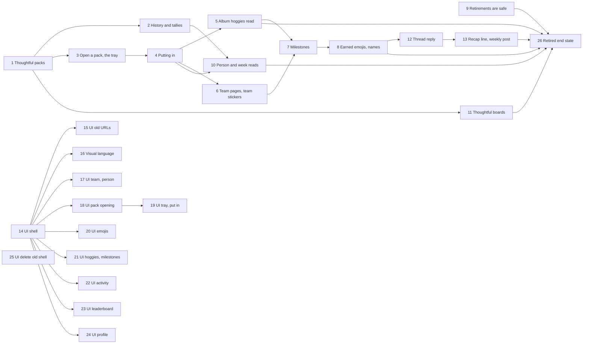

# Planned implementation tickets: the collection-first core loop and the album website

> **Settled on [#627](https://github.com/Silthus/kudos/issues/627) (2026-10-18) under the product owner's full-autonomy grant, reviewed by GPT-6.1 Sol, not yet published.** The conductor publishes them as `wayfinder:implement` tickets of map #624 with native blocking edges, and adds the ship tickets. Rule numbers (`AL7`) refer to the [album spec](album.md); `MS…` rules to `spec/measure.md` on `docs/measure`.

Every ticket builds on `main`, is AFK and `tdd`-sized, is tested outside-in at the seam it names, has `pnpm gate` green, merges dark, and proves itself as its "Proof" line says. No ticket puts a usage number into the repository. A ticket that declares a flag creates it in PostHog project 662840 at `environment = sandbox`, 100%, and links it in its PR. A ticket that renames a scheduled function or changes its arguments checks production's pending `_scheduled_functions` before merging. A backend ticket proves itself with signed Slack-shaped requests to the sandbox and `convex run … --identity` reads.

**UI** marks a ticket that renders website pages. It owes a sandbox browser proof: real sandbox data through a synthetic session, light and dark, 1440×900 and 390×844, by keyboard, with reduced motion, no CSP violation in the console, and a recording for moments. It owns the phone, dark and reduced-motion layouts and the `ph-no-capture` blocks of the pages it builds (AL55, AL56). Its **Starts after** edge is hard. Its **Proof waits for** edge lets it build against the fixture contract (`AlbumAnswer`, from ticket 14) while the backend lands, and merge once that backend is on `main`.

**Order.** The backend core loop (1 → 3 → 4 → 5/6 → 7 → 8) and the retirement fixes (9, no blockers) come first. The album shell (14) starts at once against fixtures, in parallel with 1. 2, 10 and 11 run beside the chain once their blockers land. 12 and 13 wait for the emojis. 15–24 start once 14 is on `main` and merge once the backend they show is. 25 waits for the rollout (AL66 step 7 and AL67). 26 proves the retired end state once the backend and the Slack moments are on `main`, and must be green before the rollout's step 4. Backend: 1–13, 26. UI: 14, 15, 17–25. Docs: 16.

| # | Title | Starts after | Proof waits for | Flag | UI |
|---|---|---|---|---|---|
| 1 | Thoughtful packs are earned | — | — | declares `album` | |
| 2 | The album's history and its tallies | 1 | — | `album` | |
| 3 | Open a thoughtful pack into the tray | 1 | — | `album` | |
| 4 | Putting in | 3 | — | `album` | |
| 5 | The album's hoggie read | 4 | — | `album` | |
| 6 | Team pages and team stickers | 4 | — | `album` | |
| 7 | `Milestones` | 5, 6 | — | `album` | |
| 8 | Earned emojis and their names | 7 | — | `album` | |
| 9 | Retirements are safe | — | — | AL33's flags | |
| 10 | Person and week reads | 2, 4 | — | `album` | |
| 11 | Thoughtful boards | 1 | — | `album` | |
| 12 | The thread reply | 8 | — | declares `album-slack` | |
| 13 | The recap line and the weekly post | 12 | — | `album-slack` | |
| 14 | The album shell | — | 1 | `album` | UI |
| 15 | Every old URL lands | 14 | — | `album` | UI |
| 16 | The visual language for the album | 14 | — | — | docs |
| 17 | The team page and the person page | 14 | 6, 10 | `album` | UI |
| 18 | Pack opening | 14 | 3 | `album` | UI |
| 19 | The tray and putting in | 18 | 4 | `album` | UI |
| 20 | The emoji popup, moments and Add to Slack | 14 | 8 | `album` | UI |
| 21 | `Hoggies` and `Milestones` | 14 | 5, 7 | `album` | UI |
| 22 | Activity | 14 | 10 | `album` | UI |
| 23 | Leaderboard | 14 | 11 | `album` | UI |
| 24 | The profile page | 14 | 7, 11 | `album` | UI |
| 25 | Delete the old shell | AL66 step 7, AL67 | — | ends `album`'s off branch | UI |
| 26 | The retired end state, proven | 5, 8, 9, 10, 11, 13 | — | `album`, `album-slack`, AL33's flags | |

---

## 1. Thoughtful packs are earned

**Starts after:** none. **Flag:** declares `album` (AL39). **Backend.**

**What to build:** a giver who sends a thoughtful kudos to three people earns one thoughtful pack for each, at most one per person per giver's week; a second thoughtful kudos to one of them that week earns none; a short kudos and a hug earn none. Each grant writes its outcome (`new`, `held`, `waiting`, `nextWeek`), and the message's last page publishes `thoughtfulPacksGranted` once, which Analytics sends as `packs earned`. A new `Album` module holds it, with `album` declared and created, ADR-0009 landed with its decision record, the lexicon's **thoughtful pack** declared, the workspace's emoji name registry (AL25) with its level, milestone and company team reservations and each hype name allocated at its grant, and a first `getAlbum` read that answers `{ kind: "off" }` while `album` is off and, while on, the member, their level and their waiting packs.

**Test seam:** signed Slack events through the router with `convex-test` (`transactionLimits: true`), PostHog stubbed at `fetch`, `getAlbum` with `aSignedInSession`.
**Proof:** in the sandbox, signed kudos (one thoughtful to three people, a second thoughtful to one of them, one short) and `convex run website/album:getAlbum --identity …` show exactly three waiting packs; the project shows `packs earned` with `packs_earned = 3`, then one with `0` and `recipients = 1`.

- [ ] AL1–AL5, AL7; the invariants "a thoughtful pack is earned once per giver, person and week" and "a message's packs are told once", the latter over a 120-recipient message and Analytics run before and after the grant.
- [ ] AL6: `packs earned` from `thoughtfulPacksGranted`; Analytics' allowlist invariant amended; the darkFeatures walk fires the recorder (E11); MS13's reservation noted as moved.
- [ ] `album` declared and created; "the album is dark where album is off" with AL39's exemptions.
- [ ] `getAlbum` v1 behind `memberQuery`; its entrance declared; "the album is private" started.
- [ ] AL25's registry: reservations before any earn, the job after each company sync, hype names at the grant; "an earned emoji's name never moves".
- [ ] `docs/adr/0009-the-album-is-collection-first.md` with its `coherence decide` record.

## 2. The album's history and its tallies

**Starts after:** 1. **Flag:** `album` (records whatever it says). **Backend.**

**What to build:** a member who gave kudos before the album finds those people already in it; people who only thanked them are not there. A one-off, paged backfill records them with its start instant, and fills the pair and week tallies from past awards and hugs. From then on `Album`'s kudos and hug subscribers keep the tallies.

**Test seam:** the backfill run directly with `convex-test` over awards and hugs in both directions, then `getAlbum` and the tallies through an internal read.
**Proof:** in the sandbox, `startAlbumHistory` runs to done; `getAlbum` for a synthetic member who gave to two people and was thanked by a third holds exactly the two, and a second run changes nothing.

- [ ] AL13–AL16; "people join the album only by giving"; lexicon **album sticker**.
- [ ] The pair and week tallies of AL46 and AL48, kept by subscribers and backfilled, each recorded once per award or hug, redelivery included.

## 3. Open a thoughtful pack into the tray

**Starts after:** 1. **Flag:** `album`. **Backend.**

**What to build:** a member opens a waiting thoughtful pack on the website: it draws a hoggie (crate kind `thoughtful`, surface `website`), pays 15 XP and no coins, and puts the pack's sticker and hoggie in their stored tray, which survives a reload.

**Test seam:** website command `openThoughtfulPack` and `getAlbum` with `aSignedInSession` and `convex-test`, PostHog stubbed at `fetch`.
**Proof:** in the sandbox, a synthetic member opens a pack; `getAlbum` shows it in the tray with its hoggie; the project shows `hoggie dropped` with `crate_kind: thoughtful` and `surface: website`.

- [ ] AL8–AL10, AL12; refusals for a second open, someone else's pack and `album` off.
- [ ] `Hoggies`: kind `thoughtful` in `crateKey`, `dropFor` and band version 2 (15 XP, 0 coins).
- [ ] "a pack's sticker is decided at its grant"; lexicon **tray**; the entrance declared.

## 4. Putting in

**Starts after:** 3. **Flag:** `album`. **Backend.**

**What to build:** a member puts tray items in one at a time, or all of them in AL11's put-in order, 25 a call until done; the person joins their album and `album sticker collected` is sent.

**Test seam:** website commands `putIn` and `putAllIn` with `convex-test` and `transactionLimits: true`, a tray of 60 items over three calls.
**Proof:** in the sandbox, a synthetic member with two opened packs puts all in; `getAlbum` shows the tray empty, the person held, the hoggie found; the project shows one `album sticker collected`.

- [ ] AL11, AL12's put-in filter, AL17; "a tray item is put in once"; the `stickerPutIn` recorder in the darkFeatures walk; both entrances declared.

## 5. The album's hoggie read

**Starts after:** 4. **Flag:** `album`. **Backend.**

**What to build:** the album reads a member's hoggie collection (found and hidden, counts, spares, first-found dates, rarity counts, rarest finds) on its own, whatever the Book, `achievements` or `unlocks` say.

**Test seam:** `getAlbumHoggies` with `convex-test`, with `achievements` and `unlocks` off.
**Proof:** in the sandbox, `convex run` for a synthetic member with a put-in and an unput hoggie answers only the first as found.

- [ ] AL73; the entrance declared; "the album is private" covers it.

## 6. Team pages and team stickers

**Starts after:** 4. **Flag:** `album`. **Backend.**

**What to build:** each company team is a page counting the member's album stickers of its matched people (the member excluded, unmatched people shown but not counted, nobody dropped from a big team). A complete page answers `ready`; the member's click unlocks its team sticker once, for good, storing the team's name, art and its emoji name from ticket 1's registry.

**Test seam:** website command `unlockTeamSticker` and `getAlbum` with `convex-test`, the company copy seeded as the sync writes it.
**Proof:** in the sandbox, a synthetic member holding everyone on a seeded team reads `ready`, unlocks it, and still reads `unlocked` with its name and date after the team is removed from the copy.

- [ ] AL18–AL20; refusals for incomplete, unknown, twice and `album` off; "a team sticker stays unlocked"; lexicon **team sticker**; the entrance declared.

## 7. `Milestones`

**Starts after:** 5, 6. **Flag:** `album`. **Backend.**

**What to build:** five milestones count album facts and record each tier once with its date. The diamond team steps are fixed from the real company team count the day the catalogue is built.

**Test seam:** kudos through the router and the commands of 3, 4 and 6, then `getAlbum`'s `milestones`, with `convex-test`.
**Proof:** in the sandbox, a synthetic member's first thoughtful kudos and first put-in show `Kind words` and `Faces in the album` at bronze with today's date; the PR states the catalogue's `D` without any usage number.

- [ ] AL21, insert-only tiers recorded once however often a count moves; the catalogue versioned; lexicon **milestone**.

## 8. Earned emojis and their names

**Starts after:** 7. **Flag:** `album`. **Backend.**

**What to build:** each member's earned emojis (team, milestone at gold, levels 5–25, hype per person from their first thoughtful pack), derived from their causes, with names from ticket 1's registry, public pictures under catalogue IDs, progress for locked ones, `seen` and `inSlack`. Team, milestone and level art is built as `/emoji/<name>.png`. Admins and owners get the shared list.

**Test seam:** `getAlbum`'s `emojis` and `markEmojisSeen` with `convex-test`; `emoji.list` stubbed at `fetch` through the existing custom emoji sync; the static file listing asserted from the website build.
**Proof:** in the sandbox, a seeded team whose name slugs to an emoji the sandbox workspace already has reads `inSlack: true` after `syncCustomEmoji` runs, and another reads `false`; a synthetic member's emojis show a packed person's hype emoji with their face URL; `curl` of one `/emoji/team-<slug>.png` answers a PNG under 128 KB.

- [ ] AL23–AL27, AL29, AL30, AL32's read; "an earned emoji follows its cause"; lexicon **earned emoji**, **hype emoji**; no Slack write and no new scope (AL28); the entrance declared.

## 9. Retirements are safe

**Starts after:** none. **Flag:** none new; makes AL33's flags safe to turn off. **Backend.**

**What to build:** with `store` or `coins` off, a member's owned kudos emojis, custom ones included, keep giving kudos; with `group-quest` off, no group quest is drawn, tallied or caught up, launches recorded before included; with `unlocks` off, every shipped feature shows from level 1 and no level-up DM names one. The full end-state walk is ticket 26.

**Test seam:** kudos with owned and custom kudos emojis through the router; the group quest sweep; level-ups through kudos; App Home through signed `app_home_opened`; all with `convex-test`.
**Proof:** in the sandbox with `store` and `coins` off for one synthetic member, a kudos with their bought custom kudos emoji counts; App Home shows no coins, store, quests, Journey, skill tree, ladders or level unlocks with AL33's flags off for them.

- [ ] AL34 along the whole call path, the three Store invariants amended with a decision; AL35; AL36; AL38.

## 10. Person and week reads

**Starts after:** 2, 4. **Flag:** `album`. **Backend.**

**What to build:** a member reads one person's page from its pair tally (first thanked, kudos and hugs both ways, best message, their teams, the hype emoji state) and one week's edition from its week tally (counts, the kudos of the week, up to 12 people per list with the rest counted, new faces, hoggies from packs, quiet hugs, sparkline points).

**Test seam:** `getAlbumPerson` and `getAlbumWeek` with `aSignedInSession` and `convex-test`, `transactionLimits: true`, over a pair with 300 kudos and a week with 800 recipients.
**Proof:** in the sandbox, `convex run` of both reads for a synthetic member answers the seeded history.

- [ ] AL46, AL48; both entrances declared; "the album is private" covers them.

## 11. Thoughtful boards

**Starts after:** 1. **Flag:** `album`. **Backend.**

**What to build:** the people board ranks thoughtful kudos awards given this week, the team board sums them per company team, with the member's row and team pinned, and "Who gave" narrows people to one team. Hidden members stay off both.

**Test seam:** `getThoughtfulBoards` with `convex-test` over kudos through the router.
**Proof:** in the sandbox, after three synthetic givers' thoughtful kudos, the read ranks them and their teams as given.

- [ ] AL49 from a tally the grant subscriber keeps; `Show me on the leaderboards` honoured; the entrance declared.

## 12. The thread reply after a thoughtful kudos

**Starts after:** 8. **Flag:** declares `album-slack` (AL58). **Backend.**

**What to build:** where `album-slack` applies to the giver, `thoughtfulPacksGranted` posts one public thread reply naming, per recipient, `new`, `held`, `waiting` or `nextWeek`, with the hype emoji it unlocked as a picture, a team page it completes, and "Open your pack" or "See <First>'s page". A short kudos keeps today's private reply.

**Test seam:** a signed Slack event through the router with `convex-test`, Slack calls captured at `fetch`, asserting the `Block Kit` bodies, with `Feedback`'s subscriber run before and after the grant.
**Proof:** in the sandbox, a signed thoughtful kudos to a new person and to a held person posts one reply with both lines; `chat.postMessage` answers `ok: true` and `conversations.replies` returns the image element; with the flag off the calls equal `main`.

- [ ] AL58, AL59, AL29; "album moments are dark where album-slack is off"; `album-slack` declared and created.

## 13. The recap line and the weekly top thoughtful kudos post

**Starts after:** 12. **Flag:** `album-slack`. **Backend.**

**What to build:** the Monday hug recap gains one line of last week's earned emojis; the Monday post's body becomes the week's top three thoughtful kudos from public channels, ranked by hugs, then recipients, then newest, plus the week's team stickers unlocked.

**Test seam:** the recap and Monday post sweeps with `convex-test` and pinned time, Slack calls captured at `fetch`.
**Proof:** in the sandbox, the post sent by `convex run` to the sandbox channel quotes only public kudos; the recap DM to a synthetic member shows their emoji line.

- [ ] AL60–AL63; "a weekly post quotes only public kudos".

## 14. UI: the album shell

**Starts after:** none (builds against fixtures at once). **Proof waits for:** 1. **Flag:** `album`. **UI.**

**What to build:** a member the flag is on for gets the album shell: the top bar (brand, XP bar, packs button with the waiting count, an empty tray, Activity and Leaderboard icon buttons, emoji button, face and name, settings cog), the sidebar (search, your team first, teams by progress, "Show N more", `Hoggies`, `Milestones`), the `Getting started` strip, Settings inside the frame, and placeholder pages for the routes later tickets fill. The fixture contract `AlbumAnswer` and a fixture build (`VITE_SHELL_FIXTURE=album`) exist for the other UI tickets.

**Test seam:** `renderApp` with injected reads (Testing Library); `entryBundle.test.ts`; `privateBlocks.test.tsx`; `accessibility.test.tsx`; DOM and CSS equality with `album` off.
**Proof:** the sandbox browser proof; with `album` off the page equals `main`.

- [ ] AL39, AL42, AL43, AL53, AL55, AL56, AL57.

## 15. UI: every old URL lands in the album

**Starts after:** 14. **Flag:** `album`. **UI.**

**What to build:** every URL the backend builds today (the route list, every query and the Book hashes, with and without `/sign-in`) lands on an album page and canonicalises its address.

**Test seam:** a landing table over every URL the backend's link builders can produce, generated from `convex/website/routes.ts` and `link.ts`, rendered through `renderApp`.
**Proof:** the sandbox browser proof, walking ten old Slack links by hand.

- [ ] AL44; "every URL Slack sends lands in the album"; the pageview seam unchanged (MS22).

## 16. Docs: the visual language for the album

**Starts after:** 14. **Flag:** none. **Docs.**

**What to build:** `docs/website/visual-language.md` rewritten for the album: which of V1–V24 hold, which the album breaks and what replaces them, with ADR-0005 and WCAG 2.2 AA standing.

**Test seam:** `pnpm gate`'s vocabulary check over the document.
**Proof:** every rule cites the album page or component that follows it, checked against ticket 14's shell and the prototype's screenshots.

- [ ] One rule per line, numbered afresh; the prototype's motion, foil and confetti rules written down; reduced motion and dark mode rules kept.

## 17. UI: the team page and the person page

**Starts after:** 14. **Proof waits for:** 6, 10. **Flag:** `album`. **UI.**

**What to build:** `/` and `/book#teams/<team>` show the Class photo with silhouettes, the seal and its one next step, the ready state, the unlock moment and the unlocked state; `/book#people/<person>` shows your history with them, their teams and their hype emoji.

**Test seam:** `renderApp` over fixtures of every state; `unlockTeamSticker` injected; the moment's reduced-motion end state.
**Proof:** the sandbox browser proof, with a recording of a synthetic member unlocking a seeded complete team.

- [ ] AL45, AL46, AL54.

## 18. UI: pack opening

**Starts after:** 14. **Proof waits for:** 3. **Flag:** `album`. **UI.**

**What to build:** the packs button opens a waiting pack with the binder flips (rip, the sticker flip, the hoggie glowing in its rarity colour), shine and rings, confetti sized to the moment, "New in your album", the team bar and XP bar ticking up, and "+ :name-hype: unlocked"; the opened items fly into the top-bar tray.

**Test seam:** `renderApp` with `openThoughtfulPack` injected, each turn's state and the reduced-motion end state asserted.
**Proof:** the sandbox browser proof with a recording of a synthetic member opening a pack.

- [ ] AL47's opening.

## 19. UI: the tray and putting in

**Starts after:** 18. **Proof waits for:** 4. **Flag:** `album`. **UI.**

**What to build:** the tray panel lists each item with where it goes; "Put in" and "Put them all in" fly each to its glowing slot in the order the command answers, calling `putAllIn` until done; counts tick on landing; a team's unlock action arrives after its last sticker settles; `/book#packs` opens the tray.

**Test seam:** `renderApp` with `putIn` and `putAllIn` injected, a 60-item tray over three answers, order and landing counts asserted.
**Proof:** the sandbox browser proof with a recording of a synthetic member putting two packs in.

- [ ] AL47's tray and flights, AL11's order, AL54.

## 20. UI: the emoji popup, emoji moments and Add to Slack

**Starts after:** 14. **Proof waits for:** 8. **Flag:** `album`. **UI.**

**What to build:** the emoji button opens a popup grouped as team stickers, hype, milestones and levels, earned in colour with their names, locked in grey with how to unlock and progress, nearest first with "Show all" and a search; each new emoji pops as a queued moment, then flies into the button; "use it in Slack" only when in Slack; Add to Slack downloads the picture and opens the workspace's custom emoji page; admins see the shared list in Settings.

**Test seam:** `renderApp` over fixtures with `inSlack` true and false, `markEmojisSeen` injected, the download's file name and the hype fallback asserted.
**Proof:** the sandbox browser proof with a recording of an emoji moment and an Add to Slack download.

- [ ] AL26, AL29–AL32, AL54.

## 21. UI: `Hoggies` and `Milestones`

**Starts after:** 14. **Proof waits for:** 5, 7. **Flag:** `album`. **UI.**

**What to build:** `/book#hoggies` with the rarest-finds shelf, the sticky collection bar with its filters and rarity strip, the field-guide plates and the centred detail at `#hoggies/<hoggie>`; `/book#milestones` with one row per milestone, four medals and the gold emoji named.

**Test seam:** `renderApp` over fixtures; the sticky bar's highlighted rarity; detail previous and next by keyboard.
**Proof:** the sandbox browser proof with AL33's flags off for the synthetic member.

- [ ] AL50, AL51.

## 22. UI: Activity

**Starts after:** 14. **Proof waits for:** 10. **Flag:** `album`. **UI.**

**What to build:** `/activity` as the `Weekly edition`: one issue per week with its tallies, kudos of the week, people lists, new faces, hoggies from packs and quiet hugs, with week tabs and sparklines.

**Test seam:** `renderApp` over fixtures of a full, an empty and an overflowing week.
**Proof:** the sandbox browser proof.

- [ ] AL48.

## 23. UI: Leaderboard

**Starts after:** 14. **Proof waits for:** 11. **Flag:** `album`. **UI.**

**What to build:** `/leaderboard` with the people and team boards side by side, your row and team pinned, and "Who gave" narrowing people to one team.

**Test seam:** `renderApp` over fixtures, including a hidden member and a member on two teams.
**Proof:** the sandbox browser proof.

- [ ] AL49.

## 24. UI: the profile page

**Starts after:** 14. **Proof waits for:** 7, 11. **Flag:** `album`. **UI.**

**What to build:** `/book#me` with your photo, name, team, level and XP bar, the last kind note, your weekly and team rank, the album at a glance, coolest finds and best milestones.

**Test seam:** `renderApp` over fixtures; the profile's and the top bar's numbers equal the board's.
**Proof:** the sandbox browser proof.

- [ ] AL52.

## 25. UI: delete the old shell

**Starts after:** the rollout's step 7 (AL66) and AL67's matured cohort. **Flag:** removes `album`'s and `album-slack`'s dead off branches only. **UI.**

**What to build:** the album is the only shell. Today's HUD frame, Book spread, Quests, skill tree page, crate store and pack shelf, and their tests, are deleted; the old-URL map stays in the router; the backend's link builders point at album routes. No stored data, table or PostHog flag is deleted.

**Test seam:** ticket 15's landing table, unchanged; `entryBundle.test.ts`; the website's full suite.
**Proof:** the sandbox browser proof that every old Slack link still lands, and a production check of five links after the deploy.

- [ ] AL67, AL68; the queued-jobs check if any scheduled function changes.

## 26. The retired end state, proven

**Starts after:** 5, 8, 9, 10, 11, 13. **Flag:** `album`, `album-slack` and AL33's flags, read only. **Backend.**

**What to build:** one walk proves that, with `album` and `album-slack` on and every retirement flag off, a member keeps everything the album needs (packs, the tray, stickers, team pages, hoggies, milestones, emojis, boards, person and week pages, the thread reply, the recap line, the weekly post) and App Home shows no coins, store, quests, Journey, skill tree, ladders or level unlocks.

**Test seam:** a darkFeatures-style walk with `convex-test`: kudos and hugs through the signed Slack router, App Home through signed `app_home_opened`, every album read and command signed in, Slack and PostHog stubbed at `fetch`, beside the same walk with AL33's flags on.
**Proof:** in the sandbox, a synthetic member with AL33's flags off for them only walks the loop end to end, and the PR lists each read's answer as equal or as the documented difference.

- [ ] AL37; must be green before the rollout's step 4 (AL66).
