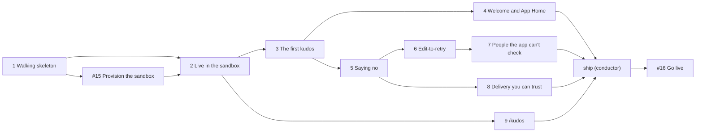

# Planned implementation tickets: the core kudos loop

> **Draft for approval on [#12](https://github.com/Silthus/kudos/issues/12), approved by Michael on 2026-10-13, revision 3 (after #9 and #10).** Each ticket becomes a sub-issue of #12 labelled `wayfinder:implement`, with native blocking edges. Rule numbers (`R7`) refer to [the spec](core-loop.md).

Every slice lands on the integration branch `spec/core-loop`, which the conductor creates from `main`, following the wayfinder SHIP procedure: a ticket branch `spec/core-loop/<ticket>` from the integration tip, built test-first, the full local gate green, then a fast-forward push to `spec/core-loop`, with the proof bundle (red, green, gate, and a screenshot for user-facing surfaces) linked on the ticket. Each slice is tested outside-in at the spec's seams. None of them is the `ship` ticket: the conductor creates it, and it turns the integration branch into one reviewed pull request to `main`.

The first slice that needs the sandbox deployment is **slice 2**; it is the only one blocked by #15 directly. #15 is blocked by slice 1: it installs the app from slice 1's manifest and deploys slice 1 by hand to prove a sandbox message arrives; slice 2 then automates the deploy. Slice 4 delivers the welcome message and the minimal App Home that `d-1c7a971d` puts in the first slice; it comes right after the first kudos because both read awards.

---

## 1. Walking skeleton: signed Slack events reach Convex

**Blocked by:** none.

**What to build:** Convex and `convex-test` in the repo; the `/slack/events` HTTP route that verifies the Slack signature with Web Crypto, answers `url_verification`, calls one mutation that records the receipt and runs a processing step that does nothing yet, and acknowledges; the daily receipt cleanup. The Slack app manifest template, rendered per environment (sandbox, real), with every spec 1 scope, event, route and the `/kudos` command, so #15 can install the app once. The Coherence bootstrap follow-ups.

**Acceptance criteria**
- [ ] A correctly signed event gets 200, one receipt and one run of the processing step in the receipt's transaction (R48, R49).
- [ ] A bad signature or a timestamp older than 5 minutes gets 401 and records nothing (R48).
- [ ] A redelivery with the same `team_id`/`event_id` gets 200 and runs nothing (R49).
- [ ] `url_verification` returns the challenge.
- [ ] Receipts older than 7 days are deleted by a daily job (R49).
- [ ] Only HTTP routes are public; the processing step is internal (R50).
- [ ] The manifest renders for sandbox and real with the scopes, events, routes and command listed in the spec, and no secret in the repo.
- [ ] Coherence: the lexicon declares or maps the nouns this slice brings in (Convex, sandbox), so `pnpm gate` stays green.
- [ ] Coherence: the entry spec (`Kudos.spec.md` with trust levels) exists, the `/slack/events` entrance is declared by hand, `convex/_generated` is in `ignore`, a `coherence decide` names the spec issue as the source of the core loop rules, and the first invariant (an unsigned request records nothing) is declared and its refutation witnessed.

**Context:** spec "Ingress and data", "The Slack app", "Where the spec lives"; brief §3.5, §4.1; Convex research ([#7](https://github.com/Silthus/kudos/issues/7)) on raw-body HMAC and atomic receipt plus schedule; Slack research ([#5](https://github.com/Silthus/kudos/issues/5)) §7 on manifests.

## 2. Live in the sandbox: the integration branch deploys itself

**Blocked by:** 1, #15.

**What to build:** a GitHub Actions workflow that deploys the integration branch to the sandbox deployment with a scoped deploy key on every push, and the first live proof that a sandbox Slack event reaches the deployed route and is acknowledged in time.

**Acceptance criteria**
- [ ] A push to `spec/core-loop` deploys to the sandbox deployment; the deploy key lives only in GitHub secrets.
- [ ] Sandbox check: Web Crypto HMAC verifies in the deployed HTTP action, and the acknowledgment stays under 3 s, measured over several real events and recorded on the pull request.
- [ ] A redelivered sandbox event leaves one receipt.

**Context:** spec "Deployments and pipeline", "Testing Decisions" (sandbox checks); #15 deploys slice 1 by hand, this slice replaces that with the workflow; #15's resolution comment (deployment name, app id, where each secret lives); Convex research on deploy keys.

## 3. The first kudos

**Blocked by:** 2.

**What to build:** a member posts "thanks `@Bob` :taco:" in a channel the app is in, Bob receives 1 kudos, and the message gets the `:taco:` reaction. It covers normalizing posted messages into countable rich text, the kudos parser with the workspace emoji hook, workspace settings with defaults, the directory filled by `users.info` on a miss (the happy path: one lookup, then evaluate), the Given outcome with awards, the daily allowance (the workspace base) on the allowance day in the giver's time zone, `kudosGiven` published to an empty registry, and the indicator delivered as desired state.

**Acceptance criteria**
- [ ] Given: one award per recipient, `n` per recipient, cost recipients × `n`, paid from the daily allowance (R4, R8, R11, R15, R18).
- [ ] Countable content and kudos emoji rules hold: code, quotes, strikethrough, attachments and forwards don't count; non-kudos emoji and mention-less or emoji-less messages are ordinary chat (R1–R3).
- [ ] Bot-authored messages, DMs and group DMs are ignored; a thread reply counts and a thread broadcast counts once (R5–R7).
- [ ] The allowance day follows the giver's time zone with a UTC fallback; a message just before local midnight spends from that day (R12, R13).
- [ ] Concurrent messages of one giver never overspend (R17).
- [ ] Exactly one `kudosGiven` per Given outcome, with the allowance facts, in the awards' transaction (R20).
- [ ] The `:taco:` (first kudos emoji used) reaction appears and stays correct after a repeated delivery (R32).
- [ ] No message text in any table or in any scheduled function's arguments (R51).
- [ ] Sandbox checks: a `thread_broadcast` arrives as one event; struck-through and code-styled emoji carry `style` flags.
- [ ] Lexicon: directory, indicator, domain event, hook, parse hook and annotation are settled; the Coherence component specs for the adapter, workspace, parser, engine, feedback and bus exist, with the awards-are-insert-only invariant declared.

**Context:** spec R1–R20, R32, "Interfaces", "Data"; brief §3.1–§3.4, §5; prototype scenarios 1, 8, 12, 14; ADR-0001; Hey Taco research ([#6](https://github.com/Silthus/kudos/issues/6)) for parity.

## 4. Welcome message and a minimal App Home

**Blocked by:** 3.

**What to build:** the two surfaces `d-1c7a971d` puts in the first slice. The first time a member gives or receives a Given award, they get one welcome DM explaining how Kudos works, with no group block yet. When a member opens Kudos in Slack, the Home tab shows how to give, how many kudos they have left today and when more come, and their kudos given and received this week and in total. It covers the welcome subscriber (the first entry in the event registry), the DM through the feedback module, `app_home_opened`, the `homeOf` query, and publishing the view with `views.publish`. Progression's and groups' sections come later through their own specs.

**Acceptance criteria**
- [ ] A member's first Given award, as giver or recipient, sends them exactly one welcome DM with the R43 copy; later awards send none (R42, R43).
- [ ] A redelivered Slack event, a retry by edit, or a retried delivery never sends a second welcome (R44).
- [ ] A failed welcome DM is tried at most 3 times and never touches awards or allowance (R44, R34).
- [ ] Opening App Home publishes a view with the R45 lines for that member; with nothing left it shows the "used all your kudos" line (R45).
- [ ] `{left}` matches what the next kudos message would see, across the member's local midnight (R46).
- [ ] Week and total given and received are the sums of the member's awards, 0 before any award; the week runs Monday to Sunday in the member's time zone (R46).
- [ ] The view and the welcome name the workspace emoji in force (R43, R46).
- [ ] A person who isn't a member sees the members-only line (R47).
- [ ] Sandbox checks: the welcome DM arrives for a first-time recipient, and the Home tab renders in the sandbox app.
- [ ] Coherence: the welcome component's spec exists, with the invariant that a member is welcomed at most once.

**Context:** spec R34, R42–R47, the "App Home" interface; #10 handoff (welcome message and profile), decisions `d-0321797e`, `d-f8ad338b`, `d-766ac71d`, `d-1c7a971d`, `d-f6186e52`; Slack research ([#5](https://github.com/Silthus/kudos/issues/5)) on App Home, `views.publish` and app-user DMs.

## 5. Saying no, and saying how many are left

**Blocked by:** 3. Can run beside 4.

**What to build:** the rest of the outcomes and every private reply. Over allowance (hourglass, nothing spent), Invalid (red X), skipped mentions with their reasons, and the ephemeral beside the message for Given, Over allowance and Invalid with the #8 copy, placed in the thread or the channel. The extras-line seam in the Given reply, left empty. Settings changed mid-day.

**Acceptance criteria**
- [ ] Over allowance: nothing spent, no partial awards, `:hourglass_flowing_sand:`, the Over allowance reply with cost, people, `n`, left and daily (R15, R36, R37).
- [ ] Invalid: all mentions skipped gives `:x:` and the Invalid reply with the distinct reasons (R9, R10, R36).
- [ ] Skipped mentions: self, bots, groups and broadcasts, non-members and external people are skipped with the exact reasons; the rest receive; the Given reply adds one line per reason (R9, R36).
- [ ] The Given reply shows what's left, or the "last kudos" line when nothing is left (R36, R37).
- [ ] Replies go to the giver only, in the thread for a thread reply, in the channel otherwise; recipients get nothing (R33).
- [ ] The copy is exactly the #8 table; a Given reply built with an extras line renders it once, last (R38).
- [ ] A base lowered below what was spent leaves 0; a changed workspace emoji makes the old one ordinary chat from the next evaluation (R16).
- [ ] Sandbox check: a thread ephemeral reaches the giver.

**Context:** spec R9–R16, R33, R36–R38; #8 handoff ("Feedback" and the copy); #9 handoff ("Copy baseline" for the extras line); brief card D4; prototype scenarios 1 and 12.

## 6. Edit-to-retry

**Blocked by:** 5.

**What to build:** editing a message that gave nothing fixes it. It covers `message_changed` normalization, revisions and watermarks, the fingerprint, the retry evaluated as new and spending from the edit's day, withdrawal, the indicator swap, the accepted-message reply, stale revisions, metadata-only edits and dropped deletions.

**Acceptance criteria**
- [ ] A fingerprint-changing edit to a message without a Given outcome is evaluated as new, whatever its age, and spends from the edit's day; an edit seen first spends from its own day (R13, R23).
- [ ] A successful retry swaps the hourglass or red X for the kudos reaction; a failed one shows its new outcome (R25).
- [ ] Removing every kudos emoji, or every mention, withdraws the attempt and clears its indicator without a reply (R24).
- [ ] Prose-only edits and `message_changed` without an `edited` block change nothing (R22).
- [ ] The original after its edit and a late older edit are ignored (R21).
- [ ] An edit to a Given message changes no award; the giver gets the accepted-message reply only when the mentions or kudos emoji changed (R26).
- [ ] A message gives at most once across redeliveries and edits (R19); deletions change nothing (R27).
- [ ] Sandbox check: `message_changed` without an `edited` block covers metadata changes.
- [ ] Lexicon: revision is settled.

**Context:** spec R19, R21–R27; brief §4.2, cards D5 and L2; prototype scenarios 2–7; Slack research on `message_changed`; kudos-garden lessons ([#4](https://github.com/Silthus/kudos/issues/4)) on edit ordering.

## 7. People the app can't check

**Blocked by:** 6. Can run beside 8.

**What to build:** a message whose author or recipients Slack can't confirm waits, is rechecked on the D6 ladder, and gives on its posted day when the lookup succeeds, or is abandoned silently. The directory stays fresh from `team_join` and `user_change`.

**Acceptance criteria**
- [ ] An unknown author or mention parks the message with nothing given or spent (R29).
- [ ] Rechecks run with successive delays of 1 min, 5 min, 30 min, 2 h and 6 h (1, 6, 36, 156 and 516 minutes after the first miss); a success evaluates with the waiting revision's spend instant: the posted day for a post, the edit day for a retry (R13, R29).
- [ ] A workspace emoji changed during the wait applies to the recheck (R16).
- [ ] After the last failed recheck: no reaction, no reply, nothing spent (R30).
- [ ] A newer revision while waiting is handled by the edit rules (R31); a deletion while waiting doesn't stop the award (R27).
- [ ] `team_join` and `user_change` update the directory, including deactivation and time zone changes, and evaluation reads eligibility from it (R28).
- [ ] The manifest's bot events include `team_join` and `user_change` (already from slice 1) and they arrive in the sandbox.

**Context:** spec R27–R31; brief §4.3, cards D2 and D6; prototype scenarios 9 and 10; kudos-garden lessons on unknown members.

## 8. Delivery you can trust

**Blocked by:** 5. Can run beside 6 and 7.

**What to build:** feedback delivery that survives Slack's rate limits and failures without ever touching awards: per-method `Retry-After`, reaction reconciliation retried until it matches, private replies tried at most 3 times.

**Acceptance criteria**
- [ ] A 429 with `Retry-After` delays the next call for that method; deliveries resume afterwards (R35).
- [ ] A reaction delivery that fails or times out is retried until the message shows exactly the desired indicator; `already_reacted` and `no_reaction` count as success (R32, R35).
- [ ] A private reply is tried at most 3 times on any failure, including an unknown result (R35).
- [ ] A failing or repeated delivery never re-runs an evaluation and never changes awards or allowance (R34).
- [ ] A delivery to a deleted message or a channel the app left stops for good, and awards and spending stay (R35).

**Context:** spec R32–R35; brief §3.4, §6, card D3; prototype scenario 11 and `reconcile-indicator.ts`; Slack research §8 on rate limits.

## 9. Getting into channels with `/kudos`

**Blocked by:** 2. Can run beside 3 onwards.

**What to build:** the `/slack/commands` route with signature verification, and `/kudos`: it joins a public channel, explains `/invite` in a private one, and points to channels from a DM. The replies are rendered by the feedback module.

**Acceptance criteria**
- [ ] An unsigned or stale command request gets 401 and does nothing (R48).
- [ ] `/kudos` in a public channel the app isn't in joins it and replies privately with the R39 text; in a channel it's already in, the "already in" text (R39).
- [ ] `/kudos` in a private channel the app isn't in replies with the `/invite` guidance (R40); in a DM or group DM, the channels guidance (R41).
- [ ] The command is acknowledged within 3 s.
- [ ] Sandbox check: `/kudos` in a sandbox public channel joins it, and the app then receives that channel's message events.
- [ ] Coherence: the `/slack/commands` entrance is declared.

**Context:** spec R39–R41, R48, "The Slack app" (`/kudos` stays in the adapter); brief card D7; Slack research §6 on slash commands.
