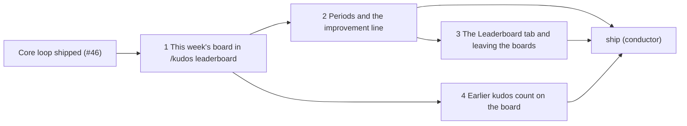

# Planned implementation tickets: stopping point 1, the Everyone board

> **Accepted on [#14](https://github.com/Silthus/kudos/issues/14) (2026-10-13).** Stopping point 1 is a `wayfinder:spec` sub-issue of #14 and each ticket below a `wayfinder:implement` sub-issue of #14 with native blocking edges. Rule numbers (`G17`, `R36`) refer to the [groups spec](groups.md) and the [core loop spec](https://github.com/Silthus/kudos/blob/docs/spec-core-loop/spec/core-loop.md).

**What stopping point 1 ships:** `/kudos leaderboard` and an App Home Leaderboard tab with the Everyone board: kudos given, never received, for this week, this month and all time; the top 3 and you with three people above and below; how much more you gave than at this point last week or month, or your best week so far; a Settings switch to leave the boards; every kudos given since the core loop went live counts. No groups yet.

Every ticket is a reviewed pull request, tested outside-in at the spec's seams, with `pnpm gate` green. The conductor's `ship` ticket deploys stopping point 1 to production and runs the backfill there.

---

## 1. This week's board in `/kudos leaderboard`

**Blocked by:** the core loop's `ship` ticket (#46: production publishes `kudosGiven` and runs `/kudos`). The conductor wires that edge.

**What to build:** a member types `/kudos leaderboard` and privately sees this week's Everyone board. It covers the leaderboard module with its totals of kudos given per member by day (with week, month and all-time rollups) fed by a `kudosGiven` subscriber, the pure board function (ranking and the ten-row window), the Everyone board query for this week, the `leaderboard` argument of `/kudos` in the adapter, and the rendered rows.

**Acceptance criteria**
- [ ] `/kudos leaderboard` replies privately, in any conversation, with this week's Everyone board: rows `{medal} {name} · {n} kudos`, ranked by kudos given this week by allowance day, chime-ins included once they exist (G13, G23, copy).
- [ ] Received kudos never change the board (G13).
- [ ] The window follows G17 on positions: positions 1–3 plus the viewer with three above and three below, the first ten positions when the viewer is 7th or better, one `…` at a gap, never more than ten rows even when many people tie; a viewer who gave nothing sees the top 3 and `Give kudos this week to join the board.` Tested at positions 1, 7, 8 and with eleven people tied at rank 1.
- [ ] Equal totals share a rank and list by name (G16); people who aren't members (R5) are never on it (G15).
- [ ] Delivering the same `kudosGiven` twice, or retrying the subscriber, counts the award once (G44).
- [ ] A week boundary is tested in two time zones: an award counts in its giver's allowance day's week (G14 periods).
- [ ] Bare `/kudos` still behaves as R39–R41; any unknown argument after `leaderboard` gets the usage line (G23).
- [ ] The board function is pure and tested with rule tables; the subscriber once at the module seam; the command once at the Slack boundary.
- [ ] Coherence: the leaderboard component spec exists with the invariant "the leaderboard counts kudos given, never kudos received" declared and its refutation witnessed; the lexicon settles board and window.

**Context:** spec G13–G17, G23, G44, "Contracts" (the pure board function, totals); brief §6 (totals table over an aggregate); core loop R12, R39–R41, `kudosGiven`.

## 2. Periods and the improvement line

**Blocked by:** 1.

**What to build:** the board for this month and all time, and the private line that shows a member's progress. It adds `week`, `month` and `all` to `/kudos leaderboard`, the improvement line against the previous period up to the same day with places climbed, and the best-period line.

**Acceptance criteria**
- [ ] `/kudos leaderboard month` and `/kudos leaderboard all` show those periods; `week` and no argument show this week (G23).
- [ ] With a gain above 0 the viewer sees `▲ {gain} more kudos than this time last week` under the Everyone board, plus ` · ▲ {places} places` when they were on last week's board up to the same weekday and their position is better now; a first-time giver with no position last week gets the gain without places; the month compares up to the same day of last month, or its last day (G18).
- [ ] Without a gain, the viewer with a completed period behind them sees `Your best week so far: {n} kudos.` (or month); otherwise no line. No line ever states a loss; all time has no line (G18).
- [ ] Tested with fake timers across a Monday, a month end, and a 31-day month against a 30-day one, in two time zones.

**Context:** spec G14, G18, G23, copy.

## 3. The Leaderboard tab and leaving the boards

**Blocked by:** 2 (the tab renders every period). Can run beside 4.

**What to build:** the board in App Home and a way to step off it. It adds the Leaderboard tab with `This week`, `This month` and `All time` buttons rendering the same board view as `/kudos leaderboard`, and `Show me on the leaderboards` in Settings. Unless progression stopping point 1 (#25) built them first, it also builds the App Home tab bar (the minimal App Home's contents become the Profile tab), the `/slack/interactivity` route with signature checks, the command registry (D17) and the manifest's interactivity URL.

**Acceptance criteria**
- [ ] Opening App Home and clicking **Leaderboard** shows this week's board; the period buttons republish the tab for that period (G23, G24).
- [ ] The tab and `/kudos leaderboard` render the same rows for the same viewer and period.
- [ ] Turning `Show me on the leaderboards` off removes the member from every viewer's board, their own included, and shows them `You're not on the leaderboards. You can change that in Settings.`; turning it on brings them back; repeating a click changes nothing (G22).
- [ ] An unsigned or stale interactivity request gets 401 and does nothing (R48); interactions are acknowledged within 3 s.
- [ ] Sandbox check: switching tabs and periods in App Home works in the sandbox app, recorded on the pull request.
- [ ] Coherence: the `/slack/interactivity` entrance is declared if this ticket adds it; the lexicon settles App Home tab names used here.

**Context:** spec G22–G24, G42; progression P67–P68 (App Home as desired state) and its ticket #25; brief D17.

## 4. Earlier kudos count on the board

**Blocked by:** 1. Can run beside 2 and 3.

**What to build:** a one-off, resumable backfill that adds every award given before the leaderboard shipped to the totals, in award order; live `kudosGiven` events continue from where it stopped with no gap and no double count (G14).

**Acceptance criteria**
- [ ] After the backfill, every earlier award counts once in its allowance day's week, month and all time (G14, G44).
- [ ] Running it twice, or interrupting and resuming it, changes nothing more.
- [ ] An award that arrives while the backfill runs is counted once.
- [ ] Totals after the backfill equal a recount from the awards table.
- [ ] The `ship` ticket can run it against production with one command, and its run is recorded on the pull request.

**Context:** spec G14, G44; brief D12 (the awards table as the permanent log new subscribers backfill from); progression's ticket #26 (the same pattern for XP).

---

## Calls for this plan (accepted)

- **The backfill is its own ticket (4)**, as in progression, so ticket 1 stays a pure tracer bullet.
- **Ticket 3 waits for ticket 2** so the tab renders every period from the start; ticket 4 runs beside both.
- **The tab bar and interactivity go to ticket 3, conditionally**: whichever of ticket 3 and progression's #25 lands first builds them, and the other only adds its tab.
- **No groups, no peer line, no profile card here**: they are stopping points 2 and 3.
