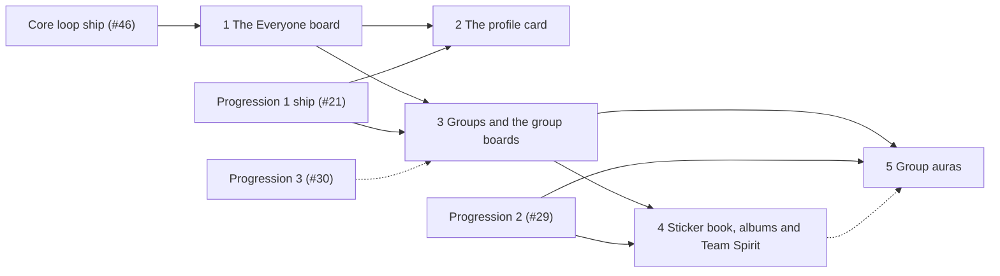

# Groups, the leaderboard and the profile in stopping points

> **Accepted on [#14](https://github.com/Silthus/kudos/issues/14) (2026-10-13)** under the map's autonomous build-and-ship authority. The [groups spec](groups.md) is the destination; it ships as the stopping-point specs below, each a `wayfinder:spec` sub-issue of #14, shipped and deployed to production on its own (map decision 8). Rule numbers (`G17`) refer to the spec. The placement follows `d-1c7a971d` (where the groups grilling's pieces land) inside the cross-spec slice order `d-1e03b988`.

Every stopping point leaves something a member can use, and nothing empty: no group screen appears before groups exist, and no card part appears before the thing it shows.

Solid edges are dependencies; dotted edges are the slice order only.

| # | Stopping point | What a member gets | Rules | Needs shipped first | Slack changes |
|---|---|---|---|---|---|
| 1 | **The Everyone board** | `/kudos leaderboard` and an App Home Leaderboard tab with the Everyone board for this week, this month and all time; the ten-row window; the improvement and best-period lines; leaving the boards in Settings; earlier kudos count | G13–G18, G22–G24, G42 (Leaderboard tab, the leaderboard setting), G44–G45 | the core loop (#46) | interactivity URL (unless progression added it) |
| 2 | **The profile card** | `/kudos @member` with name and level (unless hidden); later stopping points add title, card, group and achievement tiers | G28–G30 | the Everyone board; progression stopping point 1 (#21: levels and the hide setting) | none |
| 3 | **Groups and the group boards** | groups from Slack user groups (hidden without them), the admin's group mode and allowlist, the primary group in the welcome message and Settings, attribution with every award, the Groups and My group boards with the peer line and most improved group, the group on the profile card, the Monday post | G1–G12, G19–G21, G25–G27, G28 (group), G42–G43 | the Everyone board; progression stopping point 1 (#21: App Home tabs, the Admin tab, the announcement channel). Slice order: after progression stopping point 3 (#30) | `usergroups:read`, `subteam_*` events (one reinstall) |
| 4 | **Sticker book, albums and Team Spirit** | stickers of everyone you thanked or who thanked you, the sticker line, an album for every group, the Sticker book tab, the Team Spirit ladder | G31–G36 | groups (3); progression stopping point 2 (#29: achievements, the extras line) | none |
| 5 | **Group auras** | `rally` on sale with the opt-in DM and the Settings switch; `beacon` and `provision` join when drops (#42) and the weekly reserve (#35) have shipped | G37–G41 | groups (3); progression stopping point 2 (#29: perks and the gate) | none |

## Calls in this split (accepted)

- **The Everyone board is the thin slice right after the core loop** (`d-1c7a971d`): it only reads awards, so it ships without progression and without groups. Its App Home tab and its Settings switch need the tab bar and the interactivity route; it builds them if progression stopping point 1 hasn't yet (#25 says the same the other way round).
- **The profile card is its own stopping point, landing with XP and levels** (`d-1c7a971d`: "the profile card with XP and levels"). Folding it into stopping point 1 would make the board wait for progression; on its own it ships the moment levels exist. It is small: one ticket. Its later parts (title, card, achievement tiers, group) are acceptance criteria of the stopping points that bring them.
- **Groups come before their fun.** Stopping point 3 delivers the groups and the boards that only need attribution; albums and auras each build on it. The Monday post rides with stopping point 3 because it only reads the Groups board.
- **Groups wait for progression stopping point 1's ship**, not only for the slice order: the welcome message's dropdown, the Settings and Admin tabs and the announcement channel all come from it, and attribution keys on the award IDs its ticket #22 adds to `kudosGiven`.
- **Team Spirit lands with the albums it counts** (stopping point 4), on the achievements framework of progression stopping point 2.
- **`beacon` and `provision` go on sale with what they boost.** Whichever ships second, drops (#42) or the weekly reserve (#35) versus group auras, carries the perk; progression's split already says so for `provision`.
- **Each stopping point names its other-spec dependency in its first ticket's body**; the conductor wires those edges to the ship tickets.
