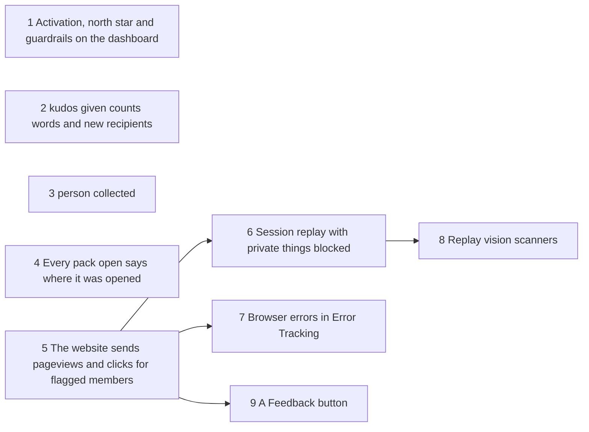

# Planned implementation tickets: measure how members use HedgeHug

> **Drafted on [#631](https://github.com/Silthus/kudos/issues/631) (2026-10-18), not yet published.** The conductor publishes them as `wayfinder:implement` tickets of map #624 once the product owner accepts, with native blocking edges, and adds the ship tickets. Rule numbers (`MS7`) refer to the [measurement spec](measure.md).

Every ticket builds on `main`, is AFK and `tdd`-sized, is tested outside-in at the seam it names, has `pnpm gate` green, and proves itself as its "Proof" line says. No ticket puts a number from the project into the repository. A ticket that creates a PostHog object names it `HedgeHug: …` and links it in its PR.

1–4 come first, in that order of priority, and none blocks another. 5 can start at once; 6, 7 and 9 wait for 5, and 8 for 6.

---

## 1. Activation, north star and guardrails on the adoption dashboard

**Blocked by:** none.

**What to build:** the product owner opens dashboard 2209148 and sees, in a new top row, the 7-day activation rate per week of entry, weekly thoughtful givers beside enrolled members, hugs per weekly active member and the giver repeat rate, all production only, built from events that exist today. The "gave 3+" tiles are renamed secondary. Each metric is a proposed Data Catalog metric. The first flag annotation is added. PostHog only: no code.

**Test seam:** the PostHog query runner (`execute-sql` / typed runners) over the project.
**Proof:** each new insight run with `environment = sandbox` in place of production matches a hand count over the same sandbox events, reported in the PR as match or mismatch without the numbers, and `dashboard-insights-run` returns data for every tile.

- [ ] MS1–MS3 as saved insights with descriptions, in the top row (MS4).
- [ ] The "gave 3+" tiles keep their queries, with "(secondary)" in their names; nothing deleted.
- [ ] Proposed Data Catalog metrics for MS1–MS3; a text card's `agent_context` names them (MS5).
- [ ] The PostHog action `HedgeHug: pack opened` over `hoggie dropped` (MS11).
- [ ] An annotation for this change (MS6).

## 2. kudos given counts words and new recipients

**Blocked by:** none.

**What to build:** a kudos message given in Slack sends `kudos given` with `word_count` (the gate's count) and `new_recipients` (recipients the giver had never thanked), and nothing of the message's words. Analytics' privacy invariant is amended by a recorded decision. The dashboard's "Collecting" row gains the share of kudos with a new recipient.

**Test seam:** a signed Slack event through the router with `convex-test`, PostHog stubbed at `fetch`, asserting the drain's request bodies.
**Proof:** a signed Slack-shaped kudos in the sandbox to one old and two new recipients shows `word_count` and `new_recipients = 2` on the event in the project.

- [ ] `word_count` equals the gate's `words`; a message whose annotations lack it leaves it out (MS7).
- [ ] The privacy invariant amended as MS8 says, with its `over:` and the kudosGiven test's forbidden-number assertion changed, and a decision quoting #630; no word of the message in any body.
- [ ] `new_recipients` counted in the subscriber through `earliestAwardFrom`, one range per recipient, the giving mutation unchanged; a redelivered event counts the same (MS9).
- [ ] The insight for the share of kudos with `new_recipients > 0` on the dashboard (MS15).

## 3. person collected

**Blocked by:** none.

**What to build:** a member who collects a person's sticker, by giving or receiving kudos, sends one `person collected` with `via`, and a backfill sends nothing. Stickers publishes `stickersCollected`; Analytics records it.

**Test seam:** a signed Slack event through the router with `convex-test`, PostHog stubbed at `fetch`; the sticker backfill run directly.
**Proof:** a sandbox kudos between two members who had never exchanged one shows two `person collected` events in the project, one `via: gave` and one `via: received`.

- [ ] One event per inserted sticker, `via` per direction, collector as subject, no second person named (MS10).
- [ ] A backfill records nothing.
- [ ] darkFeatures E11: a walk fires the new recorder; "analytics only observes" names it (MS14).
- [ ] The "Collecting" row's weekly collectors and people collected per week (MS15).

## 4. Every pack open says where it was opened

**Blocked by:** none.

**What to build:** opening any crate, a quest's, the Journey's, a feature's or a bought one, from App Home or from the website, sends `hoggie dropped` with `surface: slack` or `surface: website`, passed explicitly from the entry point.

**Test seam:** App Home's signed interactivity payloads and the website's commands with `convex-test`, PostHog stubbed at `fetch`.
**Proof:** in the sandbox, one pack opened from App Home and one from the website show `surface` `slack` and `website` in the project.

- [ ] `surface` on `hoggieDropped` through every open path; never inferred; an event queued without it leaves it out (MS12).
- [ ] The "Collecting" row's packs opened per week by `surface`, using the action (MS11, MS15).

## 5. The website sends pageviews and clicks for flagged members

**Blocked by:** none.

**What to build:** a signed-in member the `website-analytics` flag is on for browses the website, and the project shows their pageviews (every page and Book spread), page leaves with time on page, autocapture, heatmaps, dead and rage clicks and web vitals, on the same person as their Slack events, with `environment`. Kudos text, Slack links, faces and emoji are blocked, the sign-in code never leaves, and capture stops at sign-out or when the flag turns off. The CSP widens by PostHog's two hosts. A member the flag is off for downloads nothing new. The "Website" row lands on the dashboard.

**Test seam:** `getBrowserAnalytics` through `memberQuery` with `convex-test`; `contentSecurityPolicy` directly; the website rendered with Testing Library over a recording fake of posthog-js.
**Proof:** on the sandbox with the flag on, a real browser session shows pageviews with `page` and `spread`, page leaves, a heatmap and web vitals under the member's person, request bodies with no person property beyond posthog-js's first-visit ones, and no CSP violation in the console; with the flag off and after sign-out, no request leaves for PostHog.

- [ ] The flag declared and created at `environment = sandbox`, 100%; flags disabled in posthog-js (MS16).
- [ ] `getBrowserAnalytics` per MS17, declared as an entrance with the invariant "a browser learns only its own analytics ID".
- [ ] Bootstrap, no identify, `environment` registered, first-visit person properties verified (MS18).
- [ ] `module.full.no-external` in a lazy chunk, no remote script, entry budget unchanged (MS19).
- [ ] Capture stops and resets whenever the answer stops being `capture`; a pending import is abandoned (MS20), with the invariant "the browser captures only while told to".
- [ ] `code` stripped from every URL property (MS21), with its invariant.
- [ ] Pageviews and page leaves from the address seam, deduped, with `page`, `book_page`, `spread` (MS22).
- [ ] Autocapture with all text and attributes masked, heatmaps, dead clicks, rage clicks, web vitals; project settings for heatmaps and authorised URLs (MS23).
- [ ] The private renderers carry `ph-no-capture`, with the block totality test over every page (MS27) and the invariant "nothing private reaches PostHog from the browser".
- [ ] The CSP per MS28, with its invariant.
- [ ] The "Website" row (MS29).

## 6. Session replay with private things blocked

**Blocked by:** 5.

**What to build:** sessions of flagged members are recorded, with inputs masked and private things blocked as the product owner chose, no network payloads or console logs, and replay switched on in the project.

**Test seam:** the browser analytics module's posthog-js options, asserted on the recording fake; the block totality test from 5.
**Proof:** a sandbox replay of the activity page and the spotlight shows every kudos message, Open in Slack link and face as an empty block, and the PR links it; the console shows no CSP violation while recording.

- [ ] Replay options per MS26 and the chosen masking (MS27).
- [ ] Replay's URLs scrubbed of `code` (MS21).
- [ ] `worker-src` only if the pinned recorder needs it, with the reason in the PR (MS28).
- [ ] Project replay settings and authorised URLs switched on, and the PR says which.

## 7. Browser errors in Error Tracking

**Blocked by:** 5.

**What to build:** an exception in the browser, and one the shell's error page catches, lands in Error Tracking once, with its message replaced by its type, a stack trace resolved through public source maps, and the route's `page`.

**Test seam:** `Root`'s `ShellBoundary` rendered with a throwing page over the recording fake, and an unhandled rejection; the production build's output.
**Proof:** a staged throw on the sandbox shows one issue in Error Tracking with a readable top frame in a source file and no message text.

- [ ] Exception autocapture on; the boundary reports once; messages replaced by type names; frame URLs scrubbed; posthog-js's own errors never reported (MS24).
- [ ] Source maps emitted and served by the static hosting (MS25).
- [ ] Project exception autocapture switched on.

## 8. Replay vision scanners for friction and confusion

**Blocked by:** 6.

**What to build:** two scanners, a friction classifier and a confusion scorer, watch new production website replays within a capped share of the credit budget. PostHog only: no code.

**Test seam:** the scanner estimate and an inline scan over sandbox sessions before creation.
**Proof:** the estimate and budget check in the PR (as shares, not credits), an inline scan of 3 sandbox sessions per prompt, and 5 rated observations per scanner once they arrive.

- [ ] MS30 and MS31 created with the default model, `balanced` sampling and a `credit_limit` (MS32).
- [ ] Created disabled if the projection exceeds a quarter of the remaining budget, and said so.
- [ ] The first observations rated (MS33).

## 9. A Feedback button

**Blocked by:** 5. The most optional ticket: dropping it removes nothing else.

**What to build:** a flagged member clicks Feedback in the frame, writes what's confusing, and sends it; the answer appears on the survey's results page in the project, linked to their replay.

**Test seam:** the website rendered with Testing Library over the recording fake.
**Proof:** a sandbox answer shows on the survey's results page with its replay.

- [ ] The API survey created in the project (MS34).
- [ ] The control and form, shown only while capturing; `survey shown` on open, `survey sent` with `$survey_id` and `$survey_response`, `survey dismissed` on close (MS35).
- [ ] Brand components, WCAG AA, keyboard path (MS36).
