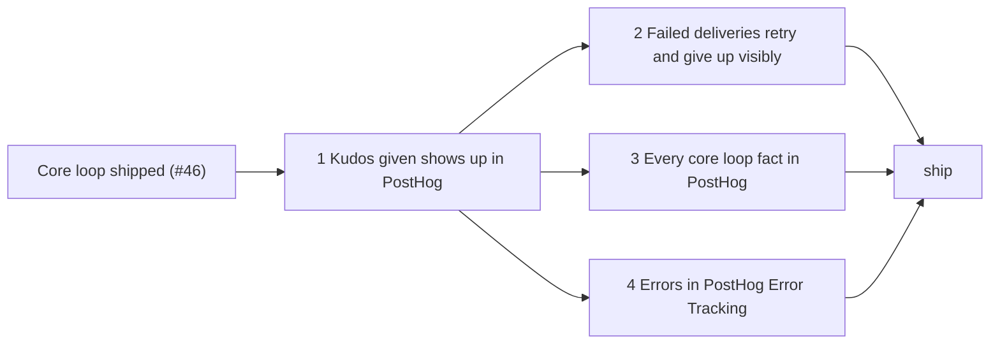

# Planned implementation tickets: stopping point 1, the core loop in PostHog

> **Accepted on [#69](https://github.com/Silthus/kudos/issues/69) (2026-10-13).** Each ticket below is a `wayfinder:implement` sub-issue of #69 with native blocking edges, and the ship ticket a `wayfinder:ship` sub-issue blocked by all of them. Rule numbers (`O17`, `R35`) refer to the [PostHog spec](posthog.md) and the [core loop spec](https://github.com/Silthus/kudos/blob/docs/spec-core-loop/spec/core-loop.md).

**Published:** tickets #71, #72, #73 and #74; ship #75. #72–#74 are blocked by #71, and #75 by all four.

**What stopping point 1 ships:** every core loop fact as a product event in PostHog within a minute, under an opaque analytics ID, with nothing a member wrote and no Slack ID; uncaught errors in PostHog Error Tracking; an outbox that retries failed deliveries on a fixed schedule and gives up visibly; capture off wherever the token or the environment isn't set.

Every ticket builds on `main` after the core loop ships (blocked by #46) and lands on the integration branch `spec/posthog`, which the conductor creates and wires. Every ticket is a reviewed change, tested outside-in at the spec's seams, with `pnpm gate` green. The token never enters the repository, a test, a log or GitHub (O32); tests use a fake token.

---

## 1. Kudos given shows up in PostHog (#71)

**Blocked by:** #46 (core loop ship). The conductor wires that edge.

**What to build:** a Given kudos message in Slack makes `kudos given` (on the giver) and one `kudos received` per award (on each recipient) appear in PostHog. It adds the analytics module: analytics IDs and the workspace key, the projections for both events, recording into the outbox from a `kudosGiven` subscriber, the drain that POSTs due rows to `/batch/` with a checked `fetch` and deletes them on 2xx, and the capture switch. The engine adds `retry` and `skippedMentions` to `kudosGiven` (and `inThread` if the projection needs it).

**Acceptance criteria**
- [ ] At the Slack boundary: a signed kudos message that gives makes one `/batch/` request to `POSTHOG_HOST` with `kudos given` and a `kudos received` per recipient, with exactly O3's properties and O2's `environment`, `workspace_key` and `taxonomy_version` (O1–O3).
- [ ] `distinct_id` is the member's analytics ID: the same UUID on every event for a member, different per member, never a Slack ID or a Convex ID (O7); `workspace_key` is the same on every event (O8).
- [ ] Never sent (O10): a kudos message full of distinctive words, display names and IDs runs through the whole loop and no PostHog request body contains any of them, nor any `U…`, `T…` or `C…` Slack ID, an emoji name or a time zone.
- [ ] Redelivering the Slack event sends each event once (O4); the timestamp is the spend instant (O5); UUID, name, `distinct_id` and timestamp are fixed when recorded (O14).
- [ ] Without `POSTHOG_PROJECT_TOKEN`, or without a valid `KUDOS_ENVIRONMENT`, nothing is recorded and nothing is sent (O26).
- [ ] PostHog answering 503 changes nothing Slack sees: the same awards, indicator and reply (O15); recording makes no network call.
- [ ] With PostHog answering 2xx, an event is delivered within 1 minute and leaves the outbox (O16, O17); requests carry at most 100 events; only one drain runs at a time.
- [ ] The projections are pure functions with rule tables; the subscriber and drain are tested at the module seam; one end-to-end path at the Slack boundary.
- [ ] Coherence: the analytics component spec exists with the invariants "only allowlisted properties leave the deployment" and "analytics never blocks the domain", each with a witnessed refutation; the lexicon settles product event, analytics ID, workspace key, outbox, drain and capture.

**Context:** spec O1–O5, O7–O8, O10–O17, O26–O28, O32, "Contracts" (projections, outbox, drain), "Why an outbox, not the Workpool"; research #68 (`captureImmediate()` resolves on a 503; edge entrypoint only).

## 2. Failed deliveries retry and give up visibly (#72)

**Blocked by:** 1.

**What to build:** the drain's failure handling. A batch PostHog doesn't accept is retried on the R29 schedule with the same identity, a rejected batch is given up at once, an exhausted event is logged and kept for 7 days, claims are fenced by a lease token, a crashed drain's batch is released when its lease expires, and capture switched off pauses the outbox.

**Acceptance criteria**
- [ ] With fake timers and a stubbed `fetch`: 429, 503, 401, a network error and no answer within 10 s each retry every event 1, 6, 36, 156 and 516 minutes after its first failure (successive delays of 1, 5, 30, 120 and 360), and give it up on the sixth failure (O18).
- [ ] A retry sends the same UUID, name, `distinct_id` and timestamp as the first attempt (O14).
- [ ] 400 and 413 give the batch up at once as `rejected` (O18).
- [ ] Giving up logs one line per batch with a fixed code, the event names and the reason, never properties (O19, O25); exhausted rows are deleted 7 days later by a daily cron (O19).
- [ ] A drain that dies mid-batch has its batch released by the recovery check at its lease's expiry and sent within 3 minutes (O16, O17); a drain that resumes after its lease expired and tries to settle rows now claimed by another changes nothing (lease token); an event recorded during recovery is still sent; the 10-minute cron restarts a stale drain as a backstop.
- [ ] With capture switched off and a populated outbox, the drain makes no request and counts no failure; switching it back on sends the rows; a row still pending 7 days after recording is given up as `expired` (O26).
- [ ] A failure of the analytics module's own functions is logged and never recorded as an exception event (O20).
- [ ] Coherence: the invariant "an event keeps its identity across delivery attempts" is declared with a witnessed refutation; the lexicon settles exhausted.

**Context:** spec O14, O16–O20, O25, "Contracts" (the outbox and the drain); core loop R29 (the schedule) and R49 (the 7-day cleanup).

## 3. Every core loop fact in PostHog (#73)

**Blocked by:** 1. Can run beside 2 and 4.

**What to build:** the rest of O3's taxonomy. The engine publishes `attemptFailed` for Over allowance and Invalid; welcome publishes `memberWelcomed`; the adapter reports App Home opens and `/hedgehug` use as usage facts. The analytics module projects and records `attempt failed`, `member welcomed`, `app home opened` and `command used`.

**Acceptance criteria**
- [ ] At the Slack boundary: an Over allowance message and an Invalid message each send `attempt failed` with `outcome` and O3's properties; editing the Over allowance message into one that gives sends `kudos given` with `retry: true` (O3, O4).
- [ ] Ignored, withdrawn, waiting and abandoned messages send nothing (O3).
- [ ] A member's first Given award sends `member welcomed` with `as` once, whatever Slack redelivers (O3, O4, R42).
- [ ] Opening App Home sends `app home opened`, recorded with the event's receipt: a redelivered `app_home_opened` and a retried `views.publish` send nothing more; a non-member opening it sends nothing (O3, O4, R47, R49).
- [ ] `/hedgehug` and `/kudos` send `command used` with `alias` and each `result` (`joined`, `already in`, `private channel`, `direct message`) once the action knows it, with the time the command arrived; the route passes the user, the alias and that time to the action; a non-member's command sends nothing (O3, O5).
- [ ] The never-sent test of ticket 1 covers the new events (O10).
- [ ] `attemptFailed` and `memberWelcomed` are added to the event registry by adding types only; existing subscribers are unchanged.
- [ ] Coherence: the lexicon's domain event entry names the new events if it lists them.

**Context:** spec O3–O5, O10–O11, "Contracts" (domain events, usage facts); core loop R10, R15, R23, R42, R45, R47, `/hedgehug` (R39–R41).

## 4. Errors in PostHog Error Tracking (#74)

**Blocked by:** 1. Can run beside 2 and 3.

**What to build:** manual error capture for the free plan. Every exported `httpAction` and `internalAction` runs inside the analytics module's error boundary, which records one `$exception` in the outbox and rethrows it marked `[reported]`; a cron sweeps failed scheduled functions every 15 minutes with a watch list; only reportable errors send their message; `POSTHOG_NATIVE_ERRORS=on` turns both reporters off.

**Acceptance criteria**
- [ ] An action that throws records one `$exception` and still fails; an HTTP route whose mutation throws records one `$exception` and Slack still gets a failure status, so it redelivers; an action called by another action reports once, not twice (O22).
- [ ] If recording the exception fails, the boundary logs it and the original error still propagates (O22).
- [ ] A scheduled mutation that throws is found by the sweep and recorded once; so is one that was still pending at one sweep and failed before the next; a failure already recorded by a boundary (`[reported]`) is not recorded again; the sweep never reports the analytics module's own functions (O20, O22).
- [ ] An `$exception` carries `distinct_id` `deployment:{environment}`, O2's properties, the function path and kind, and `$exception_list` with the type, the value and stack frames as file, function and line only; the shape is checked against PostHog's current manual-capture schema (O23).
- [ ] Only a reportable error sends its message; malformed JSON, a Convex argument validation error and a dependency error whose input holds distinctive text and Slack IDs send `unexpected error` and their type name, and none of that text (O10, O23).
- [ ] Expected outcomes record no exception: an Over allowance attempt, a gone delivery, a rate limit, a 401 for an unsigned request, a retried analytics batch (O21).
- [ ] With `POSTHOG_NATIVE_ERRORS=on`, boundaries and the sweep record nothing (O24, O29).
- [ ] The errors this codebase throws on purpose become reportable errors with messages from fixed text and Slack error codes (for example the `conversations.join` failure).
- [ ] Every `httpAction` and `internalAction` except the drain is wrapped; a test lists the exported actions and fails on an unwrapped one.
- [ ] Coherence: the invariants "an error is reported once" and "only a reportable error sends its message" are declared with witnessed refutations; the lexicon settles error boundary, reportable error and failed-job sweep.

**Context:** spec O20–O24, O29, "Contracts" (the error boundary); research #68 (rethrowing from a mutation rolls back a scheduled report; native reporting needs Convex Professional).

## Ship: the core loop in PostHog (#75)

**Blocked by:** 1, 2, 3 and 4.

**What to do:** follow the **Ship ticket** section of the orchestration-wayfinder SHIP procedure, with the map's merge and deploy authority.

1. Open a draft pull request from `spec/posthog` to `main` with the `pr` skill; the Summary maps each ticket to its commits. It closes this ticket and tickets 1–4.
2. Review the whole branch against `main` with the [PostHog spec](posthog.md) as the oracle: one review from the other model family, or `qa-swarm` if it touches a `merge-risk` danger area (it wraps every public HTTP route). Fix every finding that holds, gate green, push.
3. Configure the sandbox deployment: `KUDOS_ENVIRONMENT=sandbox` and `POSTHOG_PROJECT_TOKEN` from the conductor's local config (`~/.config/kudos/posthog-project-token`), set through the Convex CLI or MCP without printing it. Prove on the pull request, without the token: a real kudos in the sandbox app shows `kudos given` and `kudos received` in PostHog with `environment = sandbox`, and a synthetic error shows as an issue in Error Tracking.
4. Merge to `main`, confirm the production deploy, set `KUDOS_ENVIRONMENT=production` and the token on the production deployment the same way, and record the merged commit, the deploy run and the first production `kudos given` (its existence, never a count or member data).

**Michael's decisions (2026-10-13), shipped as settings:** one PostHog project for both deployments, the same token on each and `KUDOS_ENVIRONMENT` telling them apart; Convex stays free, so `POSTHOG_NATIVE_ERRORS` stays off and our own boundaries and sweep report errors; no flags key (the first ticket that gates something behind a flag asks for it); group analytics off.
