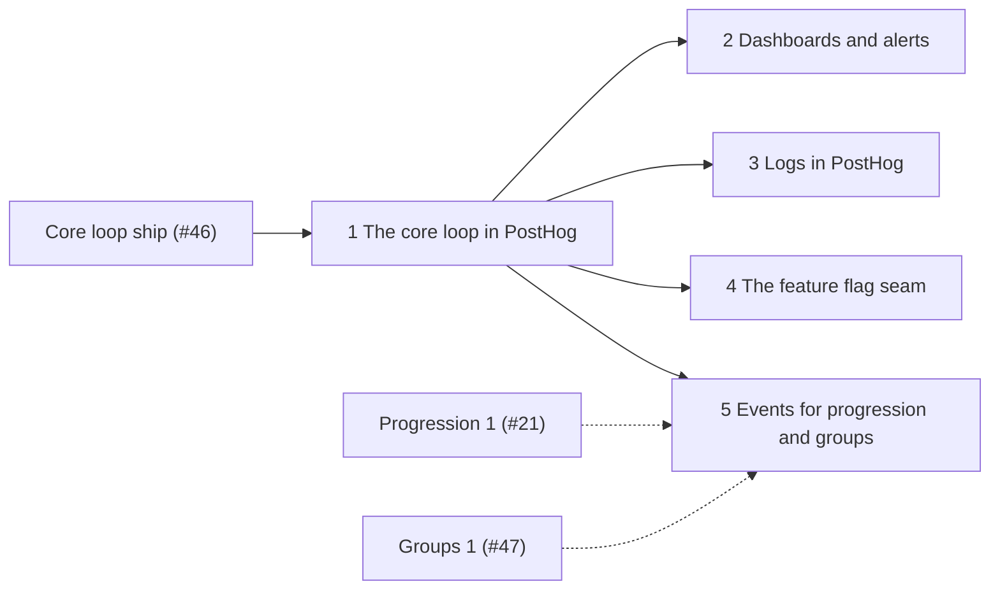

# PostHog in stopping points

> **Accepted on [#69](https://github.com/Silthus/kudos/issues/69) (2026-10-13)** under the map's autonomous build-and-ship authority. The [PostHog spec](posthog.md) is the destination; it ships as the stopping points below, each deployed to production on its own (map decision 8). Rule numbers (`O17`) refer to the spec. Stopping point 1 is published as `wayfinder:implement` sub-issues of #69 with a `wayfinder:ship` sub-issue; stopping points 2–5 are `wayfinder:spec` sub-issues of #69.

**Published (sub-issues of #69):** 1 the core loop in PostHog: tickets #71–#74 and ship #75 · 2 dashboards and alerts #76 · 3 logs in PostHog #77 · 4 the feature flag seam #78 · 5 events for progression and groups #79. Stopping points 2–5 are blocked by #75.

Every stopping point leaves something Michael can see in PostHog. Michael's decisions of 2026-10-13 apply to all of them: Convex stays free, one PostHog project with `environment` on every event, and the flags key is asked for by the first ticket that gates something behind a flag (spec, "Michael's decisions").

Solid edges are dependencies; dotted edges mean stopping point 5 rides along with those stopping points as they ship.

| # | Stopping point | What Michael gets | Rules | Needs shipped first | Needs from Michael |
|---|---|---|---|---|---|
| 1 | **The core loop in PostHog** | every core loop fact as a product event in PostHog within a minute (`kudos given`, `kudos received`, `attempt failed`, `member welcomed`, `app home opened`, `command used`); uncaught errors in PostHog Error Tracking; delivery that retries and gives up visibly; capture off wherever it isn't configured | O1–O5, O7, O8, O10–O24, O26–O29, O32 | the core loop (#46) | nothing: the project token exists; one project and no Convex Professional are decided |
| 2 | **Dashboards and alerts** | the "HedgeHug product" and "HedgeHug operations" dashboards, the hourly heartbeat, alerts on new production errors, more than 10 production exceptions in an hour and a missing heartbeat, each proven with a controlled notification; a weekly product subscription | O37–O40 | 1 | access to the PostHog project for creating dashboards and alerts (API key with dashboard and alert write, or doing it through the PostHog MCP); a notification destination (default: Michael's email) |
| 3 | **Logs in PostHog** | production's function logs in PostHog Logs, every line a safe fixed code (O25), after an audit that fixes the core loop's lines that print a Slack user ID | O25, O29 | 1 | nothing: Convex stays free, so our own code exports the logs (below) |
| 4 | **The feature flag seam** | `flag()` with a safe default for every flag, local evaluation, exposure events; its first consumer is the next slice that wants a dark launch | O31, O33–O36 | 1 | the flags key, asked for by the first ticket that gates something behind a flag; until then every flag answers its safe default |
| 5 | **Events for progression and groups** | the events of "Events for later stopping points", each added by the stopping point that builds its code; the group analytics switch | O6, O9, O12, O30 | 1; then each progression and groups stopping point as it ships | whether to buy PostHog's group analytics add-on (default: no) |

## Calls in this split (accepted)

- **Stopping point 1 is the thinnest slice Michael can see**: product events from the live core loop plus error capture. It needs no new secret and no paid plan, so it ships autonomously after the core loop.
- **Retries are their own ticket** inside stopping point 1: the first ticket proves the path end to end on 2xx, and the second makes failure handling (O16–O20) complete before the ship.
- **Dashboards and alerts come second**, once there is data to chart, and they are the first step that needs Michael's PostHog access. The heartbeat (O40) rides with them, because only an alert gives it a purpose.
- **Logs come third, on the free path Michael chose.** Our own code exports `warn` and `error` lines as OTLP records through the analytics outbox's drain to PostHog's `/i/v1/logs` (#68: direct OTLP JSON from a default-runtime action answered 200), after the O25 audit, so production problems reach PostHog Logs; `info` lines stay in the Convex dashboard. Convex Professional's native log stream stays a later upgrade that replaces the export.
- **Flags wait for a consumer.** The seam ships with the stopping point that first wants a dark launch, so its first flag is real. Installing the `@posthog/convex` component earlier would run its refresh loop and supervisor cron for nothing.
- **Progression and groups events ride along.** Stopping point 5 is not a separate deploy: it lists, per progression and groups stopping point, the events and properties to add (O6), and the conductor folds them into those stopping points' tickets as they are planned. Group analytics stays off unless Michael opts in.
