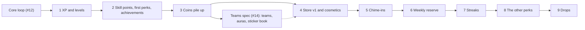

# Progression in stopping points

> **Draft for approval on [#13](https://github.com/Silthus/kudos/issues/13).** Not published yet. The [progression spec](progression.md) is the destination; it ships as the stopping-point specs below, each its own `wayfinder:spec` sub-issue of #13, shipped and deployed to production on its own. Rule numbers (`P16`) refer to the spec. The order follows the cross-spec slice order `d-1e03b988`.

Every stopping point leaves a usable game: something to earn, somewhere to see it, nothing empty. Each one adds its Coherence component specs, invariants and vocabulary, and its achievement ladders land with the data they count.

The dotted edge is the slice order, not a dependency: store v1 doesn't need teams, so it can ship before the teams spec if #14 runs late.

| # | Stopping point | What a member gets | Rules | Ladders that land | Slack changes |
|---|---|---|---|---|---|
| 1 | **XP and levels** (+ minimal App Home) | XP from every kudos, levels, skill points saved for later, a level-up DM, a public level notice, App Home with level, XP and privacy settings; earlier kudos count | P1–P13, P63–P70 | none | App Home tab, `app_home_opened`, interactivity URL, `im:write` |
| 2 | **Skill points, first perks and achievements** | Spend points on the first tiers `spark`, `circle` and `echo` from DM buttons and App Home; the thoughtful-kudos hint; 7 ladders with exclusive titles and cards; collection and loadout (title, card) | P14–P24 (first tiers), P34–P36, P39, P58–P62, P71 hint | Generosity, Recognition, Connections, Dependability, Applause, Seasons, Old Friends | image blocks (Convex storage check) |
| 3 | **Coins pile up** | 4 coins per qualifying recognition, receiving coins, balance in App Home, `+4 🪙` on the success line; first sink: the upgrades of stopping point 2's perks (`flame`, `bridge`, `resonance`) | P16–P17, P19–P20 (upgrades), P29–P30, P71 | none | none |
| — | **Teams spec (#14)** | teams, team perks and auras, the sticker book, Team Spirit | P45 seams | Team Spirit | per #14 |
| 4 | **Store v1 and cosmetics** | the store (exact cosmetics at rarity prices, XP booster), expression perks (`signature`, `keepsake`, `gallery`), quips as the one public reply, unlockable kudos emoji incl. admin custom emoji | P31–P33 (without lantern and freeze), P34–P39, P24 | none | `emoji:read` |
| 5 | **Chime-ins** | click the app's reaction to join a kudos; thresholds, Crowd boosters, recipient bonus XP, the threshold line | P46–P53 | Crowd Favourite, Standing Ovation, Amplifier | `reactions:read`, `reaction_added` |
| 6 | **Weekly reserve** | `reserve`, `reservoir` (and `provision` once teams ship), the reserve in replies and App Home, the reason hint | P25–P28 | none | none |
| 7 | **Streaks** | workdays, free pauses, streak display (hideable), freezes in the store, `rhythm` and `cadence` (they need workdays) | P54–P57, P31 freeze | Momentum | none |
| 8 | **The other perks** | the active branch: `focus` switched on for one day a week, and its upgrade `spotlight`; with it every non-team, non-discovery perk is in | P18–P22 | none | none |
| 9 | **Drops** | free drops with rising chance, `curiosity`, `fortune`, `fieldnotes`, Discovery Lantern, drop DMs, odds in App Home | P40–P44, P31 lantern | none | none |

## Calls in this split (each open to Michael)

- **Minimal App Home ships with stopping point 1**, not the core loop: `d-1e03b988` names "core loop + minimal App Home" first, but the core loop spec (#12) leaves App Home out. Levels need a place to show, so it lands here.
- **Stopping point 2's first perks** are the three passive ones whose triggers need nothing later: `spark`, `circle` and `echo`, one per play style (steady, broad, receiving). `rhythm` waits for workdays (7), `reserve` for the reserve (6), `signature` for coins (4), `focus` for its switch-on command (8), discovery for drops (9).
- **Coins get a first sink in stopping point 3**: the upgrades of the perks members already own. "Coins pile up" in `d-1e03b988` means earning before the store; a sink that already exists in the rules keeps the wallet from feeling pointless for a whole stopping point.
- **The XP booster ships with store v1**, the Discovery Lantern with drops, freezes with streaks: each store item arrives with the thing it boosts.
- **Achievements land where their data is**: 7 ladders in 2, Momentum in 7, the chime-in ladders in 5, Team Spirit with teams.
- **The content ticket lands in stopping point 2**, where the first cosmetics (achievement titles and cards) appear. It is long-lead (original art), so it is planned now with stopping point 1's tickets and can start immediately; its catalogue grows in later stopping points (quips, emoji and store items in 4, drop pools in 9).
- **`spark` uses the default Monday-to-Friday workdays until streaks ship** (stopping point 7 adds changing them and pauses).
