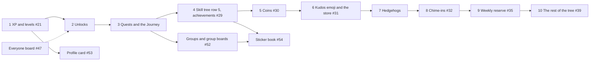

# Progression in stopping points, after the scope cut

> **Accepted on [#86](https://github.com/Silthus/kudos/issues/86) (2026-10-13).** The [revised spec](progression.md) is the destination. It ships as the stopping points below, each a `wayfinder:spec` issue on map #1, shipped and deployed on its own and dark behind its own flag until Michael switches it on (decision 11). Rule numbers (`P72`) refer to the spec, `G` numbers to the groups spec. Amended on [#97](https://github.com/Silthus/kudos/issues/97) for the Octalysis findings: rows 3, 4, 5, 6, 7 and 8 changed, the order didn't. This plan replaces [the first one](https://github.com/Silthus/kudos/blob/1da795da2755e54cedbee21fb2659cbf0840bd7b/spec/progression-stopping-points.md).

Every stopping point leaves a usable game. The order follows the unlock schedule (P72), so each feature arrives in the order members meet it, and puts first what the website needs first: each member's opened unlocks, then quest state, then tier dates.

The dotted edge is the order, not a dependency: the Everyone board ships before unlocks, and P77 keeps it open for every member who had it.

| # | Stopping point | Issue | What a member gets | Rules | Flag |
|---|---|---|---|---|---|
| 1 | **XP and levels** | #21, shipped by #80 | XP, levels, skill points from level 5, the level-up DM, the public level notice, App Home's level and settings | P1–P13, P63–P70 | `xp-levels` |
| 2 | **Unlocks** | new | the schedule, ready and opened, `Open` in the level-up DM and App Home, `Next:` lines, the opened set for the website, the unlock filter in feedback | P72–P79, P92 (unlock crates) | `unlocks` |
| 3 | **Quests and the Journey** | new | Quests at level 2: 3 feasible personal quests a week with one reroll, the Journey's steps for shipped features, rewards recorded on finishing and revealed by `Open`, quest lines in the success reply; the group quest joins with groups | P2, P80–P92, P71, P95 | `quests` |
| 4 | **The skill tree's first row and achievements** | #29 | the skill tree at level 5 with `spark`, `rhythm`, `circle`; the gate hint; the perk copy; the Book's achievements: 11 ladders with earned dates, their DMs and notices, rewards granted as their kinds ship | P14–P22 (row 5), P15, P58–P62, P76, P94, P95 | `skill-tree` |
| 5 | **Coins** | #30 | coins from giving, receiving, quests and tiers from the day coins ship (tiers earned earlier get their coins once, P62), the wallet at level 6, `+4 🪙`, `treasurer` and `banker`, the row-7 upgrades `flame`, `cadence`, `bridge` | P16–P20, P29–P30, P62 (coin rewards), P71, P94 | `coins` |
| 6 | **Kudos emoji and the store** | #31 | the inventory at level 6: the starter 🦔 in the first loadout slot, the Journey's `your-emoji` step, up to 3 emoji in the loadout, the store's kudos emoji, silver tier and quest emoji, admin custom emoji | P31–P32, P34, P36, P38, P62 (emoji rewards), P69 | `store` |
| 7 | **Hedgehogs** | new | the starter avatar, the collection at level 7, level, tier, quest and Journey hedgehogs, the store's hedgehogs, the avatar on App Home and the profile card; no Journey step | P31, P34, P36, P39, P62 (hedgehog rewards), P90 | `hedgehogs` |
| 8 | **Chime-ins** | #32 | join a kudos with the app's reaction, the threshold line (no threshold XP); the three chime-in ladders; chime-in quests | P46–P52 | `chime-ins` |
| 9 | **Weekly reserve** | #35 | `reserve` and `reservoir`, the reserve gated on thoughtful kudos, the reason hint | P25–P28 | `weekly-reserve` |
| 10 | **The rest of the tree** | #39 | `focus` and `spotlight`, `echo` and `resonance`: every perk is in | P18–P22 | `perks` |

**Groups stopping points** (groups spec #14): the Everyone board #47 (shipped by #81, no change), the profile card #53 (after stopping point 1, the avatar joins with 7), groups and the group boards #52 (adds the group quest P82, after stopping point 3), the sticker book #54 (part of the Book, after stopping point 4 and #52). Group auras #55 are cut.

**Cut and closed:** streaks #37, drops #42, group auras #55.

## Calls in this split

- **Unlocks come right after XP and levels**, before any feature they gate, so every later stopping point plugs into the unlock filter instead of retrofitting it. With only the basics and the leaderboard shipped, unlocks ship as the mechanism and the website's opened set.
- **Quests come before the skill tree**, following the schedule (quests at 2, the tree at 5), and they give the XP slice its first weekly goal.
- **Achievements stay with the tree's first row** (#29), as in the first plan. Their rewards arrive as coins (5), kudos emoji (6) and hedgehogs (7) ship (P62), so the Book's earned dates exist early for the website.
- **Coins and the store are split by kind**: coins and their perk sink first (5), then kudos emoji with the store (6), then hedgehogs (7), one stopping point per unlock row.
- **The weekly reserve stays** because `reserve` and `reservoir` are in the tree. It is not cut.
- **Chime-ins stay**, without the crowd booster, because three ladders and the participation quests count them.
