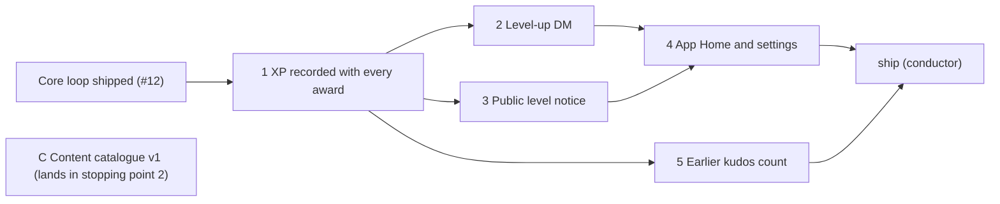

# Planned implementation tickets: stopping point 1, XP and levels

> **Draft for approval on [#13](https://github.com/Silthus/kudos/issues/13).** Not published yet. On approval, stopping point 1 becomes a `wayfinder:spec` sub-issue of #13 and each ticket below a `wayfinder:implement` sub-issue of #13 with native blocking edges. Rule numbers (`P7`, `R36`) refer to the [progression spec](progression.md) and the [core loop spec](https://github.com/Silthus/kudos/blob/docs/spec-core-loop/spec/core-loop.md).

**What stopping point 1 ships:** every Given kudos earns XP (10 given, 5 received) recorded once with its award; levels and saved skill points; a level-up DM; a public level notice under the kudos message or in an announcement channel; App Home with level, XP and privacy settings; earlier kudos counted. No perks, coins or cosmetics yet.

Every ticket is a reviewed pull request, tested outside-in at the spec's seams, with `pnpm gate` green. The conductor's `ship` ticket deploys stopping point 1 to production and runs the backfill there.

---

## 1. XP recorded with every award

**Blocked by:** the core loop's `ship` ticket (production publishes `kudosGiven`).

**What to build:** a member gives kudos and both sides earn XP, recorded once with the award. It covers award IDs and `via` on `kudosGiven` (additive), the thoughtful parse hook that annotates every kudos message with its gate decision, the progression module as a pure reducer wrapped by a `kudosGiven` subscriber, insert-only effects records with base XP and the gate decision, derived XP, level and skill points, and `levelReached`.

**Acceptance criteria**
- [ ] A Given award writes one giver record (+10 XP per kudos) and one recipient record (+5 per kudos), each with the gate decision and catalogue version (P1, P7).
- [ ] Delivering the same `kudosGiven` twice, or retrying the subscriber, leaves one record per side; records are never updated (P8).
- [ ] Levels follow P3 (20, 100, 300 … 3,600 at L10); skill points are `level − 1 − spent` (P4); an award crossing several levels publishes one `levelReached` with the highest level and the points gained (P6).
- [ ] The parse hook annotates `{ version: 1, thoughtful, words }` per P11 (mentions, emoji, channel links and URLs don't count); a recheck reuses it and a retry decides again (P12). Base XP doesn't depend on it (P13).
- [ ] The reducer is a pure function tested with rule tables; the subscriber is tested once at the engine seam.
- [ ] Coherence: the progression component spec exists, with the invariant "effects records are insert-only" declared and its refutation witnessed; the lexicon settles effects record, gate decision and levelReached, and `kudosGiven`'s new fields keep the core loop's terms.

**Context:** spec P1–P13, "Contracts"; ADR-0002, ADR-0004; brief D20, D21, §13 E6; prototype `progression-sketch.ts`; the rerun's XP curve.

## 2. Level-up DM

**Blocked by:** 1.

**What to build:** reaching a level sends the member a DM. It adds DM intents to the feedback module (`notify`), their delivery (`conversations.open`, `chat.postMessage`, retries and `Retry-After` as for private replies), the `im:write` scope in the manifest, and the "before perks ship" level-up copy. The member's DM setting is read with its default (on); ticket 4 lets them change it.

**Acceptance criteria**
- [ ] `levelReached` sends `🎉 You reached level {n}! You have {points} skill points saved for perks.` then `Level {n+1} is {xp} XP away.` to that member only (P63, copy table).
- [ ] Several levels in one award send one DM for the highest (P6).
- [ ] A member whose DM setting is off gets no DM; nothing else changes (P63).
- [ ] A failed or repeated delivery never changes XP or levels, and a DM is tried at most 3 times (R34, R35).
- [ ] Sandbox check: the DM arrives from the app in the member's Messages tab.

**Context:** spec P63, P70, copy; brief §13 E3; core loop R34–R35 (delivery policy to reuse).

## 3. Public level notice

**Blocked by:** 1. Can run beside 2.

**What to build:** a level reached through a kudos message is celebrated publicly under it. It adds the one public reply per kudos message as desired state (D18: post once, then `chat.update` as sections arrive), its level section, routing to an announcement channel when the workspace has one, and the mute and hide rules (read with defaults: shown, not muted).

**Acceptance criteria**
- [ ] A level reached through a kudos message sets a section `🎉 {member} reached level {n}.` in that message's one public thread reply; a second level-up under the same message updates the same reply, never posts another (P64, D18).
- [ ] Two members levelling up from one message share the one reply.
- [ ] With an announcement channel set, the notice goes there instead and the thread gets nothing (P64).
- [ ] A member who hid their level or muted notices gets no public notice (P65).
- [ ] The notice never contains the kudos text or the giver (P64); no text is stored (R45).
- [ ] Sandbox check: the reply appears in the thread and is edited in place.

**Context:** spec P64–P65; brief D18, §13 E3; core loop R33 (relaxed: public replies are now allowed), R45.

## 4. App Home and progression settings

**Blocked by:** 2, 3.

**What to build:** a member opens the app's Home tab and sees their level, XP and settings. It adds `app_home_opened` and `views.publish` through a platform-neutral `homeOf(member)` view, App Home as desired state republished after changes, the `/slack/interactivity` route with signature checks, the command registry (D17) with its first commands (progression settings, announcement channel), and the manifest's App Home tab and interactivity URL.

**Acceptance criteria**
- [ ] Opening App Home shows level, XP, XP to the next level, skill points saved, today's kudos left, and the settings (P67).
- [ ] After a level up, the member's App Home is republished; the latest version wins and a failed publish is retried (P68).
- [ ] Toggling hide level, hide achievements, mute notices or progression DMs takes effect on the next notice or DM (P63, P65), and repeating the same click changes nothing (command idempotency).
- [ ] Workspace admins, and only admins, see a channel picker that sets or clears the announcement channel (P69).
- [ ] An unsigned or stale interactivity request gets 401 and does nothing (R42); interactions are acknowledged within 3 s.
- [ ] Coherence: the `/slack/interactivity` entrance is declared; the lexicon settles App Home, command and announcement channel use.

**Context:** spec P63–P69, "Contracts" (commands, App Home); brief D17, §13 E1; Slack research ([#5](https://github.com/Silthus/kudos/issues/5)) on App Home and interactivity.

## 5. Earlier kudos count

**Blocked by:** 1. Can run beside 2–4.

**What to build:** a one-off, resumable backfill that replays every award given before progression shipped into effects records with base XP only (P10), in award order, without notices; then live `kudosGiven` events continue from where it stopped, with no gap and no double count.

**Acceptance criteria**
- [ ] After the backfill, every earlier award has exactly one record per side with base XP only: no bonus, coins, drops, DMs or public notices (P10).
- [ ] Running it twice, or interrupting and resuming it, changes nothing more (P8).
- [ ] An award that arrives while the backfill runs is counted once.
- [ ] Levels and skill points after the backfill equal what the reducer computes from all awards.
- [ ] The `ship` ticket can run it against production with one command, and its run is recorded on the pull request.

**Context:** spec P8, P10; brief D12 (the awards table as the permanent log new subscribers backfill from); the Convex migrations component.

## C. Content catalogue v1

**Blocked by:** none. Lands in stopping point 2 (achievement rewards are the first cosmetics); planned now because original art is long-lead.

**What to build:** the cosmetics catalogue as versioned data with stable IDs, and its first art: ~70 quips, the curated kudos emoji list, cards and titles, and the 48 achievement tier rewards (12 ladders × 4 tiers), each with a rarity and a source pool (store, achievement, drop, expression perk). Art is original (commissioned or AI-assisted), reviewed by a person, ready for Convex storage.

**Acceptance criteria**
- [ ] Every cosmetic has a stable ID, kind, rarity, source pool and copy; IDs are unique and pools are disjoint (P34, P24).
- [ ] Every ladder tier (P58) names exactly one reward from the achievement pool.
- [ ] The drop pool holds 60 / 40 / 24 / 12 / 6 items by rarity, the `keepsake` pool 12, `signature` and `gallery` pools their disclosed items (P42, P18).
- [ ] A test validates the catalogue's shape and the rules above.
- [ ] Each card has a static image within Slack's image limits and a person's review recorded; no GIPHY, Tenor or member uploads, and no customer names or data anywhere (P39, public repo).
- [ ] Quips and titles follow the copy voice (P70).

**Context:** spec P18, P24, P34–P39, P42, P58; cosmetics research on `research/progression-economy`; the kudos-garden catalogue lessons (#4) as inspiration only.

---

## Open calls for this plan

- **Ticket C is planned with stopping point 1** although it lands in 2. Recommendation: publish it now so the art starts early.
- **No separate image-hosting ticket in stopping point 1**: no images ship until stopping point 2, whose first image ticket carries the Convex storage check.
- **The backfill is its own ticket (5)** rather than part of ticket 1, so ticket 1 stays a pure tracer bullet and the backfill can be reviewed against production data handling on its own.
