# Spec: the website's fifth slice, the home as the character sheet

> **Accepted on 2026-10-14 under the product owner's autonomous directive** (map [#57](https://github.com/Silthus/kudos/issues/57) Notes: "ship as much as you can of this autonomously proofing each step and deploying dark and safely behind feature flags"), with every open call at its recommendation (listed under "Further Notes"). Ticket [#231](https://github.com/Silthus/kudos/issues/231). This file lives on the branch `docs/spec-website-5` and is never merged. Its rules continue the earlier slices': `WS1`–`WS28` in [`spec/website.md`](https://github.com/Silthus/kudos/blob/docs/spec-website/spec/website.md), `WS29`–`WS54` in [`spec/website-2.md`](https://github.com/Silthus/kudos/blob/docs/spec-website-2/spec/website-2.md), `WS55`–`WS77` in [`spec/website-3.md`](https://github.com/Silthus/kudos/blob/docs/spec-website-3/spec/website-3.md) and `WS78`–`WS96` in [`spec/website-4.md`](https://github.com/Silthus/kudos/blob/docs/spec-website-4/spec/website-4.md). All still hold except where a rule below names the one it changes.
>
> Sources: the product owner's review of production on 2026-10-14 (#231's question, quoted there; the product owner's screenshot is described, never committed), the code on `main` at `384208c` and on `spec/website-4` at `c10ab6d` (the skill tree and the Book, ship #193, in flight), the accepted prototype #62's variant E (`prototype/website-ui` at `3409ade`, served at <https://earnest-ibis-715.convex.site>), the visual language ([`docs/website/visual-language.md`](https://github.com/Silthus/kudos/blob/main/docs/website/visual-language.md), V1–V24), #62's round 9 game cut, and the conductor's update moving the received-kudos card to spec [#233](https://github.com/Silthus/kudos/issues/233).

## Problem Statement

The product owner opened the live website and found that its home doesn't look like the prototype they accepted. Production's home is a text hero with a thin level bar, a `Your kudos` table of given and received counts, the Journey, two rows of small `Open` and `Still locked` cards, and one profile card alone on the right. The prototype's home is a game-HUD character sheet: a hero with a big level ring, the member's name as the title, an XP bar and the kudos left today as pips; a right rail with what teammates see, this week's quests and where the member stands; and every feature that isn't open yet shown as a locked panel in its own place, so the sheet has the same shape from level 1 on.

Each piece of the prototype's home either has its facts on `main` today or waits for a feature that hasn't shipped. The website's earlier slices built the facts but kept the first slice's layout, and two rules kept the look quieter than the prototype on purpose (WS17's quiet allowance line, WS48's unfilled ring). The other pages are close to the prototype, and nearly every difference there is a deliberate cut.

## Solution

**The home becomes the character sheet**, built only from facts the website already reads:

- **The hero is the character header.** It shows the member's face large, a level ring filled to the XP share of the level, and `Character` over the member's name as the page title. The invitation to thank someone and its one primary action come next, before any counter (#85). Then come a neutral XP bar, the kudos left today as the hero's one big number with one pip per kudos, the member's given and received totals in one quiet line, and Max's line on the week. The `Your kudos` table goes. The HUD's avatar carries the same filled ring.
- **Every shipped feature has one panel in its own place.** The Quests and Leaderboard panels sit in the right rail, and the Book and Skill tree panels sit in the main column under the Journey. A panel shows its feature's state: locked with its level, ready with its crate, or open with its content. A feature that hasn't shipped has no panel. The three `Ready for you`, `Open` and `Still locked` groups go.
- **The right rail is the prototype's.** It holds `What teammates see`, then a reserved slot for the recent-kudos card spec #233 designs, then `Quests this week` from `getQuests`, then `Where you stand` from `getLeaderboard` for this week.

The leaderboard, quests, skill tree and Book pages keep their shape. Their differences from the prototype are deliberate cuts, listed in the gap table with the rule behind each.

Each implementation ticket is its own pull request from `main`, because production is live. Each is complete when it merges and proves the live behaviour. No new flag is needed: each panel rides the flags that already gate its feature.

## The gap table

Screens compared on 2026-10-14. Production ran `main` plus `spec/website-4` from typed fixtures (a member at level 2 with the Leaderboard open, as in the product owner's screenshot, and a member at level 7 with every page open). The prototype ran at preview levels 2 and 8. Each image shows production on the left and the prototype on the right.

| Screen | Light | Dark |
|---|---|---|
| Home, level 2 | 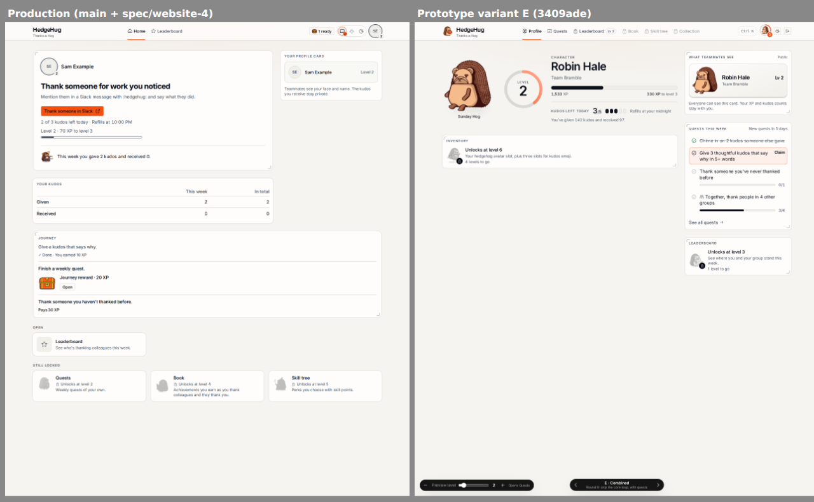 | 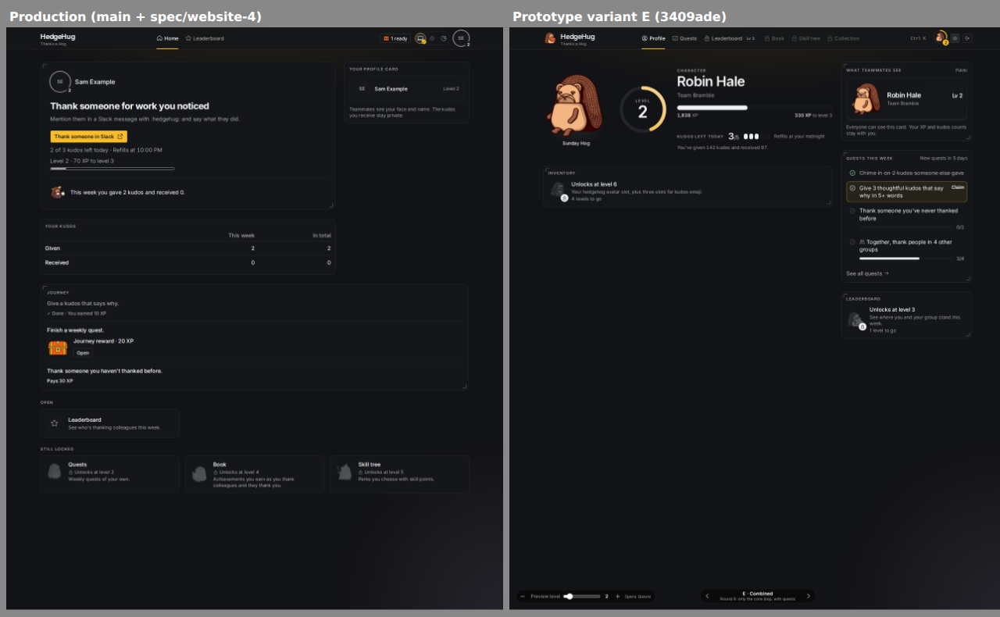 |
| Home, every feature open | 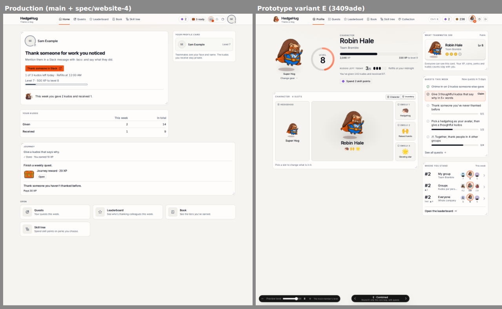 | 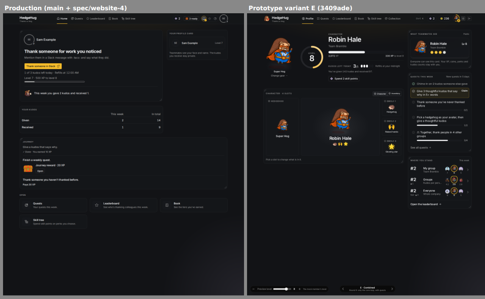 |
| Leaderboard | 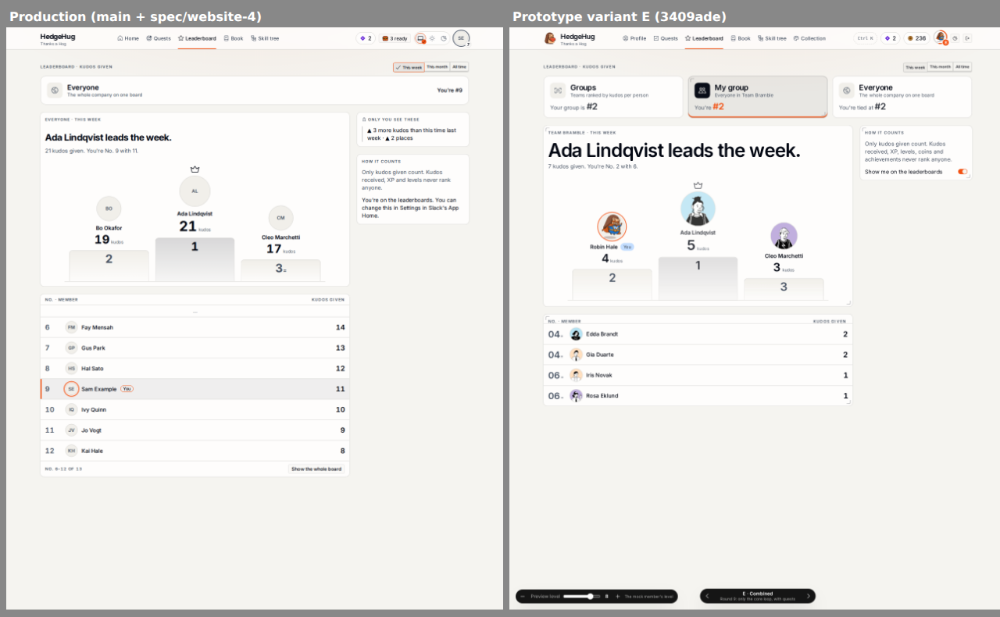 | 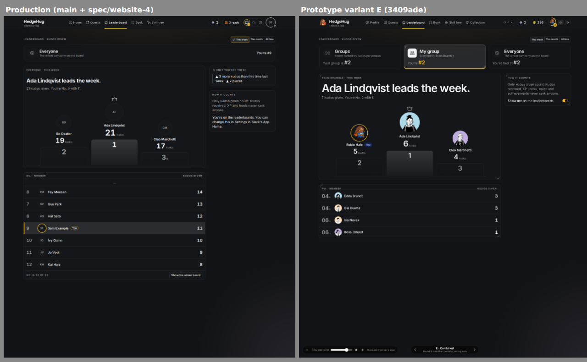 |
| Quests | 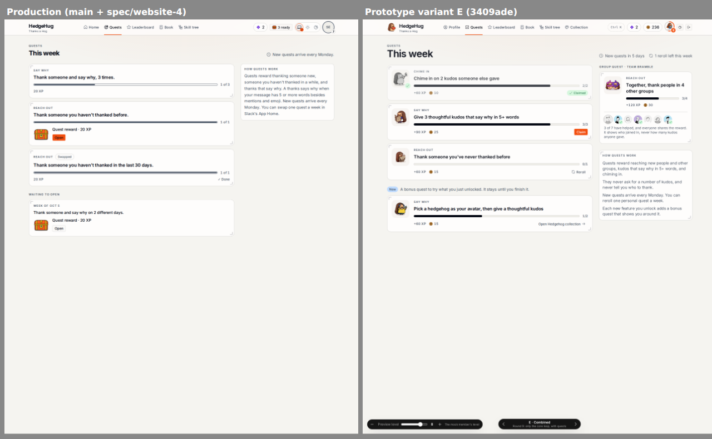 | 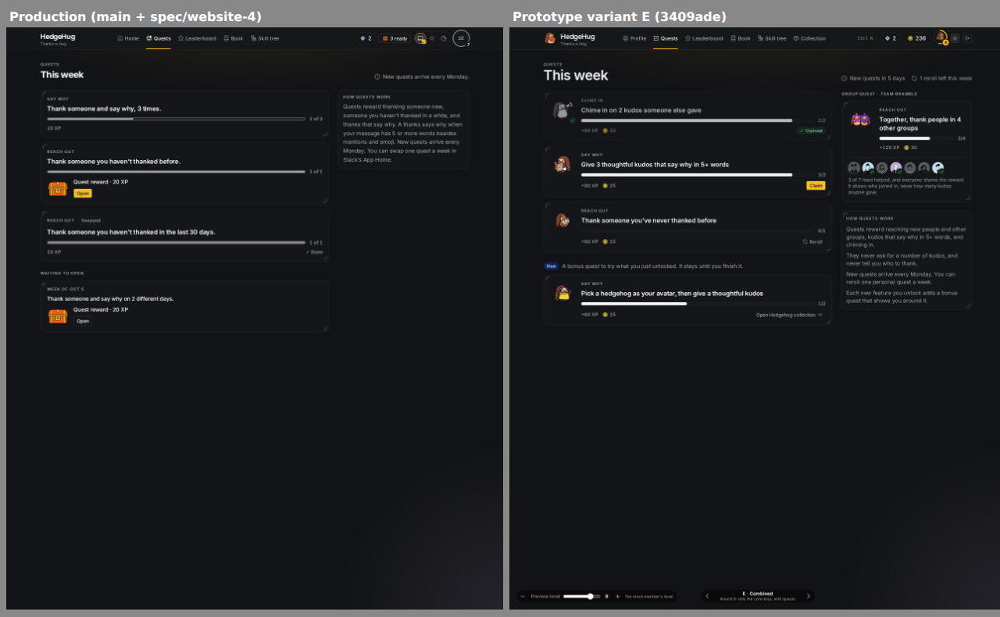 |
| Skill tree (`spec/website-4`) | 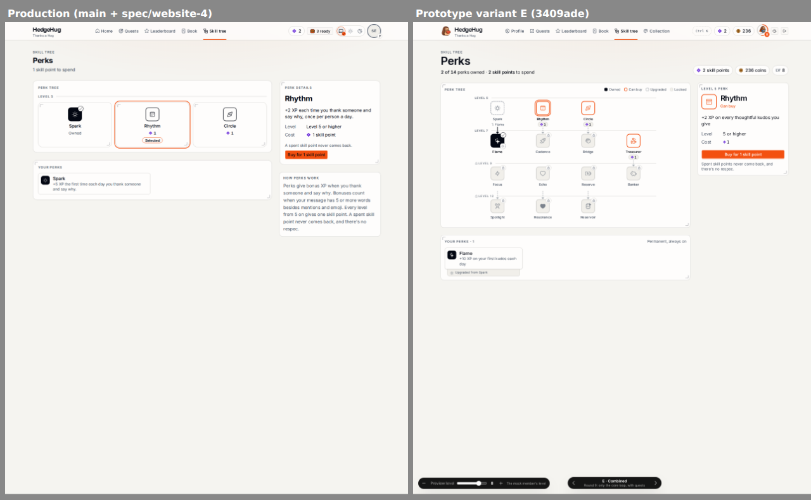 | 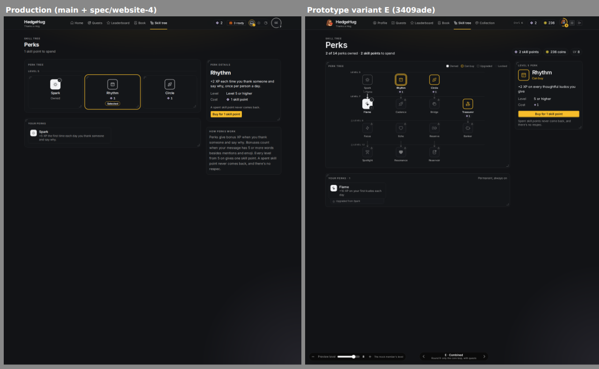 |
| Book (`spec/website-4`) | 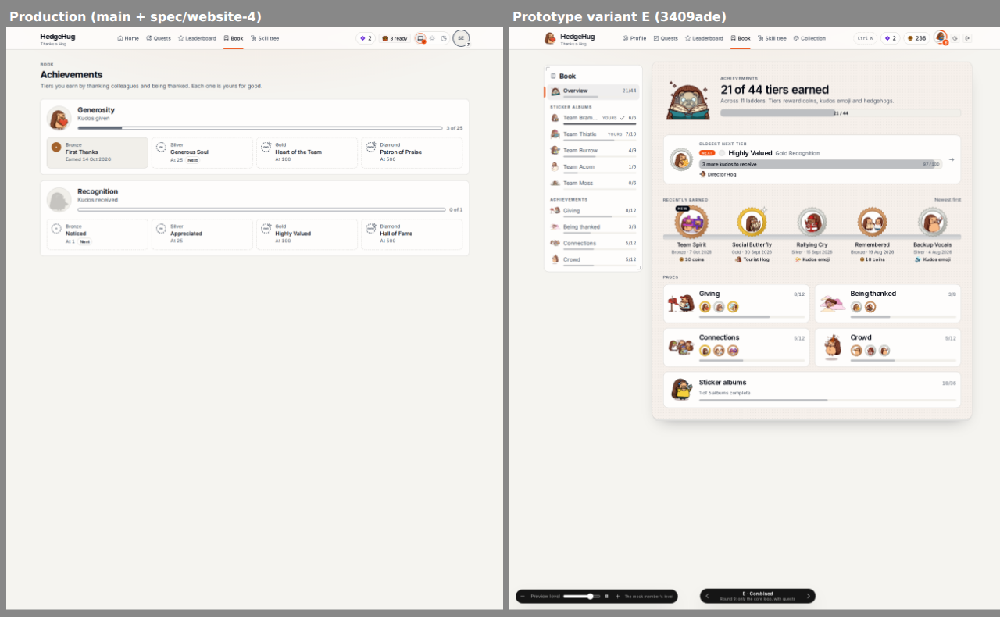 | 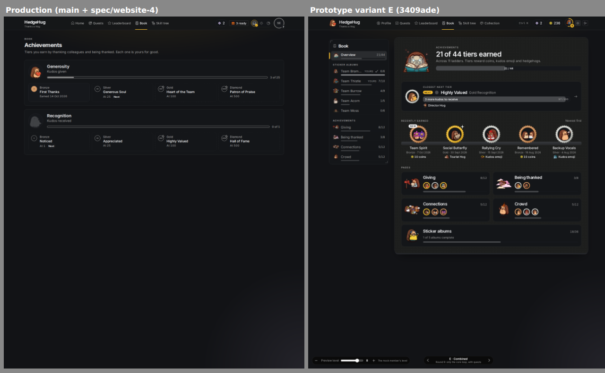 |

Verdicts: **port** is an unshipped port that lands now, with the rule and ticket. **Cut** is a deliberate spec call, with the rule behind it. **Later** is a follow-up outside this slice.

### Home

| Prototype | Production | Verdict |
|---|---|---|
| A 168 px hedgehog portrait with its name and `Change gear` | The member's face, 48 px | **Cut** for the hedgehog: hedgehogs haven't shipped (P78), and a hedgehog is the avatar only once equipped (V17, V20, WS48). **Port** for the size: the face becomes the portrait (WS98, ticket 1). |
| A 120 px level ring filled to the level's XP share, `Level` over the number | A plain ring around the small face, never filled (WS48) | **Port** (WS98, WS99, ticket 1). The arc stays neutral (V4), where the prototype's is primary. |
| `Character` label, the member's name as the title | The name in small type, then the headline `Thank someone for work you noticed` | **Port** (WS98, ticket 1). The invitation moves under the allowance. |
| The member's team under the name | none | **Cut**: groups haven't shipped (map #1's #52, P78). |
| A full-width XP bar with `{xp} XP` and `{n} XP to level {n + 1}` | `Level {n} · {n} XP to level {n + 1}` over a short bar | **Port** (WS98, ticket 1). |
| `Kudos left today` `3/5` in display type, with pips and the refill | `2 of 3 kudos left today · Refills at …` as a quiet line | **Port** (WS98, ticket 1), changing WS17's quiet line. |
| `You've given 142 kudos and received 97.` | the `Your kudos` table, this week and in total | **Port** (WS100, ticket 1). |
| `Spend 2 skill points` in the hero | the HUD's skill point chip (WS84, on `spec/website-4`) | **Port** to the Skill tree panel (WS105, ticket 2). The hero keeps one primary action. |
| `Give your first kudos in Slack` nudge panel | the invitation and `Thank someone in Slack` in the hero | **Cut**: the hero already invites, with the page's one primary action (WS17, V4), and the Journey teaches the first kudos (WS72). |
| No Max line | Max's line on this week | **Cut**: Max narrates the home's insight line (V18, WS17). |
| The Character and Inventory gear panel | none | **Cut**: coins, the inventory and hedgehogs haven't shipped (P78, #62 round 9). |
| The Inventory locked panel with `4 levels to go` | none | **Cut**: an unshipped feature has no card (P78, WS58), and locked never teases progress (V23). |
| `What teammates see` with `Public`, the hedgehog, team, `Lv 2` and best medals | `Your profile card`: face, name, `Level 2` | **Port** for the label, the look and the note (WS107, ticket 3). **Cut** for the hedgehog (V20), the team (#52) and medals, which teammates can't see until profile cards show tiers (#53, WS93). |
| `Quests this week`: each quest with progress, `See all quests` | none on the home; the Journey only | **Port** (WS109, ticket 3). **Cut** for `Claim` (rewards are crates, V13) and the group quest (unshipped). |
| `Where you stand`: My group, Groups and Everyone, faces above and below, a change arrow | none on the home | **Port** for the Everyone row (WS110, ticket 3). **Cut** for the group boards (unshipped) and the change arrow (no read carries last week's rank; call 10). |
| Locked panels in place: `Leaderboard · Unlocks at level 3` in the rail | `Open` and `Still locked` card rows below everything | **Port** (WS102–WS106, ticket 2). |
| no Journey on the home | the Journey panel | **Kept** (WS72), now in the main column under the hero (WS97). |
| no recent kudos | none | **Later**: spec #233's card, in the slot WS108 reserves. |

### The HUD

| Prototype | Production | Verdict |
|---|---|---|
| The avatar's ring filled to the level's XP share | a plain ring | **Port** (WS99, ticket 1). |
| The avatar is the equipped hedgehog | the member's face | **Cut**: hedgehogs haven't shipped (V20, P78). |
| Locked nav items with `Lv 3` | open pages only | **Cut** (WS59, P78, V23). |
| `Ctrl K` command palette | the theme control | **Cut** for now: the website has no command list (WS16). |
| Page titles in large display type (`This week`, `Perks`, `Robin Hale`) | smaller titles on every page | **Port** for the home's title (WS98, ticket 1). **Later** for the other pages: follow-up 4. |
| Coins chip | none | **Cut**: coins haven't shipped. |
| Skill point chip | the chip on `spec/website-4` | Ships with #193 (WS84). |
| The wordmark's hedgehog logo | the wordmark alone | **Cut**: no decorative hedgehogs in headers (V17). |

### Leaderboard

| Prototype | Production | Verdict |
|---|---|---|
| Three board cards: Groups, My group, Everyone | the Everyone card | **Cut**: group boards haven't shipped (G45; the card becomes a tab list when they do, #134). |
| Faces of other members on the podium and list | initials | **Later**: V19 asks for faces, and WS34 waits for the directory's real names and pictures (map #1's profile backfill). Follow-up 1. |
| `Show me on the leaderboards` toggle | the same sentence with a pointer to Slack's Settings | **Cut**: settings stay in Slack (WS46). |
| `How it counts` names coins | it doesn't | **Cut**: coins haven't shipped. |

### Quests

| Prototype | Production | Verdict |
|---|---|---|
| The group quest panel | none | **Cut**: unshipped (WS73). |
| Coin rewards | XP only | **Cut**: coins haven't shipped (WS70). |
| `Reroll` on the page | swapping stays in Slack | **Cut** (WS73). |
| `Claim` | crates with `Open` | **Cut** (V13). |
| A bonus quest per unlock | none | **Cut**: unshipped (WS73). |
| A hedgehog per quest card | the kind label | **Cut**: a hedgehog carries meaning only in V17's places. |

### Skill tree (`spec/website-4`)

| Prototype | Production | Verdict |
|---|---|---|
| 14 perks in four rows, later rows locked | the one shipped row | **Cut** (WS85, P78). |
| `2 of 14 perks owned`, coins, `LV 8` | none | **Cut** (WS85, WS94). |
| A legend: Owned, Can buy, Upgraded, Locked | none | **Later**: follow-up 2 (Owned and Can buy only; `Upgraded` waits for upgrades, WS85). |
| Compact square nodes joined by lines | wide nodes | **Later**: follow-up 2. Lines come with upgrades (WS85). |
| Its own perk lines, such as `+2 XP on every thoughtful kudos you give` | P94's copy, word for word | **Cut** (WS86, P95). |
| A `Can buy` node outlined in primary | an outlined neutral node; primary marks only the selection and `Buy` | **Cut** (V4, WS94). |

### Book (`spec/website-4`)

| Prototype | Production | Verdict |
|---|---|---|
| Sticker albums in a side list | none | **Cut**: the sticker book hasn't shipped (WS82). |
| `21 of 44 tiers earned` and the closest next tier | none | **Cut** (P61, WS92). |
| Recently earned tiers with their rewards | none | **Cut** (WS92 for the shelf, WS91 for the rewards). |
| Category pages | one page of ladders | **Cut** (slice 4, call 10). |

## User Stories

**The character sheet**
1. As a member, I want my home to look like a character sheet, with my level, my XP and what I can do next in one place, so that the website feels like the game it is.
2. As a member, I want to see my level as a ring that shows how far into the level I am, so that my progress is clear at a glance.
3. As a member, I want my kudos left today shown plainly, so that I know whether I can still thank someone today.
4. As a member, I want my given and received totals in one line instead of a table, so that the home reads as a sheet and not a report.
5. As a member, I want the action to thank someone to stay the one thing the page asks of me, so that the home stays about the people I thank.

**Features in place**
6. As a member, I want every feature I can reach to have its own place on my home, locked, ready or open, so that I can see what's coming and where it will be.
7. As a member below a feature's level, I want its panel to say the level it opens at and nothing more, so that I'm never pushed.
8. As a member whose feature is ready, I want to open its crate where its panel stands, so that opening leads straight to it.
9. As a member, I want features that don't exist yet to stay out of sight, so that I'm never promised something I can't get.

**The right rail**
10. As a member, I want to see exactly what teammates see of me, so that I know what's public and what stays mine.
11. As a member with Quests open, I want this week's quests and their progress on my home, so that I don't have to open another page to see them.
12. As a member with the Leaderboard open, I want to see where I stand this week and who is around me, so that I see the board without leaving home.
13. As a member, I want my received kudos to stay on my own home only, so that being thanked never becomes a ranking.

**Running it**
14. As the product owner, I want each change to land in production as soon as it is complete and proven, so that the live site catches up with the prototype step by step.
15. As the product owner, I want the website to show a feature only where Slack shows it, so that the web never shows more than Slack.

## Rules

Rules continue the fourth slice's numbering, from `WS97`.

### The character sheet

- **WS97. The home's layout.** On wide screens the home is two columns, a main column and a right rail about 21rem wide, as in variant E. On narrow screens the main column comes first, then the rail.
  - **Main column:** the hero (WS98), the Journey panel while it has steps (WS72), the Book panel and the Skill tree panel (WS102).
  - **Right rail:** `What teammates see` (WS107), the recent-kudos slot (WS108), the Quests panel and the Leaderboard panel (WS102).

  This replaces the first slice's order (WS17, WS19) and moves the Journey from between the counters and the feature groups (WS72) to under the hero.
- **WS98. The hero is the character header.** The hero stays a game object with corner marks (V2). It holds, from left to right on wide screens and stacked and centred on narrow ones:
  - **The portrait:** the member's face from V19's chain (WS21) at about 128 px, because there is no equipped hedgehog to show (V17, V20, WS48).
  - **The level ring**, while `progression` is present: a 120 px ring whose arc runs from `levelStartsAt` to `nextLevelAt` and is filled at `xp`, neutral (V4) on an outlined track that meets 3:1 in both modes (V24), with the small label `Level` over the level number in RoundHog (V5). It is drawn at its value with no fill animation (V9). It is one image whose accessible name is `Level {n}, {xpToNextLevel} XP to level {n + 1}`.
  - **The sheet:**
    - the panel label `Character`, then the member's name as the page's title in RoundHog (`You` when the sign-in carried no name), whose tab still reads `HedgeHug · Home`;
    - the invitation, directly under the name, so contribution comes before every counter (#85): `Thank someone for work you noticed. Mention them in a Slack message with :{emoji}: and say what they did.`, then the primary `Thank someone in Slack` (WS17), the page's one primary element (V4);
    - while `progression` is present, a full-width neutral XP bar from `levelStartsAt` to `nextLevelAt` at `xp`, exposed as a progressbar labelled by the line under it: `{xp} XP` on the left and `{xpToNextLevel} XP to level {n + 1}` on the right, in tabular figures;
    - the allowance row, after a divider: the label `Kudos left today`, then `{left}/{base}` as the hero's one big number in RoundHog (V5), then one pip per kudos of the base, filled for each kudos left and outlined for each spent, as one image named `{left} of {base} kudos left today`, then `Refills at {time}` in the browser's time format;
    - one quiet line, `You've given {given} kudos and received {received}.` from the lifetime totals (WS100);
    - after a divider, Max's line on this week (WS17, V18), unchanged.

  While `progression` is `null`, the ring and the XP bar are absent and the rest stands, which changes WS47's "unchanged" home. The XP bar still follows the action, as WS49 asks, but it is now full width and carries `{xp} XP`, which changes WS49's single quiet line. The order differs from variant E, which puts the XP bar first and has no action, because #85 asks for the contribution first and counters second (call 6).
- **WS99. The HUD's ring shows the same progress.** The HUD avatar's level ring (WS48) becomes the hero's ring at the avatar's size, filled at the same share and neutral, with the level number on its badge. Its accessible name is the hero ring's. This changes WS48's "not filled by XP": a ring drawn at its value on a static page is what V9 allows, and only count-ups and fills on an ordinary visit stay out.
- **WS100. The counters table goes.** The `Your kudos` table (WS17) is removed. This week's given and received stay in Max's line, and the totals in the hero's quiet line. Both appear only on the member's own home (WS18). No other surface gains a received count.
- **WS101. The copy rules hold.** The hero leads with the member's character and the invitation to thank, and never with a received count (#85). Max still never forecasts, and nothing on the home solicits incoming thanks, names a missing person, or sets a volume or rank deadline (WS17).

### Features in place

- **WS102. One panel per shipped feature, in its slot.** Each feature in `getMyProfile.features` (WS56) has exactly one panel, in a fixed slot:
  - **Quests** and **Leaderboard** in the right rail, in that order (WS97);
  - **Book** and **Skill tree** in the main column, in that order, under the Journey.

  A feature that isn't in `features`, because it hasn't shipped (P78), has no panel. Coins and Hedgehogs have none today, so the prototype's Inventory panel waits until coins ship. The panel's label is Unlocks' `name`, as the cards' names are today (WS58). This replaces WS58's three groups. The nav doesn't change (WS59).
- **WS103. A locked panel.** While the feature's entry is `locked`, its panel holds the feature's hedgehog in silhouette with a lock badge, `Unlocks at level {level}`, and the website's one sentence on the feature (WS58, WS82). It never shows levels to go, a bar or any progress (V23). It is a plain card with its panel label (V2).
- **WS104. A ready panel.** While the entry is `ready`, the panel holds the feature's crate in place, labelled with what it unlocks, with an outline `Open` (WS65). Opening plays the reveal (WS66), after which the panel becomes open. The ready pill is unchanged (WS68). While it holds a crate, the panel carries corner marks, because the crate is a game object (V2).
- **WS105. An open panel.** While the entry is `open`, the panel shows the feature itself:
  - **Quests:** `Quests this week` (WS109).
  - **Leaderboard:** `Where you stand` (WS110).
  - **Book:** `See the tiers you've earned.` (WS81) and the link `Open the Book`.
  - **Skill tree:** `{n} skill points to spend` (`1 skill point to spend`, `No skill points to spend`) from `getMyProfile.skillPoints` (WS84), and the link `Open the Skill tree`.

  Until WS109 and WS110 land (ticket 3), the open Quests and Leaderboard panels show their WS58 sentence with a link to their page, as their open cards do today.

  **Counts on the home's open panels.** This changes three "no count" rules for open panels: WS38 (the leaderboard card never shows a rank or a count), WS72's last sentence (the Quests card shows no count) and WS81 (an open card never shows a count). The open panels now show the member's own quest progress, their rank and their neighbours' kudos given, and their unspent skill points, as variant E does. All of these come after the hero's invitation, none is a received count, and none forecasts or sets a deadline (#85, WS101). The Journey keeps WS72's other rule: no step count.
- **WS106. While unlocks don't apply.** While `features` is `null` (WS55), the four slots show WS19's plain locked panel with no level, except the Leaderboard slot, which follows `getMyProfile.leaderboard` as its card does today (WS38, WS57). Coins and Hedgehogs show no panel, changing WS19's six cards to four. These plain panels name a feature and say nothing else, as WS19's cards do today, so they are exempt from the ship flags: the website has no unlock facts to gate them by in this state. WS102's "only shipped features" applies while unlocks apply. In production unlocks apply, so this state is a fallback.

### The right rail

- **WS107. What teammates see.** The rail opens with a panel labelled `What teammates see`, with `Public` at its right. It holds the member's profile card, as raised as the prototype's: the face (V19), the name in Inter semibold, and `Lv {n}` while `progression` is present (WS50). RoundHog stays for V5's uses only, so the card doesn't use it. Under it: `Everyone can see this card. Your XP and the kudos you receive stay with you.` Kudos given aren't promised as private, because the boards rank them. It never shows a received count (WS18). The team line and the best medals join only when groups ship (#52) and when teammates can see tiers on profile cards (#53, WS93).
- **WS108. The recent-kudos slot.** Directly under `What teammates see`, the rail reserves one slot for the recent-kudos card that spec #233 designs. This spec defines neither its content nor its read. Until #233's ticket fills it, the slot renders nothing and leaves no gap.
- **WS109. Quests this week.** While Quests is open, the Quests panel reads `getQuests` (WS70) through the page's own subscription. The panel is labelled `Quests this week`, with `New quests every Monday.` at its right, and corner marks, because quest cards are game objects (V2). It lists the week's slots in slot order, and each row links to `/quests`:
  - the goal;
  - while `in-progress`, a neutral progress bar with `{done}/{target}`, exposed as a progressbar named by the goal;
  - while `finished`, the tag `Reward ready`, because the crate opens on `/quests` or from the ready pill, never in the rail;
  - while `opened`, a check mark and `Done`.

  Under the list, `See all quests` links to `/quests`. With no slots drawn, the panel is V23's empty state in compact form: one small hedgehog, Max's `No quests this week yet. New quests arrive every Monday.`, and an outline `Thank someone in Slack`. The panel's state (locked, ready or open) always follows `getMyProfile.features` (WS102), never `getQuests`, so the nav, the panel and the page can't disagree. The panel shows no XP, swap, group quest or waiting crates, which `/quests` shows (WS73).
- **WS110. Where you stand.** While the Leaderboard is open, the Leaderboard panel reads `getLeaderboard({ period: "week" })` (WS29) through the page's own subscription. The panel is labelled `Where you stand`, with `This week` at its right. It holds one row for the Everyone board, linking to `/leaderboard`:
  - while the viewer is `ranked`: `#{rank}` in Inter semibold with tabular figures (V5 keeps RoundHog for its own uses), with `tied` under it when the viewer's row is tied (WS35); `Everyone` and `The whole company on one board`; then the faces of the row above the viewer, the viewer and the row below, each with their kudos given, the viewer's face larger and marked as "you" by a ring plus a label (V24). A missing neighbour leaves its place empty.
    - **Accessible text:** the faces are decorative (`MemberFace` hides them), so each neighbour carries its words: `Above you: {name}, {kudos} kudos given`, `You: {kudos} kudos given`, `Below you: {name}, {kudos} kudos given`. The row's link is named `Everyone this week: you're #{rank}` (`you're tied at #{rank}` when tied), the board card's wording (WS39).
  - while `not-ranked`: `Give kudos this week to join the board.` (the page's line);
  - while `left`: `You're not on the leaderboards. You can change that in Settings in Slack.` (the page's line).

  Under the row, `Open the leaderboard` links to `/leaderboard`. Neighbours are shown exactly as the board shows them (WS33, WS34). Group boards join the panel as rows when they ship. There is no rank change arrow (call 10).
- **WS111. The rail's reads follow the page.** The two reads of WS109 and WS110 run only while their feature's panel is open. `Quests this week` uses the `getQuests` answer `App` already subscribes to while Quests is open (for the ready pill, WS68), and adds no second subscription. `Where you stand` adds one memoized `getLeaderboard({ period: "week" })` subscription. Each updates when a kudos lands, and turns over with the website clock as its page does (WS36). Neither changes `getMyProfile` or any read's answer. Every answer has one rendering:
  - **No answer yet:** the panel shows its label with `aria-busy` and no rows. Once the socket stays unconnected for five seconds, the frame's own "Can't reach HedgeHug" decides (WS20), as on every page.
  - **The open answer** (`quests` or `board`): WS109 or WS110.
  - **`locked` or `ready`** while the panel still thinks it is open (the read moved first): WS103 or WS104 from the read's own answer, until `getMyProfile` catches up.
  - **`not-found`:** the panel renders nothing, because its feature stopped shipping. `getMyProfile` removes the slot on its next answer (WS102).
  - **A denial** (WS11): the panel renders nothing, and the frame follows `getMyProfile`'s own answer to the denial page, as on any read.
  - **A failed read** that throws: the panel keeps only its link to the page, so the rest of the home stays up. It never shows stale rows from an earlier member: a sign-out or a change of member clears the panel (WS87's rule for browser state).

### Look, order and flags

- **WS112. The look and the checks.** WS23, WS24, WS54 and WS75 hold for every new state, ported fresh from variant E's `Profile`, `profile-card`, `profile-locked`, `profile-standing` and `quests-card`:
  - **Look:** rings, bars, pips and counts are neutral (V4), and nothing counts up, fills or rises on an ordinary visit (V8, V9). Primary marks only `Thank someone in Slack`, the "you" ring in `Where you stand`, and a ready panel's crate where WS65 already uses it.
  - **Contrast:** the ring's arc and track, the XP bar, the pips and the progress bars meet 3:1 against their card in both modes (V24). axe doesn't check non-text contrast, so a test computes the ratio from the theme tokens each element uses, in light and dark, the way `medalMetals.test.tsx` checks the medals on `spec/website-4`, and the pull request records the measured ratios.
  - **axe:** every state passes axe in light and dark.
  - **Keyboard:** the path covers the hero's action, each panel's link or crate, the quest rows, the standing row, and `Open the leaderboard`, in reading order.
  - **Manual pass:** focus order, focus visibility, reduced motion and screen-reader wording for the home, recorded in each ticket's pull request.
- **WS113. Each ticket is its own pull request from `main`.** Production is live for every member (#57 Notes, 2026-10-14), so this slice has no integration branch, and WS27 doesn't apply to it. Each ticket branches from `main`, merges to `main` after review with a green gate, and is complete when it merges. Its proof is a local run in light and dark before the merge, and a read-only check of the live site after its deploy, never writing production data or changing a flag. Where a ticket edits a file that `spec/website-4` also edits, whichever of the two merges second merges `main` and keeps both changes (Slices).
- **WS114. No new flag.** Every piece rides the flags that already gate its facts:
  - the whole home on `website`;
  - the ring, the XP bar and `Lv {n}` on `xp-levels` (WS47);
  - the panels' states on `xp-levels` and `unlocks` (WS55);
  - `Quests this week` on `quests` (WS69), `Where you stand` on `everyone-board` (WS30), the Book panel on `achievements` and the Skill tree panel on `skill-tree` (WS96).

  The reads send no exposure (O36). All of these flags are on in production, so each merge is its release (call 12).

## Implementation Decisions

### Modules

- **Website package (`website/`), the only module that changes:**
  - `home/Hero.tsx`: the character header (WS98), with the ring, the XP bar, the allowance row and the totals line. `home/LevelLine.tsx` and `home/Counters.tsx` are removed.
  - one ring component shared by the hero and `LeveledFace.tsx` (WS99), drawn as SVG at its value.
  - `pages/HomePage.tsx`: the two-column sheet (WS97).
  - `home/FeatureCards.tsx` becomes the feature panels (WS102–WS106), one component per state, placed by slot. The one-sentence copy stays in `features.ts`.
  - `home/ProfileCardPanel.tsx`: `What teammates see` (WS107), with the empty slot after it (WS108).
  - new `home/QuestsPanel.tsx` (WS109) and `home/StandingPanel.tsx` (WS110), each taking its read as a hook from `App`, the way `/quests` and `/leaderboard` take `useQuests` and `useLeaderboard`, so the fixture build and the tests drive them.
- **Convex:** no change. The home reads `getMyProfile`, `getQuests` and `getLeaderboard`, all on `main` and on WS10's list, and `skillPoints` from `getMyProfile` once #193 ships.

### Contracts

No contract changes. The home composes answers that already exist:

```ts
// convex/website/profile.ts (unchanged; skillPoints arrives with #193, WS84)
type MemberProfile = { name?: string; face: Face; kudosEmoji: string; allowance: { left; base; refillsAt }; thisWeek: Kudos; lifetime: Kudos;
  chatUrl: string; leaderboard: LeaderboardState; features: FeatureCard[] | null; journey: JourneyStep[] | null;
  progression: { level; xp; levelStartsAt; nextLevelAt; xpToNextLevel } | null; skillPoints: number | null };

// convex/website/quests.ts (unchanged), read by WS109
type QuestsAnswer = { kind: "not-found" } | { kind: "locked"; level } | { kind: "ready" } | { kind: "quests"; slots: QuestSlot[]; waiting: WaitingCrate[]; chatUrl };

// convex/website/leaderboard.ts (unchanged), read by WS110 with { period: "week" }
type Leaderboard = { kind: "board"; period; chatUrl; rows: LeaderboardRow[]; window: number[]; standing: Standing; improvement; onTheBoards };
```

### Data

There is no new table, field or migration. Nothing new is stored in the browser.

### The flags

| Flag | Owner | Gates on the home | Production |
|---|---|---|---|
| `website` | this map (957148) | the whole home | on |
| `xp-levels` | map #1 (956733) | the ring, the XP bar, `Lv {n}` | on |
| `unlocks` | map #1 (956771) | the panels' states | on |
| `quests` | map #1 (957184) | `Quests this week` and the Journey | on |
| `everyone-board` | map #1 (956734) | `Where you stand` | on |
| `achievements` | map #1 | the Book panel | on |
| `skill-tree` | map #1 | the Skill tree panel and its points | on |

The website creates no flag (WS114), and no ticket changes one.

### Coherence

Each ticket rewrites its part of `website/Website.spec.md`'s description, which today describes the hero, the counters and the three feature groups, and makes `coherence spec --check` pass. It records its decisions with `coherence decide`, and commits the journal with the change.

- **Ticket 1:** the hero as the character header, the filled ring on the hero and the avatar, the removed counters.
- **Ticket 2:** one panel per shipped feature in its slot, with its locked, ready and open states.
- **Ticket 3:** `What teammates see`, the reserved slot, `Quests this week` and `Where you stand`.
- **Invariants:** *the website shows only shipped features* is witnessed again with a panel per feature while unlocks apply (WS106 exempts the plain fallback panels): with `achievements` off, the home has no Book panel, and with Coins unshipped, no Coins panel. *Received stays private* is witnessed again: the totals line is on the member's own home and nowhere else.
- **Lexicon:** no new term. "Panel" is the visual language's word, and the spec never needs "character sheet" outside this file. A ticket that writes "character sheet" in a Coherence spec declares it first.

## Testing Decisions

- **A good test enters at the page and checks what a member could observe:** what the rendered home says, which panels it holds in which order, each element's accessible name, and where links and crates lead. It never tests private helpers.
- **Seams, highest first:**
  1. **The home page** with Vitest and Testing Library, from typed fixtures through `renderApp`:
     - the hero for a member with and without `progression`: the portrait, the ring's accessible name, the title, the XP line, the allowance image's name and the refill, the totals line, the action, and Max's line;
     - no `Your kudos` table anywhere;
     - the HUD avatar's ring name;
     - one panel per shipped feature, in its slot, for unlocks not applying, each locked, ready and open, and an unshipped feature, which has none;
     - a ready panel's crate opening in place;
     - `What teammates see` with no received count, and nothing rendered for the reserved slot;
     - `Quests this week` for slots in progress, finished and opened, and for an empty week;
     - `Where you stand` for `ranked`, tied, at the top and the bottom of the board (an empty neighbour), `not-ranked` and `left`, with each neighbour's accessible text and the row's name;
     - each rail panel with no answer yet, `locked` or `ready` from its read, `not-found`, a denial and a failed read (WS111), and a sign-out clearing it;
     - the hero's order: the invitation and action before the XP bar and the counters;
     - the measured 3:1 ratios of the ring, the bars and the pips against their card in light and dark;
     - axe in light and dark for every state.
  2. **The live shell** (`liveShell.test.tsx`): the home opens the `getQuests` and `getLeaderboard` subscriptions only while their features are open, with memoized requests (memory: an unmemoized `useQueries` looped the live site).
- **Proof each ticket owes:**
  - a red test before the change and a green one after;
  - `pnpm gate` green, with heavy runs through `~/dev/fleet/fleet heavy --`;
  - screenshots of the running home in light and dark, from a disposable local backend on its own ports with synthetic members, beside the prototype at the same level;
  - V24's manual pass;
  - after the merge and deploy, a read-only check of production: the shell is served, and the new bundle carries the change.

## Slices

Each ticket is a sub-issue of map #57 and its own pull request from `main` (WS113). Casting: UI work on Opus 5.5 (high), reviewed by GPT-6.1 Sol (high). The order puts the most visible gaps first.

Blocking edges (native on GitHub):
- ticket 1 → ticket 2
- ship #193 → ticket 2
- ticket 2 → ticket 3

1. **The hero as the character header, with the level ring.** WS97 (the hero's place), WS98–WS101, WS112. It also gives the HUD avatar the filled ring. Blocked by nothing.
   - **Touches slice 4's files:** `HomePage.test.tsx` and `accessibility.test.tsx`, which `spec/website-4` also edits. Whichever of this ticket and #193 merges second merges `main` and keeps both.
2. **Every feature in its place: locked, ready and open panels.** WS97 (the layout), WS102–WS106, WS112. It replaces the three groups with slotted panels and moves the Journey under the hero. The open Quests and Leaderboard panels keep their sentence and link until ticket 3.
   - **Blocked by ticket 1, and by ship #193:** the Book and Skill tree panels need slice 4's page registry, its Book sentence (WS82) and `skillPoints` (WS84), and slice 4 edits `features.ts`, `FeatureCards.test.tsx` and `HomePage.test.tsx`.
3. **The right rail: what teammates see, quests this week and where you stand.** WS107–WS111, WS112. It adds the reserved slot for #233's card, which renders nothing. Blocked by ticket 2.

There is no sandbox proof ticket and no integration branch: each ticket proves itself locally and then live (WS113). The conductor decides whether a `ship` ticket is needed.

## Cross-map needs on map #1

None. Every read this slice needs is on `main`. The received-kudos card and its map #1 read (#232) belong to spec #233.

## Out of Scope

- **The recent-kudos card, its read and its words.** Spec #233 designs them, and this slice only reserves its slot (WS108).
- **Everything #62's round 9 cut:** boosters, auras, drops, rarities, titles, quips, cards, streaks and freezes.
- **Unshipped features on the home:** coins, the inventory, the hedgehog collection and the gear panel, group boards, the group quest and bonus quests (P78).
- **Teammates' faces on boards** (follow-up 1) and the skill tree's legend and node shape (follow-up 2).
- **The command palette** and the Book's totals.
- **Game rules in the website.** It reads facts and sends commands (#57).

## Further Notes

Calls taken at recommendation under the AFK directive. The product owner can override each one.

1. **"Evertown profile" reads as "everything on the profile".** Every panel of the prototype's character sheet whose feature has shipped is on the home: the hero with the ring, `What teammates see`, `Quests this week`, `Where you stand`, and a panel in place for every shipped feature (WS97–WS110). Panels for unshipped features stay out (P78).
2. **The received-kudos card is not in this spec.** The conductor moved it, with its content and its read, to spec #233. This spec only reserves its slot directly under `What teammates see` (WS108) and publishes no ticket for it. The earlier "facts only, no words" call is withdrawn and decides nothing; what the card shows is #233's to settle.
3. **The portrait is the face** until hedgehogs ship, because a hedgehog is the avatar only once equipped (V17, V20, WS48).
4. **The ring's arc is neutral**, where the prototype's is primary, because primary marks only the next action, the selection or "you" (V4).
5. **Kudos left today is the hero's one big number** (V5), changing WS17's quiet line. It follows the invitation and the action, it is about giving, and it is never a received count.
6. **The invitation and `Thank someone in Slack` come right after the name**, before the XP bar and every counter, as the page's one primary action (WS17, V4, #85). The prototype's hero has no action, puts its XP bar first, and puts a nudge panel below. The Journey teaches the first kudos (WS72).
7. **The `Your kudos` table goes.** The week stays in Max's line and the totals in one quiet hero line, as the prototype words it (WS100). The product owner called the table out.
8. **The Journey stays on the home**, under the hero in the main column. The prototype keeps it on the quests page only, but WS72 placed it on the home, and it is how a new member learns.
9. **The Book and Skill tree panels sit in the main column**, under the Journey. The prototype has no home slot for them because it shows locked nav items instead, which WS59 cut.
10. **No rank change arrow in `Where you stand`.** No read carries last week's rank, and adding one would be a second board read for a decoration.
11. **The quests panel links to `/quests` and never opens a crate.** Crates open on `/quests` and from the ready pill, so the rail stays a summary.
12. **No new flag, and one pull request per ticket from `main`.** Every flag involved is on in production, so the home's change is visible on merge. A preview flag for the product owner alone would need per-member flags on the website (#204, open), and each ticket is complete when it merges.
13. **Production was screenshotted from fixture builds**, not a local backend: `main` plus `spec/website-4`'s real components rendered from typed fixtures shaped like the product owner's state, on ports 6310 and 6311. The pages are the same components a backend would feed. Each ticket's own proof runs on a local backend (Testing Decisions).

**Follow-ups:**
1. **Teammates' faces on the leaderboard and in `Where you stand`** (V19). WS34 shows initials until the directory has each member's real name and picture. Map #1's profile backfill (`fillMemberProfiles`) waits on the product owner's manifest re-paste (#57 Notes). Once it runs, a ticket can match teammates to company profiles by name (V21) and fall back to the Slack picture.
2. **The skill tree's legend and compact nodes.** Add `Owned` and `Can buy` to the tree's header and the prototype's square nodes, once ship #193 is on `main`.
3. **Quests locked at level 2 in the product owner's screenshot.** The screenshot showed a level-2 member whose Quests card read `Unlocks at level 2`. That fits `quests` being switched on for production after the screenshot was taken, with the ship sweep making Quests ready afterwards. The conductor confirms with a read-only check that a level-2 member now sees Quests ready or open.
4. **Page title sizes.** Give `/leaderboard`, `/quests`, `/skills` and `/book` variant E's title size, after ticket 1 sets the home's (WS23, WS54).

**Review.** One read-only GPT-6.1 Sol (high) review found 11 issues, 7 major and 4 minor, and all 11 are fixed in this revision:
- Call 2 no longer keeps the withdrawn "facts only" wording, and leaves the card to #233.
- The invitation and action now come before the XP bar and every counter (WS98, #85), and WS49's change is named.
- The three "no count" rules the open panels change (WS38, WS72, WS81) are named (WS105).
- WS106's plain fallback panels are exempt from the ship flags, and the invariant applies while unlocks apply.
- `What teammates see` promises only XP and received kudos as private, because given kudos are ranked (WS107).
- Every rail answer state has one rendering, and `Quests this week` reuses the existing `getQuests` subscription (WS111).
- `Where you stand` names each neighbour and the row in accessible text (WS110).
- The card's name and the rank use Inter, not RoundHog (V5).
- The empty week is V23's compact empty state (WS109).
- The gap table classifies title sizes, perk copy and the `Can buy` node, and cites WS73 and WS92.
- Non-text contrast is measured by a test, not judged by eye (WS112).

The `to-spec` and `to-tickets` skills can only be started by a human, so this spec follows the earlier slices' layout instead.
