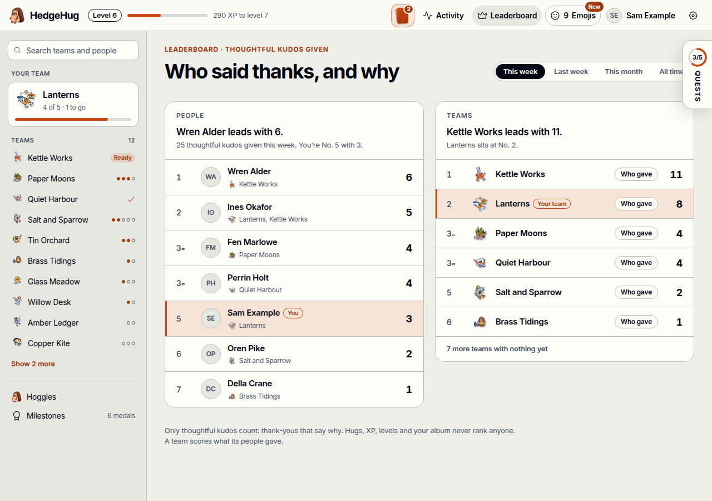
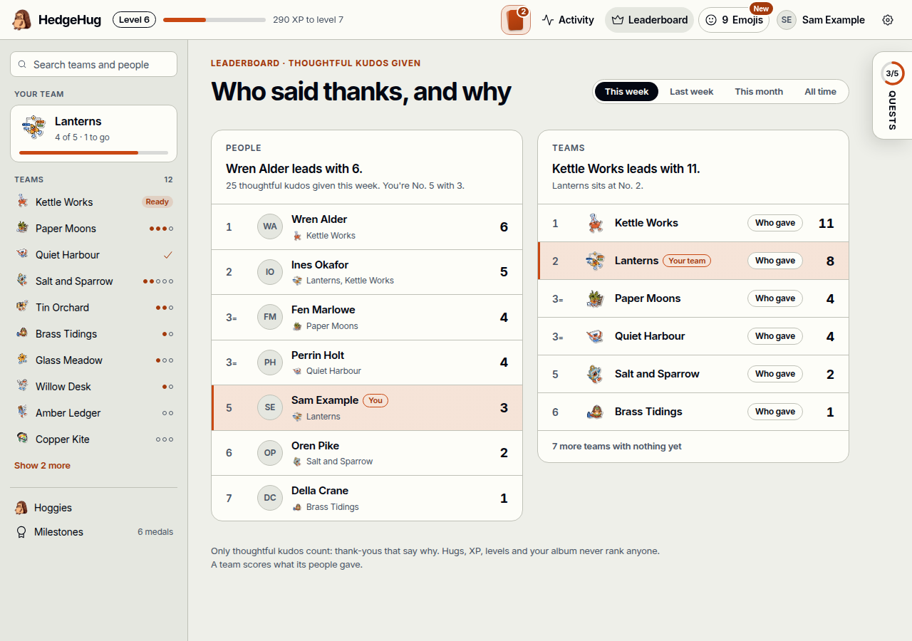
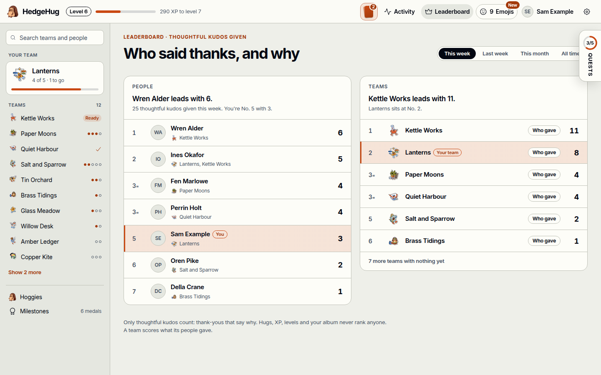
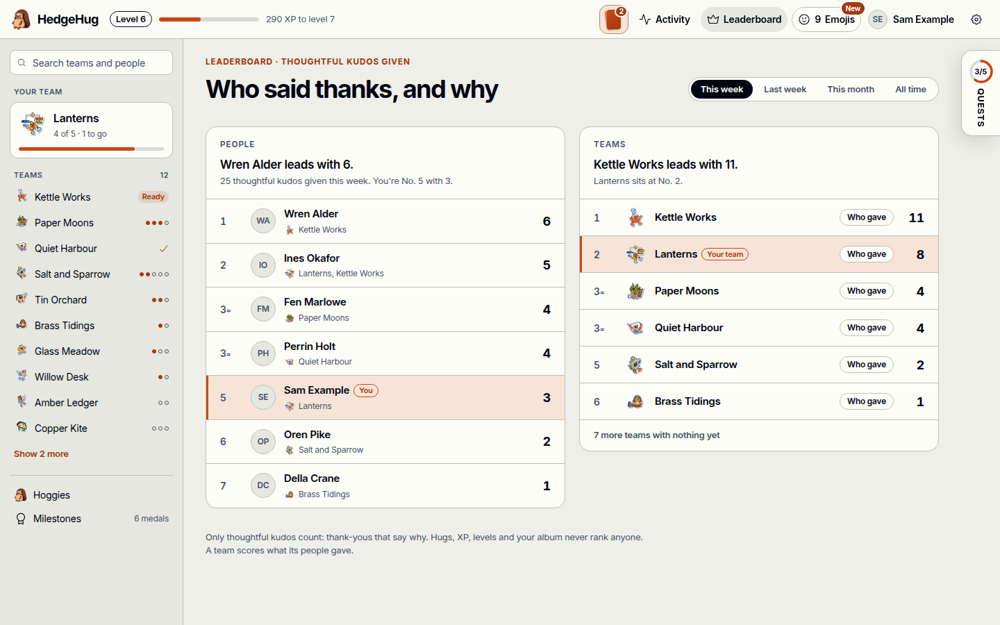

# Slice D3 proof: the folded quests tab never covers page controls

Slice D3 of `spec/monday-quests.md` (MQ38–MQ40). At 1280 px the folded "Quests n/m" tab covered the right end of the leaderboard's "All time" period switch. From 64 rem up, while the tab shows, the page now keeps a right-hand gutter as wide as the tab plus the page's own 2 rem padding, so no control sits under it at any scroll position.

The walk ran on production builds (`vite build`, then `vite preview`) of the committed shell fixtures `album-quests` (a Monday-path member, page D on) and `album-person-page-d` (off the Monday path). All members are made up.

## Red and green

`walk.sh <origin>` folds the panel and visits eight album pages, a team page with an unlock seal among them, at 1024, 1280, 1440 and 1536 px. On each, `measure.js` lists every control in the page whose visible box reaches into the tab's column, clipped to its scroll container, so a control that scrolls under the fixed tab counts too.

- **Red**, before the change, on the first seven pages: [`before.txt`](before.txt). "All time" sits under the tab at 1280, 1440 and 1536 px, and the hoggies grid, the activity weeks, the profile's cards and the settings switches reach under it at 1024 px.
- **Red after the first fix**, found by review round 1: [`round-1-before.txt`](round-1-before.txt). With a 1 rem gap, a team's unlock seal, which sits 1.5 rem past its card, still reached under the tab at 1024 px. [`seal.js`](seal.js) scrolls the team page to the bottom at 1024×260 and asks the browser what a click at the seal's right edge hits: the tab. `before-team-seal-1024x260.png`
- **Green**, after: [`after.txt`](after.txt). No control on any of the eight pages at any width. With the 2 rem gap the seal ends 6 px left of the tab, and the same click hits the seal: `after-team-seal-1024x260.png`

`click.js` asks the browser which element answers a click at the right end of "All time". Before: the tab, `Quests, 3 of 5 done`, at 1280 and 1440 px. After: "All time", which a click then presses.

| Width | Before | After |
| --- | --- | --- |
| 1280 px |  |  |
| 1440 px |  |  |

## Walk, against #172's element checklist

- [x] Folded tab with a ring, n/m and a vertical "QUESTS", clear of the page: `after-leaderboard-folded-1280.png`, `after-hoggies-folded-1280.png`, `after-activity-folded-1024.png`
- [x] "All time" pressed with the tab folded beside it: `after-all-time-clicked-1280.png`
- [x] Steps aside to its tab on the own profile, clear of the page: `after-own-page-d-tab-1280.png`
- [x] Pushes the page at 90 rem and wider, floats below, both unchanged: `after-panel-open-pushes-1536.png`, `after-panel-open-floats-1280.png`. The page's right padding reads 368 px and 32 px, before and after.
- [x] Phones start folded, unchanged: `after-phone-starts-folded.png`. The page's right padding reads 16 px, before and after.
- [x] With `monday-quest` off, nothing changes: `after-off-the-path-1280.png`. No panel, no tab, and the page's right padding reads the album's 32 px.
