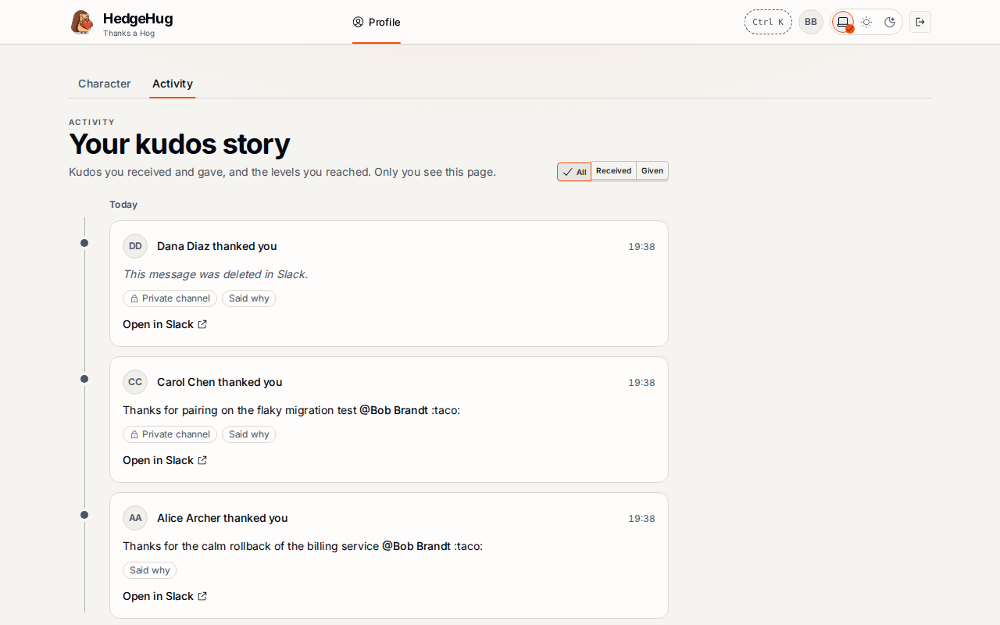
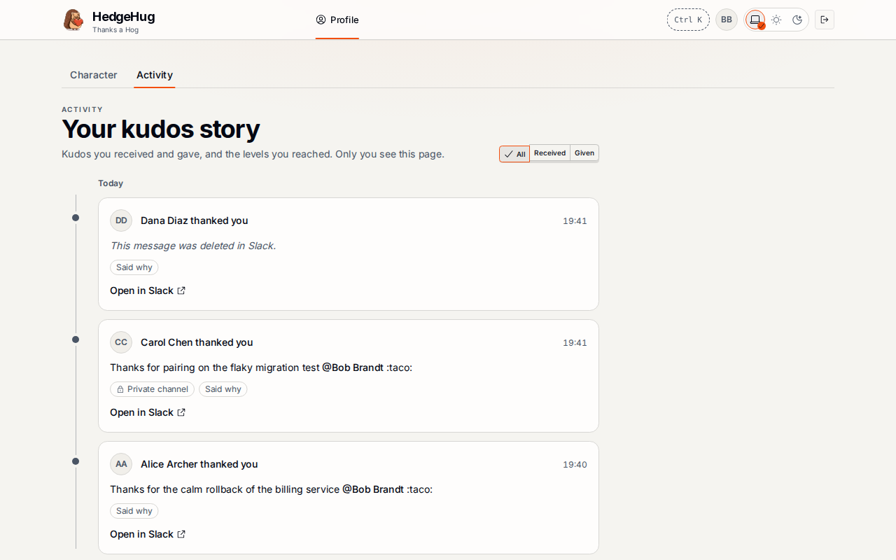

# #429: a kudos whose channel isn't known shows no channel tag

A fresh local Convex backend, three kudos to Bob sent as signed Slack events: Alice in public `C1`, Carol in private `G2`, and Dana in public `C1`, which Dana then deletes with a real-shaped `message_deleted` (no `channel_type`). Bob's `/activity`, served by Vite against that backend.

| Before (`5b895d5f`) | After (`0af75b33`) |
| --- | --- |
|  |  |

Before, Dana's deleted public kudos reads "Private channel". After, it shows no channel tag; Carol's private kudos keeps its tag.
