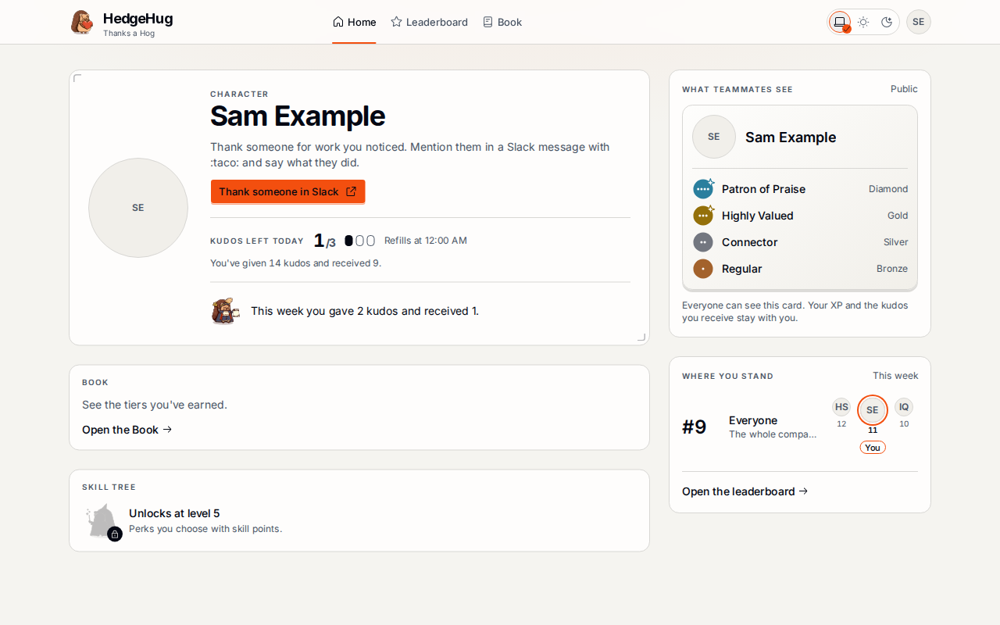
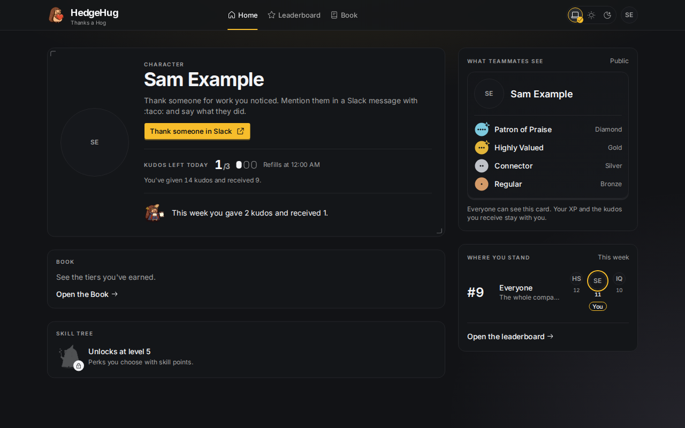
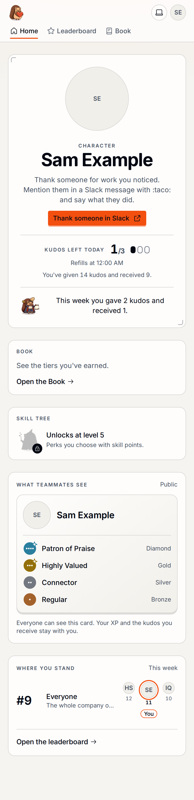
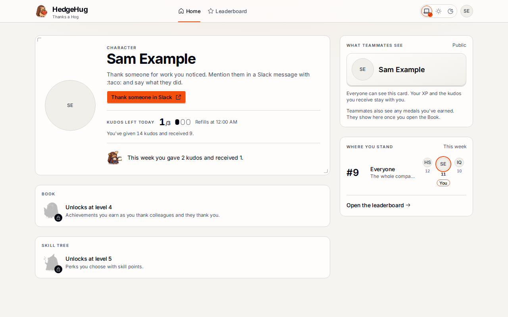
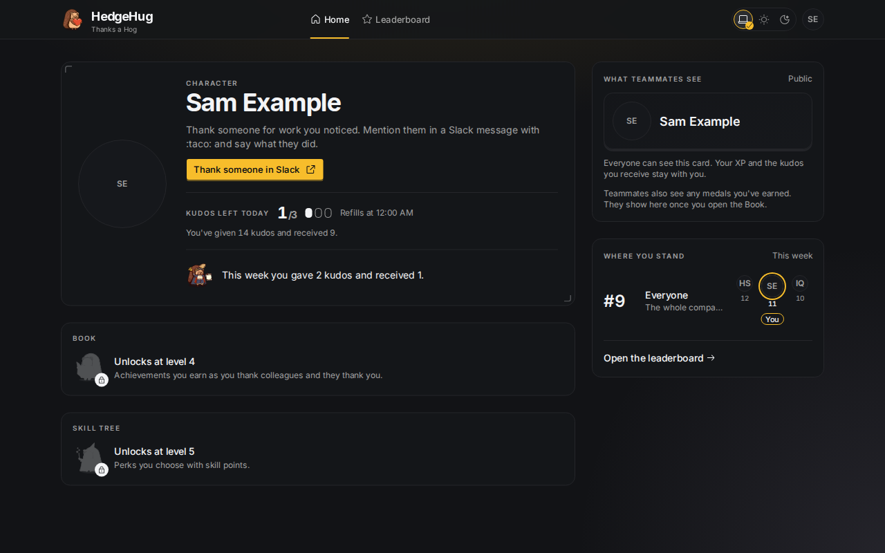
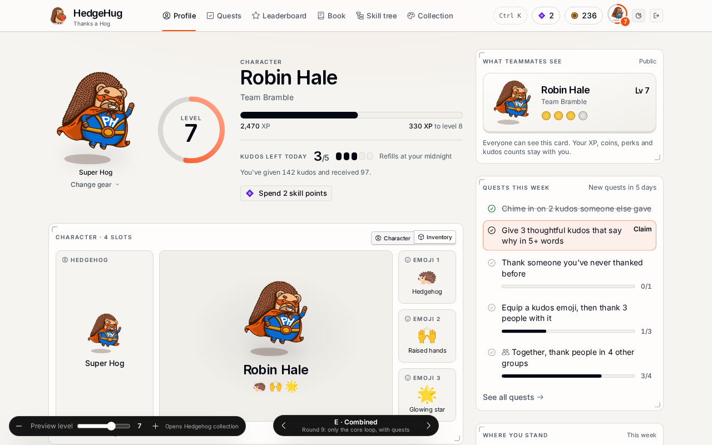
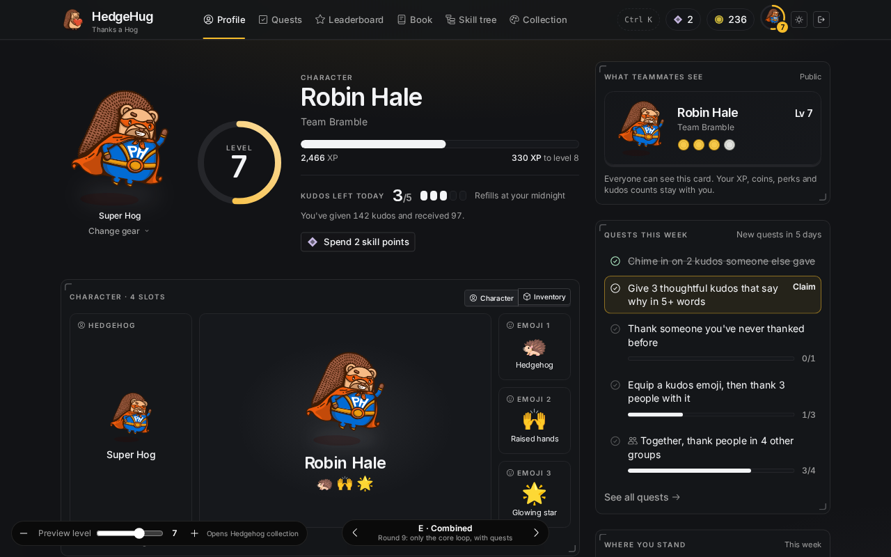

# #284: the public card's best medals (WS343)

Fixture builds of this branch, served with `vite preview` (`VITE_SHELL_FIXTURE=member-with-the-book-opened` and `member-waiting-for-the-book`). The fixture card read answers four medals once the Book is open, and none before.

| State | Light | Dark |
| --- | --- | --- |
| Book opened, best four medals |  |  |
| Book opened, 390 px |  | |
| Book locked: the line before the Book opens |  |  |
| Variant E (`3409ade`, `?v=e&lvl=7`) |  |  |

Deviation from variant E, recorded as a decision: the medals are a list with each tier's name and word (V16, as Slack prints names) instead of a bare row of 18 px medals. The group line waits for map #1's #52.

`red.txt` is the WS343 tests failing on the tree before the change.
