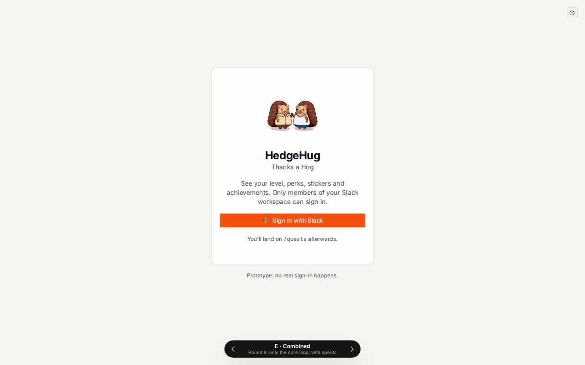
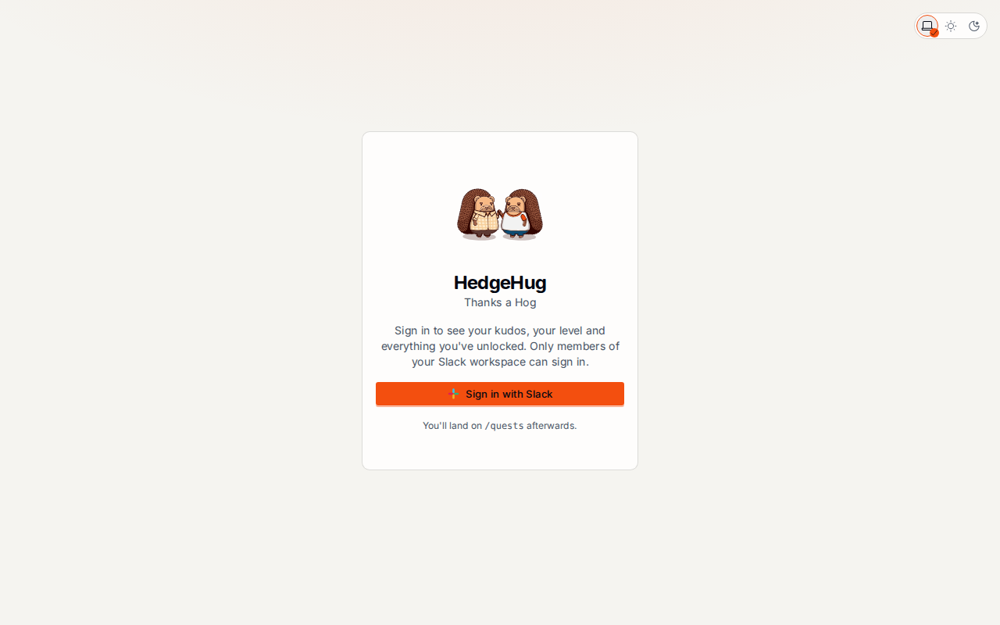
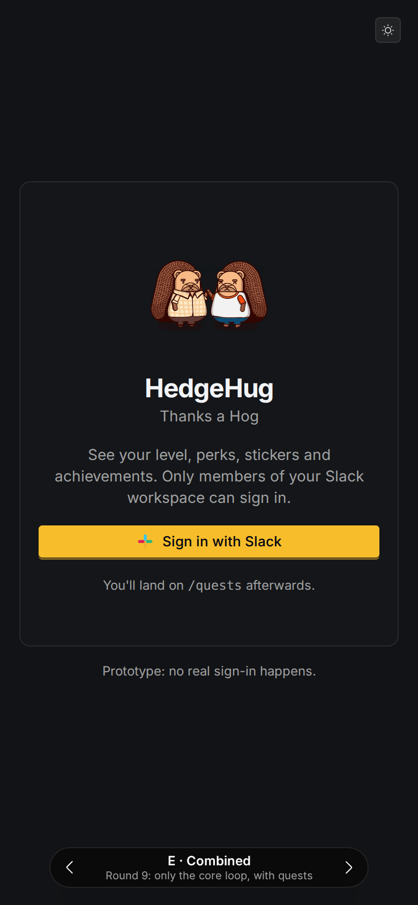
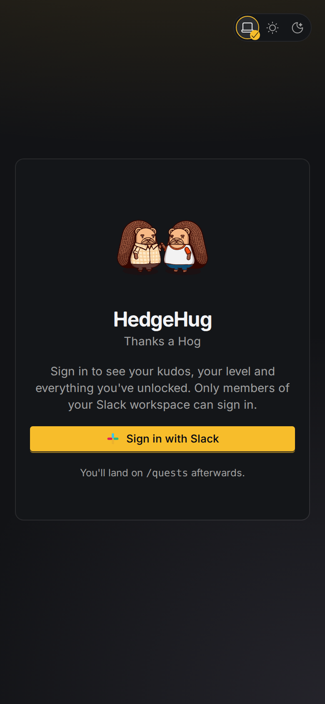
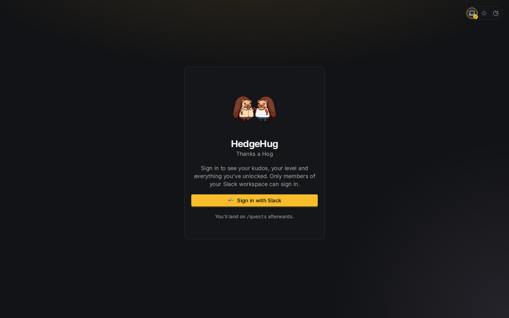
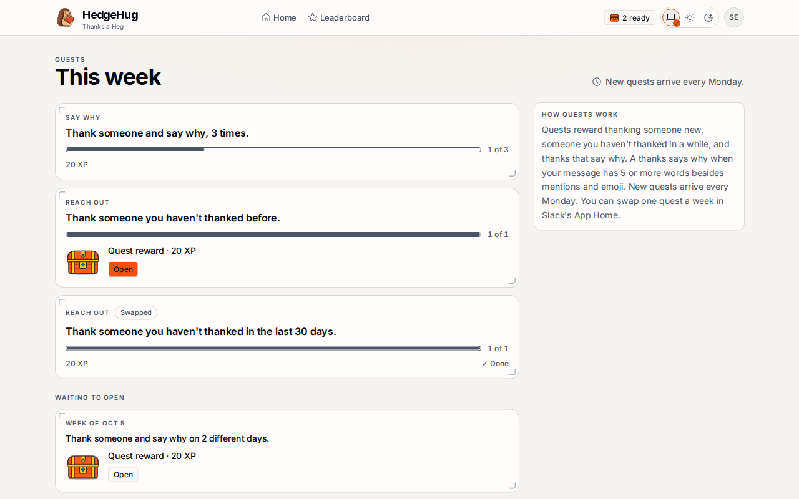
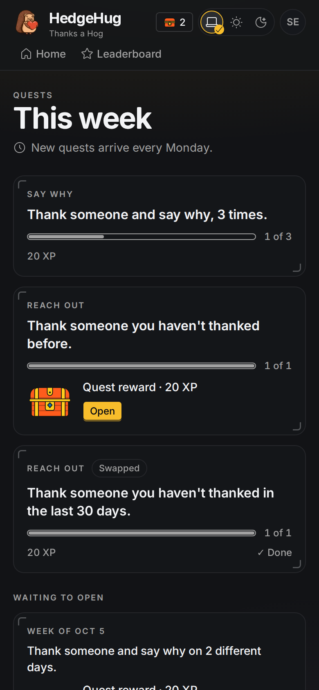
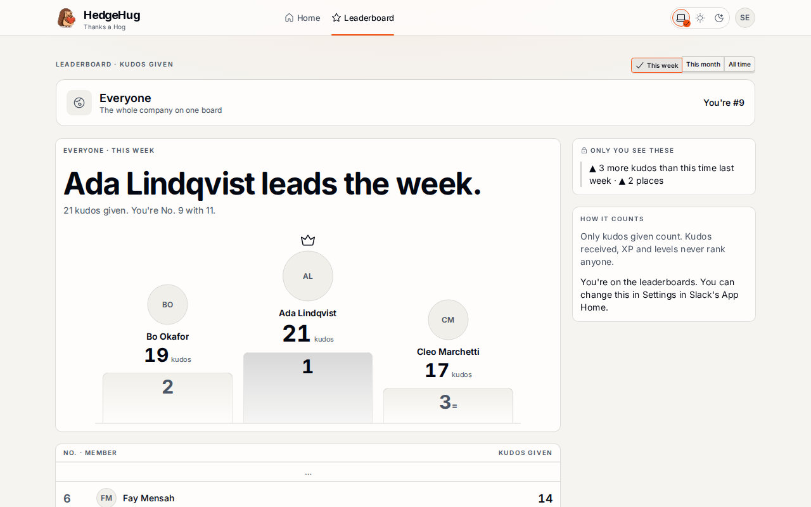
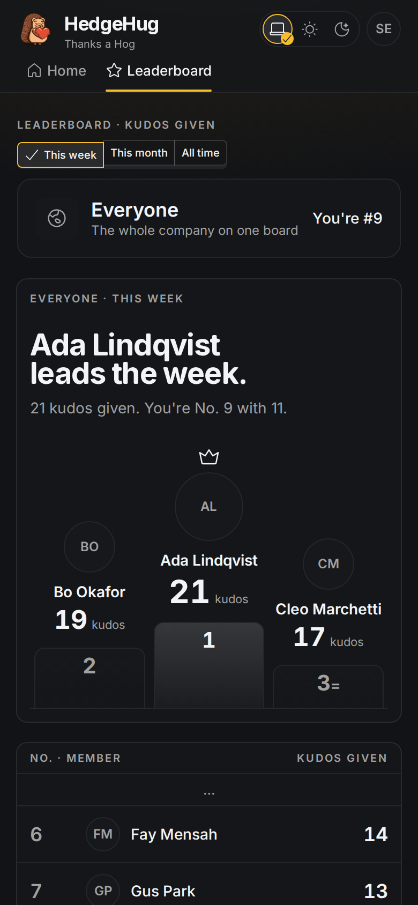

# #271: the sign-in card and display-size titles (WS309, WS310)

Fixture build (`VITE_SHELL_FIXTURE=signed-out` and `member-with-every-feature-open`) beside the accepted prototype at `3409ade`, variant E, at the same state: a signed-out visitor on a deep link to `/quests`.

| | Variant E (`3409ade`) | This branch |
|---|---|---|
| Light, 1280 px |  |  |
| Dark, 390 px |  |  |
| Dark, 1280 px | |  |

E's `Prototype: no real sign-in happens.` and its variant picker never ship (WS338). The sentence is WS309's, which names nothing a member might not have.

Display titles (WS310):

| | Light, 1280 px | Dark, 390 px |
|---|---|---|
| `/quests`, `text-4xl leading-none` |  |  |
| `/leaderboard`, `clamp(1.75rem, 5vw, 3rem)`, 0.95, balanced |  |  |

## Tests

- [red.txt](red.txt): `signInCard.test.tsx` and `displayTitles.test.tsx` at the red commit, 11 failing.
- [green.txt](green.txt): the same 15 tests passing, every assertion intact.
- [gate.txt](gate.txt): `pnpm gate` through `fleet heavy`, 134 files and 2105 tests, Coherence clean. Recorded-name advisories are trimmed.
- axe in light and dark covers the card at `/` and with the landing hint at `/leaderboard?period=month` (`accessibility.test.tsx`).

## V24 manual pass

- **Focus order:** the theme control's three buttons, then `Sign in with Slack`. Nothing else on the page takes focus.
- **Focus visibility:** quill's button ring on `Sign in with Slack`, and the theme control's ring, both unchanged.
- **Reduced motion:** the card has no motion.
- **Screen readers:** the title reads `HedgeHug`, the tab `HedgeHug · Sign in`. The hand-clasp hedgehog and the Slack glyph are `aria-hidden`. The button reads `Sign in with Slack`. After signing out, focus moves to the title (`signInCard.test.tsx`).
