# Prototype #625: the accepted HedgeHug website

Michael accepted this design on 2026-10-18. It is the **pick and mix with the round 6 refinements**, at `?variant=5` in a fixture build (`VITE_SHELL_FIXTURE=prototype-redesign`). The code is in `round-5/`, and it reads its data from `round-3/album.tsx`, mounted with the 55-team cast in `round-4/cast.ts` and the `trayed` flag.

This branch is a throwaway primary source and is never merged into `main`. The real build re-implements it.

- **Rounds:** round 1 was game HUDs (`r1-1..5`), round 2 was HUD remixes (`r2-1..4`), round 3 reset to a calm, collection-first album (`1..3`, `slack`), and round 4 offered three layouts per page (`4a..4c`). Round 5 is the pick and mix (`5`), and round 6 refined it in place.
- **Decision history:** the round notes on Silthus/kudos#625.

## The product, in one breath

- **People are the collection; hoggies are the surprise.**
- **Packs:** a thoughtful kudos (thank someone and say why) earns a pack, at most one per person per week. The pack holds that person's card the first time, plus a hoggie roll.
- **Teams:** team pages fill from the people you collect. A complete team unlocks its team sticker and a team emoji.
- **Emojis:** you earn them, never at random. There is one per team sticker, one per milestone at gold, one at levels 5/10/15/20/25, and one **hype emoji per person**, unlocked by your first thoughtful kudos to them.
- **Hugs:** a hug (a kudos-emoji reaction) is quiet, worth 1 XP.
- **No economy:** no coins, store, or weekly or group quests.
- **Level:** a status line with an XP bar. Nothing unlocks by level except the level emojis.
- **Calm:** a new member grasps it in five seconds.

## The parts

### Shell: top bar and sidebar (`round-5/RoundFive.tsx`, `round-5/shell/`)
- **Top bar, no tabs:**
  - the brand;
  - a slim **XP bar** (`Level 6 · 290 XP to level 7`);
  - the **packs button**;
  - the **opened-cards tray**;
  - **Activity** and **Leaderboard** as icon buttons that expand to show their label on hover or focus (the active one always shows icon and label);
  - the **emoji button** with your count;
  - your face and name, linking to your **profile**;
  - the **settings cog**.
- **Sidebar:** search for teams and people, **your team first** as a progress card, then the teams sorted by progress. Ten teams show, then "Show 44 more". **Hoggies** and **Milestones** follow.
- **Journey:** a slim "Getting started · 3 of 4" strip on the home page, shown only while unfinished.

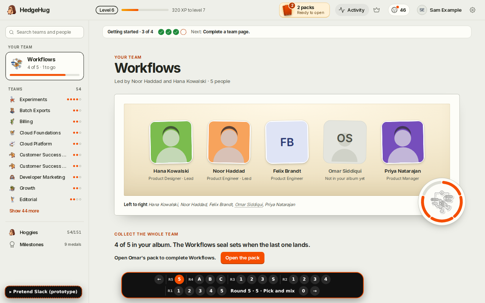

### Home and team page (`round-5/pages/team/`, from round 4 layout A "Class photo")
- `/` is your team's page, and `/book#teams/<team>` is any other team's.
- **The photo:** the team stands in one mounted photo. People you have not collected yet are silhouettes. A "Left to right" caption runs underneath.
- **The seal:** the team crest is a seal ringed by one segment per person. "Collect the whole team" names the one next step, e.g. "Open Omar's pack to complete Workflows", or "Omar is in your tray: put the card in…".
- **Complete but not unlocked:** the sticker stays **grey but alive**, with a shimmer, a "Ready to unlock" ribbon and an **"Unlock the Workflows sticker"** call to action.
- **The unlock moment** (`UnlockMoment.tsx`, about 5 s):
  1. The page dims, and the sticker lifts to the centre.
  2. **Colour spreads through the grey crest like ink**, then a stamp, light rays, a foil shine and gold confetti.
  3. "Workflows sticker unlocked" appears, followed by the new **`:workflows:` team emoji** ("use it in Slack for reactions and kudos").
  4. The coloured sticker flies back into its place.
- **Claimed state:** a gold-foil sticker with "Unlocked <date>" and the emoji.

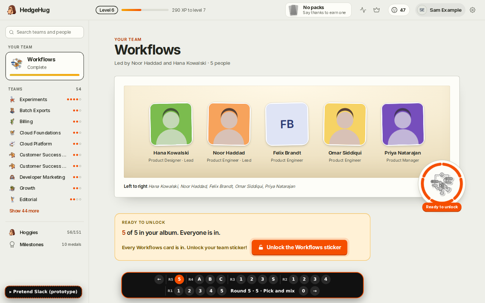
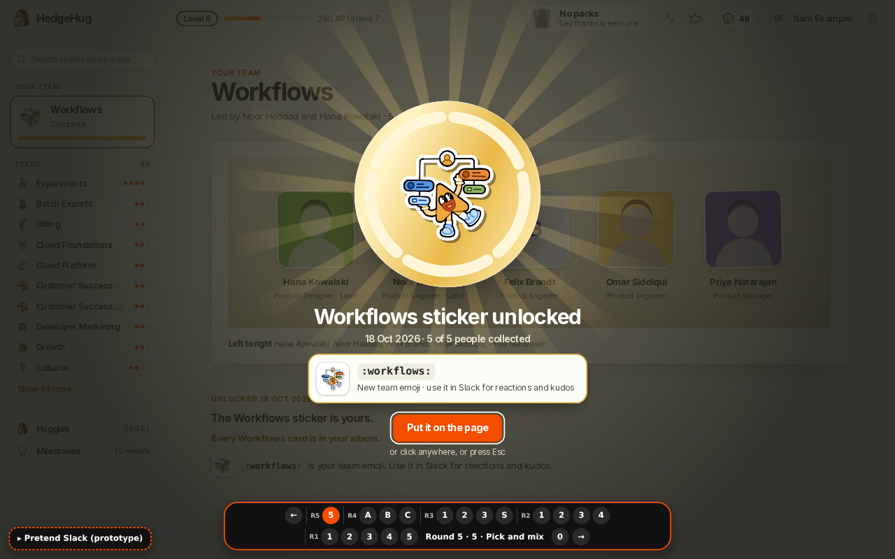
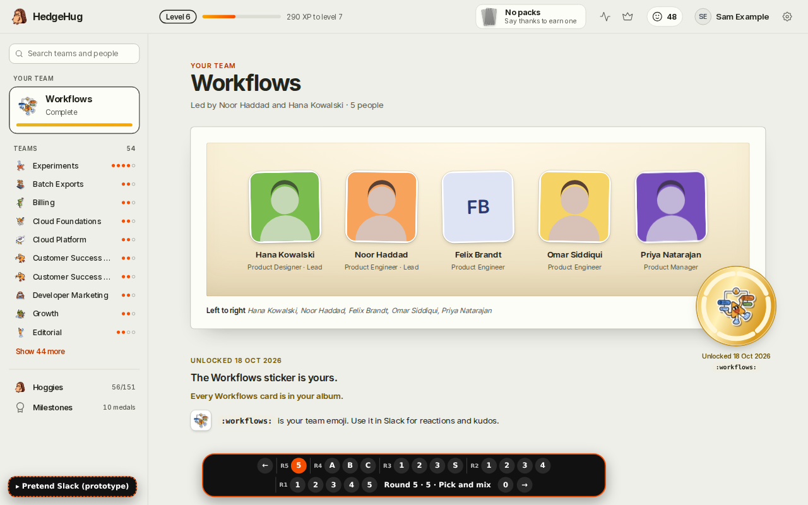

### Person page (`round-5/pages/team/PersonParts.tsx`, from round 4 "Yearbook entry")
- **Your history with them:** first thanked, kudos both ways, hugs both ways and your best message.
- **Their teams.**
- **Their hype emoji:** unlocked, or "Give Omar a thoughtful kudos to unlock their hype emoji".

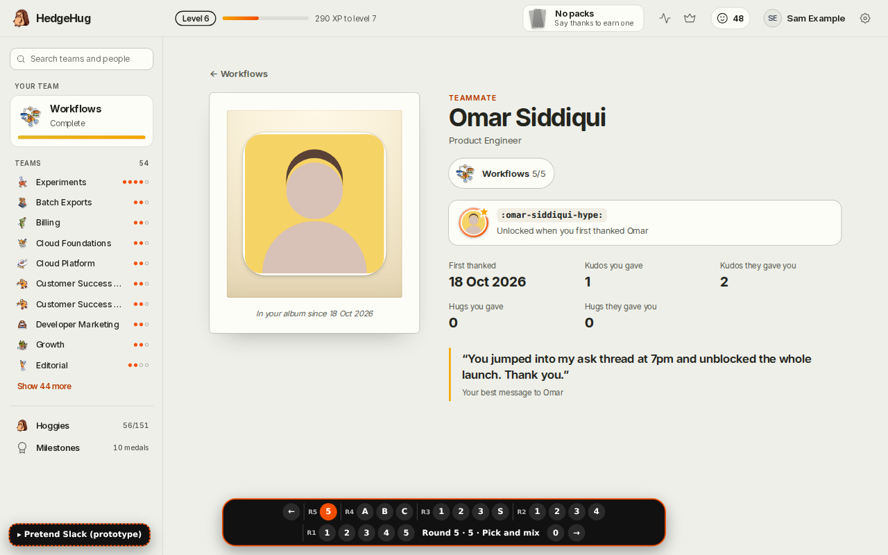

### Packs: opening, tray, putting in (`round-5/shell/PackOpening.tsx`, `Cards.tsx`, `Celebration.tsx`, `Tray.tsx`, `putIn.tsx`, `Flights.tsx`, `plan.ts`)
- **Opening** keeps round 3's pocket binder flips: rip the booster, flip the person card, then the hoggie, which glows in its rarity colour before it flips.
  - Each turn gets a shine sweep and a ring.
  - Confetti is sized to the moment: a big gold "Team complete!" and rarity sparkles for rare and above.
  - New cards carry a "New in your album" ribbon, the team bar ticks up, and the XP bar counts up.
  - A first-time person shows **"+ :their-name-hype: unlocked"**.
- **Tray:** the opened cards fly up into a **tray in the top bar**, not straight into the album. The tray panel lists each card with where it goes ("Omar → Workflows · completes the page!", "Burning Money → Hoggies · Uncommon, new"). Each card has its own **"Put in"**, and there is a **"Put them all in"**.
- **Putting in is deliberate**, one card at a time:
  1. The card lifts out of the tray, holds, and flies on a curve to its slot, which glows first.
  2. It lands with a press, a ring of light and sparkles, and the counts tick up on landing.
  - Hoggies press into the Hoggies entry like stickers.
  - After a team's last card settles, its unlock call to action arrives.
- **Order of "Put them all in":** hoggies first, then one team page at a time, with the page a card completes last.

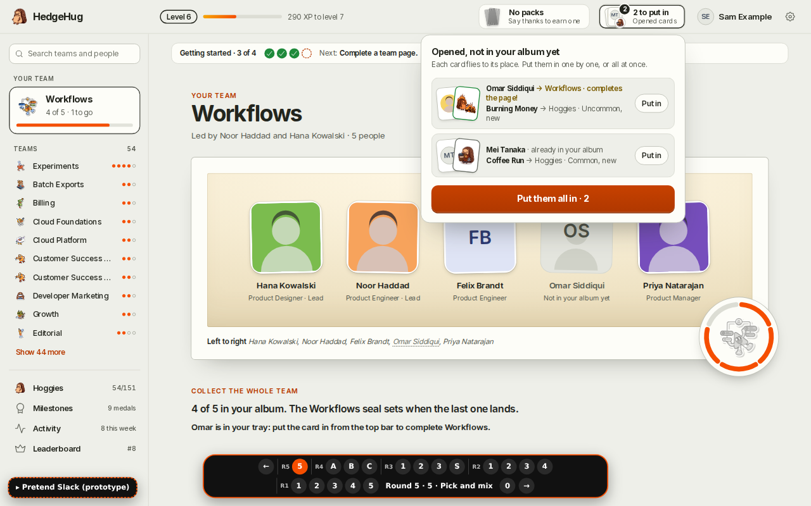
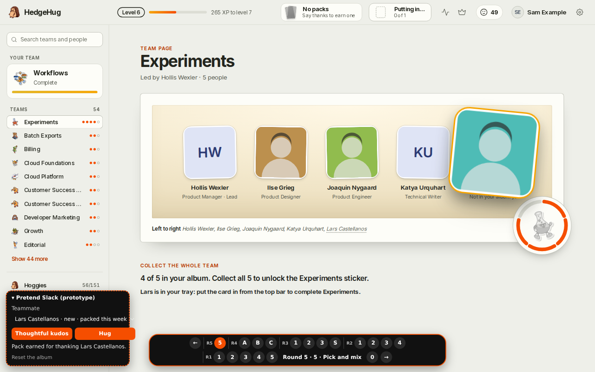
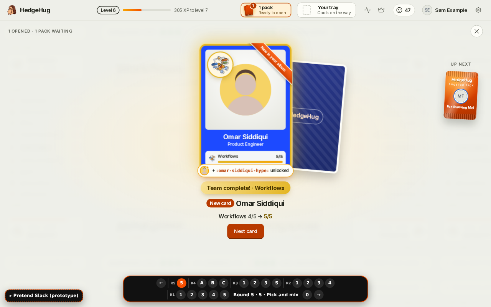

### Emojis (`round-5/shell/EmojiShelf.tsx`, `EmojiMoments.tsx`, `EmojiArt.tsx`, `emojis.ts`; data in `round-3/album.tsx`)
- **Popup:** the emoji button opens a popup grouped as Team stickers, Hype, Milestones and Levels.
  - Unlocked emojis show in colour with their `:name:`.
  - Locked ones are grey, with **how to unlock each and your progress** ("Experiments · 4 of 5 people", "Gold in Across the company · 24 of 25", "Level 10 · … XP").
  - Each kind shows the nearest few first, then "Show all", and there is a search.
- **Moment:** every new emoji pops into the centre with its name, why you got it and "use it in Slack: react with it or put it in a kudos", then flies into the emoji button.
  - Moments queue, and they never interrupt packs, putting in, or the sticker moment.
- **Names:** team emojis are `:<team-name>:`, hype emojis `:<full-name>-hype:`, milestone emojis the gold tier's name, and level emojis `:level-<n>:`.

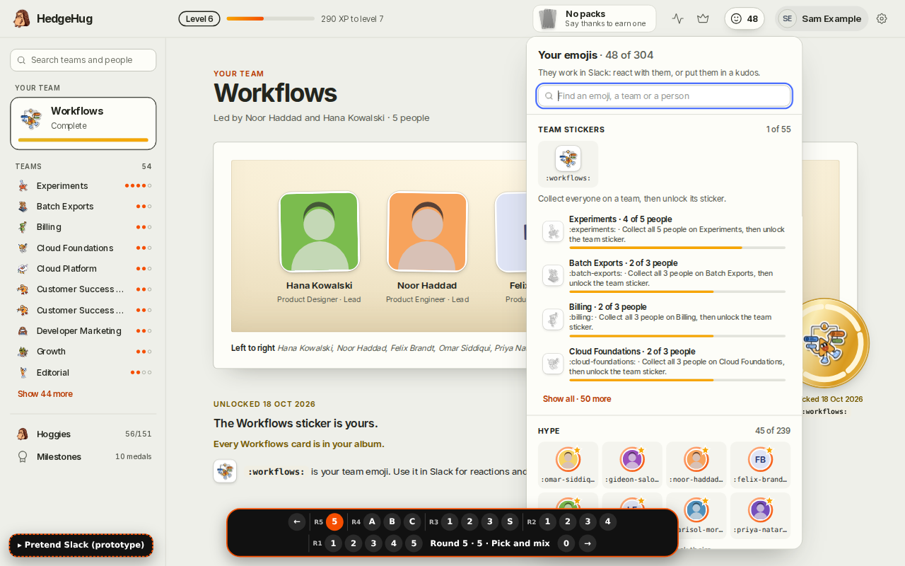
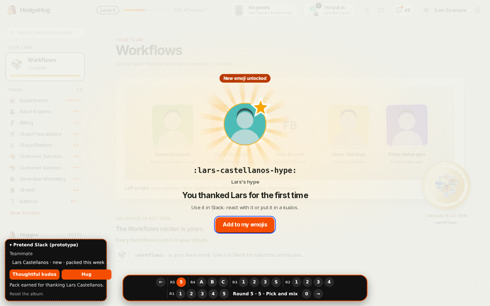

### Hoggies (`round-5/pages/hoggies/`, round 4 A's cards with B's organisation)
- **Header and shelf:** the header and the lit **rarest-finds shelf**.
- **Sticky bar:** "The collection" with the **filters** (All / Found / Still hidden / Spares) and the **rarity strip** (common … legendary, found/total). It sticks under the top bar and highlights the rarity you are in.
- **Cards:** the larger field-guide plates. Hidden hoggies are silhouettes, and spares show "×n".
- **Detail:** a centred card at `#hoggies/<slug>`, with previous and next.

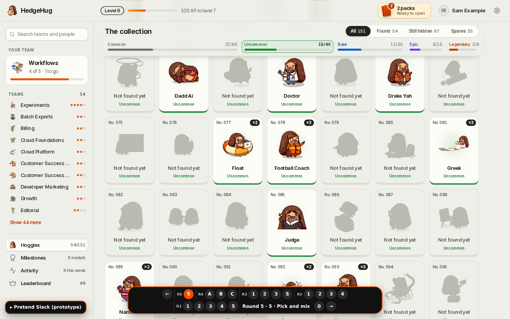

### Milestones (`round-5/pages/milestones/`, round 4 A's clarity with B refined)
- One row per milestone: its emblem (today's detailed achievement art), what it counts in plain words, and the next goal.
- Each row shows four medals, reading left to right from Bronze to Diamond:
  - earned medals in metal with their dates;
  - the next medal lit with a progress ring;
  - later medals faint.
- Each row also says which emoji its gold tier gives.
- There is no "Collected" strip and no "just earned" band.

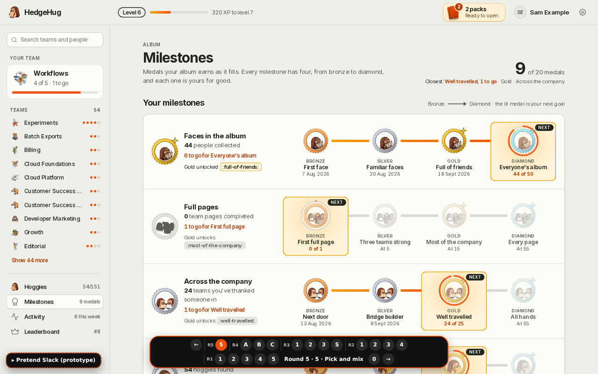

### Activity (round 4 layout B "Weekly edition", `round-4/pages/activity/`)
- One issue per week of "This week in your album": tallies, the kudos of the week, who you thanked, who thanked you, new faces, hoggies from packs and quiet hugs.
- Week tabs with sparklines.

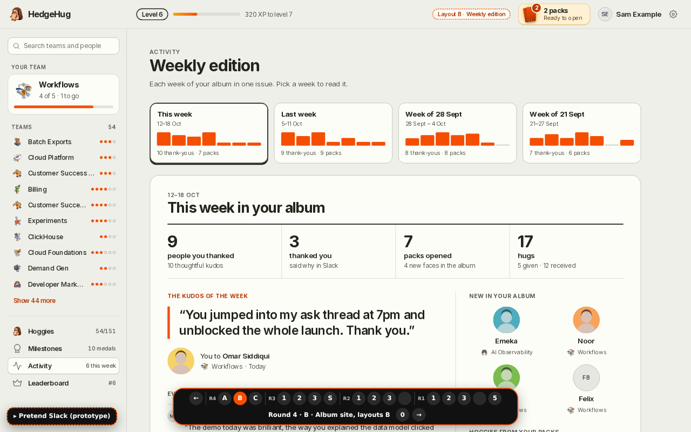

### Leaderboard (round 4 layout C "Side by side", `round-4/pages/leaderboard/`)
- The people board (thoughtful kudos this week) and the team board are shown together, with your row and your team pinned.
- "Who gave" narrows the people board to one team.

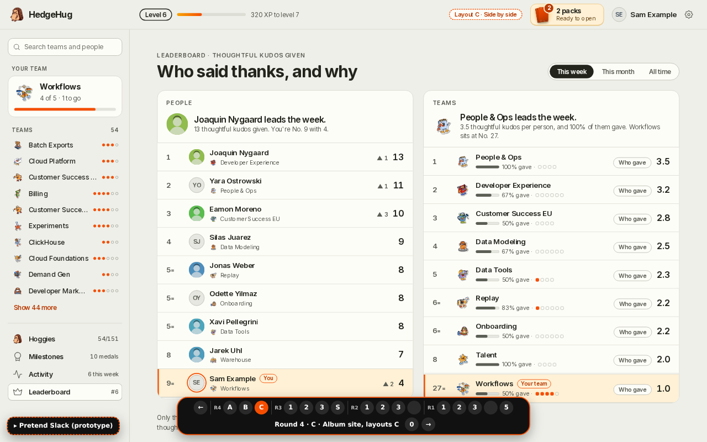

### Profile (`round-5/pages/profile/`, `/book#me`)
- Your yearbook photo, name, team, level and XP bar, plus the last kind note someone sent you.
- **Rank:** your weekly thoughtful-kudos rank and your team's rank, using the same numbers as the leaderboard.
- **Album at a glance:** people, your team and hoggies.
- **Coolest finds:** rarest hoggies and newest people.
- **Best milestones:** plus the one you're closest to next.

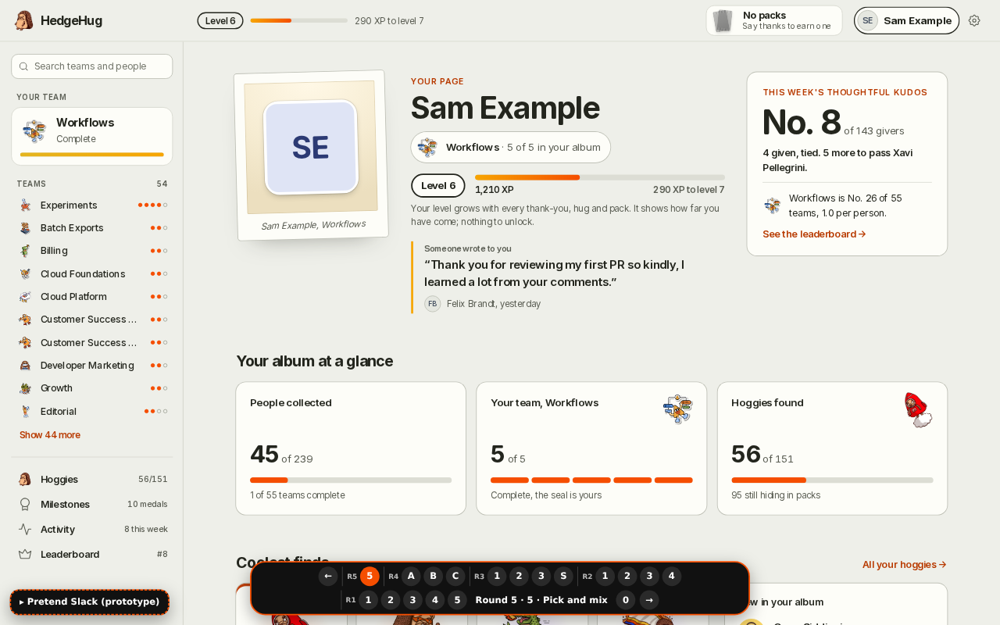

### Settings
Today's settings page, inside the frame.

## Open items for the build
- **Slack custom emoji delivery:** unique team and hype emojis need a way to exist in Slack. `admin.emoji.add` is limited to Enterprise Grid, so pick the approach (Enterprise API, a Slack Connect-safe fallback, or app-rendered images in messages) before promising "works for reactions".
- **Today's production features this design removes:** coins, the store, weekly and group quests, the skill tree and the HUD pages. Plan their retirement behind flags. Every new feature ships behind a PostHog flag, default off.
- **Real data:** people and teams come from the directory and company teams, not the fixture cast. Re-tune the milestone steps for the real team count (the prototype uses 1/5/15/all teams).
- **Mobile:** the prototype only avoids sideways scroll. Phone layouts need design.
- **Dark mode:** the prototype is light only.
- **Reduced motion:** written in code but never checked in a browser.
- **Level emoji moment:** not exercised (the fixture can't reach level 10).
- **Slack moments** (round 3, `?variant=slack`): the thread reply after a thoughtful kudos, the Monday hug recap, and the weekly top-thoughtful-kudos post. They should now mention emoji unlocks (hype, team).
